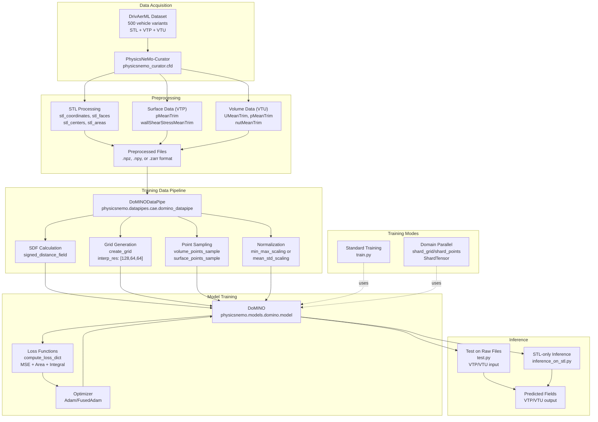
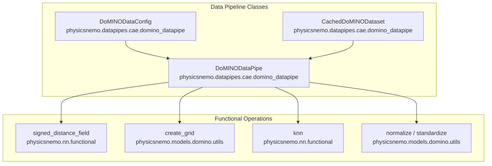
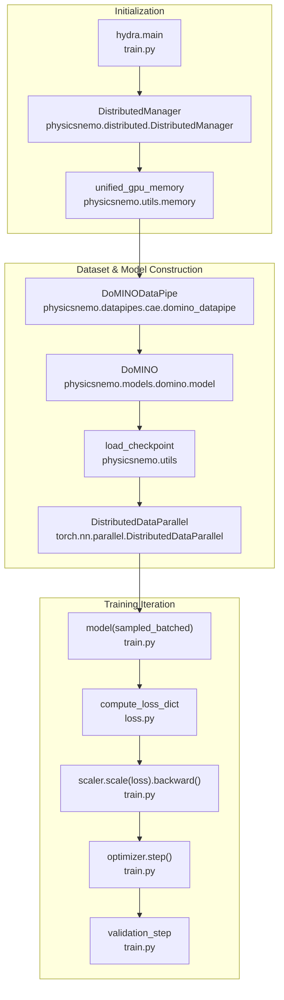

<!-- source: DeepWiki mcp.deepwiki.com · repo NVIDIA/physicsnemo · extra page DoMINO for External Aerodynamics · fetched 2026-10-21 -->

# DoMINO for External Aerodynamics

<details>
<summary>Relevant source files</summary>

The following files were used as context for generating this wiki page:

- [docs/img/domino_result_rtwt.jpg](docs/img/domino_result_rtwt.jpg)
- [examples/cfd/external_aerodynamics/domino/README.md](examples/cfd/external_aerodynamics/domino/README.md)
- [examples/cfd/external_aerodynamics/domino/requirements.txt](examples/cfd/external_aerodynamics/domino/requirements.txt)
- [examples/cfd/external_aerodynamics/domino/src/conf/config.yaml](examples/cfd/external_aerodynamics/domino/src/conf/config.yaml)
- [examples/cfd/external_aerodynamics/domino/src/inference_on_stl.py](examples/cfd/external_aerodynamics/domino/src/inference_on_stl.py)
- [examples/cfd/external_aerodynamics/domino/src/test.py](examples/cfd/external_aerodynamics/domino/src/test.py)
- [examples/cfd/external_aerodynamics/domino/src/train.py](examples/cfd/external_aerodynamics/domino/src/train.py)
- [examples/cfd/external_aerodynamics/domino/src/utils.py](examples/cfd/external_aerodynamics/domino/src/utils.py)
- [examples/cfd/external_aerodynamics/transformer_models/src/inference_on_zarr.py](examples/cfd/external_aerodynamics/transformer_models/src/inference_on_zarr.py)
- [examples/cfd/external_aerodynamics/transformer_models/src/metrics.py](examples/cfd/external_aerodynamics/transformer_models/src/metrics.py)
- [examples/weather/graphcast/README.md](examples/weather/graphcast/README.md)
- [examples/weather/graphcast/compute_time_diff_std.py](examples/weather/graphcast/compute_time_diff_std.py)
- [examples/weather/graphcast/conf/config.yaml](examples/weather/graphcast/conf/config.yaml)
- [examples/weather/graphcast/data_utils.py](examples/weather/graphcast/data_utils.py)
- [examples/weather/graphcast/requirements.txt](examples/weather/graphcast/requirements.txt)
- [examples/weather/graphcast/train_utils.py](examples/weather/graphcast/train_utils.py)
- [physicsnemo/datapipes/cae/domino_datapipe.py](physicsnemo/datapipes/cae/domino_datapipe.py)
- [physicsnemo/metrics/climate/graphcast_loss.py](physicsnemo/metrics/climate/graphcast_loss.py)
- [physicsnemo/models/domino/model.py](physicsnemo/models/domino/model.py)
- [physicsnemo/utils/memory.py](physicsnemo/utils/memory.py)
- [test/datapipes/test_domino_datapipe.py](test/datapipes/test_domino_datapipe.py)
- [test/models/graphcast/test_concat_trick.py](test/models/graphcast/test_concat_trick.py)
- [test/models/graphcast/test_grad_checkpointing.py](test/models/graphcast/test_grad_checkpointing.py)
- [test/models/graphcast/test_graphcast.py](test/models/graphcast/test_graphcast.py)
- [test/models/graphcast/utils.py](test/models/graphcast/utils.py)
- [test/pytest_utils.py](test/pytest_utils.py)
- [test/utils/test_mesh_utils.py](test/utils/test_mesh_utils.py)

</details>


## Purpose and Scope

This page documents the complete workflow for training and deploying DoMINO (Decomposable Multi-scale Iterative Neural Operator) for external aerodynamics applications, specifically automotive CFD simulations. It covers data preprocessing from raw OpenFOAM simulations, model training with various configurations, inference on new geometries, and integration with the domain parallelism infrastructure.

**Related Pages:**
- For DoMINO model architecture details, see [DoMINO](#3.1.3)
- For `DoMINODataPipe` implementation, see [CFD and Mesh Data](#4.3)
- For domain parallelism implementation, see [Distributed Algorithms](#5.5)

Sources: `examples/cfd/external_aerodynamics/domino/README.md:1-24`, `physicsnemo/models/domino/model.py:45-64`

---

## Overview and Data Flow

The DoMINO external aerodynamics workflow processes raw CFD simulation files (`.stl` geometry, `.vtp` surface data, `.vtu` volume data) through preprocessing, training, and inference stages. The model learns to predict pressure and wall shear stress on vehicle surfaces, as well as velocity fields and pressure in the surrounding volume.

### End-to-End Workflow



Sources: `examples/cfd/external_aerodynamics/domino/README.md:1-24`, `examples/cfd/external_aerodynamics/domino/src/train.py:17-28`, `physicsnemo.datapipes.cae.domino_datapipe:17-60`

---

## Dataset: DrivAerML

The primary dataset for this example is DrivAerML, containing 500 parametrically morphed variants of the DrivAer notchback generic vehicle. Each simulation includes:

| Data Type | Format | Content | Variables |
|-----------|--------|---------|-----------|
| Geometry | STL | Surface triangulation | Vertex coordinates, face indices |
| Surface Fields | VTP | Cell-centered data on surface | `pMeanTrim`, `wallShearStressMeanTrim` |
| Volume Fields | VTU | Unstructured volume mesh | `UMeanTrim`, `pMeanTrim`, `nutMeanTrim` |

The dataset represents industrial-quality scale-resolving CFD simulations. The configuration defines these variables for the model.

Sources: `examples/cfd/external_aerodynamics/domino/README.md:65-76`, `examples/cfd/external_aerodynamics/domino/src/conf/config.yaml:50-68`

---

## Data Preprocessing and Caching

Data preprocessing uses the companion [PhysicsNeMo-Curator](https://github.com/NVIDIA/physicsnemo-curator) project. The preprocessing steps:

1. **Download DrivAerML dataset** following curator instructions [examples/cfd/external_aerodynamics/domino/README.md:87-88]().
2. **Run data processing** to convert raw simulation files into Zarr or NumPy format for training [examples/cfd/external_aerodynamics/domino/README.md:103-109]().
3. **Caching (Optional):** Users can run caching utilities to save `DoMINODataPipe` outputs (SDF and Nearest Neighbor interpolations) to `.npy` files via `CachedDoMINODataset`, which is recommended for large surface meshes exceeding 30 million cells [examples/cfd/external_aerodynamics/domino/README.md:110-118]().

**Example configuration for preprocessing (`config.yaml`):**

```yaml
data_processor:
  kind: drivaer_aws  # must be either drivesim or drivaer_aws
  output_dir: /user/aws_data_all/
  input_dir: /data/drivaer_aws/drivaer_data_full/
  cached_dir: /user/cached/drivaer_aws/drivaer_data_full/
  use_cache: false
  num_processors: 12
```

Sources: `examples/cfd/external_aerodynamics/domino/README.md:78-119`, `examples/cfd/external_aerodynamics/domino/src/conf/config.yaml:37-46`, `physicsnemo.datapipes.cae.domino_datapipe:30-33`

---

## DoMINODataPipe: Runtime Processing

The `DoMINODataPipe` class performs online preprocessing during training, including signed distance field (SDF) calculation, grid generation, and point sampling [physicsnemo.datapipes.cae.domino_datapipe:17-27]().

### Code-to-System Mapping for Data Pipeline



Sources: `physicsnemo.datapipes.cae.domino_datapipe:30-60`, `examples/cfd/external_aerodynamics/domino/src/conf/config.yaml:73-90`

---

## Model Architecture (`DoMINO`)

The `DoMINO` model architecture (defined in `physicsnemo.models.domino.model`) predicts both surface and volume physical quantities [physicsnemo/models/domino/model.py:45-56](). It operates in three modes configured via `model.model_type`:
1. **Surface-only**: Predicting surface quantities (`output_features_surf`)
2. **Volume-only**: Predicting volume quantities (`output_features_vol`)
3. **Combined**: Predicting both simultaneously

### Key Components
- **Geometry Representation (`GeometryRep`)**: Learns global multi-scale geometry encodings via `MultiGeometryEncoding` [physicsnemo/models/domino/model.py:37-40]().
- **Neural Network Basis Functions**: Uses `FourierMLP` for evaluating spatial bases [physicsnemo/models/domino/model.py:34]().
- **Solution Calculators**: `SolutionCalculatorSurface` and `SolutionCalculatorVolume` aggregate local neighborhood features and geometric stencils [physicsnemo/models/domino/model.py:42]().

Sources: `physicsnemo/models/domino/model.py:45-115`, `examples/cfd/external_aerodynamics/domino/src/conf/config.yaml:102-160`

---

## Model Training Workflow (`train.py`)

The training script `train.py` implements a distributed pipeline using `DistributedDataParallel` and mixed-precision training (`GradScaler` and `autocast`) [examples/cfd/external_aerodynamics/domino/src/train.py:17-52]().



### Loss Functions
The loss dictionary is computed by `compute_loss_dict`, combining MSE/RMSE with area-weighting and integral conservation penalties [examples/cfd/external_aerodynamics/domino/src/train.py:122-135]().
- **Surface Loss:** Scaled by `surf_loss_scaling` (default `5.0`) [examples/cfd/external_aerodynamics/domino/src/conf/config.yaml:123]().
- **Volume Loss:** Scaled by `vol_loss_scaling` (default `1.0`) [examples/cfd/external_aerodynamics/domino/src/conf/config.yaml:124]().
- **Integral Loss:** Scaled by `integral_loss_scaling_factor` (default `100`) [examples/cfd/external_aerodynamics/domino/src/conf/config.yaml:120]().

Sources: `examples/cfd/external_aerodynamics/domino/src/train.py:17-181`, `examples/cfd/external_aerodynamics/domino/src/conf/config.yaml:105-125`

---

## Training with Domain Parallelism

Domain parallelism enables scaling to high-resolution latent grids and point clouds by sharding spatial domains across worker groups.

**Configuration Parameters (`domain_parallelism` in `config.yaml`):**
- `domain_size`: Number of GPUs per parallel domain group (default `1`) [examples/cfd/external_aerodynamics/domino/src/conf/config.yaml:95]().
- `shard_grid`: Whether to shard volumetric and surface latent grids across ranks [examples/cfd/external_aerodynamics/domino/src/conf/config.yaml:96]().
- `shard_points`: Whether to shard sampled evaluation points across ranks using `ShardTensor` [examples/cfd/external_aerodynamics/domino/src/conf/config.yaml:97]().

Sources: `examples/cfd/external_aerodynamics/domino/src/conf/config.yaml:94-98`, `physicsnemo.domain_parallel:sync_module_over_mesh`

---

## Inference and Testing

### Test Pipeline (`test.py`)
The testing script evaluates trained models on raw simulation files (`.vtp`, `.vtu`, `.stl`) [examples/cfd/external_aerodynamics/domino/src/test.py:17-27]().
1. **Model Loading:** Automatically detects and loads the latest checkpoint [examples/cfd/external_aerodynamics/domino/src/test.py:20]().
2. **Batched Subdomain Inference:** Iterates over volumetric points in memory-safe chunks (`point_batch_size = 256000`) [examples/cfd/external_aerodynamics/domino/src/test.py:92-169]().
3. **VTK Export:** Injects predicted variables back into `vtkPolyData` and `vtkUnstructuredGrid` data structures and saves them [examples/cfd/external_aerodynamics/domino/src/test.py:24-27]().

### STL-Only Inference (`inference_on_stl.py`)
Enables zero-shot evaluation on newly generated or CAD-derived `.stl` files without requiring pre-computed volume ground-truth files [examples/cfd/external_aerodynamics/domino/src/inference_on_stl.py:1-31](). Volume evaluation points are sampled within a defined bounding box and filtered against interior geometry using SDF signs [examples/cfd/external_aerodynamics/domino/src/inference_on_stl.py:78-129]().

Sources: `examples/cfd/external_aerodynamics/domino/src/test.py:17-173`, `examples/cfd/external_aerodynamics/domino/src/inference_on_stl.py:1-130`

---

## Summary of Key Files

| File Path | Description |
|-----------|-------------|
| `examples/cfd/external_aerodynamics/domino/src/train.py` | Distributed training entry point with mixed precision and validation loops. |
| `examples/cfd/external_aerodynamics/domino/src/test.py` | Evaluation script for raw simulation files with VTK output generation. |
| `examples/cfd/external_aerodynamics/domino/src/inference_on_stl.py` | Zero-shot inference on raw STL geometries with volume point sampling. |
| `physicsnemo/datapipes/cae/domino_datapipe.py` | Core data pipeline (`DoMINODataPipe`, `CachedDoMINODataset`) handling SDF, grid generation, and sampling. |
| `physicsnemo/models/domino/model.py` | `DoMINO` model architecture class and multi-scale geometry encoders. |
| `examples/cfd/external_aerodynamics/domino/src/conf/config.yaml` | Hydra configuration file for model hyperparameters, data paths, and training settings. |

Sources: `examples/cfd/external_aerodynamics/domino/README.md:1-141`, `examples/cfd/external_aerodynamics/domino/src/train.py:1-55`, `physicsnemo/models/domino/model.py:45-115`, `physicsnemo.datapipes.cae.domino_datapipe:30-135`

---

