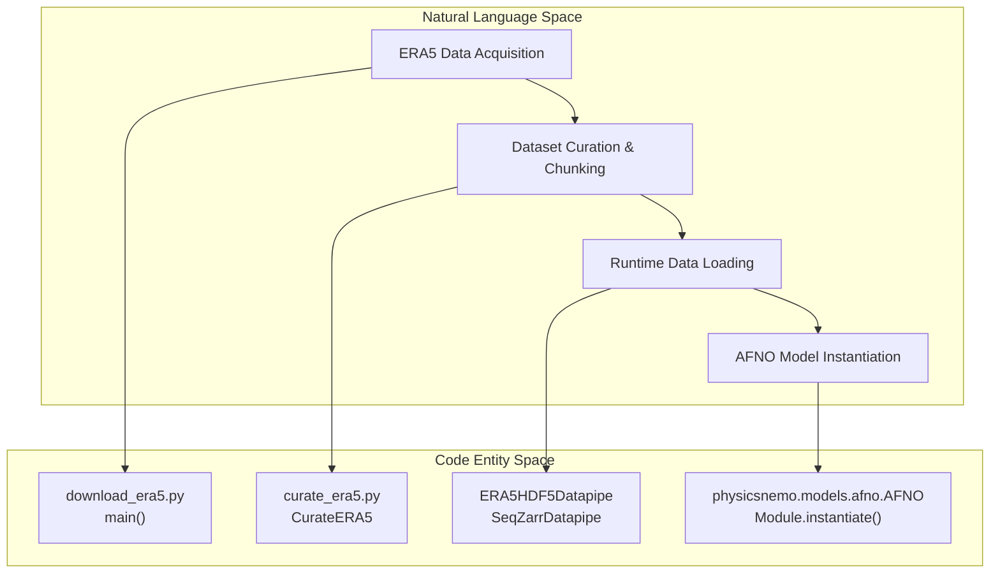
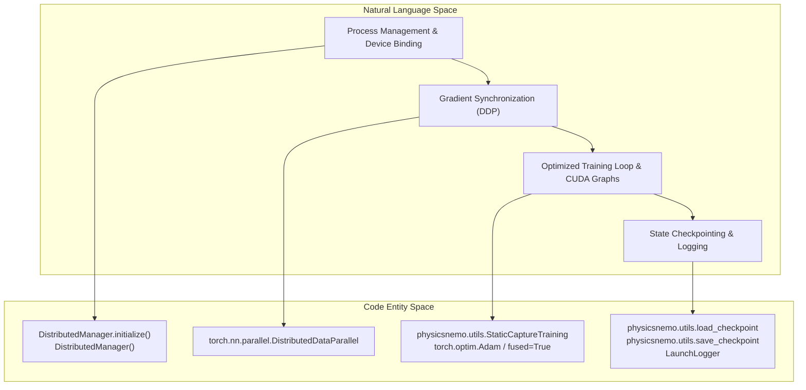

<!-- source: DeepWiki mcp.deepwiki.com · repo NVIDIA/physicsnemo · extra page FCN-AFNO Training on ERA5 · fetched 2026-10-21 -->

# FCN-AFNO Training on ERA5

<details>
<summary>Relevant source files</summary>

The following files were used as context for generating this wiki page:

- [examples/cfd/mhd_pino/train_mhd.py](examples/cfd/mhd_pino/train_mhd.py)
- [examples/cfd/mhd_pino/train_mhd_vec_pot.py](examples/cfd/mhd_pino/train_mhd_vec_pot.py)
- [examples/cfd/mhd_pino/train_mhd_vec_pot_tfno.py](examples/cfd/mhd_pino/train_mhd_vec_pot_tfno.py)
- [examples/weather/diagnostic/train_diagnostic_precip.py](examples/weather/diagnostic/train_diagnostic_precip.py)
- [examples/weather/dlwp/conf/config.yaml](examples/weather/dlwp/conf/config.yaml)
- [examples/weather/dlwp/cube_sphere_plotter_no_subplots.py](examples/weather/dlwp/cube_sphere_plotter_no_subplots.py)
- [examples/weather/dlwp/era5_hdf5.py](examples/weather/dlwp/era5_hdf5.py)
- [examples/weather/dlwp/train_dlwp.py](examples/weather/dlwp/train_dlwp.py)
- [examples/weather/fcn_afno/conf/config.yaml](examples/weather/fcn_afno/conf/config.yaml)
- [examples/weather/fcn_afno/train_era5.py](examples/weather/fcn_afno/train_era5.py)
- [examples/weather/pangu_weather/train_pangu_era5.py](examples/weather/pangu_weather/train_pangu_era5.py)
- [examples/weather/pangu_weather/train_pangu_lite_era5.py](examples/weather/pangu_weather/train_pangu_lite_era5.py)
- [examples/weather/unified_recipe/conf/config.yaml](examples/weather/unified_recipe/conf/config.yaml)
- [examples/weather/unified_recipe/conf/curated_dataset/34_var.yaml](examples/weather/unified_recipe/conf/curated_dataset/34_var.yaml)
- [examples/weather/unified_recipe/conf/curated_dataset/7_var.yaml](examples/weather/unified_recipe/conf/curated_dataset/7_var.yaml)
- [examples/weather/unified_recipe/conf/curated_dataset/healpix_19_var.yaml](examples/weather/unified_recipe/conf/curated_dataset/healpix_19_var.yaml)
- [examples/weather/unified_recipe/conf/curated_dataset/tiny_2_var.yaml](examples/weather/unified_recipe/conf/curated_dataset/tiny_2_var.yaml)
- [examples/weather/unified_recipe/conf/datapipe/default.yaml](examples/weather/unified_recipe/conf/datapipe/default.yaml)
- [examples/weather/unified_recipe/conf/dataset/6hr_subsample.yaml](examples/weather/unified_recipe/conf/dataset/6hr_subsample.yaml)
- [examples/weather/unified_recipe/conf/dataset/tiny_6hr_subsample.yaml](examples/weather/unified_recipe/conf/dataset/tiny_6hr_subsample.yaml)
- [examples/weather/unified_recipe/conf/filesystem/local.yaml](examples/weather/unified_recipe/conf/filesystem/local.yaml)
- [examples/weather/unified_recipe/conf/filesystem/object_storage.yaml](examples/weather/unified_recipe/conf/filesystem/object_storage.yaml)
- [examples/weather/unified_recipe/curate_era5.py](examples/weather/unified_recipe/curate_era5.py)
- [examples/weather/unified_recipe/download_era5.py](examples/weather/unified_recipe/download_era5.py)
- [examples/weather/unified_recipe/seq_zarr_datapipe.py](examples/weather/unified_recipe/seq_zarr_datapipe.py)
- [examples/weather/unified_recipe/train.py](examples/weather/unified_recipe/train.py)
- [examples/weather/unified_recipe/utils.py](examples/weather/unified_recipe/utils.py)

</details>


## Purpose and Scope

This page provides a complete technical walkthrough for training the FourCastNet (FCN) model using the Adaptive Fourier Neural Operator (`AFNO`) architecture on ERA5 reanalysis data. It covers the end-to-end pipeline from ERA5 data acquisition via Copernicus/ARCO Zarr stores, preprocessing and curation, distributed data loading, model configuration, distributed training using `DistributedDataParallel` and `StaticCaptureTraining`, validation rollouts, and the unified weather recipe infrastructure.

For information about the AFNO model architecture itself, see [AFNO](3.1.1). For general weather data handling, see [Climate and Weather Data](4.2). For distributed training infrastructure, see [Distributed Computing](5).

**Sources:** [examples/weather/fcn_afno/train_era5.py:1-253](), [examples/weather/unified_recipe/train.py:1-463]()

---

## Training Pipeline Overview

The FCN-AFNO training workflow bridges high-level operational concepts with concrete PhysicsNeMo code entities. The architecture coordinates distributed state initialization, data ingestion, forward-backward training steps under CUDA graph capture, and model checkpointing.

### Diagram: Natural Language Space to Code Entity Space (Data & Model Pipeline)



**Sources:** [examples/weather/unified_recipe/download_era5.py:34-103](), [examples/weather/unified_recipe/curate_era5.py:37-163](), [examples/weather/fcn_afno/train_era5.py:118-156]()

---

## ERA5 Data Acquisition and Preprocessing

ERA5 reanalysis data can be acquired through legacy scripts or via the unified weather recipe pipeline which ingests ARCO ERA5 Zarr stores (`gs://gcp-public-data-arco-era5/ar/full_37-1h-0p25deg-chunk-1.zarr-v3`) [examples/weather/unified_recipe/download_era5.py:57-61]().

### Unified Download and Curation Pipeline

1. **Download (`download_era5.py`)**: Opens the ARCO ERA5 Zarr dataset via `xarray.open_zarr()`, filters required single-level and pressure-level variables, subsamples time based on configuration intervals (`dt`), and writes out to a target Zarr store (`ZARR_FORMAT = 3`) using `xarray.Dataset.to_zarr()` [examples/weather/unified_recipe/download_era5.py:34-103]().
2. **Curation (`curate_era5.py`)**: The `CurateERA5` class restructures variables into explicit `predicted` and `unpredicted` channels, applies spatial chunks (e.g., `{"time": 1, "level": 1, "latitude": 721, "longitude": 1440}`), and prepares datasets for training global weather operators [examples/weather/unified_recipe/curate_era5.py:37-163]().

**Sources:** [examples/weather/unified_recipe/download_era5.py:34-103](), [examples/weather/unified_recipe/curate_era5.py:37-163]()

---

## Data Loading with Datapipes

Depending on the chosen recipe, PhysicsNeMo uses specialized datapipes to supply tensors to training loops:
- `ERA5HDF5Datapipe`: Used in legacy and direct FCN-AFNO workflows [examples/weather/fcn_afno/train_era5.py:118-130](). It loads HDF5 year files, applies normalization stats from `global_means.npy` and `global_stds.npy`, patches tensors, and coordinates across distributed ranks.
- `SeqZarrDatapipe`: Used in the unified recipe for streaming chunks from Zarr file mappings with parallel prefetching queues [examples/weather/unified_recipe/train.py:159-174]().

**Sources:** [examples/weather/fcn_afno/train_era5.py:118-130](), [examples/weather/unified_recipe/train.py:159-174]()

---

## AFNO Model Configuration

The `AFNO` model can be constructed directly or instantiated dynamically via the unified model registry (`Module.instantiate()`) [examples/weather/unified_recipe/train.py:90-98](). 

For FourCastNet configurations, the network accepts global spatial shapes, channel counts, patch dimensions, embedding widths, transformer depth, and spectral block counts [examples/weather/fcn_afno/train_era5.py:148-156]().

```python
fcn_model = AFNO(
    inp_shape=[720, 1440],
    in_channels=len(cfg.channels),
    out_channels=len(cfg.channels),
    patch_size=[8, 8],
    embed_dim=768,
    depth=12,
    num_blocks=8,
).to(dist.device)
```

**Sources:** [examples/weather/fcn_afno/train_era5.py:148-156]()

---

## Distributed Training Setup & Execution

### Diagram: Natural Language Space to Code Entity Space (Execution & Training)



**Sources:** [examples/weather/fcn_afno/train_era5.py:97-196](), [examples/weather/unified_recipe/train.py:73-144]()

### Distributed Initialization and Fused Optimizers

Distributed training relies on `DistributedManager` to configure local ranks, devices, and communication groups [examples/weather/fcn_afno/train_era5.py:97-98](). Models are wrapped asynchronously using `DistributedDataParallel` inside dedicated CUDA streams [examples/weather/fcn_afno/train_era5.py:163-173]().

Optimizers leverage native PyTorch fused implementations (`fused=True`) or APEX equivalents alongside learning rate schedulers like `CosineAnnealingLR` [examples/weather/fcn_afno/train_era5.py:176-183]():

```python
optimizer = torch.optim.Adam(
    fcn_model.parameters(),
    betas=(0.9, 0.999),
    lr=0.0005,
    weight_decay=0.0,
    fused=torch.cuda.is_available(),
)
scheduler = torch.optim.lr_scheduler.CosineAnnealingLR(optimizer, T_max=150)
```

**Sources:** [examples/weather/fcn_afno/train_era5.py:97-183]()

---

## Training Loop and Loss Functions

The training step is decorated with `@StaticCaptureTraining` to capture CUDA graphs and reduce host-side launch overhead [examples/weather/fcn_afno/train_era5.py:29](). 

### Loss Formulation

The loss function computes normalized L2 error across flattened batch predictions and targets [examples/weather/fcn_afno/train_era5.py:36-42]():

```python
def loss_func(x, y, p=2.0):
    yv = y.reshape(x.size()[0], -1)
    xv = x.reshape(x.size()[0], -1)
    diff_norms = torch.linalg.norm(xv - yv, ord=p, dim=1)
    y_norms = torch.linalg.norm(yv, ord=p, dim=1)

    return torch.mean(diff_norms / y_norms)
```

**Sources:** [examples/weather/fcn_afno/train_era5.py:29-43]()

---

## Evaluation and Validation Steps

Validation runs multi-step rollout evaluations without gradient tracking (`@torch.no_grad()`), accumulating MSE error and exporting validation comparison plots (predictions vs targets vs residuals) across specified channels [examples/weather/fcn_afno/train_era5.py:45-92]().

**Sources:** [examples/weather/fcn_afno/train_era5.py:45-92]()

---

## Checkpointing and Logging

- **Checkpoints**: Managed through `load_checkpoint()` and `save_checkpoint()`, persisting model weights, optimizer state, and epoch counters [examples/weather/fcn_afno/train_era5.py:33]().
- **Logging**: Integrated with MLflow (`initialize_mlflow()`) and structured under `LaunchLogger` for metric tracking across distributed ranks [examples/weather/fcn_afno/train_era5.py:31-32]().

**Sources:** [examples/weather/fcn_afno/train_era5.py:31-34]()

---

