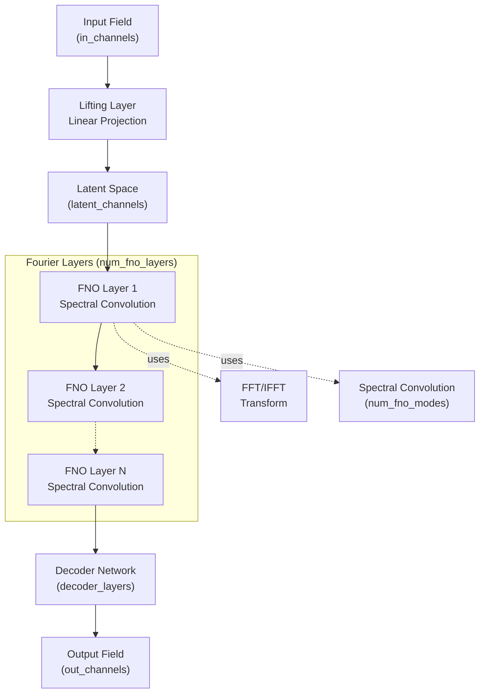
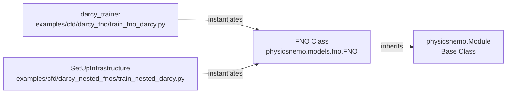
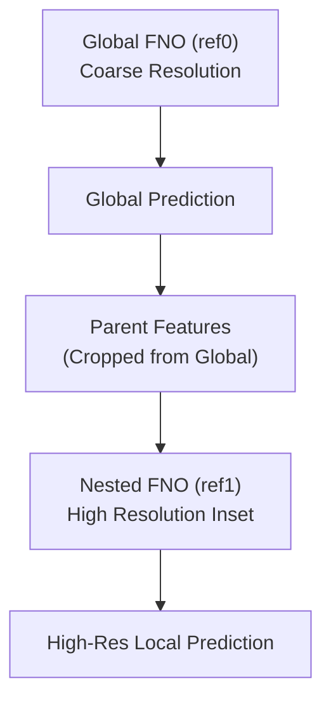

<!-- source: DeepWiki mcp.deepwiki.com · repo NVIDIA/physicsnemo · extra page FNO · fetched 2026-10-21 -->

# FNO

<details>
<summary>Relevant source files</summary>

The following files were used as context for generating this wiki page:

- [examples/cfd/darcy_fno/README.md](examples/cfd/darcy_fno/README.md)
- [examples/cfd/darcy_fno/config.yaml](examples/cfd/darcy_fno/config.yaml)
- [examples/cfd/darcy_fno/requirements.txt](examples/cfd/darcy_fno/requirements.txt)
- [examples/cfd/darcy_fno/train_fno_darcy.py](examples/cfd/darcy_fno/train_fno_darcy.py)
- [examples/cfd/darcy_fno/validator.py](examples/cfd/darcy_fno/validator.py)
- [examples/cfd/darcy_nested_fnos/README.md](examples/cfd/darcy_nested_fnos/README.md)
- [examples/cfd/darcy_nested_fnos/config.yaml](examples/cfd/darcy_nested_fnos/config.yaml)
- [examples/cfd/darcy_nested_fnos/evaluate_nested_darcy.py](examples/cfd/darcy_nested_fnos/evaluate_nested_darcy.py)
- [examples/cfd/darcy_nested_fnos/generate_nested_darcy.py](examples/cfd/darcy_nested_fnos/generate_nested_darcy.py)
- [examples/cfd/darcy_nested_fnos/train_nested_darcy.py](examples/cfd/darcy_nested_fnos/train_nested_darcy.py)
- [examples/cfd/darcy_nested_fnos/utils.py](examples/cfd/darcy_nested_fnos/utils.py)
- [examples/cfd/gray_scott_rnn/conf/config_3d.yaml](examples/cfd/gray_scott_rnn/conf/config_3d.yaml)
- [examples/cfd/gray_scott_rnn/gray_scott_rnn.py](examples/cfd/gray_scott_rnn/gray_scott_rnn.py)
- [examples/cfd/navier_stokes_rnn/navier_stokes_rnn.py](examples/cfd/navier_stokes_rnn/navier_stokes_rnn.py)
- [physicsnemo/datapipes/benchmarks/darcy.py](physicsnemo/datapipes/benchmarks/darcy.py)
- [physicsnemo/datapipes/benchmarks/kernels/indexing.py](physicsnemo/datapipes/benchmarks/kernels/indexing.py)
- [physicsnemo/datapipes/benchmarks/kernels/utils.py](physicsnemo/datapipes/benchmarks/kernels/utils.py)
- [test/datapipes/test_darcy.py](test/datapipes/test_darcy.py)
- [test/datapipes/test_kelvin_helmholtz.py](test/datapipes/test_kelvin_helmholtz.py)

</details>


## Purpose and Scope

This document describes the **Fourier Neural Operator (FNO)** implementation in PhysicsNeMo, a neural operator architecture that learns mappings between function spaces using spectral convolutions. FNO is designed for solving partial differential equations (PDEs) and is particularly effective for problems with periodic or quasi-periodic behavior, such as Darcy flow and Navier-Stokes equations.

FNO operates on structured grids and leverages the Fourier transform to perform convolutions in spectral space, enabling efficient capture of long-range dependencies and multi-scale features. The implementation in PhysicsNeMo is fully integrated with the framework's serialization, distributed training, and optimization capabilities, supporting 1D, 2D, 3D, and 4D configurations as well as nested FNOs and physics-informed neural operator (PINO) variants.

**Sources:** [examples/cfd/darcy_fno/train_fno_darcy.py:24-29](), [examples/cfd/darcy_fno/README.md:1-7]()

---

## Architecture Overview

FNO consists of three main stages: a lifting layer that projects input fields to a higher-dimensional latent space, a sequence of Fourier layers that perform spectral convolutions, and a decoder that projects back to the output space.



**Diagram: FNO Architecture Pipeline**

The architecture operates in both spatial and frequency domains, with Fourier transforms enabling efficient computation of convolutions through pointwise multiplication in spectral space.

**Sources:** [examples/cfd/darcy_fno/train_fno_darcy.py:55-65](), [examples/cfd/darcy_nested_fnos/evaluate_nested_darcy.py:63-73]()

---

## Core Components and Code Structure

### Model Implementation

The FNO model is implemented as a standard `physicsnemo.Module` under the `physicsnemo.models.fno` package. It is widely used in CFD benchmarks, such as the 2D Darcy flow problem.



**Diagram: FNO Class Usage and Hierarchy**

**Sources:** [examples/cfd/darcy_fno/train_fno_darcy.py:24-24](), [examples/cfd/darcy_nested_fnos/train_nested_darcy.py:28-28](), [examples/cfd/darcy_nested_fnos/evaluate_nested_darcy.py:26-26]()

---

## Initialization Parameters

The FNO constructor accepts the following configuration parameters, typically managed via Hydra:

| Parameter | Type | Description |
|-----------|------|-------------|
| `in_channels` | int | Number of input channels/fields |
| `out_channels` | int | Number of output channels/fields |
| `decoder_layers` | int | Number of layers in the decoder network |
| `decoder_layer_size` | int | Width of decoder layers |
| `dimension` | int | Spatial dimension (1D, 2D, 3D, or 4D) |
| `latent_channels` | int | Dimension of latent representation |
| `num_fno_layers` | int | Number of Fourier layer blocks |
| `num_fno_modes` | Union[int, List[int]] | Number of Fourier modes to retain |
| `padding` | int | Spatial padding applied to inputs |

### Example Initialization

From [examples/cfd/darcy_fno/train_fno_darcy.py:55-65]():

```python
model = FNO(
    in_channels=cfg.arch.fno.in_channels,
    out_channels=cfg.arch.decoder.out_features,
    decoder_layers=cfg.arch.decoder.layers,
    decoder_layer_size=cfg.arch.decoder.layer_size,
    dimension=cfg.arch.fno.dimension,
    latent_channels=cfg.arch.fno.latent_channels,
    num_fno_layers=cfg.arch.fno.fno_layers,
    num_fno_modes=cfg.arch.fno.fno_modes,
    padding=cfg.arch.fno.padding,
).to(dist.device)
```

**Sources:** [examples/cfd/darcy_fno/train_fno_darcy.py:55-65](), [examples/cfd/darcy_nested_fnos/train_nested_darcy.py:157-167]()

---

## Architecture Variants (1D/2D/3D/4D) and PINO

The FNO architecture natively scales across dimensions (`dimension` parameter in 1, 2, 3, or 4 spatial dimensions). Depending on the physics domain, the spectral convolution layers apply multi-dimensional Fast Fourier Transforms (FFT) to map spatial fields into corresponding frequency tensors, filtering out higher frequencies beyond `num_fno_modes`.

Physics-Informed Neural Operator (PINO) variants extend standard FNO models by incorporating physical governing equations (e.g., mass conservation, momentum equations, or Darcy's law residuals) directly into the loss function during training via PhysicsNeMo's symbolic PDE residual utilities.

**Sources:** [examples/cfd/darcy_fno/train_fno_darcy.py:55-65](), [examples/cfd/darcy_fno/README.md:1-30]()

---

## Nested FNO (Multi-Scale)

The **Nested FNO** architecture is an extension designed for high-resolution predictions, such as CO2 geological storage or high-res Darcy flow. It uses multiple FNO models at different refinement levels (`ref0`, `ref1`, etc.).



**Diagram: Nested FNO Data Flow**

In the nested implementation:
- **ref0**: Operates on the global coarse grid.
- **ref1**: Operates on high-resolution insets, taking both local permeability and cropped global predictions as input.

**Sources:** [examples/cfd/darcy_nested_fnos/train_nested_darcy.py:97-126](), [examples/cfd/darcy_nested_fnos/utils.py:107-123](), [examples/cfd/darcy_nested_fnos/README.md:73-74]()

---

## Usage Patterns

### Darcy Flow Benchmark

FNO is the primary model for the 2D Darcy flow benchmark. Data is generated in-situ via the `Darcy2D` datapipe.

```python
dataloader = Darcy2D(
    resolution=cfg.training.resolution,
    batch_size=cfg.training.batch_size,
    normaliser=normaliser,
)
```

**Sources:** [examples/cfd/darcy_fno/train_fno_darcy.py:76-80](), [examples/cfd/darcy_fno/README.md:1-7]()

### Training with Static Capture

PhysicsNeMo uses `StaticCaptureTraining` and `StaticCaptureEvaluateNoGrad` to optimize FNO execution, supporting CUDA graphs and performance enhancements.

```python
@StaticCaptureTraining(
    model=model, optim=optimizer, logger=log, use_amp=False, use_graphs=False
)
def forward_train(invars, target):
    pred = model(invars)
    loss = loss_fun(pred, target)
    return loss
```

**Sources:** [examples/cfd/darcy_fno/train_fno_darcy.py:113-119](), [examples/cfd/darcy_nested_fnos/evaluate_nested_darcy.py:100-104]()

---

## Distributed Training

FNO supports multi-GPU training via `DistributedDataParallel` (DDP). The `DistributedManager` handles environment initialization.

```python
if dist.world_size > 1:
    self.model = DistributedDataParallel(
        self.model,
        device_ids=[dist.local_rank],
        output_device=dist.device,
        broadcast_buffers=dist.broadcast_buffers,
        find_unused_parameters=dist.find_unused_parameters,
    )
```

**Sources:** [examples/cfd/darcy_nested_fnos/train_nested_darcy.py:170-178](), [examples/cfd/darcy_fno/train_fno_darcy.py:46-47]()

---

## Validation and Evaluation

Evaluation is performed using the `GridValidator`, which compares predictions against ground truth, inverts normalization, and logs visual artifacts to `LaunchLogger`.

| Metric | Component | Description |
|--------|-----------|-------------|
| MSE Loss | `torch.nn.MSELoss` | Standard training objective |
| Relative L2 | `GetRelativeL2` | Error norm for nested assembly |
| Visualization | `GridValidator.compare` | Plots input, truth, prediction, and error |

**Sources:** [examples/cfd/darcy_fno/validator.py:22-103](), [examples/cfd/darcy_nested_fnos/evaluate_nested_darcy.py:183-191](), [examples/cfd/darcy_nested_fnos/utils.py:148-203]()

---

## Summary

The FNO implementation in PhysicsNeMo provides:
1. **Spectral Convolution Architecture**: Efficient learning of function-space mappings via Fourier transforms across 1D, 2D, 3D, and 4D spaces.
2. **Multi-Scale Support**: Nested FNO variants for high-resolution local refinement and CO2 storage workflows.
3. **PINO Integration**: Physics-informed operator training options with PDE residual regularization.
4. **Framework Integration**: Seamless use with `DistributedManager`, `StaticCapture`, and `LaunchLogger`.
5. **CFD Benchmarks**: Ready-to-use examples for Darcy flow and geological storage prediction.

**Sources:** [examples/cfd/darcy_fno/README.md:1-30](), [examples/cfd/darcy_nested_fnos/README.md:1-74]()

---

