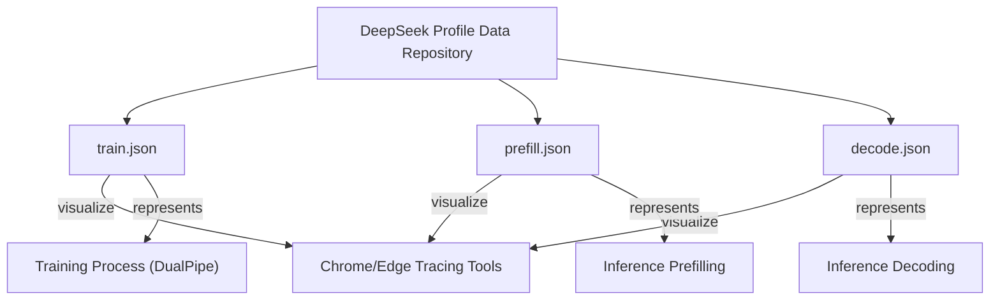
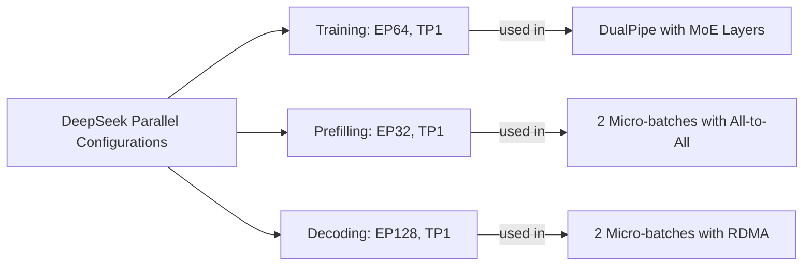
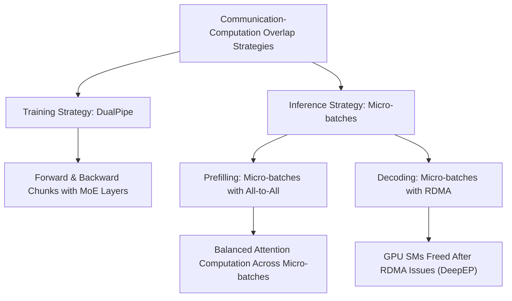
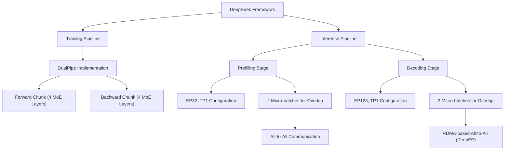

<!-- source: DeepWiki mcp.deepwiki.com · repo deepseek-ai/profile-data · page 1 Overview · fetched 2026-10-30 -->

# Overview

Relevant source files

The following files were used as context for generating this wiki page:

- [README.md](README.md)

This document provides an introduction to the DeepSeek profile data repository, which contains profiling data from DeepSeek's training and inference framework. The repository focuses on showcasing communication-computation overlap strategies and low-level implementation details that enable efficient large-scale AI model training and inference.

For detailed explanations about what profiling data is and why it's important, see [What is Profiling Data](#1.1). To learn more about the DeepSeek framework itself, see [DeepSeek Framework](#1.2).

## Purpose and Scope

The DeepSeek profile data repository serves several key purposes:

1. To demonstrate advanced techniques for overlapping communication and computation in large language model training and inference
2. To provide insight into the performance characteristics of different parallel configurations
3. To share performance optimization strategies used in production deployments
4. To help the community better understand low-level implementation details of efficient AI systems

The repository contains JSON-format profiling data captured using the PyTorch Profiler, which can be visualized using Chrome or Edge browser tracing tools.

Sources: [README.md:1-3]()

## Repository Structure

The repository contains three main JSON files representing different aspects of the DeepSeek system:

**Diagram: Repository Structure and Data Visualization Flow**

Sources: [README.md:5-30]()

## System Components Overview

The DeepSeek profiling data covers three main system components:

### 1. Training Process

The training profiling data (`train.json`) demonstrates the overlapping strategy implemented in DualPipe for forward and backward computations. Each processing chunk contains 4 MoE (Mixture of Experts) layers. For training, DeepSeek uses a parallel configuration of EP64 (Expert Parallelism with 64 partitions) and TP1 (Tensor Parallelism of 1) with a 4K sequence length.

For more details about the training process, see [Training Process](#2).

Sources: [README.md:5-12]()

### 2. Inference Prefilling

The prefilling profiling data (`prefill.json`) showcases the process of handling initial prompt tokens. It employs an EP32, TP1 configuration with a prompt length of 4K and processes 16K tokens per GPU. It uses two micro-batches to overlap computation with all-to-all communication.

For more details about the prefilling stage, see [Prefilling Stage](#3.1).

Sources: [README.md:16-22]()

### 3. Inference Decoding

The decoding profiling data (`decode.json`) represents the token generation process. It uses an EP128, TP1 configuration with a 4K prompt length and handles 128 requests per GPU. Like prefilling, it uses two micro-batches for overlapping computation and communication, but with a key difference: all-to-all communication during decoding doesn't occupy GPU SMs thanks to RDMA (Remote Direct Memory Access) implementation.

For more details about the decoding stage, see [Decoding Stage](#3.2).

Sources: [README.md:24-30]()

## Parallel Configurations

The profiling data demonstrates different parallel configurations optimized for specific workloads:

**Diagram: Parallel Configurations and Their Applications**

Sources: [README.md:5-30]()

## Communication-Computation Overlap Strategies

A key focus of the repository is demonstrating efficient strategies for overlapping communication and computation:

**Diagram: Communication-Computation Overlap Strategies**

Sources: [README.md:11-30]()

## Data Visualization

All profiling data in this repository can be visualized by:

1. Downloading the JSON files
2. Navigating to `chrome://tracing` in Chrome browser or `edge://tracing` in Edge browser
3. Loading the JSON files to analyze performance characteristics

For detailed guidance on visualization and analysis, see [Visualization and Analysis](#5).

Sources: [README.md:3]()

## DeepSeek System Architecture

The following diagram provides a high-level overview of the DeepSeek system components represented in the profiling data:

**Diagram: DeepSeek System Architecture Overview**

Sources: [README.md:5-30]()

For detailed information about specific components of the system, refer to the following pages:
- [Training Process](#2) for information about DualPipe and MoE layers
- [Inference Process](#3) for details about prefilling and decoding
- [Parallel Configurations](#4) for more on Expert Parallelism and Tensor Parallelism
- [Visualization and Analysis](#5) for guidance on using the profiling data

---

