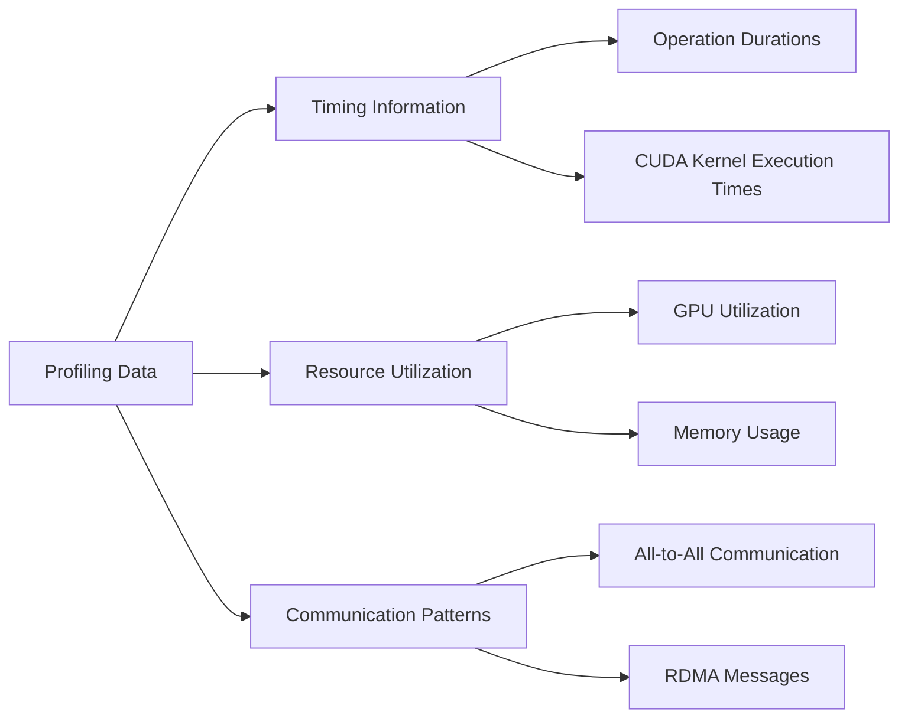
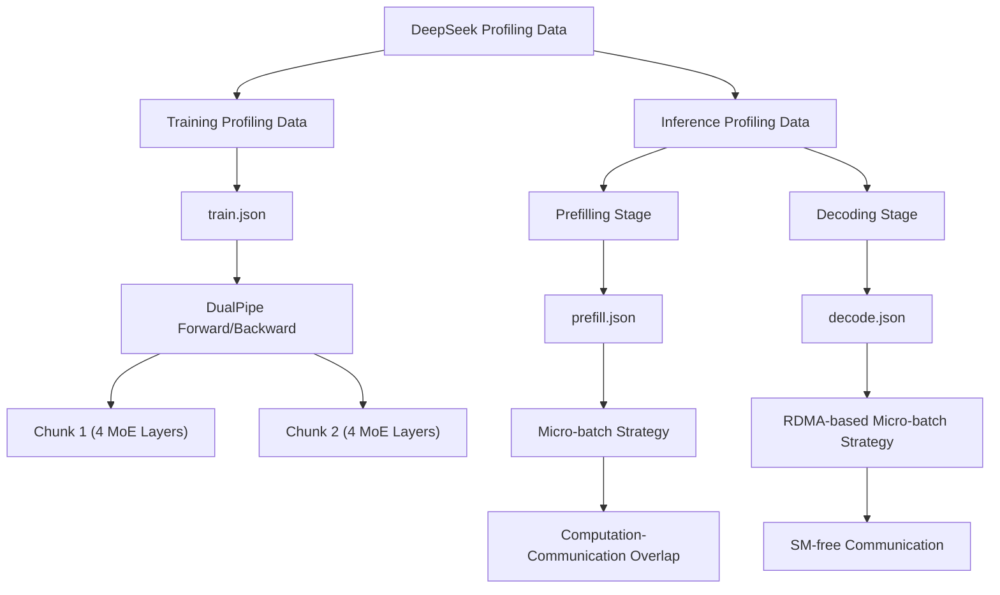
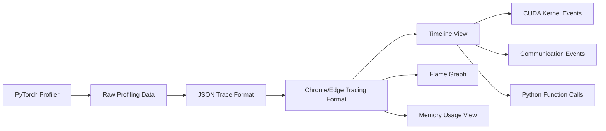
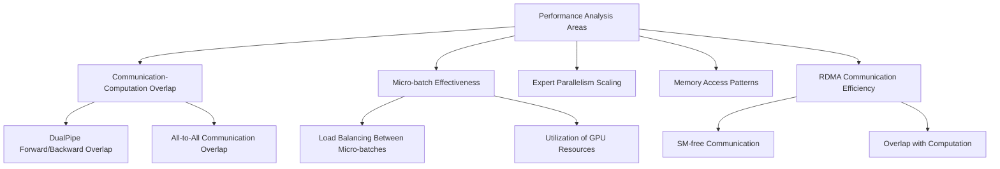
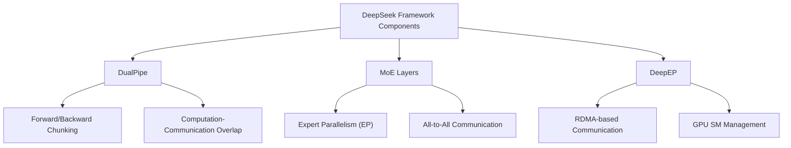

<!-- source: DeepWiki mcp.deepwiki.com · repo deepseek-ai/profile-data · page 1.1 What is Profiling Data · fetched 2026-10-30 -->

# What is Profiling Data

Relevant source files

The following files were used as context for generating this wiki page:

- [README.md](README.md)

This document explains what profiling data is in the context of deep learning systems, why it's important, and how it's specifically utilized in the DeepSeek framework. For information about the DeepSeek framework itself, see [DeepSeek Framework](#1.2). For details on how to visualize and analyze the profiling data, see [Visualization and Analysis](#5).

## Definition and Purpose

Profiling data consists of detailed timing and resource usage information collected during the execution of a software system. In the context of deep learning frameworks like DeepSeek, profiling data captures fine-grained performance metrics about computational tasks, memory operations, and communication patterns.

Sources: [README.md:1-3]()

## Purpose of Profiling Data

Profiling data serves several critical purposes in deep learning systems optimization:

| Purpose | Description |
|---------|-------------|
| Performance Analysis | Identifies bottlenecks and inefficiencies in model execution |
| Optimization Targeting | Directs optimization efforts to the most impactful areas |
| Communication-Computation Overlap | Helps design strategies to overlap communication with computation |
| Hardware Utilization | Reveals how effectively hardware resources are being used |
| System Scaling | Provides insights about scaling behavior across different configurations |

The DeepSeek profiling data specifically focuses on communication-computation overlap strategies, which are crucial for achieving high performance in distributed deep learning systems.

Sources: [README.md:3]()

## Types of Profiling Data in DeepSeek

The DeepSeek framework provides three main types of profiling data, each focusing on a different aspect of the system:

Sources: [README.md:5-30]()

### Training Profiling Data

The training profiling data (`train.json`) demonstrates the overlapping strategy employed in DualPipe, where forward and backward chunks are executed in a pattern that maximizes GPU utilization. Each chunk contains 4 MoE (Mixture of Experts) layers. The parallel configuration used for this profiling data is EP64 (Expert Parallelism with 64 partitions) and TP1 (Tensor Parallelism degree 1) with a 4K sequence length.

Sources: [README.md:5-12]()

### Inference Profiling Data

Inference profiling data is divided into two stages:

1. **Prefilling Stage** (`prefill.json`): This captures the initial processing of input prompts. The configuration uses EP32, TP1, with a prompt length of 4K and processes 16K tokens per GPU. The system uses two micro-batches to overlap computation and all-to-all communication.

2. **Decoding Stage** (`decode.json`): This captures the token generation process. The configuration uses EP128, TP1, with a prompt length of 4K and handles 128 requests per GPU. Similar to prefilling, decoding also uses two micro-batches for overlapping computation and communication, but implements a more sophisticated RDMA-based approach where communication doesn't occupy GPU streaming multiprocessors (SMs).

Sources: [README.md:14-30]()

## Collection and Format of Profiling Data

The profiling data in this repository was collected using the PyTorch Profiler, which captures detailed timing information of operations running on both CPU and GPU. The data is stored in JSON format compatible with the Chrome/Edge tracing tools. This format provides a comprehensive timeline view of all operations, allowing for detailed analysis of execution patterns.

In the DeepSeek profiling data, the system simulates a perfectly balanced MoE routing strategy for consistent profiling results. This means that the workload is distributed evenly across expert modules, which may not fully represent real-world scenarios where routing can be more dynamic and imbalanced.

Sources: [README.md:3]()

## Key Performance Insights

The profiling data in this repository is particularly valuable for understanding several key performance aspects of large-scale deep learning systems:

1. **Communication-Computation Overlap**: The data shows how computation and communication operations can be effectively overlapped to maximize hardware utilization.

2. **Micro-batch Strategies**: Both prefilling and decoding stages utilize micro-batches to improve parallelism and efficiency.

3. **Expert Parallelism Scaling**: The different EP configurations (EP32, EP64, EP128) provide insights into how expert parallelism scales with increasing partitions.

4. **Memory Usage Patterns**: The profiling data reveals memory access patterns during different phases of execution.

5. **RDMA-based Communication**: The decoding stage demonstrates an advanced RDMA-based approach where GPU SMs can be freed during communication.

Sources: [README.md:3, README.md:11-12, README.md:22-23, README.md:29-30]()

## Relationship to System Components

Understanding profiling data requires contextual knowledge of the system components being profiled. In the DeepSeek framework, several key components appear in the profiling data:

- **DualPipe**: A system for efficient training that divides the forward and backward passes into chunks to improve parallelism.
- **MoE Layers**: Mixture of Experts layers that use expert parallelism to scale model size.
- **DeepEP**: A system for efficient expert parallelism that uses RDMA-based communication.

Sources: [README.md:11, README.md:30]()

## Using Profiling Data for Optimization

The profiling data in this repository can be used to identify optimization opportunities for large-scale deep learning systems:

1. **Reducing Communication Overhead**: Analyzing the timing of all-to-all communication operations can reveal opportunities to optimize communication patterns.

2. **Balancing Compute Workloads**: Examining the execution time of different operations can help balance workloads across devices.

3. **Optimizing Memory Access**: Identifying memory access patterns can guide optimization of memory usage.

4. **Improving Scheduling**: Understanding the timing of different operations can inform better scheduling decisions.

5. **Enhancing Parallelism**: Analyzing dependencies between operations can reveal opportunities for increased parallelism.

The insights gained from profiling data analysis directly inform the design of key systems like DualPipe and DeepEP, which implement advanced strategies for efficient distributed training and inference.

Sources: [README.md:3, README.md:22-23, README.md:29-30]()

---

