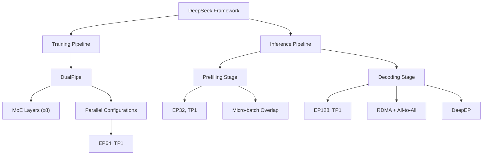
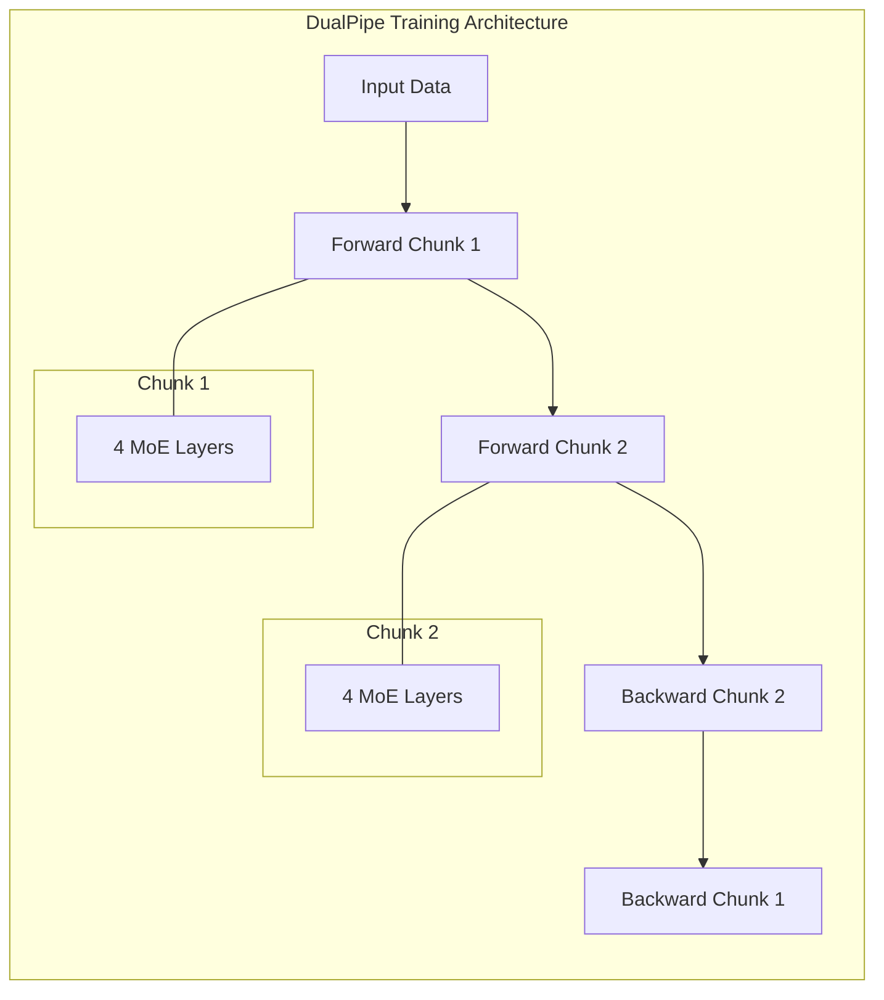
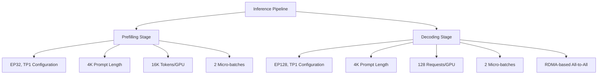
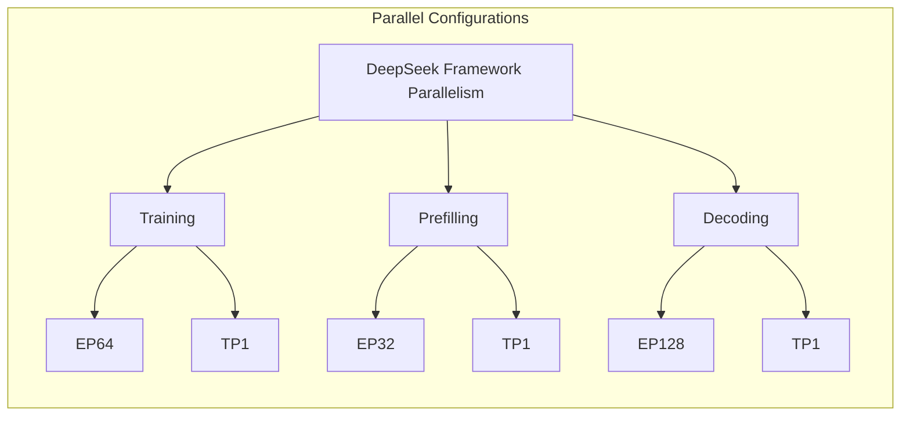
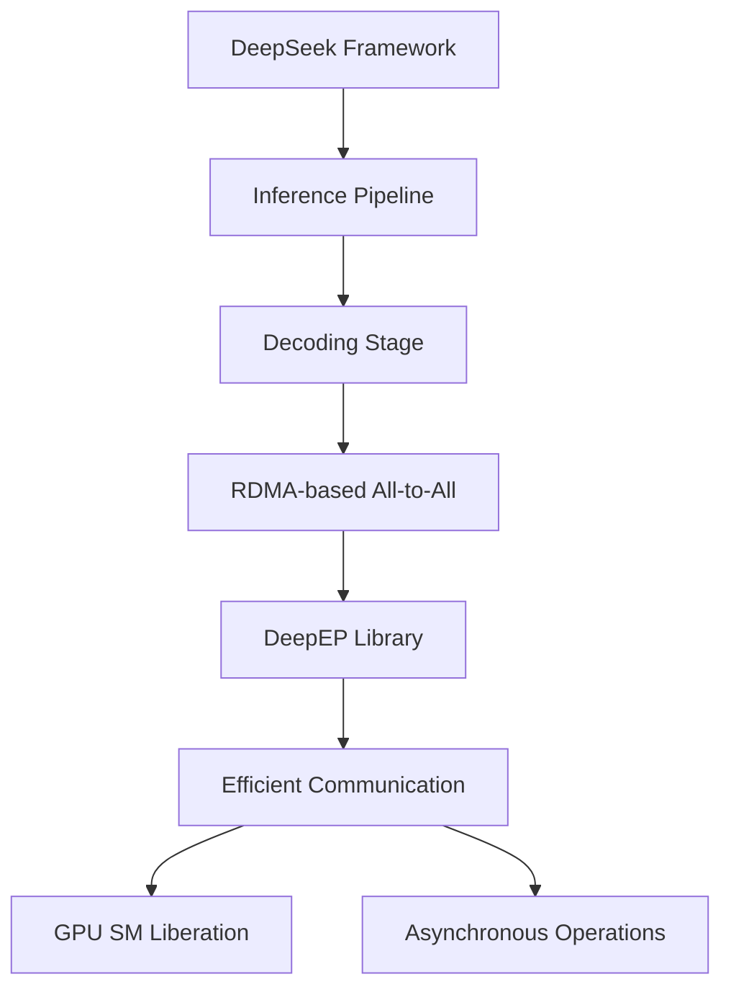

<!-- source: DeepWiki mcp.deepwiki.com · repo deepseek-ai/profile-data · page 1.2 DeepSeek Framework · fetched 2026-10-30 -->

# DeepSeek Framework

Relevant source files

The following files were used as context for generating this wiki page:

- [README.md](README.md)

## Purpose and Scope

This document provides an overview of the DeepSeek Framework, the infrastructure that generates the profiling data in this repository. Understanding the architecture and components of this framework is essential for interpreting the profiling data effectively. For specific details about the profiling data itself, see [What is Profiling Data](#1.1), and for training process details, see [Training Process](#2).

## Framework Overview

The DeepSeek Framework is a high-performance distributed training and inference infrastructure designed for large language models. It features specialized components for efficient training and inference, with particular emphasis on communication-computation overlap strategies and scalability.

Sources: [README.md:5-30]()

## System Architecture

The framework consists of two primary pipelines: training and inference. Both pipelines are optimized for different workloads and utilize specialized parallelism strategies and communication patterns.

### Training Architecture

The training pipeline implements a DualPipe architecture that enables the overlapping of forward and backward passes for different chunks of the model. This approach significantly improves GPU utilization by reducing idle time.

Sources: [README.md:5-12]()

### Inference Architecture

The inference pipeline is divided into two distinct stages: prefilling and decoding, each optimized for different workload characteristics.

Sources: [README.md:14-30]()

## Parallel Configurations

The DeepSeek Framework employs various parallel configurations to efficiently scale model training and inference across GPU clusters.

### Expert Parallelism (EP)

Expert Parallelism is a key strategy used in the framework, with different configurations for different scenarios:

- **EP64**: Used in the training pipeline with DeepSeek-V3 pretraining settings
- **EP32**: Used in the prefilling stage of inference 
- **EP128**: Used in the decoding stage of inference

### Tensor Parallelism (TP)

The framework primarily uses TP1 (no tensor parallelism) in the profiled configurations, focusing instead on expert parallelism for scaling.

Sources: [README.md:12-22]()

## Communication-Computation Overlap

A key optimization in the DeepSeek Framework is the strategic overlap of computation and communication, implemented differently in training and inference stages.

### Training Overlap

In training, the DualPipe architecture overlaps forward and backward computation of different chunks, maximizing GPU utilization.

### Prefilling Overlap

The prefilling stage uses two micro-batches to overlap computation and all-to-all communication. Attention computation load is balanced across these micro-batches, and the same prompt may be split between them for better efficiency.

### Decoding Overlap

Like prefilling, decoding uses two micro-batches for overlapping computation and communication. However, it employs a specialized RDMA-based approach where:

1. After RDMA messages are issued, GPU SMs are freed
2. Computation proceeds on the freed resources
3. The system waits for all-to-all communication to complete after computation finishes

This approach maximizes GPU utilization during the communication-intensive decoding phase.

```mermaid
gantt
    title "Communication-Computation Overlap"
    dateFormat s
    axisFormat %S
    
    section "Training (DualPipe)"
    Forward Chunk 1       : 0, 2s
    Backward Chunk 1      : after Forward Chunk 1, 2s
    Forward Chunk 2       : after Forward Chunk 1 starts, 2s
    Backward Chunk 2      : after Forward Chunk 2, 2s
    
    section "Prefilling"
    Micro-batch 1       : 0, 2s
    All-to-All 1        : after Micro-batch 1, 1s
    Micro-batch 2       : after Micro-batch 1 starts, 2s
    All-to-All 2        : after Micro-batch 2, 1s
    
    section "Decoding"
    Micro-batch 1       : 0, 1s
    RDMA Issue 1        : milestone, after Micro-batch 1, 0s
    Micro-batch 2       : after RDMA Issue 1, 1s
    RDMA Issue 2        : milestone, after Micro-batch 2, 0s
    Wait for All-to-All : after RDMA Issue 2, 1s
```

Sources: [README.md:16-30]()

## Framework Integration with DeepEP

The DeepSeek Framework integrates with DeepEP, a specialized library for efficient all-to-all communication implementation. This integration is particularly important for the decoding phase where RDMA-based communication is used.

### DeepEP Integration

Sources: [README.md:26-30]()

## Summary of Key Components

| Component | Configuration | Application | Key Features |
|-----------|---------------|-------------|-------------|
| Training Pipeline | EP64, TP1 | Model Training | DualPipe architecture, 8 MoE layers (4 per chunk) |
| Prefilling Stage | EP32, TP1 | Inference | 4K prompt length, 16K tokens/GPU, 2 micro-batches |
| Decoding Stage | EP128, TP1 | Inference | 4K prompt length, 128 requests/GPU, RDMA-based communication |
| DualPipe | - | Training | Overlaps forward and backward passes for different chunks |
| DeepEP | - | Inference | Efficient all-to-all communication for decoding stage |

Sources: [README.md:5-30]()

The DeepSeek Framework represents a sophisticated system for training and serving large language models, with specialized components for different phases of the AI lifecycle. The profiling data in this repository provides insights into the performance characteristics and optimization strategies implemented in this framework.

---

