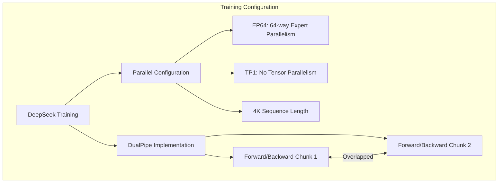
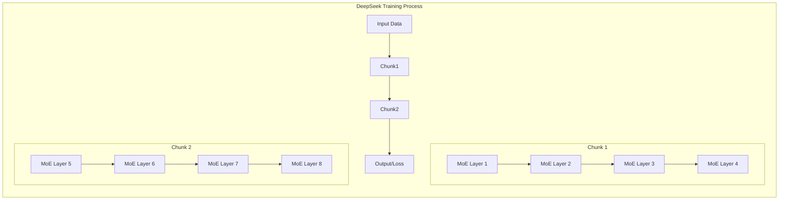
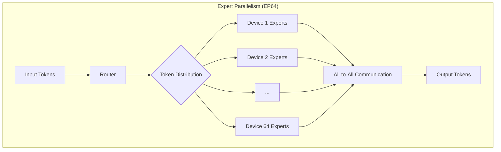

<!-- source: DeepWiki mcp.deepwiki.com · repo deepseek-ai/profile-data · page 2 Training Process · fetched 2026-10-30 -->

# Training Process

Relevant source files

The following files were used as context for generating this wiki page:

- [README.md](README.md)
- [assets/train.jpg](assets/train.jpg)
- [train.json](train.json)

This page documents the training process in the DeepSeek framework, focusing on the profiling data that demonstrates efficient training strategies. It details the parallel configuration, chunking methodology, and communication-computation overlap techniques employed during model training. For more detailed information about the DualPipe architecture, see [DualPipe Architecture](#2.1), and for specifics on MoE layers, see [MoE Layers](#2.2).

## Training Configuration Overview

The DeepSeek training profiling data showcases a high-performance parallel configuration designed for large language model training. The configuration parameters reflect those used in DeepSeek-V3 pretraining:

- **Expert Parallelism (EP)**: EP64 - distributes experts across 64 devices
- **Tensor Parallelism (TP)**: TP1 - no tensor parallelism employed
- **Sequence Length**: 4K tokens
- **Pipeline Parallelism (PP)**: Not included in profiling for simplicity

Sources: [README.md:11-12]()

## DualPipe Chunk Organization

The training process utilizes DualPipe for efficient execution of forward and backward passes. This architecture divides the model's MoE layers into chunks that can be processed with optimal computation-communication overlap.

Key characteristics of the chunking strategy:
- The model is divided into two chunks
- Each chunk contains 4 MoE (Mixture of Experts) layers
- Forward and backward passes of different chunks can be overlapped

Sources: [README.md:11]()

## Computation-Communication Overlap Strategy

The profiling data demonstrates how forward and backward passes are executed with overlapping communication and computation. This strategy is key to the efficiency of the training process.

```mermaid
gantt
    title "DualPipe Training Execution Timeline"
    dateFormat s
    axisFormat %S
    
    section "Chunk 1"
    Forward Pass      :chunk1_fwd, 0, 2s
    All-to-All Comm   :chunk1_comm, after chunk1_fwd, 1s
    Backward Pass     :chunk1_bwd, after chunk1_comm, 2s
    
    section "Chunk 2"
    Forward Pass      :chunk2_fwd, after chunk1_fwd, 2s
    All-to-All Comm   :chunk2_comm, after chunk2_fwd, 1s
    Backward Pass     :chunk2_bwd, after chunk2_comm, 2s
    
    section "Overlap"
    Chunk 2 Forward   :overlap1, after chunk1_fwd, 2s
    Chunk 1 Backward  :overlap2, after chunk1_comm, 2s
```

The timeline shows how the execution of chunks is orchestrated to maximize device utilization:

1. The forward pass of Chunk 1 is executed first
2. While communication for Chunk 1 is in progress, the forward pass of Chunk 2 begins
3. The backward pass of Chunk 1 and Chunk 2 are similarly overlapped
4. All-to-all communication operations for expert parallelism are integrated into this schedule

Sources: [README.md:11]()

## Expert Parallelism Implementation

The training process employs a balanced MoE routing strategy for profiling purposes. This ensures that expert computation is distributed evenly across devices.

The diagram illustrates how tokens are routed to experts distributed across 64 devices (EP64 configuration). For profiling purposes, the system uses a balanced routing strategy to ensure consistent performance measurement.

Sources: [README.md:3](), [README.md:11-12]()

## Profiling Data Visualization

The training profiling data captures the execution timeline of the various components of the training process. When visualized in Chrome/Edge tracing tools, it provides insights into:

- Execution of forward and backward passes for each chunk
- Communication operations (particularly all-to-all for expert parallelism)
- Overlapping execution patterns
- Overall resource utilization

The profiling data can be visualized by loading the `train.json` file in Chrome or Edge browser's tracing tool, accessible at chrome://tracing or edge://tracing.

Sources: [README.md:3](), [README.md:7-9]()

## Relationship to Inference Process

While this page focuses on the training process, it's worth noting the key differences between training and inference in the DeepSeek framework:

| Aspect | Training | Prefilling (Inference) | Decoding (Inference) |
|--------|----------|------------------------|----------------------|
| Parallel Configuration | EP64, TP1 | EP32, TP1 | EP128, TP1 |
| Sequence Length | 4K | 4K | 4K |
| Batch Size | - | 16K tokens/GPU | 128 requests/GPU |
| Chunking Strategy | 2 chunks, 4 MoE layers each | 2 micro-batches | 2 micro-batches |
| Communication Approach | All-to-all | All-to-all | RDMA + All-to-all |

For more details on the inference process, see [Inference Process](#3).

Sources: [README.md:11-12](), [README.md:22-30]()

---

