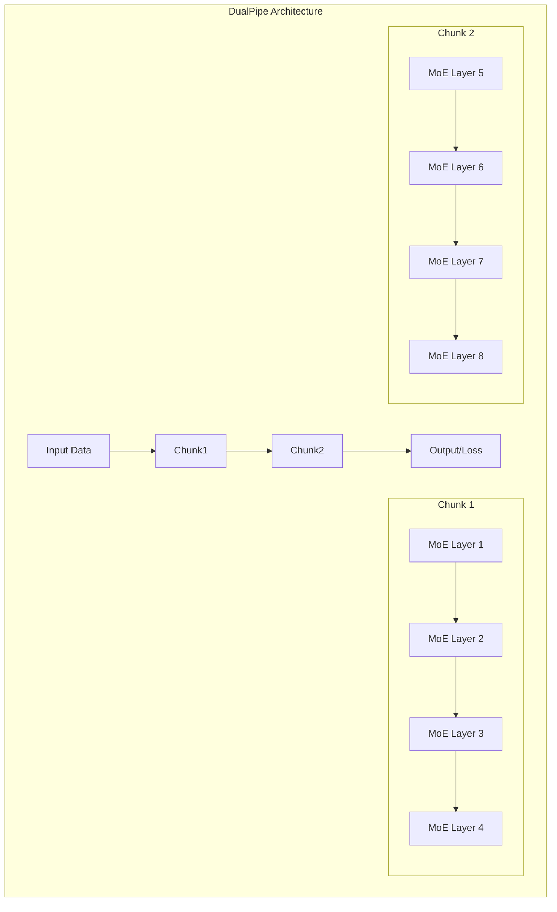
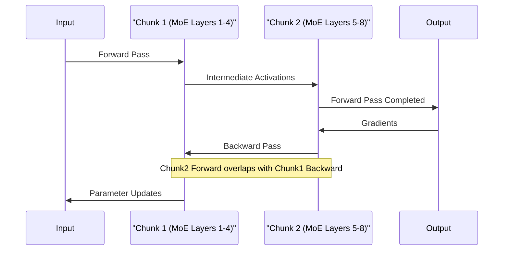
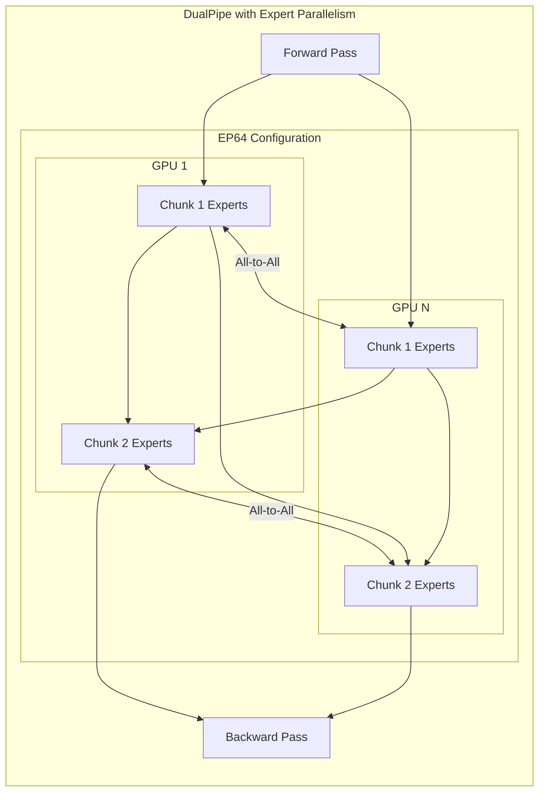

<!-- source: DeepWiki mcp.deepwiki.com · repo deepseek-ai/profile-data · page 2.1 DualPipe Architecture · fetched 2026-10-30 -->

# DualPipe Architecture

Relevant source files

The following files were used as context for generating this wiki page:

- [README.md](README.md)
- [train.json](train.json)

## Purpose and Scope

This document details the DualPipe architecture, a specialized parallelization strategy used in the DeepSeek training framework to optimize the training of large language models. DualPipe focuses on overlapping forward and backward computation chunks to maximize GPU utilization and minimize idle time. This architecture is particularly effective for models with Mixture of Experts (MoE) layers. For information about MoE layers specifically, see [MoE Layers](#2.2).

Sources: [README.md:10-12]()

## Core Concepts

DualPipe is designed around a key principle: dividing the model into chunks and strategically scheduling the forward and backward passes to create computational overlap. This architecture specifically addresses the performance challenges in training large MoE-based language models.

The main characteristics of DualPipe include:

- Chunk-based model partitioning
- Strategic scheduling of forward and backward passes
- Optimized for MoE layer computation
- Designed for Expert Parallelism (EP) configurations

Sources: [README.md:10-12]()

## Architectural Overview

DualPipe divides the model into chunks, with each chunk containing multiple MoE layers. The training profile data in this repository demonstrates the implementation with 2 chunks, each containing 4 MoE layers.

Sources: [README.md:11]()

## Computational Workflow

The key innovation in DualPipe is the strategic scheduling of forward and backward passes. Rather than waiting for the entire forward pass to complete before starting the backward pass, DualPipe begins backward computation on earlier chunks while later chunks are still performing forward computation.

```mermaid
gantt
    title DualPipe Computational Workflow
    dateFormat s
    axisFormat %S
    
    section Chunk 1
    Forward Pass      :c1f, 0, 2s
    Backward Pass     :c1b, after c1f, 2s
    
    section Chunk 2
    Forward Pass      :c2f, after c1f, 2s
    Backward Pass     :c2b, after c2f, 2s
    
    section Overlap
    Chunk 1 Backward + Chunk 2 Forward    :milestone, m1, after c1f, 0s
```

The diagram above illustrates how the backward pass of Chunk 1 overlaps with the forward pass of Chunk 2, maximizing GPU utilization and reducing training time.

Sources: [README.md:11]()

## Implementation Details

DualPipe is implemented within the DeepSeek training framework with the following configuration details:

- **Parallel Configuration**: EP64 (Expert Parallelism with 64 experts), TP1 (Tensor Parallelism dimension 1)
- **Sequence Length**: 4K tokens
- **Chunk Structure**: Each chunk contains 4 MoE layers
- **Overlap Strategy**: Backward computation of one chunk overlaps with forward computation of the next chunk

The implementation strategically schedules computational tasks to minimize idle GPU time, particularly during the communication-intensive operations required by MoE layers.

Sources: [README.md:11-12]()

## Data Flow in DualPipe

This sequence diagram shows the flow of data through the DualPipe architecture, highlighting the parallel execution of forward and backward passes across different chunks.

Sources: [README.md:10-12]()

## Performance Characteristics

DualPipe is designed to optimize the training of large language models by addressing several key performance challenges:

| Challenge | DualPipe Solution |
|-----------|-------------------|
| GPU idle time | Overlapping forward and backward passes |
| Communication bottlenecks | Strategic scheduling around MoE all-to-all communications |
| Memory utilization | Chunk-based activation management |
| Training throughput | Increased computational efficiency through overlapping operations |

The training profile data provided in `train.json` demonstrates the effectiveness of this approach, showing how GPU resources are efficiently utilized through the overlapping strategy.

Sources: [README.md:7-12]()

## Integration with Expert Parallelism

DualPipe is specifically optimized for models using Expert Parallelism. In the provided profile data, DualPipe operates with EP64 configuration, meaning the model uses 64 experts distributed across GPUs.

The diagram illustrates how DualPipe works in conjunction with Expert Parallelism, where experts from each chunk are distributed across multiple GPUs with all-to-all communication for routing tokens to appropriate experts.

Sources: [README.md:11-12]()

## Comparison with Other Approaches

DualPipe's chunk-based overlapping strategy differentiates it from other parallelization approaches:

| Approach | Key Characteristics | Comparison to DualPipe |
|----------|---------------------|------------------------|
| Pipeline Parallelism | Divides model across GPUs, introduces pipeline bubbles | DualPipe reduces bubbles through overlapping execution |
| Tensor Parallelism | Splits individual operations across GPUs | DualPipe works alongside TP but focuses on execution scheduling |
| Data Parallelism | Same model copy on multiple GPUs | DualPipe improves single-model execution efficiency |
| ZeRO | Optimizer state partitioning | Complementary to DualPipe's computation strategy |

DualPipe specifically addresses the computational challenges of MoE models, where expert routing creates unique performance bottlenecks that traditional parallelism strategies may not effectively handle.

Sources: [README.md:10-12]()

## Conclusion

The DualPipe architecture represents a specialized approach to training large language models by strategically scheduling forward and backward computation to maximize GPU utilization. By dividing the model into chunks and overlapping their execution, DualPipe addresses key performance bottlenecks in MoE-based models. The profile data provided in this repository demonstrates the practical implementation of DualPipe in the DeepSeek training framework with EP64 configuration and 4K sequence length.

Sources: [README.md:7-12]()

---

