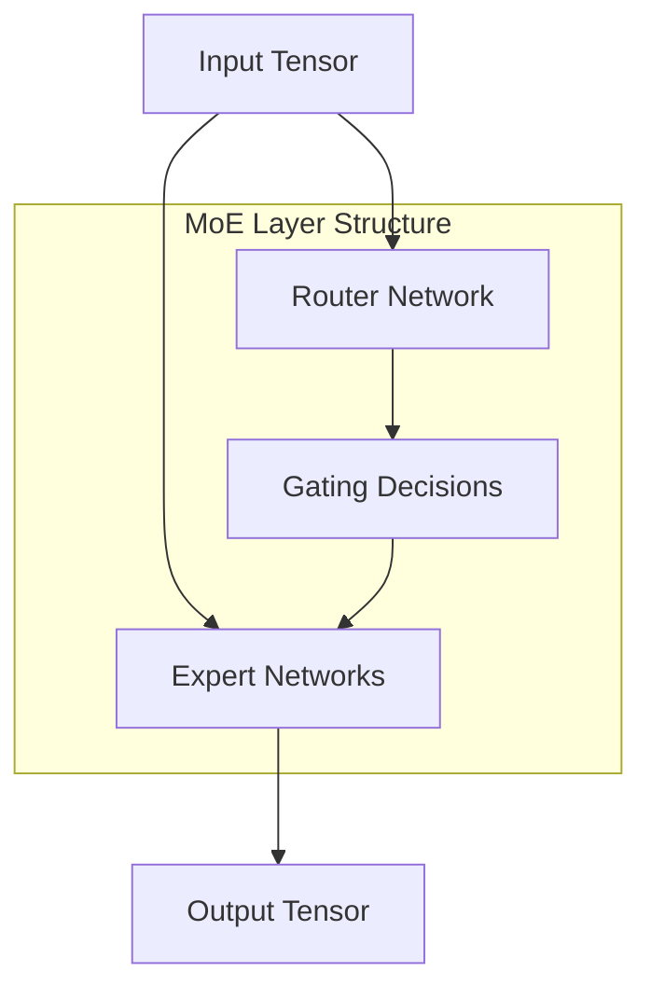
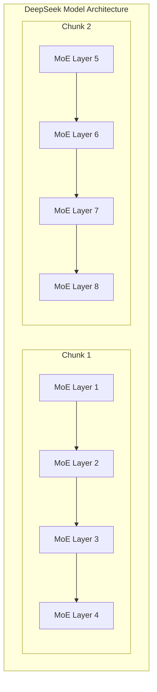
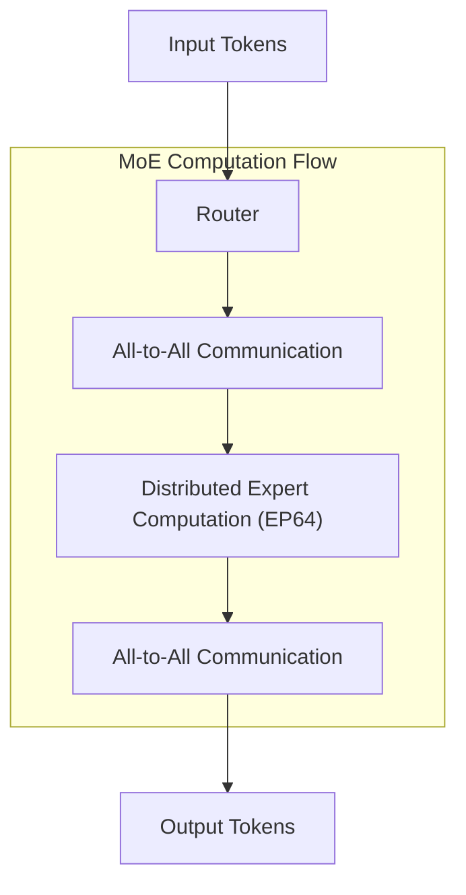
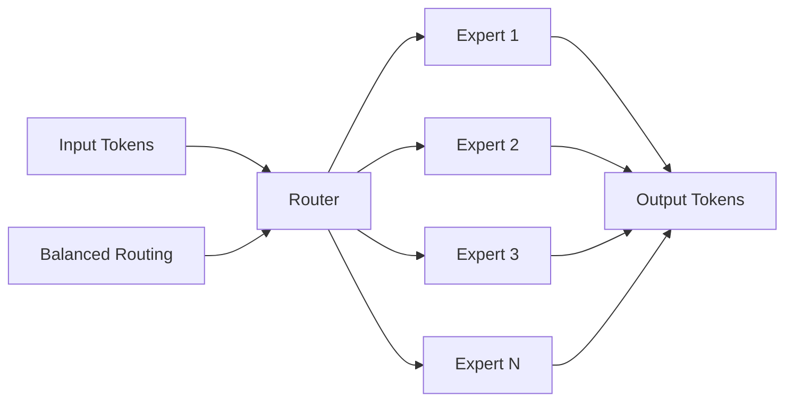
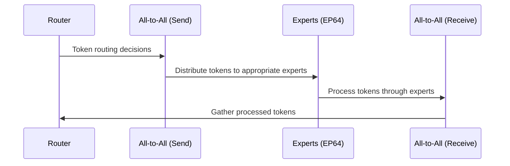

<!-- source: DeepWiki mcp.deepwiki.com · repo deepseek-ai/profile-data · page 2.2 MoE Layers · fetched 2026-10-30 -->

# MoE Layers

Relevant source files

The following files were used as context for generating this wiki page:

- [README.md](README.md)
- [train.json](train.json)

This document details the Mixture of Experts (MoE) layers used in the DeepSeek framework, focusing on their architecture and role in the training process. For information about the overall training architecture that leverages these MoE layers, see [DualPipe Architecture](#2.1).

## Introduction to MoE Layers

Mixture of Experts (MoE) is a neural network architecture that incorporates multiple specialized "expert" networks alongside a router that directs input tokens to the most appropriate experts. In large language models like DeepSeek, MoE layers replace standard dense feed-forward networks with sparse alternatives, allowing for increased model capacity without a proportional increase in computational requirements.

Sources: README.md

## MoE Configuration in DeepSeek

According to the profiling data, the DeepSeek model contains 8 MoE layers distributed across two chunks in the DualPipe training system, with 4 MoE layers per chunk. This architecture enables efficient computation-communication overlap during training.

Sources: README.md:11-12

## Expert Parallelism Implementation

The DeepSeek training profile data reveals an Expert Parallelism (EP64) configuration, where MoE experts are distributed across 64 GPU partitions. This parallelism strategy is essential for scaling model capacity effectively.

Sources: README.md:12

## Balanced Routing Strategy

For profiling purposes, DeepSeek implements a "balanced MoE routing strategy." This means tokens are distributed evenly across experts to ensure balanced computation loads, which helps in accurately measuring performance characteristics.

Sources: README.md:3

## MoE Layers in the Training Process

During training, MoE layers operate in both the forward and backward passes. The DualPipe architecture overlaps forward and backward computations for MoE layers across the two chunks to optimize GPU utilization.

```mermaid
gantt
    title MoE Layers in DualPipe Training Process
    dateFormat s
    axisFormat %S
    
    section Chunk 1
    Forward MoE Layers 1-4       :a1, 0, 2s
    Backward MoE Layers 1-4      :a2, after a1, 2s
    
    section Chunk 2
    Forward MoE Layers 5-8       :b1, after a1, 2s
    Backward MoE Layers 5-8      :b2, after b1, 2s
```

Sources: README.md:11-12

## Communication Patterns for MoE Layers

MoE layers require specific communication patterns due to their distributed nature. The most critical communication operation is the all-to-all exchange, which occurs:

1. After the router assigns tokens to experts (to distribute tokens to appropriate GPUs)
2. After expert computation (to gather processed tokens back)

This communication pattern is a key focus area for optimization in the DeepSeek framework.

Sources: README.md:11-12

## Relation to Inference Process

While training uses an EP64 configuration for MoE layers, the inference process employs different expert parallelism settings:

- **Prefilling Stage**: EP32 (32 expert partitions)
- **Decoding Stage**: EP128 (128 expert partitions)

These different configurations are optimized for the specific workload characteristics of each inference stage.

| Stage | Expert Parallelism | Batch Size | Sequence Length |
|-------|-------------------|------------|----------------|
| Training | EP64 | Not specified | 4K |
| Prefilling | EP32 | 16K tokens/GPU | 4K |
| Decoding | EP128 | 128 requests/GPU | 4K |

Sources: README.md:12, README.md:22, README.md:30

## Performance Considerations

The performance of MoE layers is influenced by:

1. **Load balancing**: How evenly tokens are distributed across experts
2. **Communication efficiency**: The speed and overlap of all-to-all communications
3. **Expert utilization**: How effectively the model uses the available expert capacity

The DeepSeek framework addresses these factors through balanced routing strategies, the DualPipe architecture for computation-communication overlap, and expert parallelism for efficient distribution.

For more information about how MoE layers function during inference, see [Prefilling Stage](#3.1) and [Decoding Stage](#3.2).

Sources: README.md:3, README.md:11-12

---

