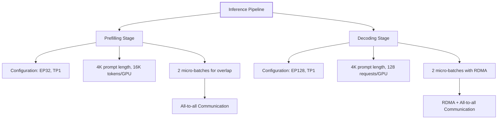
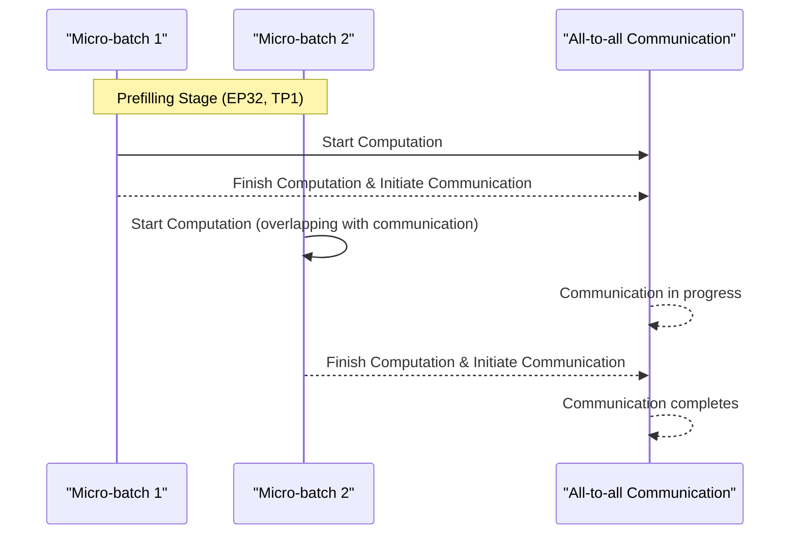
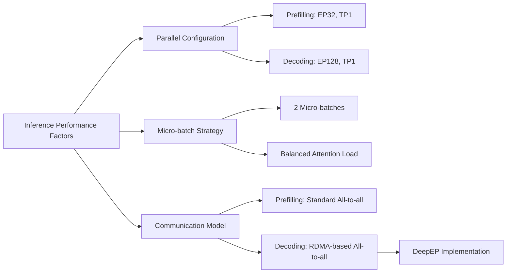
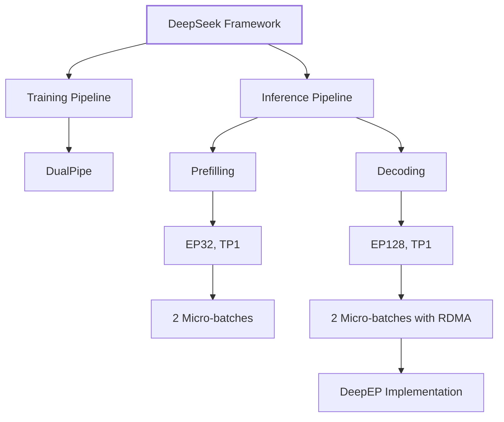

<!-- source: DeepWiki mcp.deepwiki.com · repo deepseek-ai/profile-data · page 3 Inference Process · fetched 2026-10-30 -->

# Inference Process

<details>
<summary>Relevant source files</summary>

The following files were used as context for generating this wiki page:

- [README.md](README.md)
- [assets/decode.jpg](assets/decode.jpg)
- [assets/prefill.jpg](assets/prefill.jpg)
- [prefill.json](prefill.json)

</details>


This document details the inference process used in the DeepSeek framework, focusing on the profiling data that demonstrates computation-communication overlap strategies. The inference process consists of two distinct stages: prefilling and decoding, each with different parallelism configurations and optimization techniques. For information about the training process, see [Training Process](#2).

## Overview of Inference Pipeline

The DeepSeek inference pipeline is designed for high-performance text generation, with specialized configurations for handling both the initial processing of prompts (prefilling) and the subsequent token generation (decoding). Both stages employ expert parallelism (EP) with tensor parallelism (TP) configurations, and utilize micro-batching strategies to optimize performance.



Sources: [README.md:16-30]()

## Prefilling Stage

The prefilling stage processes the initial prompt input before generating new tokens. It uses a configuration optimized for handling large batches of input tokens efficiently.

### Configuration and Workload

- **Parallel Configuration**: EP32 (Expert Parallelism with 32 experts), TP1 (Tensor Parallelism degree 1)
- **Workload**: 4K prompt length with 16K tokens per GPU
- **Deployment**: Matches DeepSeek V3/R1's actual online deployment configuration

### Micro-batch Strategy

The prefilling stage employs two micro-batches to effectively overlap computation and all-to-all communication, with the following characteristics:

- The same prompt may be split between the two micro-batches
- Attention computation load is balanced across the micro-batches
- All-to-all communication occurs while computation is being performed



Sources: [README.md:16-22]()

## Decoding Stage

The decoding stage generates new tokens sequentially after the prefilling stage completes. It uses a different configuration optimized for handling multiple simultaneous requests.

### Configuration and Workload

- **Parallel Configuration**: EP128 (Expert Parallelism with 128 experts), TP1 (Tensor Parallelism degree 1)
- **Workload**: 4K prompt length with 128 requests per GPU
- **Deployment**: Closely matches DeepSeek's actual online deployment configuration

### RDMA-based Micro-batch Strategy

Like prefilling, the decoding stage also uses two micro-batches for computation-communication overlap, but with a key difference:

- After computation, RDMA (Remote Direct Memory Access) messages are issued
- GPU SMs (Streaming Multiprocessors) are freed immediately after RDMA message issuance
- The system waits for all-to-all communication to complete after computation is finished
- This approach prevents all-to-all communication from occupying GPU SMs during decoding

```mermaid
sequenceDiagram
    participant MB1 as "Micro-batch 1"
    participant MB2 as "Micro-batch 2"
    participant RDMA as "RDMA"
    participant Comm as "All-to-all Communication"
    
    Note over MB1, MB2, RDMA, Comm: Decoding Stage (EP128, TP1)
    
    MB1->>MB1: Computation
    MB1->>RDMA: Issue RDMA Message
    Note right of RDMA: GPU SMs freed
    MB2->>MB2: Computation (overlapping)
    RDMA->>Comm: All-to-all Communication begins
    MB2->>RDMA: Issue RDMA Message
    Comm-->>Comm: Wait for communication to complete
```

Sources: [README.md:24-30]()

## Communication-Computation Overlap Mechanism

The DeepSeek inference pipeline achieves high performance through careful overlap of computation and communication operations. This section details how the overlap mechanisms differ between prefilling and decoding.

### Prefilling Overlap Pattern

In the prefilling stage, the overlap pattern follows these steps:

1. First micro-batch begins computation
2. When computation completes, all-to-all communication is initiated
3. While communication is in progress, the second micro-batch performs computation
4. This creates an effective overlap between computation and communication phases

```mermaid
gantt
    title "Prefilling Communication-Computation Overlap"
    dateFormat  s
    axisFormat %S
    
    section "Micro-batch 1"
    Computation       :a1, 0, 2s
    
    section "Communication"
    All-to-All Comm   :a2, after a1, 2s
    
    section "Micro-batch 2"
    Computation       :a3, after a1, 2s
```



### Decoding Overlap Pattern

The decoding stage uses a more advanced overlap pattern:

1. First micro-batch performs computation
2. RDMA messages are issued, immediately freeing GPU resources
3. Second micro-batch begins computation while all-to-all communication happens in the background
4. System waits for all-to-all communication to complete after all computation is finished
5. This approach ensures GPU SMs are efficiently utilized for computation

```mermaid
gantt
    title "Decoding Communication-Computation Overlap"
    dateFormat  s
    axisFormat %S
    
    section "Micro-batch 1"
    Computation       :c1, 0, 2s
    
    section "Communication"
    RDMA Issue        :milestone, c2, after c1, 0s
    All-to-All Comm   :c3, after c2, 2s
    
    section "Micro-batch 2"
    Computation       :c4, after c1, 2s
    RDMA Issue        :milestone, c5, after c4, 0s
```



The key innovation in the decoding stage is the use of RDMA to initiate communication without occupying GPU computing resources, allowing for maximum utilization of GPU SMs for computation tasks.

Sources: [README.md:16-30]()

## Performance Considerations

When using the DeepSeek inference pipeline, several factors affect performance:

### Parallel Configuration Selection

The choice of parallel configurations significantly impacts performance:

- **Prefilling**: EP32 is used as it balances expert model capacity with communication overhead for processing large prompts
- **Decoding**: EP128 provides more specialized experts for handling diverse generation requests

### Micro-batch Size Optimization

- Two micro-batches are used in both stages as this provides optimal overlap between computation and communication
- Increasing micro-batches beyond two may increase overhead without proportional performance gains

### RDMA Implementation

- The DeepEP implementation handles the low-level RDMA operations for efficient all-to-all communication
- This specialized implementation prevents all-to-all communication from occupying GPU SMs during decoding



Sources: [README.md:16-30]()

## Relationship to Other System Components

The inference process is closely connected to several other components in the DeepSeek framework:



For more detailed information about specific components:
- For information about the prefilling stage, see [Prefilling Stage](#3.1)
- For information about the decoding stage, see [Decoding Stage](#3.2)
- For detailed explanation of the micro-batch strategy, see [Micro-batch Strategy](#3.3)
- For information about expert parallelism configurations, see [Expert Parallelism](#4.1)

Sources: [README.md:1-30]()

---

