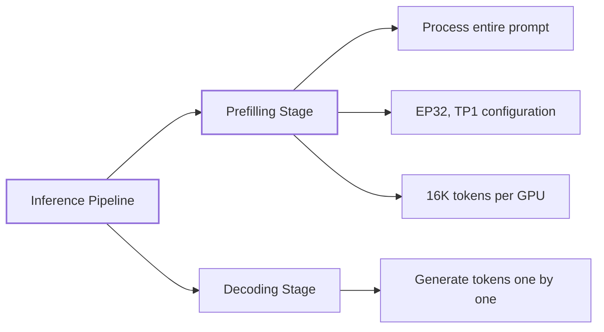
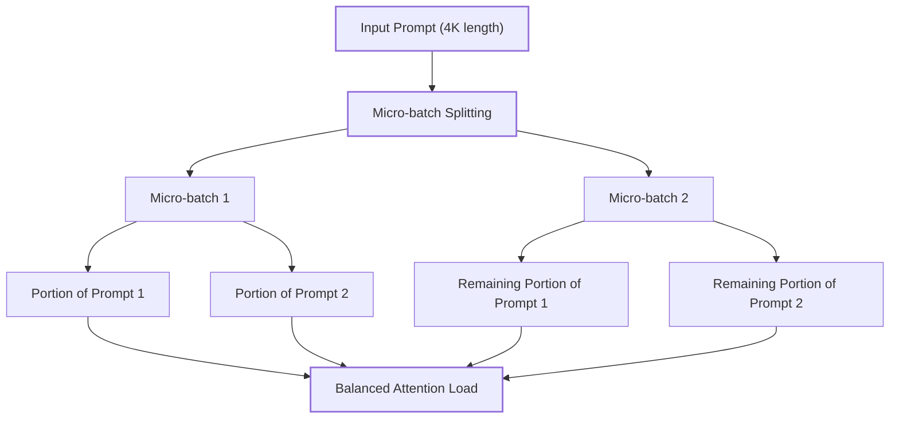
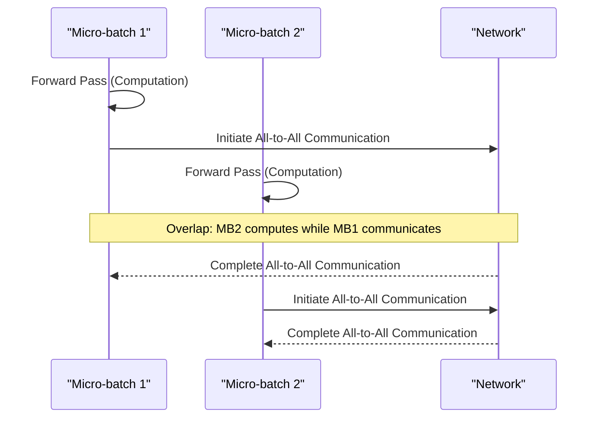

<!-- source: DeepWiki mcp.deepwiki.com · repo deepseek-ai/profile-data · page 3.1 Prefilling Stage · fetched 2026-10-30 -->

# Prefilling Stage

Relevant source files

The following files were used as context for generating this wiki page:

- [README.md](README.md)
- [assets/prefill.jpg](assets/prefill.jpg)
- [prefill.json](prefill.json)

## Purpose and Scope

This document details the prefilling stage in the DeepSeek inference process. Prefilling is the first phase of inference where the model processes the entire input prompt before generating tokens. For information about the subsequent token generation phase, see [Decoding Stage](#3.2).

## Overview

The prefilling stage processes the user's input prompt through the entire model in a single forward pass. This stage handles larger batches of tokens compared to decoding and uses specific optimization strategies to maintain efficient throughput.

Sources: [README.md:16-22]()

## Configuration Details

The prefilling stage uses the following configuration parameters:

| Parameter | Value | Description |
|-----------|-------|-------------|
| Expert Parallelism (EP) | 32 | Number of experts distributed across GPUs |
| Tensor Parallelism (TP) | 1 | No tensor parallelism used |
| Prompt Length | 4K | Maximum length of input prompt |
| Batch Size | 16K tokens per GPU | Total tokens processed per GPU |

This configuration aligns with DeepSeek V3/R1's production deployment settings and is optimized for processing large prompts efficiently.

Sources: [README.md:22]()

## Micro-batch Strategy

The prefilling stage employs a micro-batch strategy to overlap computation and communication, maximizing GPU utilization.

```mermaid
gantt
    title "Prefilling Computation-Communication Overlap"
    dateFormat s
    axisFormat %S
    
    section "Micro-batch 1"
    "Computation"      :a1, 0, 2s
    "All-to-All Communication" :a2, after a1, 2s
    
    section "Micro-batch 2"
    "Computation"      :b1, after a1, 2s
    "All-to-All Communication" :b2, after b1, 2s
```

Key characteristics of this strategy:

1. Two micro-batches are used to ensure continuous GPU utilization
2. While one micro-batch is in the communication phase, the other is in computation
3. The attention computation load is balanced across both micro-batches

Sources: [README.md:22]()

## Attention Load Balancing

A unique feature of the prefilling stage is how it balances attention computation across micro-batches.

Unlike typical batch processing, the same prompt may be split between both micro-batches to ensure balanced computation. This is particularly important for attention operations where computation scales quadratically with sequence length.

Sources: [README.md:22]()

## Execution Flow

The prefilling stage follows this general execution flow:

This strategy ensures that the GPU remains active with computation while communication is occurring, maximizing hardware utilization.

Sources: [README.md:22]()

## Visualization and Analysis

The prefilling stage can be visualized using the provided `prefill.json` profiling data. When loaded in Chrome/Edge tracing tools, this data shows the detailed timeline of operations, including:

1. Forward passes through different model layers
2. All-to-all communication operations
3. Memory allocation and data movement
4. Micro-batch transitions

An example of prefilling visualization is shown in the README assets.

To analyze this data, see [Using Chrome/Edge Tracing Tools](#5.1) for loading instructions and [Interpreting the Profiling Data](#5.2) for analysis guidance.

Sources: [README.md:18-20]()

## Comparison with Decoding

The prefilling stage differs from the decoding stage in several key ways:

| Feature | Prefilling | Decoding |
|---------|------------|----------|
| Parallel Config | EP32, TP1 | EP128, TP1 |
| Batch Size | 16K tokens per GPU | 128 requests per GPU |
| Communication | All-to-All occupies GPU SMs | All-to-All uses RDMA without occupying GPU SMs |
| Prompt Handling | May split prompts across micro-batches | Processes complete requests |

For detailed information about the decoding stage, see [Decoding Stage](#3.2).

Sources: [README.md:16-30]()

## Performance Considerations

When optimizing the prefilling stage, consider:

1. Balancing micro-batch sizes for optimal overlap
2. Attention computation distribution for minimal variance in processing time
3. Memory requirements for handling 16K tokens per GPU
4. Communication overhead of all-to-all operations

The profiling data helps identify bottlenecks in this process, allowing for targeted optimization.

Sources: [README.md:22]()

---

