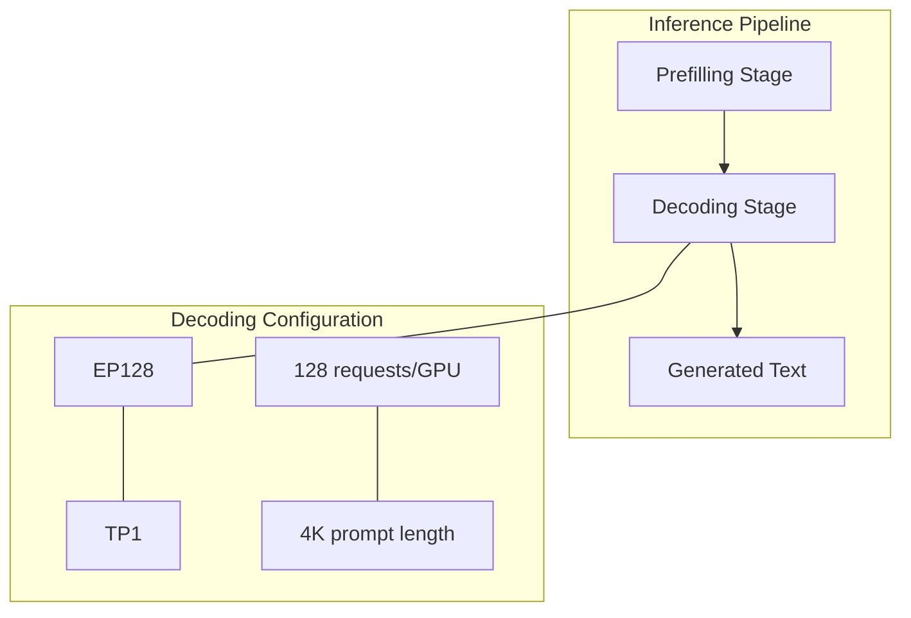
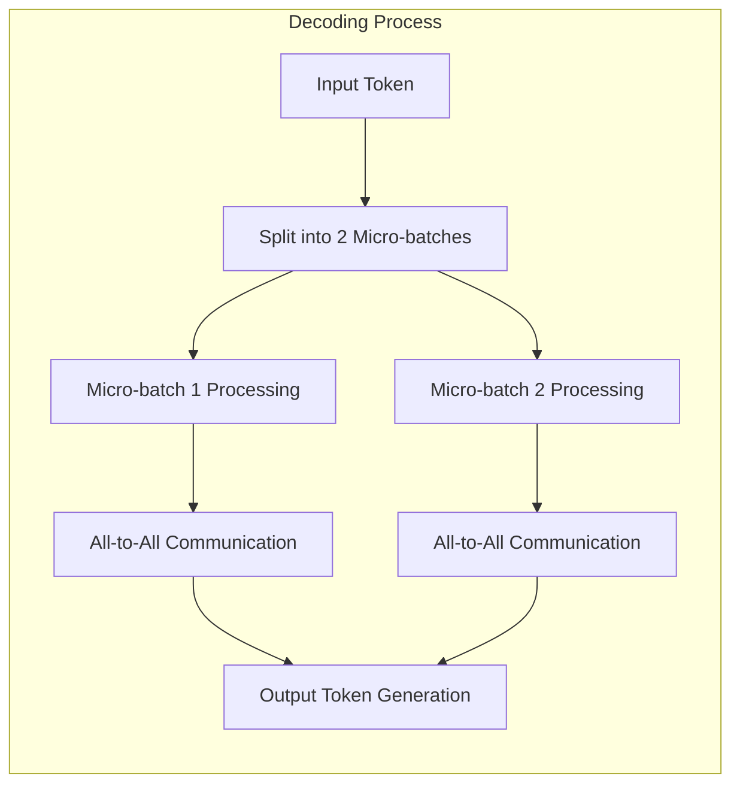
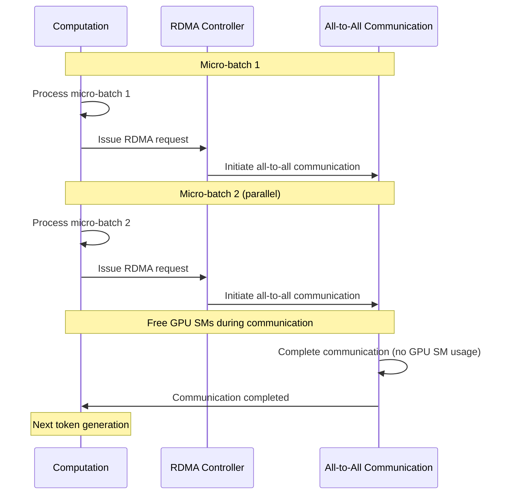
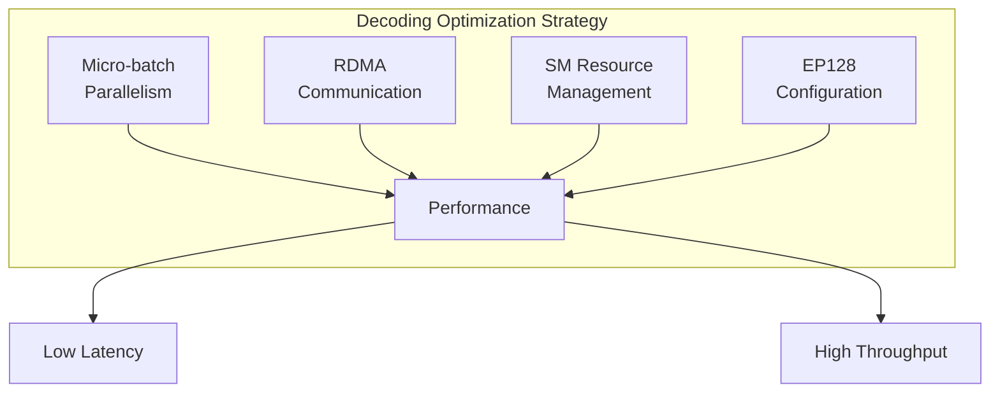

<!-- source: DeepWiki mcp.deepwiki.com · repo deepseek-ai/profile-data · page 3.2 Decoding Stage · fetched 2026-10-30 -->

# Decoding Stage

Relevant source files

The following files were used as context for generating this wiki page:

- [README.md](README.md)
- [assets/decode.jpg](assets/decode.jpg)

This document describes the decoding stage of the DeepSeek inference pipeline, focusing on its architecture, communication-computation overlap strategy, and implementation details. The decoding stage follows the prefilling stage in the inference process, handling token-by-token generation after the initial prompt processing. For information about the initial prompt processing, see [Prefilling Stage](#3.1).

## Overview of Decoding Stage

The decoding stage represents the autoregressive generation phase where tokens are generated one at a time. Unlike the prefilling stage which processes the entire prompt at once, the decoding stage handles each new token separately, making it latency-sensitive and requiring different optimization strategies.

Sources: [README.md:25-30]()

## Parallel Configuration

The decoding stage in DeepSeek uses a specific parallel configuration optimized for token generation:

| Parameter | Value | Description |
|-----------|-------|-------------|
| Expert Parallelism (EP) | 128 | Number of experts used in MoE layers |
| Tensor Parallelism (TP) | 1 | No tensor model parallelism |
| Prompt Length | 4K | Length of input context |
| Batch Size | 128 requests/GPU | Number of requests processed per GPU |

This configuration closely matches DeepSeek's actual online deployment environment, balancing throughput and latency requirements for efficient token generation.

Sources: [README.md:27-28]()

## Micro-batch Strategy

The decoding stage employs a micro-batch strategy similar to prefilling but with key differences designed for the token-by-token generation workflow.

Key characteristics of the micro-batch strategy in decoding:

1. Uses two micro-batches for computation-communication overlap
2. Each micro-batch processes a subset of the 128 requests
3. Balanced computation load across micro-batches
4. RDMA (Remote Direct Memory Access) is utilized for efficient communication

Sources: [README.md:28-30]()

## RDMA and Communication Optimization

A key differentiator of the decoding stage is how it handles communication between GPUs:

Unlike the prefilling stage, the all-to-all communication in decoding:

1. Does not occupy GPU SMs (Stream Multiprocessors)
2. After RDMA messages are issued, all GPU SMs are freed
3. The system waits for all-to-all communication to complete after computation is finished
4. Uses DeepEP for efficient all-to-all implementation

This approach maximizes GPU utilization during the latency-sensitive decoding process by freeing computational resources during communication steps.

Sources: [README.md:28-30]()

## Computation-Communication Overlap Visualization

The following diagram illustrates how computation and communication are overlapped during the decoding process:

```mermaid
gantt
    title Decoding Stage Communication-Computation Overlap
    dateFormat s
    axisFormat %S
    
    section Micro-batch 1
    Process batch 1      :a1, 0, 2s
    Issue RDMA           :milestone, a2, after a1, 0s
    All-to-All Comm      :a3, after a2, 2s
    
    section Micro-batch 2
    Process batch 2      :b1, after a1, 2s
    Issue RDMA           :milestone, b2, after b1, 0s
    All-to-All Comm      :b3, after b2, 2s
    
    section GPU SMs
    Free during comm     :c1, after b1, 2s
```

This timing diagram shows the sequence of operations for the two micro-batches and how GPU resources are freed during communication. The overlapping strategy is critical for maintaining high throughput during token generation.

Sources: [README.md:28-30]()

## Performance Characteristics

The decoding stage profile data provides insights into the performance characteristics of token generation:

1. **Latency Focus**: The decoding stage is optimized for low latency per token generation
2. **Communication Efficiency**: RDMA reduces communication overhead
3. **Resource Utilization**: GPU SMs are freed during communication phases
4. **Scalability**: EP128 configuration allows for parallelism across many experts
5. **Throughput**: Handles 128 requests per GPU concurrently

The profile data can be visualized using Chrome or Edge tracing tools by loading the `decode.json` file, providing a detailed timeline view of the decoding process.

Sources: [README.md:26-30]()

## Implementation Technologies

The decoding stage implementation leverages several key technologies:

1. **DeepEP**: For efficient all-to-all communication implementation
2. **RDMA**: For high-bandwidth, low-latency GPU-to-GPU communication
3. **PyTorch Profiler**: Used to capture the profiling data
4. **MoE Layers**: Mixture of Experts architecture with 128 experts per layer

For more details about how micro-batches are used across both prefilling and decoding stages, see [Micro-batch Strategy](#3.3).

Sources: [README.md:3, 28-30]()

---

