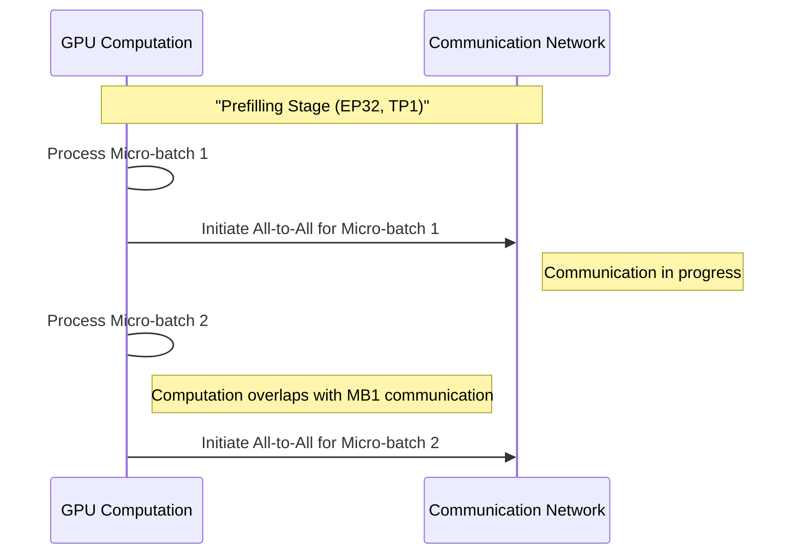

<!-- source: DeepWiki mcp.deepwiki.com · repo deepseek-ai/profile-data · page 3.3 Micro-batch Strategy · fetched 2026-10-30 -->

# Micro-batch Strategy

<details>
<summary>Relevant source files</summary>

The following files were used as context for generating this wiki page:

- [README.md](README.md)
- [prefill.json](prefill.json)

</details>


This document explains how the DeepSeek framework utilizes micro-batching techniques to optimize inference performance through effective computation-communication overlap. The strategy is implemented differently in the prefilling and decoding stages, each with specialized approaches to maximize throughput and minimize latency. For information on the broader inference process, see [Inference Process](#3).

## Purpose and Mechanism

Micro-batching divides large workloads into smaller, manageable units that can be processed concurrently, allowing communication operations to overlap with computation instead of happening sequentially. This strategy significantly reduces idle GPU time and improves overall system efficiency.

```mermaid
gantt
    title "Computation-Communication Overlap Using Micro-batches"
    dateFormat s
    axisFormat %S
    
    section "Without Micro-batches"
    "Computation"       :a1, 0, 2s
    "Communication"     :a2, after a1, 2s
    
    section "With Micro-batches"
    "Compute Micro-batch 1"    :b1, 0, 1s
    "Communication 1"          :b2, after b1, 1s
    "Compute Micro-batch 2"    :b3, after b1, 1s
    "Communication 2"          :b4, after b3, 1s
```



Sources: [README.md:17-30]()

## Micro-batch Implementation in Prefilling

During the prefilling stage, DeepSeek implements a micro-batch strategy with these characteristics:

- **Parallel Configuration**: EP32 (Expert Parallelism with 32 partitions), TP1 (Tensor Parallelism of 1)
- **Processing Load**: 4K prompt length with 16K tokens per GPU
- **Strategy**: Two micro-batches that overlap computation with all-to-all communication
- **Workload Distribution**: Attention computation load is carefully balanced across micro-batches
- **Data Handling**: Individual prompts may be split between micro-batches to maintain balanced computation

The execution flow involves processing the first micro-batch, initiating all-to-all communication for it, then immediately processing the second micro-batch while communication for the first is still ongoing.



Sources: [README.md:17-22]()

## Micro-batch Implementation in Decoding

The decoding stage employs a modified micro-batch approach:

- **Parallel Configuration**: EP128 (Expert Parallelism with 128 partitions), TP1 (Tensor Parallelism of 1)
- **Processing Load**: 4K prompt length with 128 requests per GPU
- **Strategy**: Two micro-batches with RDMA-optimized communication
- **GPU Resource Management**: All GPU SMs (Streaming Multiprocessors) are freed after RDMA messages are issued
- **Communication Pattern**: System waits for all-to-all communication to complete after computation finishes

The key distinction in decoding is the use of RDMA to completely offload communication tasks from the GPU:

```mermaid
flowchart TD
    "InputBatch"["Input Batch (128 requests/GPU)"] --> "SplitBatch"["Split into Micro-batches"]
    "SplitBatch" --> "MB1"["Micro-batch 1"]
    "SplitBatch" --> "MB2"["Micro-batch 2"]
    
    "MB1" --> "ProcessMB1"["Process MB1 on GPU"]
    "ProcessMB1" --> "RDMA1"["Issue RDMA Request"]
    "RDMA1" --> "FreeSMs1"["Free GPU SMs"]
    
    "MB2" --> "ProcessMB2"["Process MB2 on GPU"]
    "ProcessMB2" --> "RDMA2"["Issue RDMA Request"]
    "RDMA2" --> "FreeSMs2"["Free GPU SMs"]
    
    "FreeSMs1" --> "Wait"["Wait for All-to-All Completion"]
    "FreeSMs2" --> "Wait"
    
    "Wait" --> "Sync"["Synchronize Results"]
    "Sync" --> "Output"["Output"]
```

Sources: [README.md:24-30]()

## Comparison of Prefilling and Decoding Approaches

The table below highlights the key differences between the micro-batch implementations in prefilling and decoding stages:

| Feature | Prefilling | Decoding |
|---------|-----------|----------|
| Expert Parallelism | EP32 | EP128 |
| Batch Size | 16K tokens per GPU | 128 requests per GPU |
| Communication Method | GPU-managed all-to-all | RDMA-optimized all-to-all |
| GPU SM Usage | SMs involved in communication | SMs freed after RDMA issue |
| Waiting Pattern | Continuous overlap | Wait for communication after computation |
| Implementation Reference | N/A | DeepEP |

```mermaid
flowchart LR
    "MicroStrategy"["Micro-batch Strategy"] --> "PrefillingImpl"["Prefilling Implementation"]
    "MicroStrategy" --> "DecodingImpl"["Decoding Implementation"]
    
    "PrefillingImpl" --> "EP32Config"["EP32, TP1"]
    "PrefillingImpl" --> "DirectComm"["Direct GPU-managed communication"]
    "PrefillingImpl" --> "BalancedLoad"["Balanced attention load"]
    
    "DecodingImpl" --> "EP128Config"["EP128, TP1"]
    "DecodingImpl" --> "RDMAComm"["RDMA-optimized communication (DeepEP)"]
    "DecodingImpl" --> "FreedSMs"["GPU SMs freed during communication"]
```

Sources: [README.md:17-30]()

## System Integration

The micro-batch strategy serves as a critical component within DeepSeek's inference architecture, interfacing with several other system elements:

```mermaid
flowchart TD
    "Input"["Inference Request"] --> "InferenceEngine"["Inference Engine"]
    "InferenceEngine" --> "Prefill"["Prefilling Stage"]
    "InferenceEngine" --> "Decode"["Decoding Stage"]
    
    "Prefill" --> "PrefillMB"["Prefill Micro-batch Strategy"]
    "PrefillMB" --> "PrefillMB1"["Micro-batch 1"]
    "PrefillMB" --> "PrefillMB2"["Micro-batch 2"]
    
    "Decode" --> "DecodeMB"["Decode Micro-batch Strategy"]
    "DecodeMB" --> "DecodeMB1"["Micro-batch 1"]
    "DecodeMB" --> "DecodeMB2"["Micro-batch 2"]
    
    "PrefillMB1" --> "PrefillCompute1"["Computation"]
    "PrefillMB1" --> "PrefillComm1"["All-to-All Communication"]
    
    "PrefillMB2" --> "PrefillCompute2"["Computation"]
    "PrefillMB2" --> "PrefillComm2"["All-to-All Communication"]
    
    "DecodeMB1" --> "DecodeCompute1"["Computation"]
    "DecodeMB1" --> "DecodeRDMA1"["RDMA Issue"]
    "DecodeRDMA1" --> "DecodeComm1"["All-to-All Communication"]
    
    "DecodeMB2" --> "DecodeCompute2"["Computation"]
    "DecodeMB2" --> "DecodeRDMA2"["RDMA Issue"]
    "DecodeRDMA2" --> "DecodeComm2"["All-to-All Communication"]
    
    "PrefillComm1" --> "PrefillOutput"["Prefill Output"]
    "PrefillComm2" --> "PrefillOutput"
    "DecodeComm1" --> "DecodeOutput"["Decode Output"] 
    "DecodeComm2" --> "DecodeOutput"
    
    "PrefillOutput" --> "FinalOutput"["Inference Result"]
    "DecodeOutput" --> "FinalOutput"
```

Sources: [README.md:17-30]()

## Performance Benefits

The micro-batch strategy delivers significant performance advantages:

1. **Reduced Latency**: By overlapping computation with communication, total processing time is reduced
2. **Improved Throughput**: More efficient resource utilization leads to higher system throughput
3. **Enhanced GPU Utilization**: GPUs spend less time idle waiting for communication operations
4. **Better Scalability**: The approach is particularly effective for large models distributed across many devices

The decoding phase implementation with RDMA further enhances these benefits by completely freeing GPU resources from communication overhead.

```mermaid
gantt
    title "Performance Impact of Micro-batch Strategy"
    dateFormat s
    axisFormat %S
    
    section "Traditional Approach"
    "Computation"       :a1, 0, 2s
    "Communication"     :a2, after a1, 2s
    
    section "Prefilling (2 Micro-batches)"
    "Compute MB1"       :b1, 0, 1s
    "All-to-All MB1"    :b2, after b1, 1s
    "Compute MB2"       :b3, after b1, 1s
    "All-to-All MB2"    :b4, after b3, 1s
    
    section "Decoding (2 MB with RDMA)"
    "Compute MB1"       :c1, 0, 1s
    "RDMA All-to-All MB1" :c2, after c1, 1s
    "Compute MB2"       :c3, after c1, 1s
    "RDMA All-to-All MB2" :c4, after c3, 1s
```



Sources: [README.md:17-30]()

## Implementation Considerations

When implementing the micro-batch strategy, several factors must be addressed:

1. **Optimal Micro-batch Size**: DeepSeek uses two micro-batches, balancing division overhead against overlap benefits
2. **Load Balancing**: Attention computation is carefully balanced across micro-batches, even splitting individual prompts when necessary
3. **Communication Scheduling**: Timing communication operations to maximize overlap with computation
4. **Memory Management**: Efficiently handling the memory requirements for multiple active micro-batches

For the decoding stage specifically, the RDMA implementation mentioned refers to the DeepEP framework, which provides specialized all-to-all communication optimizations.

Sources: [README.md:17-30]()

---

