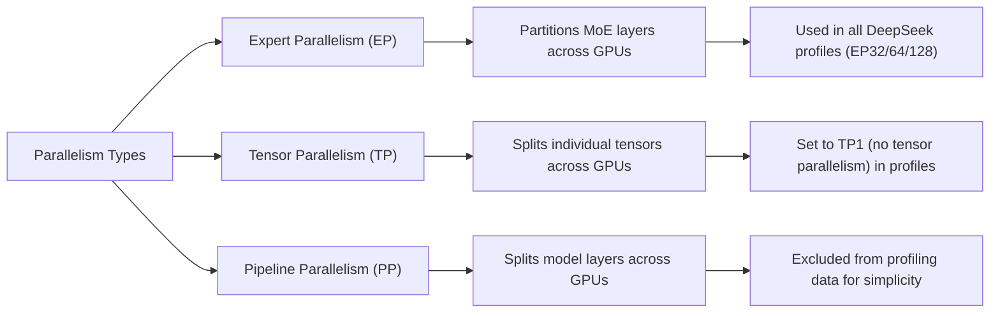
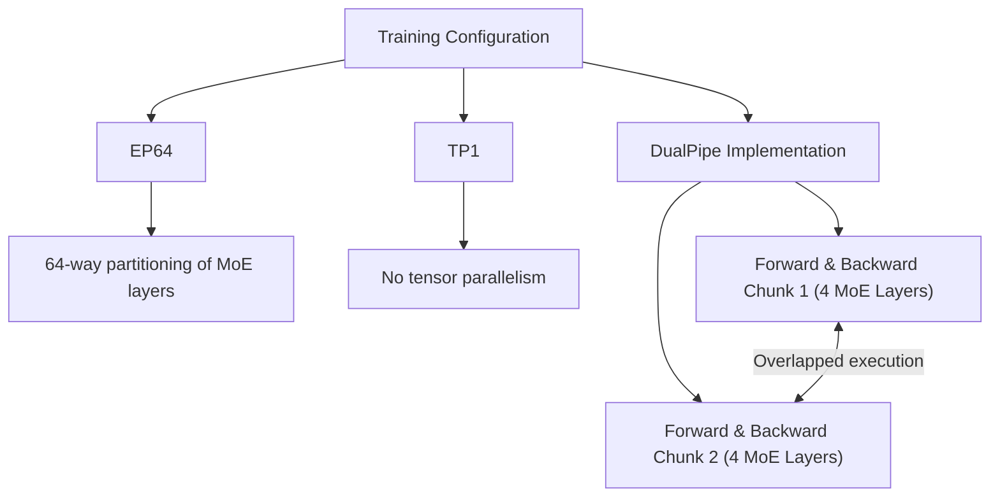
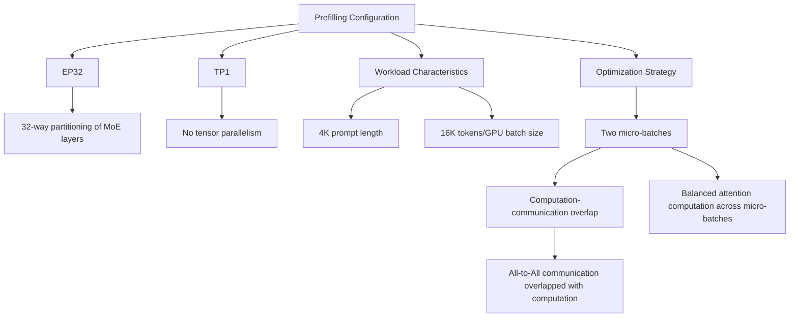
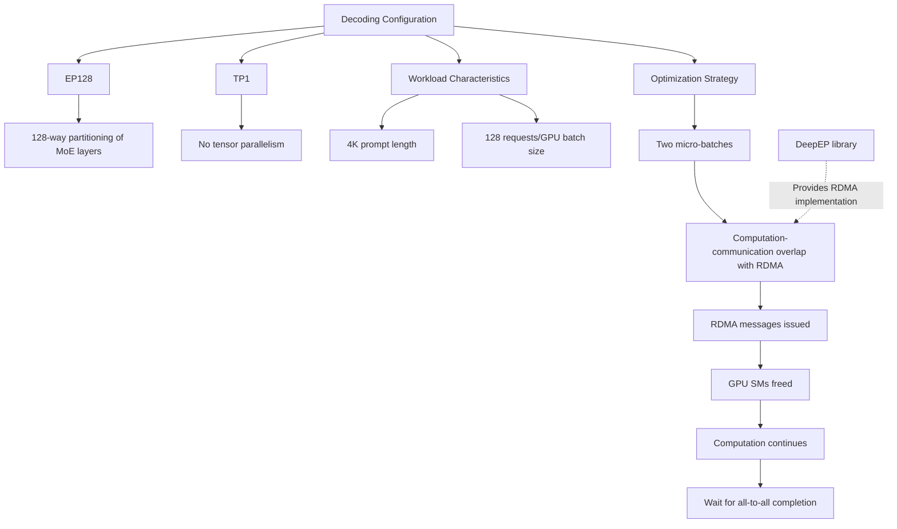
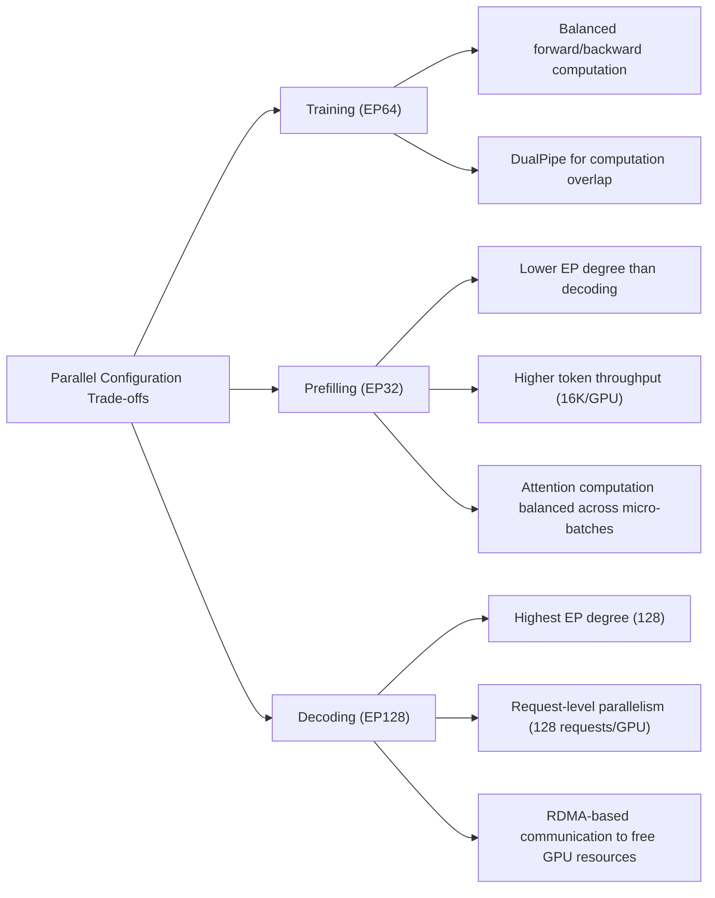
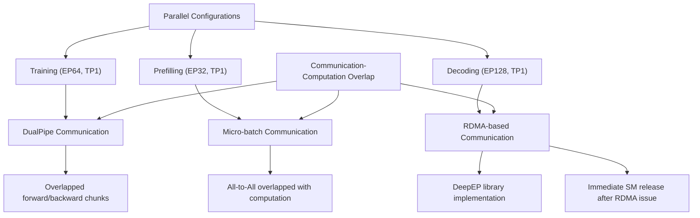

<!-- source: DeepWiki mcp.deepwiki.com · repo deepseek-ai/profile-data · page 4 Parallel Configurations · fetched 2026-10-30 -->

# Parallel Configurations

Relevant source files

The following files were used as context for generating this wiki page:

- [README.md](README.md)

This document details the various parallel configurations used in the DeepSeek framework's profiling data. It covers the specific parallelization strategies employed during training and inference phases, explaining the rationale behind different configurations and how they affect performance characteristics. For information about how these configurations are implemented in training and inference processes, see [Training Process](#2) and [Inference Process](#3).

## Overview of Parallelism Types

DeepSeek employs multiple forms of model parallelism to efficiently scale large language model training and inference:

**Diagram: Parallelism Types in DeepSeek Framework**

Sources: [README.md:11-12](). [README.md:22-23](). [README.md:28-30]().

## Configuration Summary

The following table summarizes the parallel configurations used in different stages of DeepSeek's profiling data:

| Stage | Expert Parallelism | Tensor Parallelism | Sequence Length | Batch Size | Notes |
|-------|-------------------|-------------------|-----------------|------------|-------|
| Training | EP64 | TP1 | 4K | - | Pipeline parallelism excluded; DualPipe with 4 MoE layers per chunk |
| Prefilling | EP32 | TP1 | 4K | 16K tokens/GPU | Two micro-batches for computation-communication overlap |
| Decoding | EP128 | TP1 | 4K | 128 requests/GPU | Two micro-batches with RDMA-based all-to-all |

Sources: [README.md:11-12](). [README.md:22-23](). [README.md:28-30]().

## Training Configuration (EP64, TP1)

The training configuration employs Expert Parallelism with 64 partitions (EP64) and no tensor parallelism (TP1). This configuration aligns with the DeepSeek-V3 pretraining settings.

**Diagram: Training Parallel Configuration**

Expert Parallelism (EP64) distributes the MoE (Mixture of Experts) layers across 64 GPU partitions, allowing for parallel processing of different expert networks. In combination with the DualPipe architecture, this enables overlapping forward and backward computation between different chunks of MoE layers.

Pipeline Parallelism communication is intentionally excluded from the profiling data for simplicity, focusing instead on the computation-communication patterns within the EP setup.

Sources: [README.md:11-12]().

## Inference Configurations

### Prefilling Configuration (EP32, TP1)

The prefilling stage of inference uses a different configuration with 32-way Expert Parallelism (EP32) and no tensor parallelism (TP1).

**Diagram: Prefilling Parallel Configuration**

This configuration is aligned with DeepSeek V3/R1's actual online deployment settings. The system processes 16K tokens per GPU with 4K sequence length prompts. Two micro-batches are used to overlap computation and all-to-all communication effectively.

A key optimization in the prefilling stage is that attention computation load is balanced across the two micro-batches, which may result in the same prompt being split between them.

Sources: [README.md:22-23]().

### Decoding Configuration (EP128, TP1)

For the decoding stage, DeepSeek employs an even more aggressive Expert Parallelism strategy with 128 partitions (EP128) while maintaining no tensor parallelism (TP1).

**Diagram: Decoding Parallel Configuration**

The decoding configuration represents a closer match to DeepSeek's actual online deployment. The system handles 128 requests per GPU with the same 4K sequence length. Like in prefilling, two micro-batches are used for overlapping computation and communication.

A key difference in the decoding stage is the use of RDMA (Remote Direct Memory Access) for all-to-all communication. After RDMA messages are issued, all GPU SMs (Streaming Multiprocessors) are freed, allowing computation to continue without waiting. The system then waits for the all-to-all communication to complete after computation has finished, effectively hiding communication latency.

Sources: [README.md:28-30]().

## Configuration Comparison and Trade-offs

**Diagram: Configuration Comparison**

Each parallel configuration is optimized for its specific workload characteristics:

1. **Training (EP64, TP1)**: Balances computation needs for both forward and backward passes, leveraging DualPipe to overlap operations between MoE layer chunks.

2. **Prefilling (EP32, TP1)**: Uses a lower degree of expert parallelism compared to decoding, focusing on processing a large number of tokens per GPU (16K). The two micro-batches ensure balanced attention computation.

3. **Decoding (EP128, TP1)**: Employs the highest degree of expert parallelism to handle many simultaneous requests (128 per GPU). Uses RDMA-based communication to free GPU resources immediately after issuing communication operations.

The progression from EP32 in prefilling to EP128 in decoding reflects the changing computational needs between these inference stages, with decoding requiring more parallelism to maintain throughput on a per-request basis.

Sources: [README.md:11-12](). [README.md:22-23](). [README.md:28-30]().

## Integration with Communication Strategies

**Diagram: Integration with Communication Strategies**

All three configurations are designed to maximize communication-computation overlap, but they do so using different approaches:

1. **Training**: Uses DualPipe to overlap forward and backward computation between different chunks of MoE layers.

2. **Prefilling**: Uses two micro-batches with balanced attention computation to overlap all-to-all communication with computation.

3. **Decoding**: Uses RDMA-based all-to-all communication with two micro-batches, immediately freeing GPU resources after issuing communication requests.

The DeepEP library provides the implementation for the RDMA-based all-to-all communication used in the decoding stage, enabling efficient resource utilization.

Sources: [README.md:11-12](). [README.md:22-23](). [README.md:28-30]().

---

