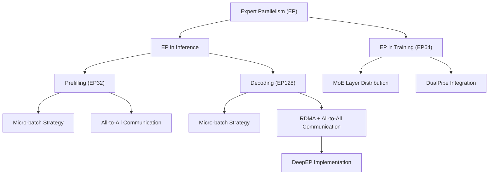
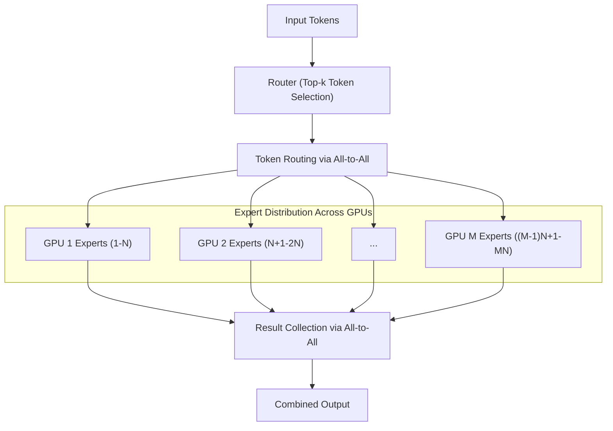
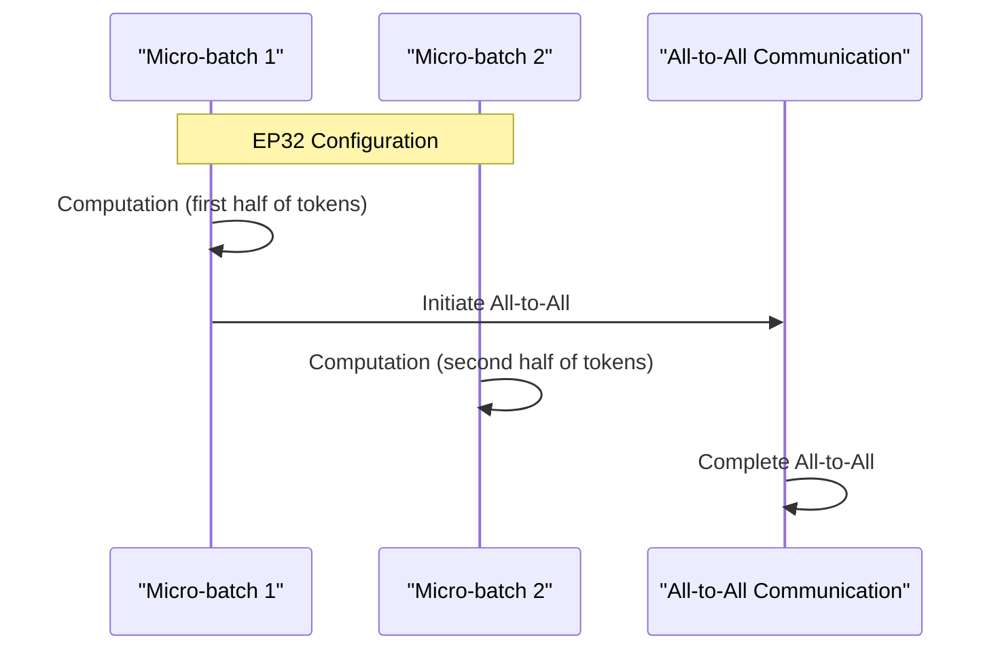
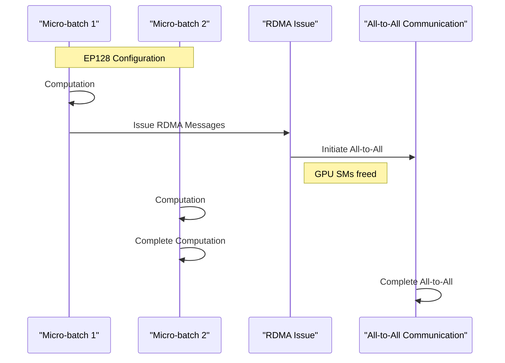
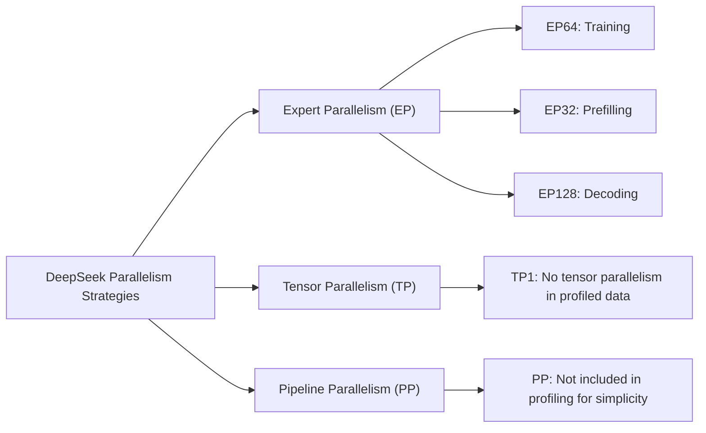
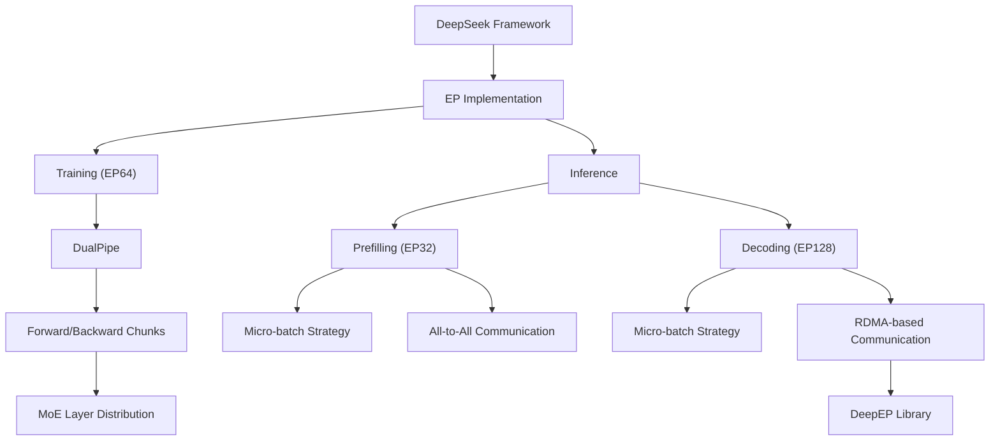

<!-- source: DeepWiki mcp.deepwiki.com · repo deepseek-ai/profile-data · page 4.1 Expert Parallelism (EP) · fetched 2026-10-30 -->

# Expert Parallelism (EP)

Relevant source files

The following files were used as context for generating this wiki page:

- [README.md](README.md)

## Purpose and Scope

This document explains Expert Parallelism (EP), a parallelization strategy used in the DeepSeek framework for efficiently distributing Mixture of Experts (MoE) layers across multiple GPUs. It covers different EP configurations used during training and inference, implementation details, and how EP integrates with other parallelism strategies. For information about Tensor and Pipeline Parallelism, see [Tensor and Pipeline Parallelism](#4.2).

Sources: [README.md:1-31]()

## EP Configurations

The DeepSeek framework employs different EP configurations based on workload requirements:

| Phase | Configuration | Sequence/Prompt Length | Batch Size | Other Parameters |
|-------|--------------|------------------------|------------|------------------|
| Training | EP64 | 4K sequence length | - | TP1, DualPipe with 4 MoE layers per chunk |
| Inference (Prefill) | EP32 | 4K prompt length | 16K tokens per GPU | TP1, 2 micro-batches |
| Inference (Decode) | EP128 | 4K prompt length | 128 requests per GPU | TP1, 2 micro-batches with RDMA |

The EP value represents the number of experts distributed across the available GPUs. Higher EP values allow for more model capacity but require more communication during the all-to-all operations.

Sources: [README.md:11-13](), [README.md:18-22](), [README.md:26-30]()

## EP Architecture

Sources: [README.md:11-13](), [README.md:18-22](), [README.md:26-30]()

## Implementation Details

### MoE Layer Distribution

Expert Parallelism distributes MoE experts across available GPUs. In an MoE layer with EP configuration, each GPU holds a subset of experts. When tokens need to be processed by experts residing on different GPUs, all-to-all communication is used to route tokens to the appropriate experts.

Sources: [README.md:11-13]()

### Training Implementation (EP64)

During training, EP64 is used with DualPipe to overlap computation and communication. The model is divided into chunks, with each chunk containing 4 MoE layers. Forward and backward passes for different chunks are executed in a pipelined manner, enabling efficient utilization of GPU resources.

```mermaid
gantt
    title DualPipe with EP64 (Training)
    dateFormat s
    axisFormat %S
    
    section Chunk 1
    Forward Pass       :a1, 0, 2s
    Backward Pass      :a2, after a1, 2s
    
    section Chunk 2
    Forward Pass       :b1, after a1, 2s
    Backward Pass      :b2, after b1, 2s
```

Sources: [README.md:11-13]()

### Inference Implementation

#### Prefilling Stage (EP32)

For prefilling, EP32 is used with two micro-batches to overlap computation and all-to-all communication. The attention computation load is balanced across the micro-batches, meaning a single prompt may be split between them for optimal performance.

Sources: [README.md:18-22]()

#### Decoding Stage (EP128)

For decoding, EP128 is employed with a more sophisticated communication strategy. The system uses two micro-batches with RDMA to efficiently handle all-to-all communication. Unlike in prefilling, after RDMA messages are issued, GPU SMs are freed, allowing for computation to continue while waiting for communication to complete.

The all-to-all implementation used for decoding is part of the DeepEP library, which provides optimized communication primitives for expert parallelism.

Sources: [README.md:26-30]()

## Integration with Other Parallelism Strategies

Expert Parallelism in the DeepSeek framework is used alongside other parallelism techniques:

In the profiled configurations, EP is the primary parallelism strategy, with TP set to 1 (no tensor parallelism). Pipeline Parallelism communication is excluded from the profiling data for simplicity.

Sources: [README.md:11-13]()

## Performance Considerations

Expert Parallelism configurations significantly impact performance:

1. **Training (EP64)**: Optimized for training throughput with DualPipe's overlapped computation strategy
2. **Prefilling (EP32)**: Balanced for efficient batch processing of prompts (16K tokens per GPU)
3. **Decoding (EP128)**: Maximized for handling numerous concurrent generation requests (128 requests per GPU)

Key performance optimizations include:
- Micro-batching for computation-communication overlap
- RDMA-based all-to-all communication during decoding
- Balanced attention computation distribution

The simulation of balanced MoE routing ensures consistent performance during profiling, though in real-world scenarios, routing patterns may vary.

Sources: [README.md:3](), [README.md:18-22](), [README.md:26-30]()

## Technical Integration

The EP implementation works with DeepSeek's communication infrastructure:

The EP configuration is a critical component of DeepSeek's architecture, enabling efficient scaling of MoE-based language models across GPU clusters.

Sources: [README.md:11-13](), [README.md:18-22](), [README.md:26-30]()

---

