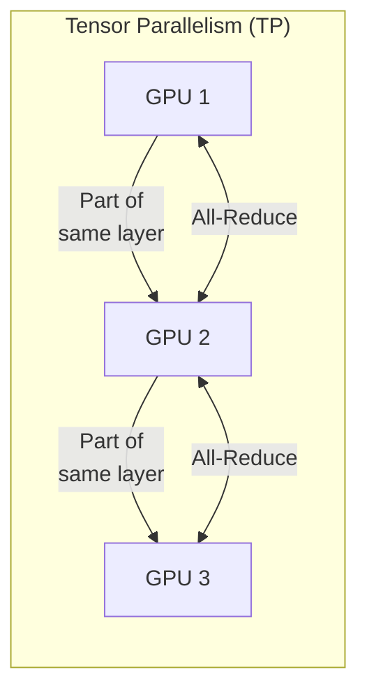
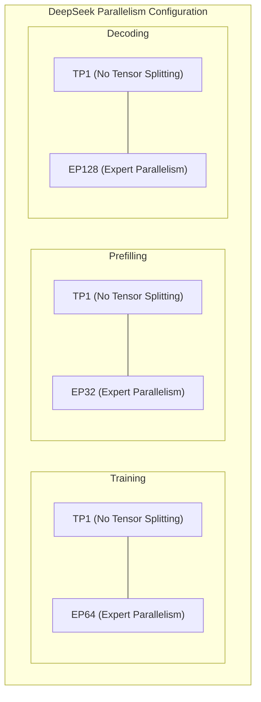
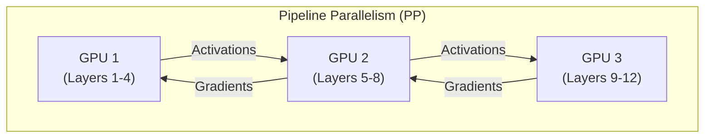
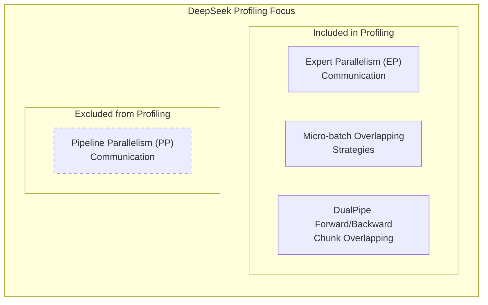
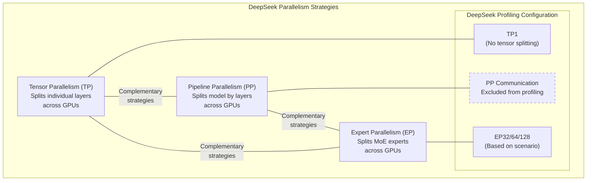

<!-- source: DeepWiki mcp.deepwiki.com · repo deepseek-ai/profile-data · page 4.2 Tensor and Pipeline Parallelism · fetched 2026-10-30 -->

# Tensor and Pipeline Parallelism

Relevant source files

The following files were used as context for generating this wiki page:

- [README.md](README.md)

## Purpose and Scope

This document explains Tensor Parallelism (TP) and Pipeline Parallelism (PP) as implemented in the DeepSeek framework, with specific focus on the TP1 configuration used throughout the profiling data and the intentional exclusion of PP communication from the profiling. For information about Expert Parallelism (EP), which is used alongside TP in the DeepSeek framework, see [Expert Parallelism (EP)](#4.1).

## Tensor Parallelism Overview

Tensor Parallelism (TP) is a distributed training strategy that splits individual neural network layers across multiple devices. In the TP approach, each layer's operations are partitioned and distributed across available GPUs, with communication required within the forward and backward passes of a single layer.

Sources: [README.md:12-12]()

### TP1 Configuration

In the DeepSeek framework, the profiling data consistently uses a TP1 configuration across all scenarios:

- Training: TP1 with EP64
- Prefilling: TP1 with EP32
- Decoding: TP1 with EP128

TP1 indicates that no tensor parallelism is being employed - each tensor operation is processed entirely within a single GPU. This configuration means:

1. No horizontal splitting of model layers across GPUs
2. No communication required for tensor operations within a layer
3. Simplified profiling data as tensor-parallel communication patterns are absent

Sources: [README.md:12-12](), [README.md:22-22](), [README.md:28-28]()

## Pipeline Parallelism

Pipeline Parallelism (PP) is a distributed training strategy that partitions a neural network along its depth, assigning different layers to different devices. In this approach, each GPU processes complete layers but only a subset of the entire model. GPUs form a pipeline where activations flow forward during the forward pass and gradients flow backward during backpropagation.

Sources: [README.md:12-12]()

### Exclusion of PP Communication from Profiling

The DeepSeek profiling data explicitly excludes Pipeline Parallelism communication. According to the documentation:

> "The PP communication is not included during profiling for simplicity."

This exclusion was made for several reasons:

1. **Simplification of Analysis**: Removing PP communication patterns allows for clearer visualization and analysis of other parallelism strategies (EP and micro-batch overlapping)
2. **Focus on Computation-Communication Overlap**: The primary focus of the profiling data is to demonstrate the overlapping strategies between computation and communication, particularly in the context of Expert Parallelism
3. **DualPipe Focus**: For training, the profiling emphasizes the DualPipe implementation, which focuses on overlapping forward and backward chunks rather than pipeline stages

Sources: [README.md:12-12]()

## Relationship Between Parallelism Strategies

In the DeepSeek framework, different parallelism strategies are combined to optimize performance. The profiling data focuses on specific configurations:

| Stage | Tensor Parallelism | Expert Parallelism | Pipeline Parallelism | Key Focus |
|-------|-------------------|-------------------|---------------------|-----------|
| Training | TP1 | EP64 | Excluded from profiling | DualPipe chunk overlapping |
| Prefilling | TP1 | EP32 | Excluded from profiling | Micro-batch + all-to-all communication overlap |
| Decoding | TP1 | EP128 | Excluded from profiling | Micro-batch + RDMA communication overlap |

### Parallelism Strategy Integration

The different parallelism strategies complement each other in the DeepSeek architecture:

Sources: [README.md:12-12](), [README.md:22-22](), [README.md:28-28]()

## Practical Implications

The choice of TP1 configuration and the exclusion of PP communication in the profiling data have several practical implications:

1. **Simplified Analysis**: The profiling data provides a clearer view of the computation-communication overlap strategies without the complexity of PP communication patterns
2. **Focus on Expert Parallelism**: The profiling highlights the EP communication patterns, which are central to the DeepSeek architecture's MoE implementation
3. **Real-world Alignment**: The configurations (TP1 with varying EP settings) align with the actual deployment settings for DeepSeek V3/R1 models

The profiling data thus provides valuable insights into the specific parallelism strategies most relevant to the DeepSeek framework's performance, while maintaining a focused scope that facilitates analysis and understanding.

Sources: [README.md:12-12](), [README.md:22-22](), [README.md:28-28]()

---

