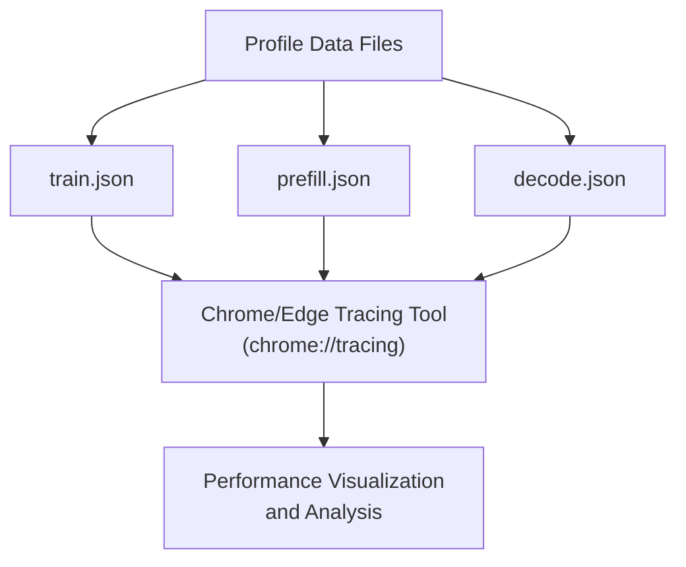
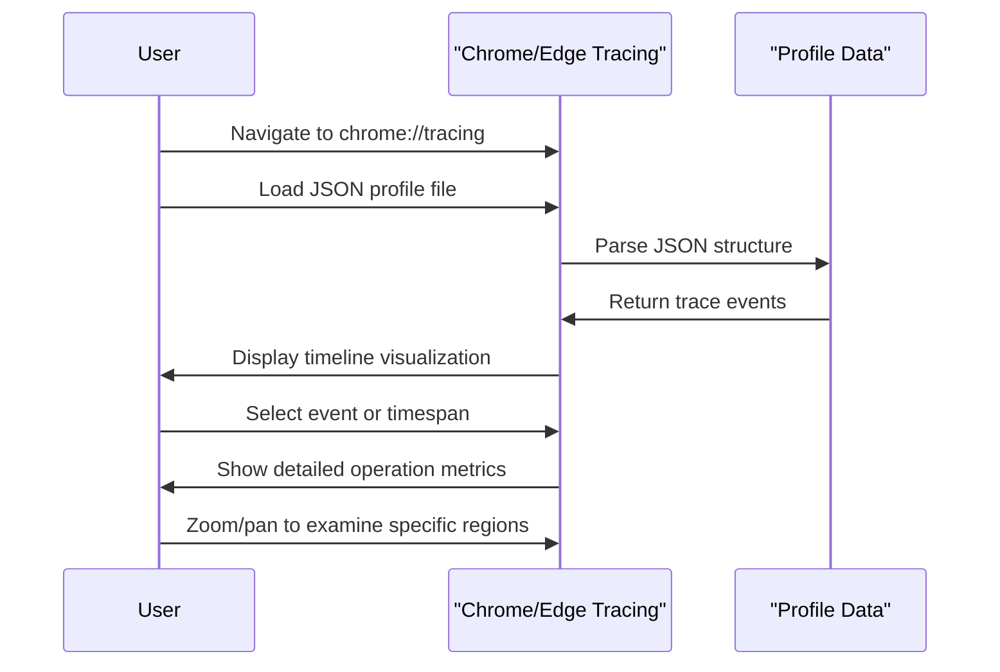
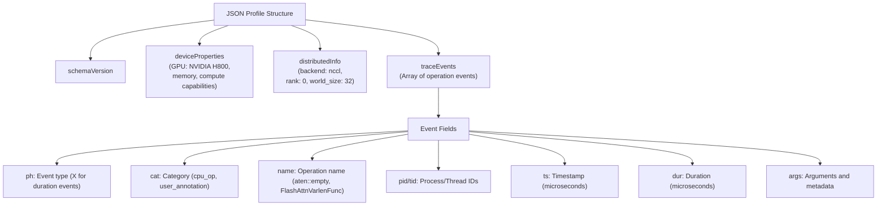
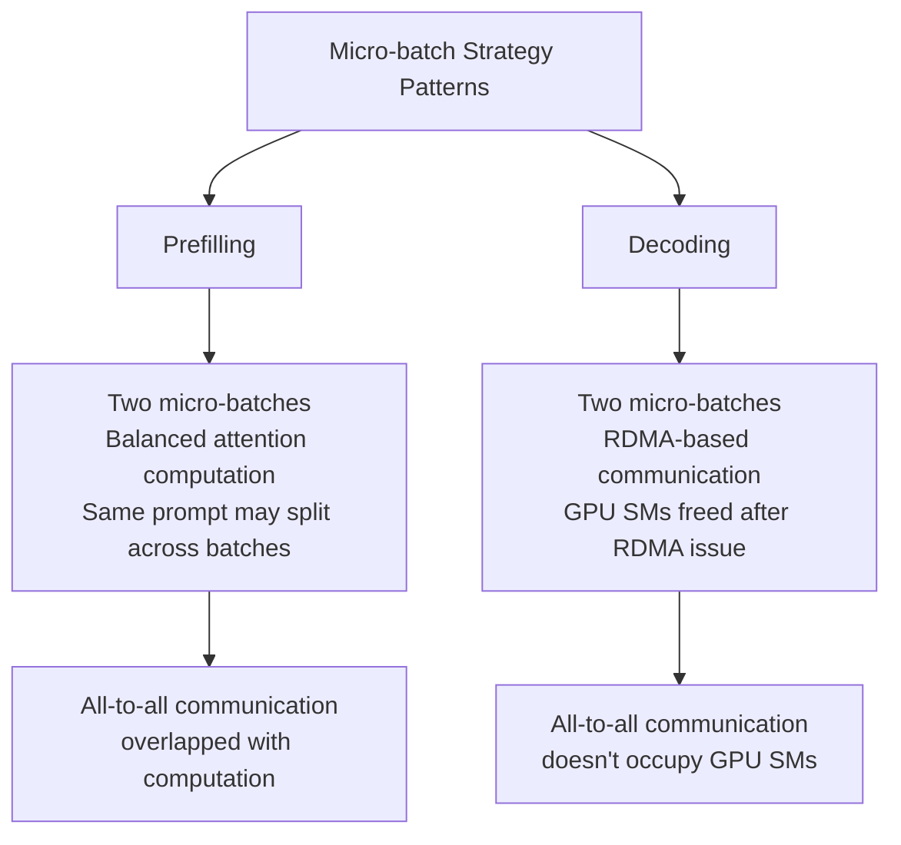
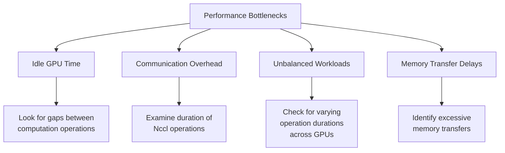
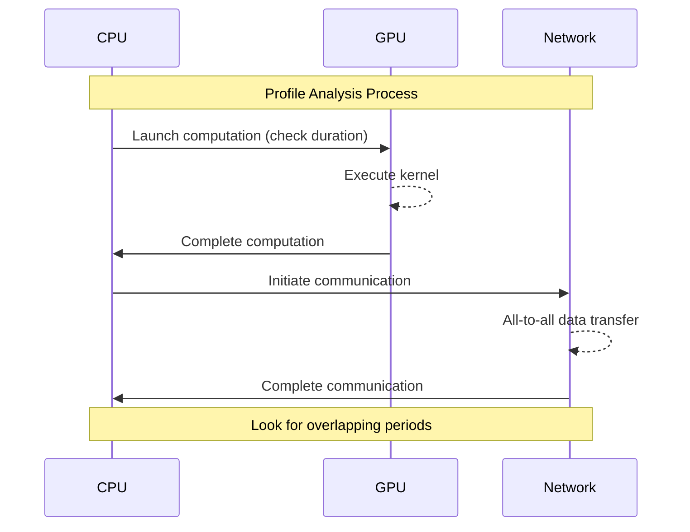
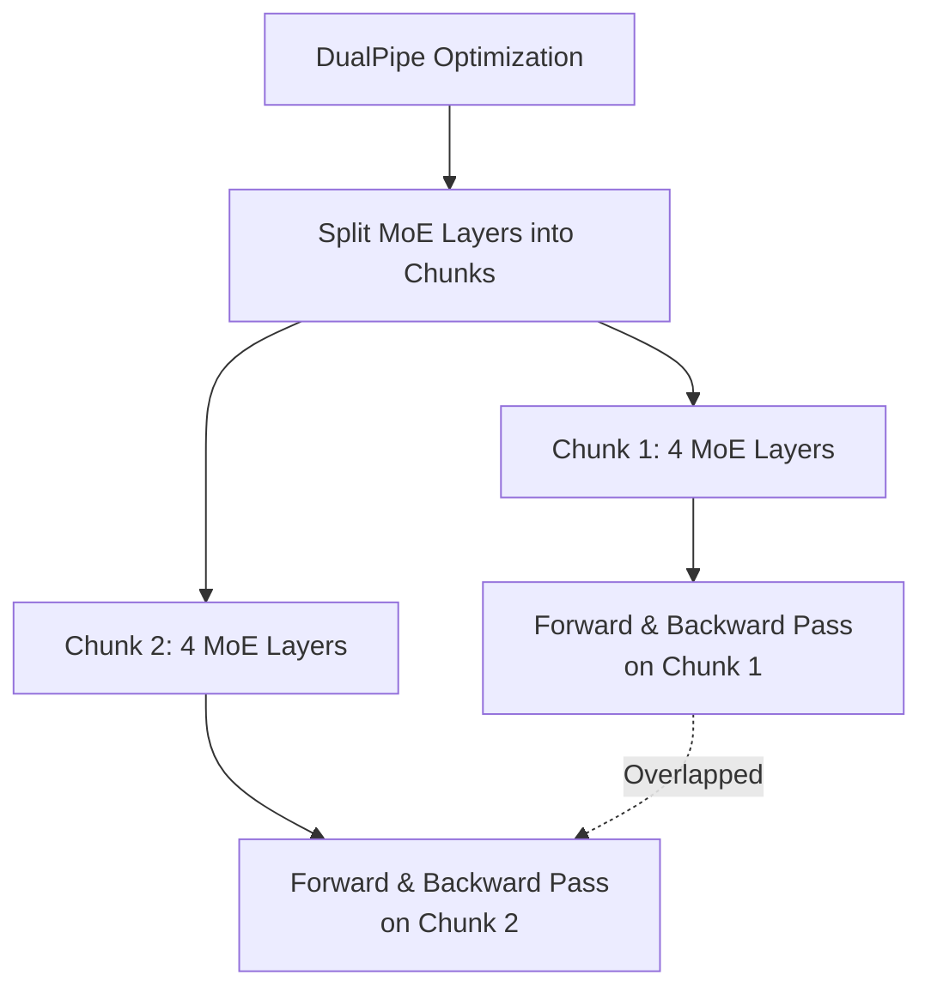
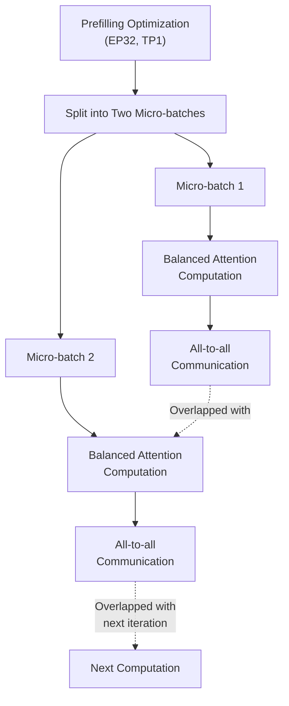
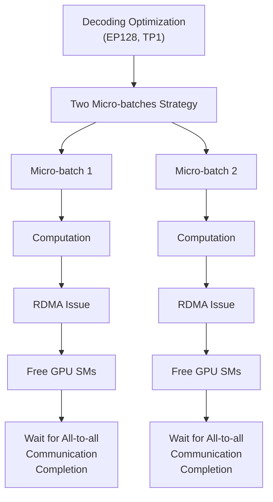

<!-- source: DeepWiki mcp.deepwiki.com · repo deepseek-ai/profile-data · page 5 Visualization and Analysis · fetched 2026-10-30 -->

# Visualization and Analysis

Relevant source files

The following files were used as context for generating this wiki page:

- [README.md](README.md)
- [prefill.json](prefill.json)
- [train.json](train.json)

This document provides guidance on how to visualize the DeepSeek profiling data and extract meaningful performance insights from it. The profiling data is captured in JSON format and can be visualized using browser-based tracing tools. For information about specific profiling components, see [Training Process](#2) or [Inference Process](#3).

## Using Chrome/Edge Tracing Tools

The DeepSeek repository contains JSON files that capture performance data from training and inference operations. These files can be opened and analyzed using the built-in tracing tools in Chrome or Edge browsers.

### Loading Profile Data

Follow these steps to visualize the profiling data:

1. Open Chrome browser and navigate to `chrome://tracing` (or `edge://tracing` in Edge)
2. Click the "Load" button in the top-left corner
3. Select one of the profiling JSON files:
   - `train.json` for training profiling data
   - `prefill.json` for prefilling stage inference data
   - `decode.json` for decoding stage inference data

Sources: [README.md:3-7]()

### Navigating the Timeline

After loading a profile, you'll see a timeline view showing various operations. Key navigation techniques include:

- **Mouse wheel** to zoom in/out
- **Click and drag** to select and zoom into a specific region
- **W, A, S, D keys** to pan the timeline
- **Click on an event** to view detailed information

Sources: [README.md:6-7]()

## Interpreting the Profiling Data

The JSON files contain structured performance data that can be analyzed to understand system behavior.

### Profile Data Structure

Each JSON profile file contains the following key sections:

| Section | Description |
|---------|-------------|
| `schemaVersion` | Version identifier for the tracing schema |
| `deviceProperties` | Hardware details about the GPU (model, memory, capabilities) |
| `distributedInfo` | Information about parallel configuration (rank, world_size) |
| `traceEvents` | Array of operation events with timing information |

Sources: [prefill.json:2-14]()

### Event Categories and Types

The profiling data includes different types of events:

| Category | Description | Examples |
|----------|-------------|----------|
| `cpu_op` | PyTorch CPU operations | `aten::empty`, `aten::view`, `aten::to` |
| `user_annotation` | Custom annotations | `nccl:all_reduce` |
| `cuda_runtime` | CUDA operations | Kernel launches, memory operations |
| `custom operations` | DeepSeek-specific operations | `FlashAttnVarlenFunc` |

Sources: [prefill.json:16-89]()

## Visual Analysis Patterns

When analyzing the profile visualizations, look for specific patterns that reveal performance characteristics.

### Communication-Computation Overlap

One of the key patterns to identify is how computation and communication operations overlap:

```mermaid
gantt
    title Communication-Computation Overlap Patterns
    dateFormat s
    axisFormat %S
    
    section Training (DualPipe)
    Forward Chunk 1       :a1, 0, 2s
    Backward Chunk 1      :a2, after a1, 2s
    Forward Chunk 2       :a3, after a1 start 1s, 2s
    Backward Chunk 2      :a4, after a3, 2s
    
    section Prefilling
    Computation Batch 1   :p1, 0, 2s
    All-to-All Comm       :p2, after p1, 1s
    Computation Batch 2   :p3, after p1 start 1s, 2s
    
    section Decoding (RDMA)
    Computation Batch 1   :d1, 0, 2s
    RDMA Issue            :milestone, d2, after d1, 0s
    Waiting for Comm      :d3, after d2, 1s
    Computation Batch 2   :d4, after d1 start 1s, 2s
```

Sources: [README.md:8-30]()

### Identifying Micro-batch Strategies

In the prefilling and decoding profiles, look for the micro-batch pattern where computation is split to overlap with communication:

Sources: [README.md:16-30]()

## Performance Bottleneck Identification

The profile visualizations help identify common performance bottlenecks:

### Common Bottlenecks to Look For

Sources: [README.md:22-30](), [prefill.json:73-99]()

### Analyzing Event Durations

Pay attention to the duration of events in the trace to identify operations that might be taking longer than expected:

Sources: [prefill.json:73-99](), [README.md:22-30]()

## Performance Optimization Insights

The profiling data reveals several optimization strategies in the DeepSeek framework:

### Training Optimization (DualPipe)

The training profile demonstrates the DualPipe strategy that allows better overlap of forward and backward passes:

Sources: [README.md:9-12]()

### Prefilling Stage Optimization

In the prefilling stage, optimizations focus on balancing computation across micro-batches:

Sources: [README.md:16-22]()

### Decoding Stage Optimization

For decoding, the RDMA-based communication strategy is key:

Sources: [README.md:23-30]()

## Advanced Analysis Techniques

To gain deeper insights from the profiling data, consider these advanced analysis techniques:

### Comparing Across Profiles

Compare the same operations across different profiling files to understand performance differences between:
- Training vs. inference
- Prefilling vs. decoding stages
- Different parallel configurations (EP32 vs. EP128)

### Quantitative Analysis

Extract timing data from the JSON profiles to perform quantitative analysis:
- Calculate average operation durations
- Measure communication-to-computation ratios
- Identify the critical path in execution

### Optimization Validation

Use the profiles to validate optimization strategies:
- Confirm that computation and communication actually overlap
- Verify load balancing across micro-batches
- Ensure RDMA operations free GPU resources as expected

Sources: [README.md:6-30]()

This guide provides the essential knowledge needed to effectively visualize and analyze the DeepSeek profiling data. The insights gained can help understand the performance characteristics of the training and inference processes and validate the effectiveness of the optimization strategies implemented in the DeepSeek framework.

---

