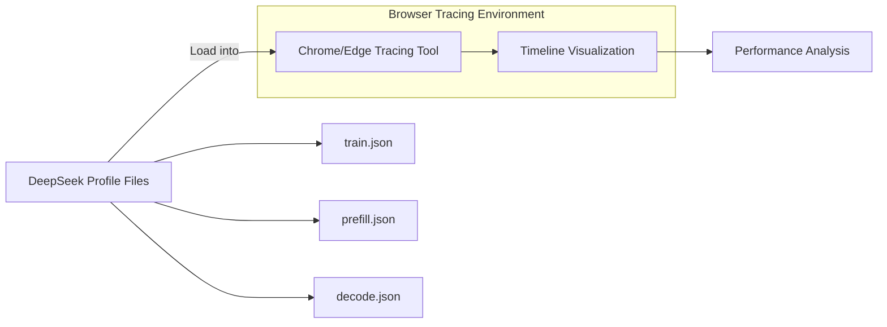
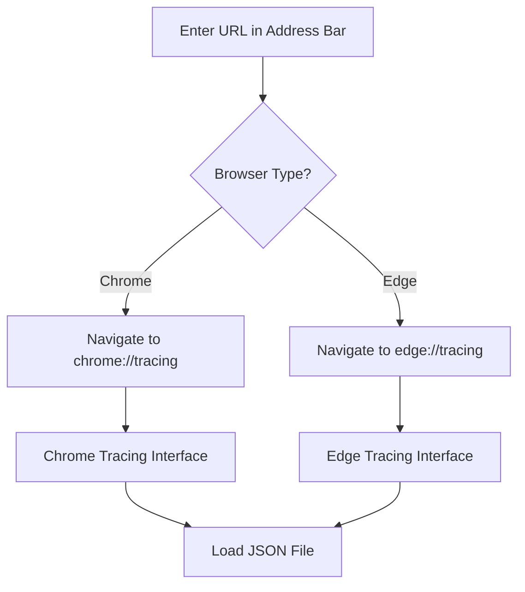
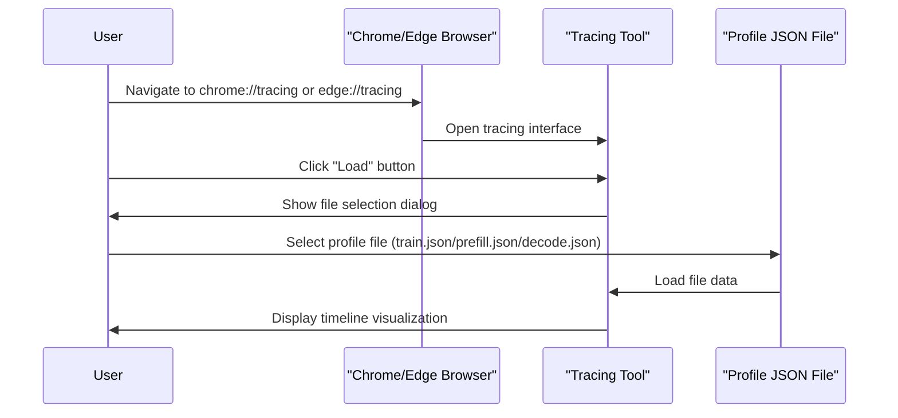
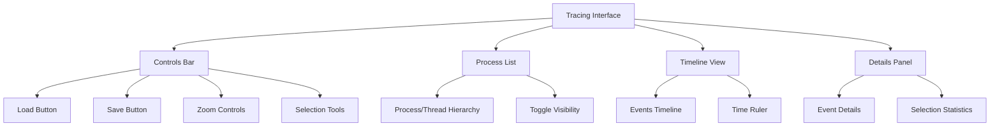
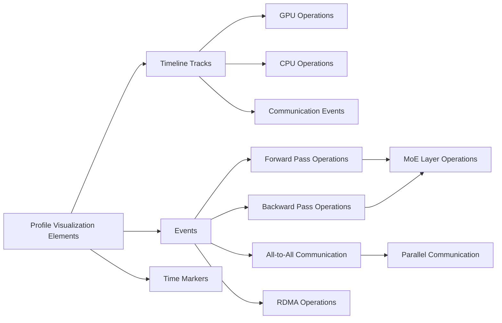

<!-- source: DeepWiki mcp.deepwiki.com · repo deepseek-ai/profile-data · page 5.1 Using Chrome/Edge Tracing Tools · fetched 2026-10-30 -->

# Using Chrome/Edge Tracing Tools

<details>
<summary>Relevant source files</summary>

The following files were used as context for generating this wiki page:

- [README.md](README.md)

</details>


This page provides instructions on how to load and visualize the DeepSeek profiling data JSON files using browser-based tracing tools. For information on interpreting the actual profiling data once visualized, see [Interpreting the Profiling Data](#5.2).

## Overview of Browser Tracing Tools

Chrome and Edge browsers include powerful built-in tracing tools originally developed for analyzing browser performance that can also visualize custom profiling data such as the PyTorch Profiler outputs included in this repository.



Sources: [README.md:3-3]()

## Prerequisites

Before you begin, ensure you have:

1. Downloaded the profile data files from the repository:
   - `train.json` - Training profiling data
   - `prefill.json` - Inference prefilling stage data
   - `decode.json` - Inference decoding stage data
2. Google Chrome or Microsoft Edge browser (recent versions)

## Accessing the Tracing Tool

To access the tracing tool in your browser:

1. In Chrome: Enter `chrome://tracing` in the address bar
2. In Edge: Enter `edge://tracing` in the address bar

The tracing interface will open, displaying a mostly empty screen with controls at the top.



Sources: [README.md:3-3]()

## Loading Profiling Data

To load and visualize the profiling data:

1. Open the tracing tool as described above
2. Click the "Load" button in the top-left corner
3. Navigate to where you saved the profile data files
4. Select one of the profile JSON files (e.g., `train.json`)
5. Click "Open" to load the file

The profiling data will be loaded and displayed as a timeline visualization.



Sources: [README.md:3-3](), [README.md:7-7](), [README.md:18-18](), [README.md:26-26]()

## Navigating the Tracing Interface

The Chrome/Edge tracing interface consists of several key components:



### Key Interface Elements:

1. **Controls Bar** - Contains buttons for loading/saving traces and navigation
2. **Process List** - Shows hierarchical view of processes and threads
3. **Timeline View** - Visual representation of events over time
4. **Details Panel** - Shows information about selected events

Sources: [README.md:9-9](), [README.md:20-20](), [README.md:28-28]()

## Understanding DeepSeek Profile Visualizations

The profiling data is displayed as horizontal bars representing different operations, color-coded by type. Each bar shows:

1. The operation type (e.g., computation, communication)
2. The duration of the operation
3. The process/thread it ran on



### Key Visualization Elements in DeepSeek Profiles:

#### Training Profile (`train.json`)
- Forward and backward chunks containing MoE layers
- Overlapping computation patterns between chunks
- Expert parallelism (EP64) communication patterns

#### Prefilling Profile (`prefill.json`)
- Micro-batch processing patterns
- All-to-all communication overlapping with computation
- Attention computation load balancing

#### Decoding Profile (`decode.json`)
- Micro-batch processing in decoding stage
- RDMA operations and all-to-all communication
- SM utilization patterns during computation-communication overlap

Sources: [README.md:8-12](), [README.md:19-22](), [README.md:27-30]()

## Using Tracing Tool Features for Analysis

### Zooming and Navigation

1. **Mouse Wheel** - Zoom in/out at cursor position
2. **Click and Drag** - Pan the timeline left/right
3. **Shift + Click and Drag** - Select a time range for detailed analysis

### Selection and Measurement

1. To measure duration between events:
   - Hold Shift and select the region of interest
   - The duration will be displayed in the details panel

2. To analyze specific operations:
   - Click directly on an event bar
   - Details about that operation will appear in the details panel

```mermaid
sequenceDiagram
    participant User
    participant Timeline as "Timeline View"
    participant Details as "Details Panel"
    
    User->>Timeline: Click on specific event
    Timeline->>Details: Display event information
    Note over Details: Operation name, duration, start/end times
    
    User->>Timeline: Shift+Click and drag to select region
    Timeline->>Details: Display region statistics
    Note over Details: Total duration, number of events in selection
```

Sources: [README.md:9-9](), [README.md:20-20](), [README.md:28-28]()

## Advanced Analysis Techniques

### Identifying Bottlenecks

1. Look for gaps in execution where no computation is occurring
2. Identify long-running operations that may be candidates for optimization
3. Examine communication-computation overlap patterns to verify effectiveness

### Analyzing Parallel Execution

The DeepSeek profiles specifically demonstrate:

1. **Training**: Overlapping forward and backward chunks in DualPipe
2. **Prefilling**: Computation-communication overlap with micro-batches
3. **Decoding**: RDMA-based all-to-all communication overlapping with computation

```mermaid
gantt
    title "Expected Patterns in DeepSeek Profiling Data"
    dateFormat s
    axisFormat %S
    
    section "Training (train.json)"
    "Forward Chunk 1"       :a1, 0, 2
    "Backward Chunk 1"      :a2, after a1, 2
    "Forward Chunk 2"       :a3, after a1, 2
    "Backward Chunk 2"      :a4, after a3, 2
    
    section "Prefilling (prefill.json)"
    "Micro-batch 1"       :b1, 0, 2
    "All-to-All Comm 1"   :b2, after b1, 2
    "Micro-batch 2"       :b3, after b1, 2
    "All-to-All Comm 2"   :b4, after b3, 2
    
    section "Decoding (decode.json)"
    "Micro-batch 1"       :c1, 0, 2
    "RDMA Issue 1"        :milestone, c2, after c1, 0
    "All-to-All Comm 1"   :c3, after c2, 2
    "Micro-batch 2"       :c4, after c1, 2
    "RDMA Issue 2"        :milestone, c5, after c4, 0
    "All-to-All Comm 2"   :c6, after c5, 2
```



Sources: [README.md:11-12](), [README.md:22-22](), [README.md:30-30]()

## Comparing Different Profile Files

Loading and comparing the different profile files can provide insights into how the system behaves during different phases:

1. **Training (`train.json`)**: 
   - Focus on forward and backward pass chunking
   - EP64, TP1 with 4K sequence length

2. **Prefilling (`prefill.json`)**:
   - EP32, TP1 with 4K prompt length
   - 16K tokens per GPU
   - Micro-batch balancing strategy

3. **Decoding (`decode.json`)**:
   - EP128, TP1 with 4K prompt length
   - 128 requests per GPU
   - RDMA-based all-to-all communication

You can also save screenshots of different profile views for side-by-side comparison using the "Save" button in the interface.

Sources: [README.md:11-12](), [README.md:21-22](), [README.md:29-30]()

## Troubleshooting

### Common Issues

1. **File too large to load**: Chrome/Edge may struggle with very large trace files
   - Solution: Filter the profile data to focus on specific time regions

2. **Browser becomes unresponsive**: 
   - Solution: Close other tabs and applications to free up memory

3. **Events appear misaligned or out of order**:
   - Solution: Check the system clock synchronization of the machine where profiling was performed

## Summary

Chrome and Edge tracing tools provide a powerful way to visualize and analyze the DeepSeek profiling data. By loading the provided JSON files, you can examine in detail how the framework implements communication-computation overlap strategies across different processing stages. The visual timeline representation makes it easier to identify patterns, bottlenecks, and optimization opportunities.

For more information on how to interpret the specific patterns and events in the profiling data, please see [Interpreting the Profiling Data](#5.2).

Sources: [README.md:3-3]()

---

