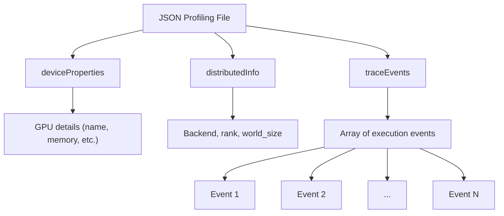
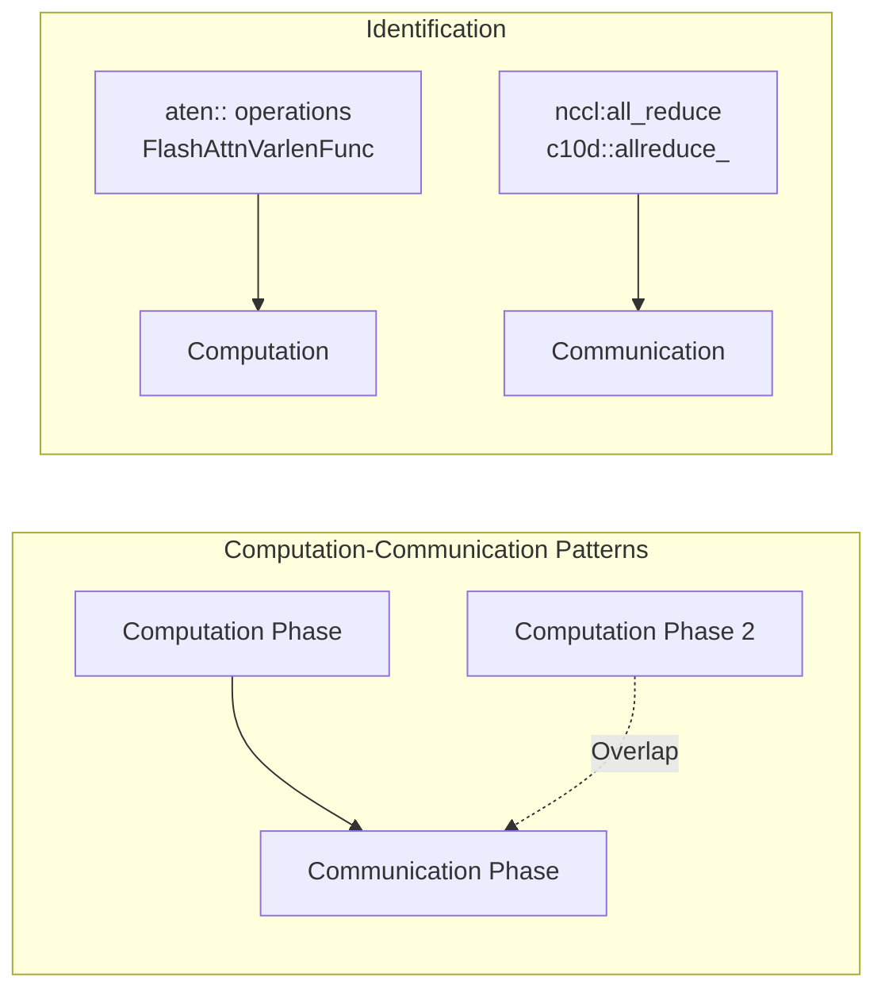
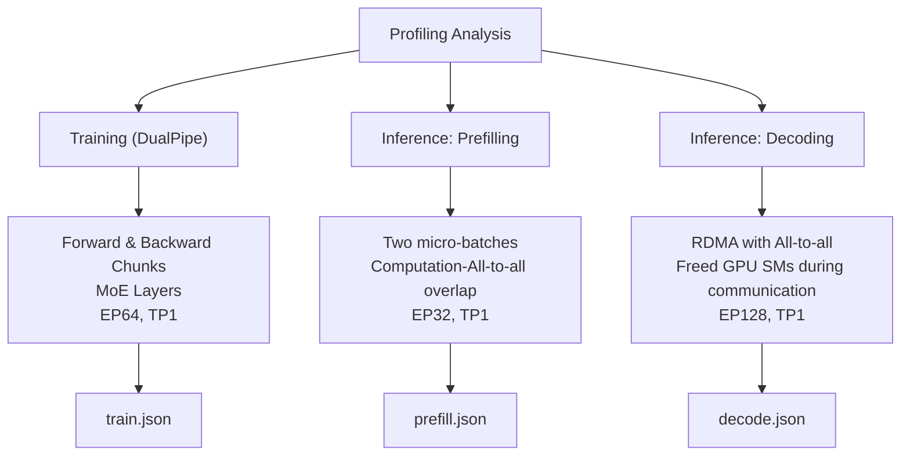
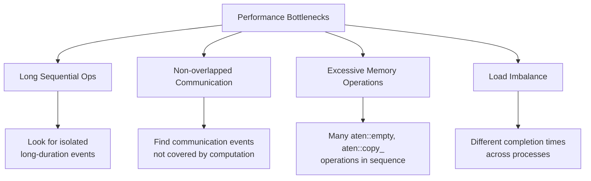
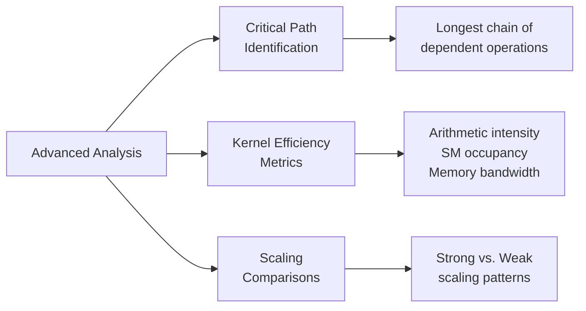
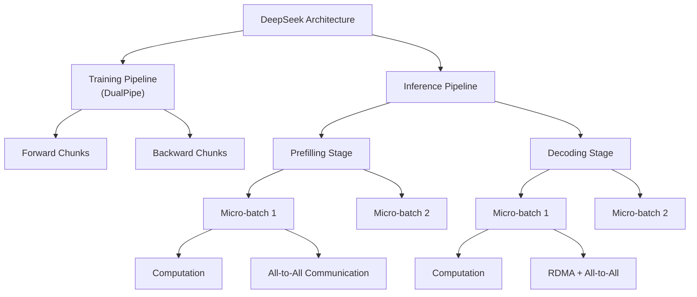

<!-- source: DeepWiki mcp.deepwiki.com · repo deepseek-ai/profile-data · page 5.2 Interpreting the Profiling Data · fetched 2026-10-30 -->

# Interpreting the Profiling Data

<details>
<summary>Relevant source files</summary>

The following files were used as context for generating this wiki page:

- [README.md](README.md)
- [prefill.json](prefill.json)
- [train.json](train.json)

</details>


This document provides a comprehensive guide to understanding and analyzing the profiling data provided in the DeepSeek repository. It explains how to extract meaningful insights from the JSON trace files for performance analysis of training and inference processes. For instructions on loading the JSON files into tracing tools, see [Using Chrome/Edge Tracing Tools](#5.1).

## Understanding Profiling Data Structure

The profiling data in this repository is captured using PyTorch Profiler and stored in JSON files (train.json, prefill.json, decode.json). Each file contains a structured representation of execution events with precise timing information.

### JSON File Structure

A profiling JSON file consists of three main sections:



Sources: [README.md:1-31](), [prefill.json:1-50]()

### Trace Event Structure

Each trace event in the JSON files contains the following key properties:

| Field | Description |
|-------|-------------|
| ph | Phase type (typically "X" for complete events) |
| cat | Category (e.g., "cpu_op", "user_annotation") |
| name | Operation name (e.g., "aten::empty", "nccl:all_reduce") |
| pid | Process ID |
| tid | Thread ID |
| ts | Timestamp (microseconds) |
| dur | Duration (microseconds) |
| args | Additional arguments including External ID, Event Index |

Example trace event:

```
{
  "ph": "X", "cat": "user_annotation", "name": "nccl:all_reduce",
  "pid": 1097, "tid": 1097, "ts": 1740462778110627, "dur": 155,
  "args": {
    "External id": 11, "Ev Idx": 10
  }
}
```

Sources: [prefill.json:86-92]()

## Timeline Visualization and Reading

When loaded into Chrome/Edge tracing tools, the profiling data is displayed as a timeline visualization where horizontal bars represent events over time.

```mermaid
gantt
    title "Timeline Visualization of Profiling Events"
    dateFormat X
    axisFormat %s
    
    section "CPU Operations"
    "aten::empty" :a1, 0, 15x
    "aten::to" :a2, after a1, 598x
    "aten::_to_copy" :a3, after a2, 90x
    
    section "Communication"
    "nccl:all_reduce" :b1, 110627, 155x
    
    section "GPU Kernels"
    "FlashAttnVarlenFunc" :c1, 139662, 82x
```



Sources: [prefill.json:16-29](), [prefill.json:87-91](), [prefill.json:1746-1751]()

### Identifying Operation Types

The profiling data contains different types of operations that can be identified by their naming patterns:

1. **PyTorch Operations**: Prefixed with `aten::` (e.g., `aten::empty`, `aten::copy_`)
2. **Communication Operations**: Usually annotated as `nccl:all_reduce`, `c10d::allreduce_`
3. **Custom CUDA Kernels**: Special functions like `FlashAttnVarlenFunc`
4. **User Annotations**: Custom markers added by the developers

Sources: [prefill.json:16-29](), [prefill.json:87-91](), [prefill.json:1746-1751]()

## Analyzing Computation-Communication Overlap

One of the key insights to extract from the profiling data is how computation and communication operations overlap, which is critical for performance in distributed training and inference.



### Identifying Computation Phases

Computation phases typically include:
- Tensor operations (`aten::empty`, `aten::copy_`, etc.)
- Custom CUDA kernels like `FlashAttnVarlenFunc`
- Matrix operations and neural network layers

### Identifying Communication Phases

Communication events are recognizable by:
- `nccl:all_reduce` annotations
- `c10d::allreduce_` operations
- Events with relatively long durations that don't utilize GPU compute resources

Sources: [README.md:15-30](), [prefill.json:87-91]()

## Analyzing Different Execution Models

The DeepSeek profiling data includes three distinct execution models, each with unique characteristics to observe in the profiles.



### Training Profile (DualPipe)

In the training profile (train.json), look for:
- Alternating forward and backward computation chunks
- Each chunk containing 4 MoE layers
- EP64, TP1 parallel configuration patterns
- Overlapping execution of chunks

### Prefilling Profile

In the prefilling profile (prefill.json), observe:
- Two micro-batches used to overlap computation and communication
- EP32, TP1 parallel configuration
- Attention computation balanced across micro-batches
- All-to-all communication patterns

### Decoding Profile

In the decoding profile (decode.json), identify:
- Two micro-batches similar to prefilling
- EP128, TP1 parallel configuration
- RDMA message issuance followed by all-to-all communication
- GPU SMs being freed during communication

Sources: [README.md:5-30]()

## Measuring Performance Metrics

The profiling data allows extraction of various performance metrics to evaluate system efficiency.

### Timing Analysis

Calculating operation durations:
- Individual operation time: Use the `dur` field in each event
- Total execution time: Calculate the span from the first to the last event
- Ratio of computation vs. communication time

### Overlap Efficiency

To measure how effectively computation and communication overlap:
1. Identify periods where both computation and communication occur simultaneously
2. Calculate the percentage of communication that is effectively hidden by computation
3. Look for gaps where processors are idle

```mermaid
gantt
    title "Analyzing Computation-Communication Overlap"
    dateFormat X
    axisFormat %s
    
    section "Compute"
    "Computation 1"       :a1, 0, 100x
    "Computation 2"       :a2, 150, 100x
    
    section "Communication"
    "Communication 1"     :b1, 80, 90x
    
    section "Analysis"
    "Effective Overlap"   :c1, 80, 20x
    "Potential Idle Time" :c2, 100, 50x
```



Sources: [README.md:15-30]()

## Common Bottlenecks and Patterns

When analyzing the profiling data, look for these common patterns that indicate performance issues:

### Long Sequential Operations

Sequential operations with no parallelism appear as lone bars with significant duration and no overlapping activities.

### Communication Bottlenecks

Look for extended communication operations (like `nccl:all_reduce`) that are not overlapped with computation, indicating potential areas for optimization.

### Memory Operations

Frequent and time-consuming memory operations (`aten::empty`, `aten::copy_`) can indicate memory management issues.

### Load Imbalance

In distributed execution, look for processors finishing at different times, indicating uneven work distribution.



Sources: [prefill.json:1-250]()

## Expert Parallelism (EP) Analysis

The DeepSeek profiles showcase different Expert Parallelism configurations (EP32, EP64, EP128), which can be analyzed in the profiling data.

### Identifying EP-related Operations

Look for these patterns in the profiles to understand EP behavior:
- All-to-all communication patterns (`nccl:all_reduce`)
- MoE (Mixture of Experts) routing operations
- Load balancing between experts

### EP Configuration Impacts

Compare the profiles to understand how different EP configurations affect performance:
- EP32 (Prefilling): Optimized for processing longer sequences
- EP64 (Training): Balanced for training workloads
- EP128 (Decoding): Optimized for serving multiple smaller requests

Sources: [README.md:10-30]()

## Case Studies

Here are brief analyses of each profile type to help you get started with your own interpretations.

### Training Profile Analysis

In the training profile:
1. Identify forward and backward computation chunks for MoE layers
2. Observe how DualPipe enables overlap between chunks
3. Look for synchronization points that might limit parallelism
4. Measure the efficiency of the overlap between chunks

### Prefilling Analysis

In the prefilling profile:
1. Identify the two micro-batches and how they're scheduled
2. Observe the all-to-all communication patterns
3. Measure how effectively computation and communication overlap
4. Look for attention computation balanced across micro-batches

### Decoding Analysis

In the decoding profile:
1. Observe how RDMA messages are issued
2. Identify when GPU SMs are freed during communication
3. Measure the time taken for all-to-all communication completion
4. Analyze the efficiency of serving multiple requests (128 per GPU)

## Advanced Analysis Techniques

For deeper analysis of the profiling data, consider these advanced techniques:

### Critical Path Analysis

Identify the longest chain of dependent operations that determines the overall execution time.

### Kernel Efficiency Analysis

For GPU operations like `FlashAttnVarlenFunc`, calculate utilization metrics:
- Arithmetic intensity
- Memory bandwidth utilization
- SM occupancy

### Scaling Analysis

Compare profiles across different parallel configurations to understand scaling efficiency:
- Strong scaling: Same problem size, more resources
- Weak scaling: Larger problem size with proportional resource increase



Sources: [README.md:1-31](), [prefill.json:1-250]()

## Correlation with System Architecture

To fully interpret the profiling data, correlate it with the DeepSeek system architecture.



Understanding this architecture helps you identify the corresponding components in the profiling data and assess how well the implementation matches the design goals.

Sources: [README.md:5-30]()

For more detailed insights on how to apply the findings from your profiling analysis to improve system performance, see [Performance Optimization Insights](#5.3).

---

