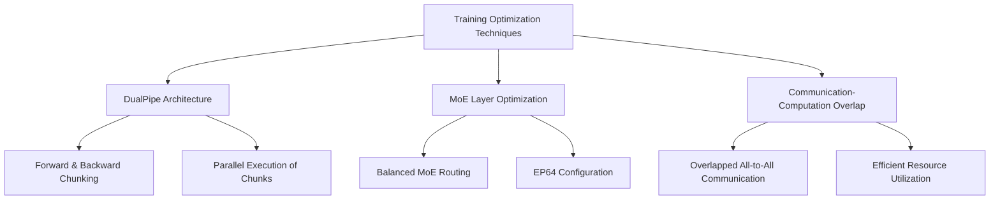
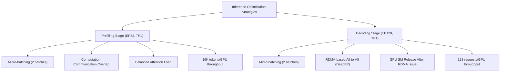
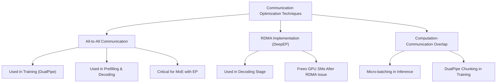
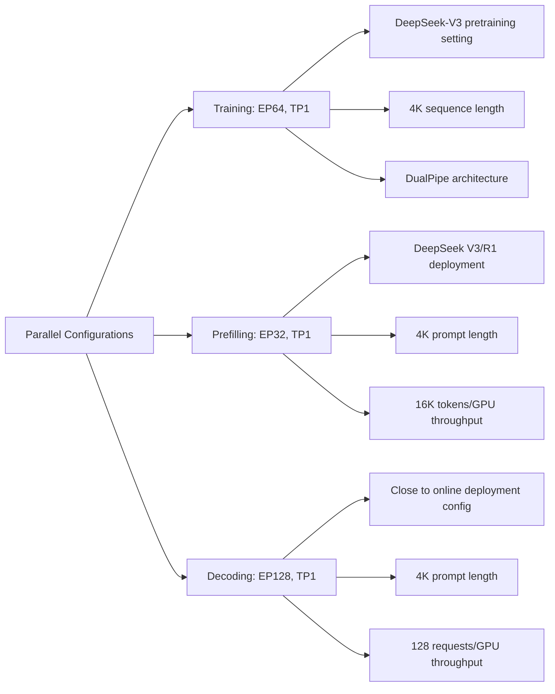
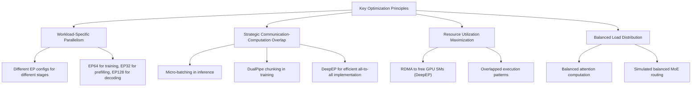

<!-- source: DeepWiki mcp.deepwiki.com · repo deepseek-ai/profile-data · page 5.3 Performance Optimization Insights · fetched 2026-10-30 -->

# Performance Optimization Insights

Relevant source files

The following files were used as context for generating this wiki page:

- [README.md](README.md)

This document presents key performance optimization insights derived from the profiling data in the DeepSeek framework. It analyzes optimization techniques for both training and inference, examining communication-computation overlap strategies and parallel configuration impacts. For details on viewing and analyzing the profiling data, see [Using Chrome/Edge Tracing Tools](#5.1) and [Interpreting the Profiling Data](#5.2).

## 1. Training Optimization Insights

Sources: [README.md:5-12]()

### 1.1 DualPipe Architecture Performance

The training data demonstrates how the DualPipe architecture effectively overlaps computation and communication. Key observations:

- Forward and backward passes are organized in chunks, each containing 4 MoE layers
- The EP64, TP1 configuration (matching DeepSeek-V3 pretraining) enables efficient parallelism
- Chunking strategy leads to better GPU utilization across different computation stages

```mermaid
gantt
    title "DualPipe Execution Timeline (EP64, TP1)"
    dateFormat s
    axisFormat %S
    
    section "Chunk 1 (4 MoE Layers)"
    "Forward Pass"       :a1, 0, 2s
    "Backward Pass"      :a2, after a1, 2s
    
    section "Chunk 2 (4 MoE Layers)"
    "Forward Pass"       :b1, after a1, 2s
    "Backward Pass"      :b2, after b1, 2s
    
    section "Communication"
    "All-to-All (Chunk 1)"    :c1, after a1, 1s
    "All-to-All (Chunk 2)"    :c2, after b1, 1s
```

Sources: [README.md:11-12]()

## 2. Inference Optimization Insights

The inference profiling data reveals distinct optimization techniques for prefilling and decoding stages.

Sources: [README.md:14-30]()

### 2.1 Prefilling Stage Performance

The prefilling stage employs EP32 and TP1 with 4K prompt length, processing 16K tokens per GPU. Key performance insights:

- Two micro-batches effectively overlap computation and all-to-all communication
- Attention computation load is balanced across micro-batches, even splitting the same prompt if necessary
- EP32 configuration offers optimal balance between parallelism and communication overhead for prefilling

```mermaid
gantt
    title "Prefilling Execution Timeline (EP32, TP1)"
    dateFormat s
    axisFormat %S
    
    section "Micro-batch 1"
    "Computation"       :a1, 0, 2s
    "All-to-All"        :a2, after a1, 1s
    
    section "Micro-batch 2"
    "Computation"       :b1, after a1, 2s
    "All-to-All"        :b2, after b1, 1s
```

Sources: [README.md:17-22]()

### 2.2 Decoding Stage Performance

The decoding stage uses EP128 and TP1 with 4K prompt length, handling 128 requests per GPU. Key optimization insights:

- Similar to prefilling, uses two micro-batches for overlapping computation and communication
- Distinctive RDMA-based all-to-all communication implementation (via DeepEP)
- GPU SMs are freed immediately after RDMA messages are issued
- System waits for all-to-all completion only after computation has finished
- Higher expert parallelism (EP128) offers better performance for decoding workloads

```mermaid
gantt
    title "Decoding Execution Timeline (EP128, TP1)"
    dateFormat s
    axisFormat %S
    
    section "Micro-batch 1"
    "Computation"          :a1, 0, 2s
    "RDMA Issue (DeepEP)"  :milestone, a2, after a1, 0s
    "Wait for All-to-All"  :a3, after a2, 1s
    
    section "Micro-batch 2"
    "Computation"          :b1, after a1, 2s
    "RDMA Issue (DeepEP)"  :milestone, b2, after b1, 0s
    "Wait for All-to-All"  :b3, after b2, 1s
    
    section "GPU SMs"
    "Available"            :c1, after a2, 3s
```

Sources: [README.md:25-30]()

## 3. Communication Optimization Techniques

Sources: [README.md:11-12](), [README.md:22](), [README.md:30]()

Key communication optimization insights:

1. **RDMA-based All-to-All Communication**: The decoding stage implementation (DeepEP) issues communication without occupying GPU SMs.

2. **Balanced Load Distribution**: The simulated balanced MoE routing strategy prevents communication bottlenecks.

3. **Micro-batch Strategy**: Both prefilling and decoding stages use two micro-batches to overlap computation with communication.

4. **DualPipe Chunking**: The training process divides the model into chunks, enabling efficient communication-computation overlap.

## 4. Parallel Configuration Impact

Sources: [README.md:12](), [README.md:22](), [README.md:28]()

### 4.1 Expert Parallelism Configuration Analysis

The profiling data shows distinct EP configurations optimized for different workloads:

| Stage | EP Config | Characteristics | Benefits |
|-------|-----------|-----------------|----------|
| Training | EP64 | 4K sequence length | Balanced parallelism with efficient communication for training |
| Prefilling | EP32 | 16K tokens/GPU | Lower communication overhead for processing long prompts |
| Decoding | EP128 | 128 requests/GPU | Higher parallelism for handling many concurrent requests |

Each configuration is tailored to the specific computational and communication patterns of the workload. The absence of Tensor Parallelism > 1 and Pipeline Parallelism in the profiling data allows for clearer analysis of the Expert Parallelism impact.

Sources: [README.md:12](), [README.md:22](), [README.md:28]()

## 5. Key Performance Optimization Principles

Sources: [README.md:3](), [README.md:11-12](), [README.md:22](), [README.md:30]()

Based on the profiling data, several critical optimization principles emerge:

1. **Tailor parallelism to workload characteristics**: 
   - EP64 for training balances parallelism with communication overhead
   - EP32 for prefilling reduces communication bottlenecks
   - EP128 for decoding maximizes throughput for many concurrent requests

2. **Leverage micro-batching strategically**: 
   - Two micro-batches consistently deliver performance benefits across stages
   - Different batching strategies for prefilling vs. decoding

3. **Optimize communication patterns**: 
   - RDMA-based communication in DeepEP
   - Strategic all-to-all optimizations significantly improve performance

4. **Balance computation loads**: 
   - Balanced attention computation across micro-batches
   - Simulated balanced MoE routing prevents expert bottlenecks

5. **Overlap communication and computation**:
   - DualPipe architecture for training
   - Micro-batching for inference
   - RDMA-based approach in decoding stage

These principles demonstrate how targeted optimizations in different stages of the ML pipeline can significantly enhance overall system performance and efficiency.

Sources: [README.md:3](), [README.md:11-30]()