# Page: Overview

# Overview

<details>
<summary>Relevant source files</summary>

The following files were used as context for generating this wiki page:

- [README.md](README.md)

</details>


This document provides an introduction to the DeepSeek profile data repository, which contains profiling data from DeepSeek's training and inference framework. The repository focuses on showcasing communication-computation overlap strategies and low-level implementation details that enable efficient large-scale AI model training and inference.

For detailed explanations about what profiling data is and why it's important, see [What is Profiling Data](#1.1). To learn more about the DeepSeek framework itself, see [DeepSeek Framework](#1.2).

## Purpose and Scope

The DeepSeek profile data repository serves several key purposes:

1. To demonstrate advanced techniques for overlapping communication and computation in large language model training and inference
2. To provide insight into the performance characteristics of different parallel configurations
3. To share performance optimization strategies used in production deployments
4. To help the community better understand low-level implementation details of efficient AI systems

The repository contains JSON-format profiling data captured using the PyTorch Profiler, which can be visualized using Chrome or Edge browser tracing tools.

Sources: [README.md:1-3]()

## Repository Structure

The repository contains three main JSON files representing different aspects of the DeepSeek system:

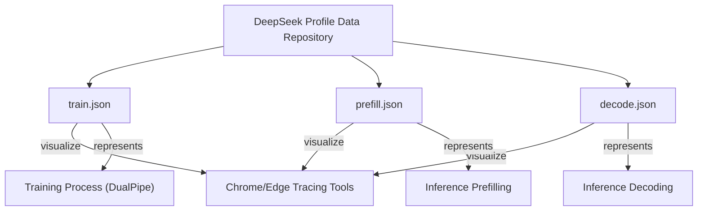

**Diagram: Repository Structure and Data Visualization Flow**

Sources: [README.md:5-30]()

## System Components Overview

The DeepSeek profiling data covers three main system components:

### 1. Training Process

The training profiling data (`train.json`) demonstrates the overlapping strategy implemented in DualPipe for forward and backward computations. Each processing chunk contains 4 MoE (Mixture of Experts) layers. For training, DeepSeek uses a parallel configuration of EP64 (Expert Parallelism with 64 partitions) and TP1 (Tensor Parallelism of 1) with a 4K sequence length.

For more details about the training process, see [Training Process](#2).

Sources: [README.md:5-12]()

### 2. Inference Prefilling

The prefilling profiling data (`prefill.json`) showcases the process of handling initial prompt tokens. It employs an EP32, TP1 configuration with a prompt length of 4K and processes 16K tokens per GPU. It uses two micro-batches to overlap computation with all-to-all communication.

For more details about the prefilling stage, see [Prefilling Stage](#3.1).

Sources: [README.md:16-22]()

### 3. Inference Decoding

The decoding profiling data (`decode.json`) represents the token generation process. It uses an EP128, TP1 configuration with a 4K prompt length and handles 128 requests per GPU. Like prefilling, it uses two micro-batches for overlapping computation and communication, but with a key difference: all-to-all communication during decoding doesn't occupy GPU SMs thanks to RDMA (Remote Direct Memory Access) implementation.

For more details about the decoding stage, see [Decoding Stage](#3.2).

Sources: [README.md:24-30]()

## Parallel Configurations

The profiling data demonstrates different parallel configurations optimized for specific workloads:

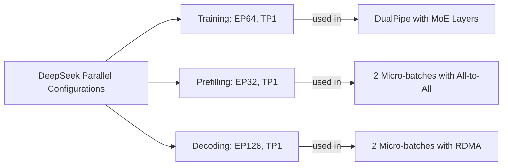

**Diagram: Parallel Configurations and Their Applications**

Sources: [README.md:5-30]()

## Communication-Computation Overlap Strategies

A key focus of the repository is demonstrating efficient strategies for overlapping communication and computation:

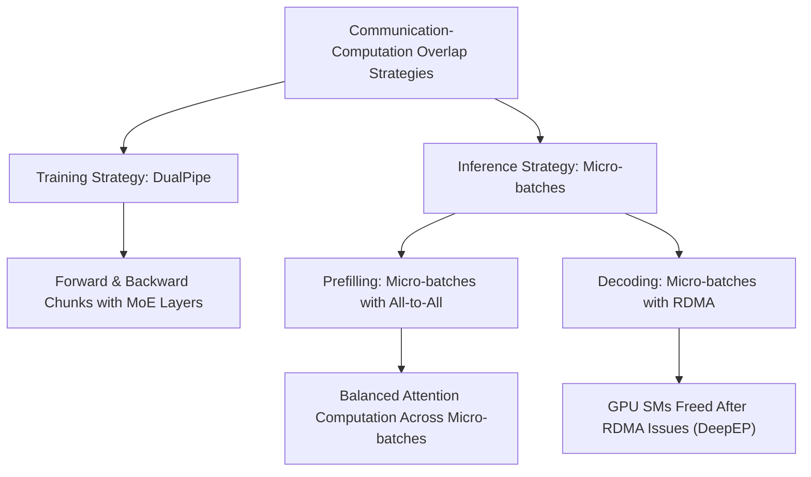

**Diagram: Communication-Computation Overlap Strategies**

Sources: [README.md:11-30]()

## Data Visualization

All profiling data in this repository can be visualized by:

1. Downloading the JSON files
2. Navigating to `chrome://tracing` in Chrome browser or `edge://tracing` in Edge browser
3. Loading the JSON files to analyze performance characteristics

For detailed guidance on visualization and analysis, see [Visualization and Analysis](#5).

Sources: [README.md:3]()

## DeepSeek System Architecture

The following diagram provides a high-level overview of the DeepSeek system components represented in the profiling data:

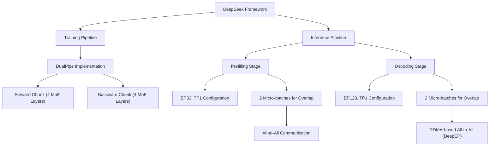

**Diagram: DeepSeek System Architecture Overview**

Sources: [README.md:5-30]()

For detailed information about specific components of the system, refer to the following pages:
- [Training Process](#2) for information about DualPipe and MoE layers
- [Inference Process](#3) for details about prefilling and decoding
- [Parallel Configurations](#4) for more on Expert Parallelism and Tensor Parallelism
- [Visualization and Analysis](#5) for guidance on using the profiling data

---

# Page: What is Profiling Data

# What is Profiling Data

<details>
<summary>Relevant source files</summary>

The following files were used as context for generating this wiki page:

- [README.md](README.md)

</details>


This document explains what profiling data is in the context of deep learning systems, why it's important, and how it's specifically utilized in the DeepSeek framework. For information about the DeepSeek framework itself, see [DeepSeek Framework](#1.2). For details on how to visualize and analyze the profiling data, see [Visualization and Analysis](#5).

## Definition and Purpose

Profiling data consists of detailed timing and resource usage information collected during the execution of a software system. In the context of deep learning frameworks like DeepSeek, profiling data captures fine-grained performance metrics about computational tasks, memory operations, and communication patterns.

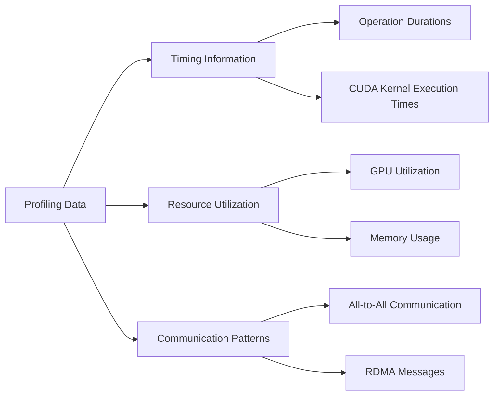

Sources: [README.md:1-3]()

## Purpose of Profiling Data

Profiling data serves several critical purposes in deep learning systems optimization:

| Purpose | Description |
|---------|-------------|
| Performance Analysis | Identifies bottlenecks and inefficiencies in model execution |
| Optimization Targeting | Directs optimization efforts to the most impactful areas |
| Communication-Computation Overlap | Helps design strategies to overlap communication with computation |
| Hardware Utilization | Reveals how effectively hardware resources are being used |
| System Scaling | Provides insights about scaling behavior across different configurations |

The DeepSeek profiling data specifically focuses on communication-computation overlap strategies, which are crucial for achieving high performance in distributed deep learning systems.

Sources: [README.md:3]()

## Types of Profiling Data in DeepSeek

The DeepSeek framework provides three main types of profiling data, each focusing on a different aspect of the system:

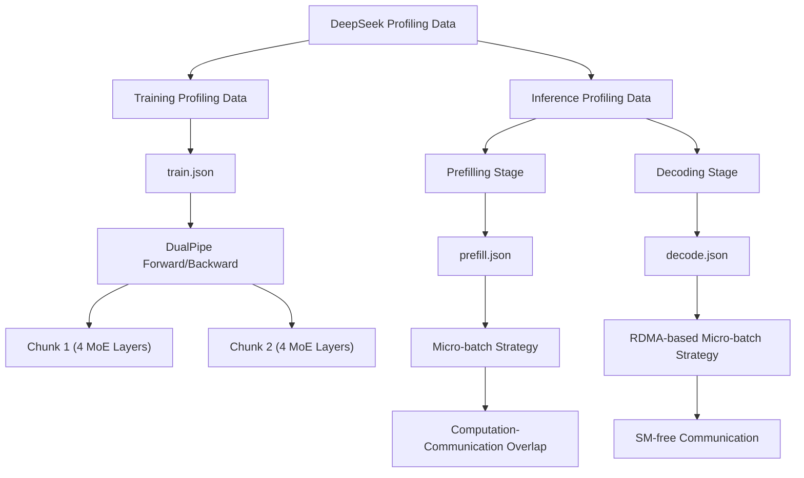

Sources: [README.md:5-30]()

### Training Profiling Data

The training profiling data (`train.json`) demonstrates the overlapping strategy employed in DualPipe, where forward and backward chunks are executed in a pattern that maximizes GPU utilization. Each chunk contains 4 MoE (Mixture of Experts) layers. The parallel configuration used for this profiling data is EP64 (Expert Parallelism with 64 partitions) and TP1 (Tensor Parallelism degree 1) with a 4K sequence length.

Sources: [README.md:5-12]()

### Inference Profiling Data

Inference profiling data is divided into two stages:

1. **Prefilling Stage** (`prefill.json`): This captures the initial processing of input prompts. The configuration uses EP32, TP1, with a prompt length of 4K and processes 16K tokens per GPU. The system uses two micro-batches to overlap computation and all-to-all communication.

2. **Decoding Stage** (`decode.json`): This captures the token generation process. The configuration uses EP128, TP1, with a prompt length of 4K and handles 128 requests per GPU. Similar to prefilling, decoding also uses two micro-batches for overlapping computation and communication, but implements a more sophisticated RDMA-based approach where communication doesn't occupy GPU streaming multiprocessors (SMs).

Sources: [README.md:14-30]()

## Collection and Format of Profiling Data

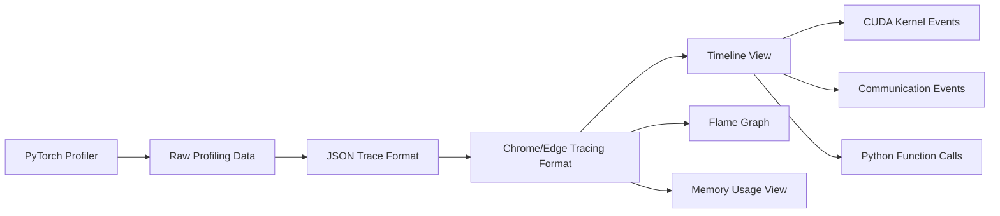

The profiling data in this repository was collected using the PyTorch Profiler, which captures detailed timing information of operations running on both CPU and GPU. The data is stored in JSON format compatible with the Chrome/Edge tracing tools. This format provides a comprehensive timeline view of all operations, allowing for detailed analysis of execution patterns.

In the DeepSeek profiling data, the system simulates a perfectly balanced MoE routing strategy for consistent profiling results. This means that the workload is distributed evenly across expert modules, which may not fully represent real-world scenarios where routing can be more dynamic and imbalanced.

Sources: [README.md:3]()

## Key Performance Insights

The profiling data in this repository is particularly valuable for understanding several key performance aspects of large-scale deep learning systems:

1. **Communication-Computation Overlap**: The data shows how computation and communication operations can be effectively overlapped to maximize hardware utilization.

2. **Micro-batch Strategies**: Both prefilling and decoding stages utilize micro-batches to improve parallelism and efficiency.

3. **Expert Parallelism Scaling**: The different EP configurations (EP32, EP64, EP128) provide insights into how expert parallelism scales with increasing partitions.

4. **Memory Usage Patterns**: The profiling data reveals memory access patterns during different phases of execution.

5. **RDMA-based Communication**: The decoding stage demonstrates an advanced RDMA-based approach where GPU SMs can be freed during communication.

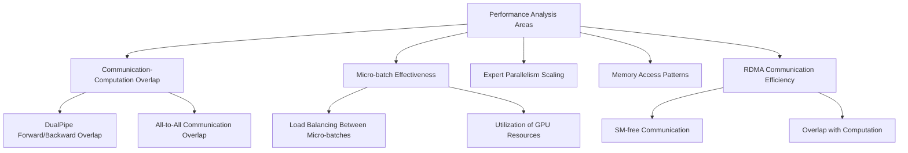

Sources: [README.md:3, README.md:11-12, README.md:22-23, README.md:29-30]()

## Relationship to System Components

Understanding profiling data requires contextual knowledge of the system components being profiled. In the DeepSeek framework, several key components appear in the profiling data:

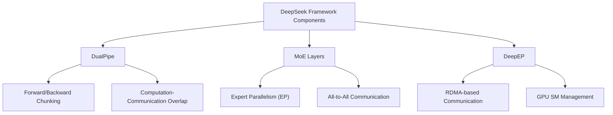

- **DualPipe**: A system for efficient training that divides the forward and backward passes into chunks to improve parallelism.
- **MoE Layers**: Mixture of Experts layers that use expert parallelism to scale model size.
- **DeepEP**: A system for efficient expert parallelism that uses RDMA-based communication.

Sources: [README.md:11, README.md:30]()

## Using Profiling Data for Optimization

The profiling data in this repository can be used to identify optimization opportunities for large-scale deep learning systems:

1. **Reducing Communication Overhead**: Analyzing the timing of all-to-all communication operations can reveal opportunities to optimize communication patterns.

2. **Balancing Compute Workloads**: Examining the execution time of different operations can help balance workloads across devices.

3. **Optimizing Memory Access**: Identifying memory access patterns can guide optimization of memory usage.

4. **Improving Scheduling**: Understanding the timing of different operations can inform better scheduling decisions.

5. **Enhancing Parallelism**: Analyzing dependencies between operations can reveal opportunities for increased parallelism.

The insights gained from profiling data analysis directly inform the design of key systems like DualPipe and DeepEP, which implement advanced strategies for efficient distributed training and inference.

Sources: [README.md:3, README.md:22-23, README.md:29-30]()

---

# Page: DeepSeek Framework

# DeepSeek Framework

<details>
<summary>Relevant source files</summary>

The following files were used as context for generating this wiki page:

- [README.md](README.md)

</details>


## Purpose and Scope

This document provides an overview of the DeepSeek Framework, the infrastructure that generates the profiling data in this repository. Understanding the architecture and components of this framework is essential for interpreting the profiling data effectively. For specific details about the profiling data itself, see [What is Profiling Data](#1.1), and for training process details, see [Training Process](#2).

## Framework Overview

The DeepSeek Framework is a high-performance distributed training and inference infrastructure designed for large language models. It features specialized components for efficient training and inference, with particular emphasis on communication-computation overlap strategies and scalability.

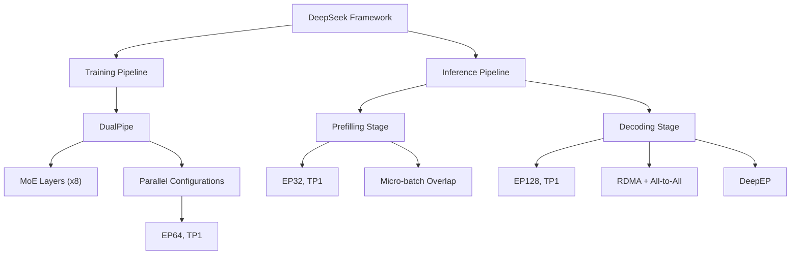

Sources: [README.md:5-30]()

## System Architecture

The framework consists of two primary pipelines: training and inference. Both pipelines are optimized for different workloads and utilize specialized parallelism strategies and communication patterns.

### Training Architecture

The training pipeline implements a DualPipe architecture that enables the overlapping of forward and backward passes for different chunks of the model. This approach significantly improves GPU utilization by reducing idle time.

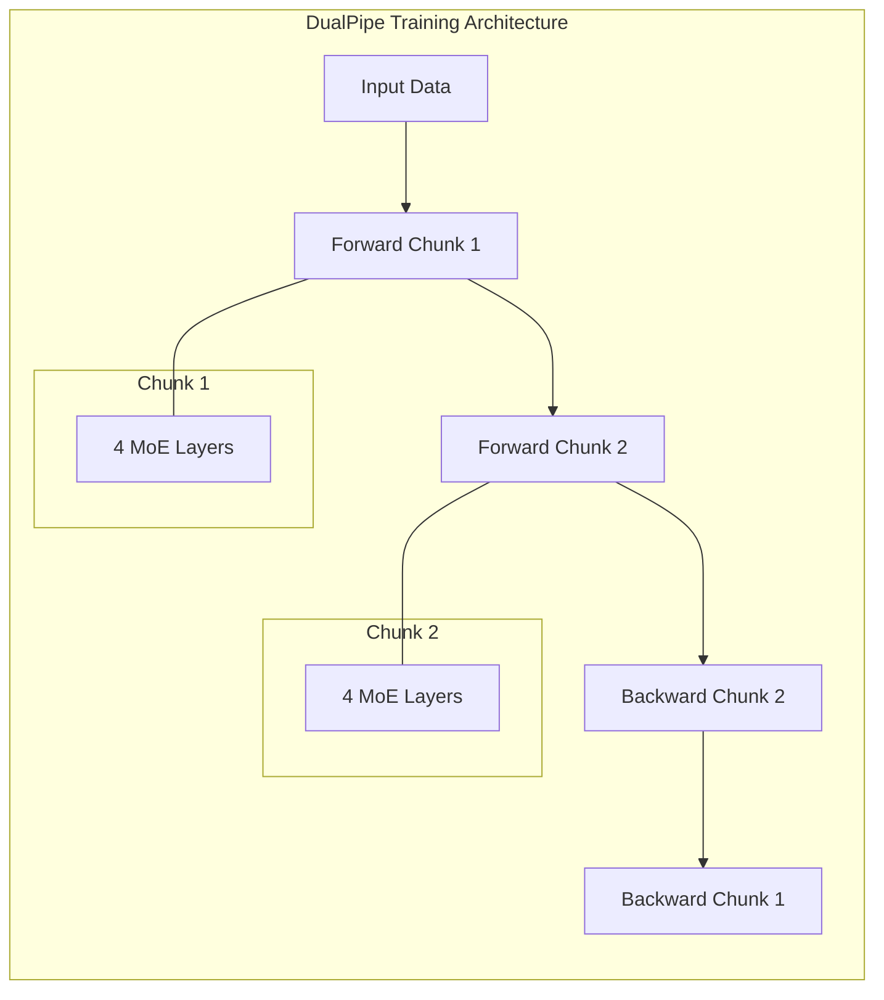

Sources: [README.md:5-12]()

### Inference Architecture

The inference pipeline is divided into two distinct stages: prefilling and decoding, each optimized for different workload characteristics.

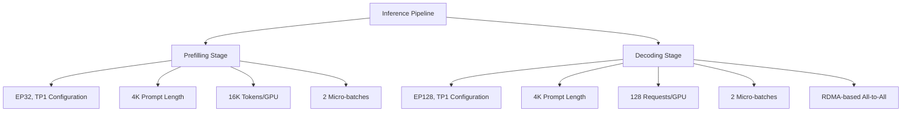

Sources: [README.md:14-30]()

## Parallel Configurations

The DeepSeek Framework employs various parallel configurations to efficiently scale model training and inference across GPU clusters.

### Expert Parallelism (EP)

Expert Parallelism is a key strategy used in the framework, with different configurations for different scenarios:

- **EP64**: Used in the training pipeline with DeepSeek-V3 pretraining settings
- **EP32**: Used in the prefilling stage of inference 
- **EP128**: Used in the decoding stage of inference

### Tensor Parallelism (TP)

The framework primarily uses TP1 (no tensor parallelism) in the profiled configurations, focusing instead on expert parallelism for scaling.

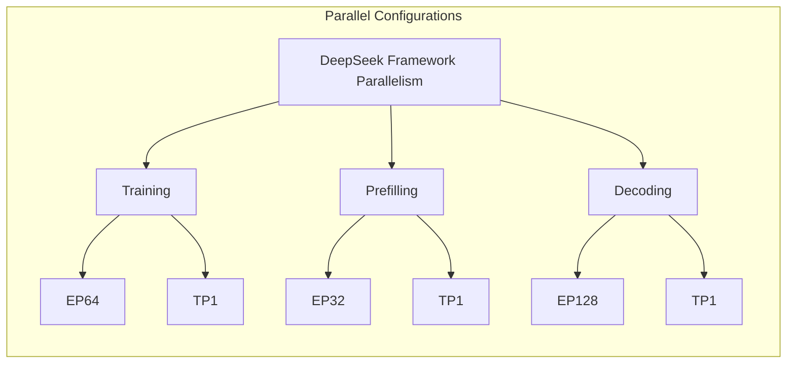

Sources: [README.md:12-22]()

## Communication-Computation Overlap

A key optimization in the DeepSeek Framework is the strategic overlap of computation and communication, implemented differently in training and inference stages.

### Training Overlap

In training, the DualPipe architecture overlaps forward and backward computation of different chunks, maximizing GPU utilization.

### Prefilling Overlap

The prefilling stage uses two micro-batches to overlap computation and all-to-all communication. Attention computation load is balanced across these micro-batches, and the same prompt may be split between them for better efficiency.

### Decoding Overlap

Like prefilling, decoding uses two micro-batches for overlapping computation and communication. However, it employs a specialized RDMA-based approach where:

1. After RDMA messages are issued, GPU SMs are freed
2. Computation proceeds on the freed resources
3. The system waits for all-to-all communication to complete after computation finishes

This approach maximizes GPU utilization during the communication-intensive decoding phase.

```mermaid
gantt
    title "Communication-Computation Overlap"
    dateFormat s
    axisFormat %S
    
    section "Training (DualPipe)"
    Forward Chunk 1       : 0, 2s
    Backward Chunk 1      : after Forward Chunk 1, 2s
    Forward Chunk 2       : after Forward Chunk 1 starts, 2s
    Backward Chunk 2      : after Forward Chunk 2, 2s
    
    section "Prefilling"
    Micro-batch 1       : 0, 2s
    All-to-All 1        : after Micro-batch 1, 1s
    Micro-batch 2       : after Micro-batch 1 starts, 2s
    All-to-All 2        : after Micro-batch 2, 1s
    
    section "Decoding"
    Micro-batch 1       : 0, 1s
    RDMA Issue 1        : milestone, after Micro-batch 1, 0s
    Micro-batch 2       : after RDMA Issue 1, 1s
    RDMA Issue 2        : milestone, after Micro-batch 2, 0s
    Wait for All-to-All : after RDMA Issue 2, 1s
```

Sources: [README.md:16-30]()

## Framework Integration with DeepEP

The DeepSeek Framework integrates with DeepEP, a specialized library for efficient all-to-all communication implementation. This integration is particularly important for the decoding phase where RDMA-based communication is used.

### DeepEP Integration

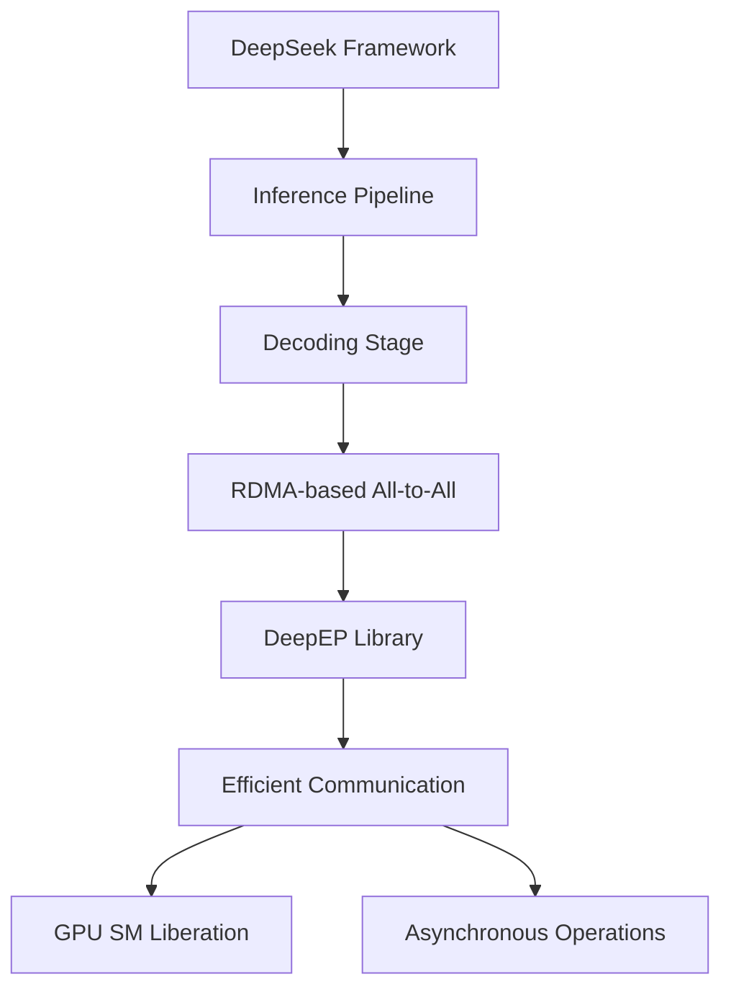

Sources: [README.md:26-30]()

## Summary of Key Components

| Component | Configuration | Application | Key Features |
|-----------|---------------|-------------|-------------|
| Training Pipeline | EP64, TP1 | Model Training | DualPipe architecture, 8 MoE layers (4 per chunk) |
| Prefilling Stage | EP32, TP1 | Inference | 4K prompt length, 16K tokens/GPU, 2 micro-batches |
| Decoding Stage | EP128, TP1 | Inference | 4K prompt length, 128 requests/GPU, RDMA-based communication |
| DualPipe | - | Training | Overlaps forward and backward passes for different chunks |
| DeepEP | - | Inference | Efficient all-to-all communication for decoding stage |

Sources: [README.md:5-30]()

The DeepSeek Framework represents a sophisticated system for training and serving large language models, with specialized components for different phases of the AI lifecycle. The profiling data in this repository provides insights into the performance characteristics and optimization strategies implemented in this framework.

---

# Page: Training Process

# Training Process

<details>
<summary>Relevant source files</summary>

The following files were used as context for generating this wiki page:

- [README.md](README.md)
- [assets/train.jpg](assets/train.jpg)
- [train.json](train.json)

</details>


This page documents the training process in the DeepSeek framework, focusing on the profiling data that demonstrates efficient training strategies. It details the parallel configuration, chunking methodology, and communication-computation overlap techniques employed during model training. For more detailed information about the DualPipe architecture, see [DualPipe Architecture](#2.1), and for specifics on MoE layers, see [MoE Layers](#2.2).

## Training Configuration Overview

The DeepSeek training profiling data showcases a high-performance parallel configuration designed for large language model training. The configuration parameters reflect those used in DeepSeek-V3 pretraining:

- **Expert Parallelism (EP)**: EP64 - distributes experts across 64 devices
- **Tensor Parallelism (TP)**: TP1 - no tensor parallelism employed
- **Sequence Length**: 4K tokens
- **Pipeline Parallelism (PP)**: Not included in profiling for simplicity

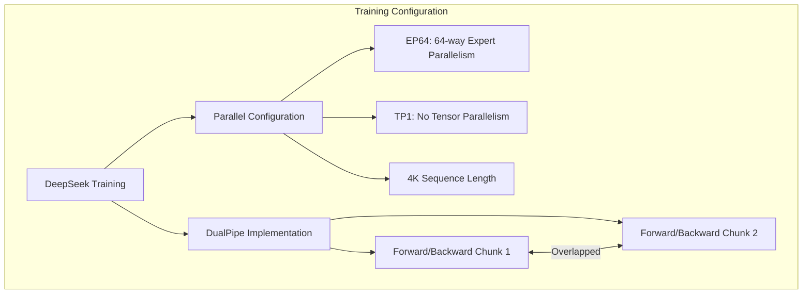

Sources: [README.md:11-12]()

## DualPipe Chunk Organization

The training process utilizes DualPipe for efficient execution of forward and backward passes. This architecture divides the model's MoE layers into chunks that can be processed with optimal computation-communication overlap.

Key characteristics of the chunking strategy:
- The model is divided into two chunks
- Each chunk contains 4 MoE (Mixture of Experts) layers
- Forward and backward passes of different chunks can be overlapped

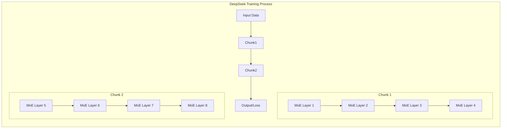

Sources: [README.md:11]()

## Computation-Communication Overlap Strategy

The profiling data demonstrates how forward and backward passes are executed with overlapping communication and computation. This strategy is key to the efficiency of the training process.

```mermaid
gantt
    title "DualPipe Training Execution Timeline"
    dateFormat s
    axisFormat %S
    
    section "Chunk 1"
    Forward Pass      :chunk1_fwd, 0, 2s
    All-to-All Comm   :chunk1_comm, after chunk1_fwd, 1s
    Backward Pass     :chunk1_bwd, after chunk1_comm, 2s
    
    section "Chunk 2"
    Forward Pass      :chunk2_fwd, after chunk1_fwd, 2s
    All-to-All Comm   :chunk2_comm, after chunk2_fwd, 1s
    Backward Pass     :chunk2_bwd, after chunk2_comm, 2s
    
    section "Overlap"
    Chunk 2 Forward   :overlap1, after chunk1_fwd, 2s
    Chunk 1 Backward  :overlap2, after chunk1_comm, 2s
```

The timeline shows how the execution of chunks is orchestrated to maximize device utilization:

1. The forward pass of Chunk 1 is executed first
2. While communication for Chunk 1 is in progress, the forward pass of Chunk 2 begins
3. The backward pass of Chunk 1 and Chunk 2 are similarly overlapped
4. All-to-all communication operations for expert parallelism are integrated into this schedule

Sources: [README.md:11]()

## Expert Parallelism Implementation

The training process employs a balanced MoE routing strategy for profiling purposes. This ensures that expert computation is distributed evenly across devices.

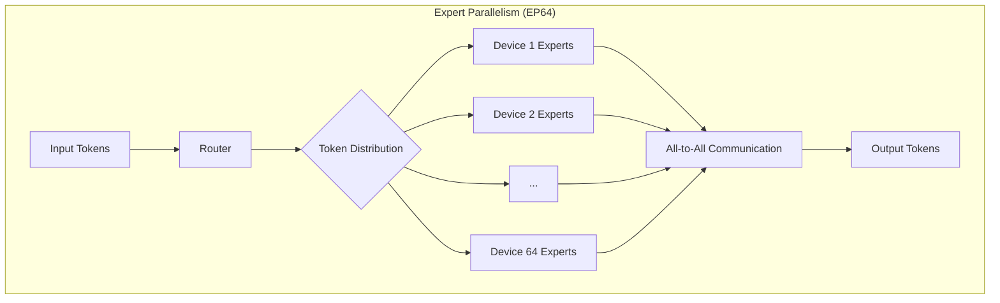

The diagram illustrates how tokens are routed to experts distributed across 64 devices (EP64 configuration). For profiling purposes, the system uses a balanced routing strategy to ensure consistent performance measurement.

Sources: [README.md:3](), [README.md:11-12]()

## Profiling Data Visualization

The training profiling data captures the execution timeline of the various components of the training process. When visualized in Chrome/Edge tracing tools, it provides insights into:

- Execution of forward and backward passes for each chunk
- Communication operations (particularly all-to-all for expert parallelism)
- Overlapping execution patterns
- Overall resource utilization


The profiling data can be visualized by loading the `train.json` file in Chrome or Edge browser's tracing tool, accessible at chrome://tracing or edge://tracing.

Sources: [README.md:3](), [README.md:7-9]()

## Relationship to Inference Process

While this page focuses on the training process, it's worth noting the key differences between training and inference in the DeepSeek framework:

| Aspect | Training | Prefilling (Inference) | Decoding (Inference) |
|--------|----------|------------------------|----------------------|
| Parallel Configuration | EP64, TP1 | EP32, TP1 | EP128, TP1 |
| Sequence Length | 4K | 4K | 4K |
| Batch Size | - | 16K tokens/GPU | 128 requests/GPU |
| Chunking Strategy | 2 chunks, 4 MoE layers each | 2 micro-batches | 2 micro-batches |
| Communication Approach | All-to-all | All-to-all | RDMA + All-to-all |

For more details on the inference process, see [Inference Process](#3).

Sources: [README.md:11-12](), [README.md:22-30]()

---

# Page: DualPipe Architecture

# DualPipe Architecture

<details>
<summary>Relevant source files</summary>

The following files were used as context for generating this wiki page:

- [README.md](README.md)
- [train.json](train.json)

</details>


## Purpose and Scope

This document details the DualPipe architecture, a specialized parallelization strategy used in the DeepSeek training framework to optimize the training of large language models. DualPipe focuses on overlapping forward and backward computation chunks to maximize GPU utilization and minimize idle time. This architecture is particularly effective for models with Mixture of Experts (MoE) layers. For information about MoE layers specifically, see [MoE Layers](#2.2).

Sources: [README.md:10-12]()

## Core Concepts

DualPipe is designed around a key principle: dividing the model into chunks and strategically scheduling the forward and backward passes to create computational overlap. This architecture specifically addresses the performance challenges in training large MoE-based language models.

The main characteristics of DualPipe include:

- Chunk-based model partitioning
- Strategic scheduling of forward and backward passes
- Optimized for MoE layer computation
- Designed for Expert Parallelism (EP) configurations

Sources: [README.md:10-12]()

## Architectural Overview

DualPipe divides the model into chunks, with each chunk containing multiple MoE layers. The training profile data in this repository demonstrates the implementation with 2 chunks, each containing 4 MoE layers.

```mermaid
flowchart TD
    subgraph "DualPipe Architecture"
        subgraph "Chunk 1"
            M1["MoE Layer 1"]
            M2["MoE Layer 2"]
            M3["MoE Layer 3"]
            M4["MoE Layer 4"]
            M1 --> M2 --> M3 --> M4
        end
        
        subgraph "Chunk 2"
            M5["MoE Layer 5"]
            M6["MoE Layer 6"]
            M7["MoE Layer 7"]
            M8["MoE Layer 8"]
            M5 --> M6 --> M7 --> M8
        end
        
        I["Input Data"] --> Chunk1
        Chunk1 --> Chunk2
        Chunk2 --> O["Output/Loss"]
    end
```

Sources: [README.md:11]()

## Computational Workflow

The key innovation in DualPipe is the strategic scheduling of forward and backward passes. Rather than waiting for the entire forward pass to complete before starting the backward pass, DualPipe begins backward computation on earlier chunks while later chunks are still performing forward computation.

```mermaid
gantt
    title DualPipe Computational Workflow
    dateFormat s
    axisFormat %S
    
    section Chunk 1
    Forward Pass      :c1f, 0, 2s
    Backward Pass     :c1b, after c1f, 2s
    
    section Chunk 2
    Forward Pass      :c2f, after c1f, 2s
    Backward Pass     :c2b, after c2f, 2s
    
    section Overlap
    Chunk 1 Backward + Chunk 2 Forward    :milestone, m1, after c1f, 0s
```

The diagram above illustrates how the backward pass of Chunk 1 overlaps with the forward pass of Chunk 2, maximizing GPU utilization and reducing training time.

Sources: [README.md:11]()

## Implementation Details

DualPipe is implemented within the DeepSeek training framework with the following configuration details:

- **Parallel Configuration**: EP64 (Expert Parallelism with 64 experts), TP1 (Tensor Parallelism dimension 1)
- **Sequence Length**: 4K tokens
- **Chunk Structure**: Each chunk contains 4 MoE layers
- **Overlap Strategy**: Backward computation of one chunk overlaps with forward computation of the next chunk

The implementation strategically schedules computational tasks to minimize idle GPU time, particularly during the communication-intensive operations required by MoE layers.

Sources: [README.md:11-12]()

## Data Flow in DualPipe

```mermaid
sequenceDiagram
    participant Input
    participant Chunk1 as "Chunk 1 (MoE Layers 1-4)"
    participant Chunk2 as "Chunk 2 (MoE Layers 5-8)"
    participant Output
    
    Input->>Chunk1: Forward Pass
    Chunk1->>Chunk2: Intermediate Activations
    Chunk2->>Output: Forward Pass Completed
    Output->>Chunk2: Gradients
    Chunk2->>Chunk1: Backward Pass
    Note over Chunk1,Chunk2: Chunk2 Forward overlaps with Chunk1 Backward
    Chunk1->>Input: Parameter Updates
```

This sequence diagram shows the flow of data through the DualPipe architecture, highlighting the parallel execution of forward and backward passes across different chunks.

Sources: [README.md:10-12]()

## Performance Characteristics

DualPipe is designed to optimize the training of large language models by addressing several key performance challenges:

| Challenge | DualPipe Solution |
|-----------|-------------------|
| GPU idle time | Overlapping forward and backward passes |
| Communication bottlenecks | Strategic scheduling around MoE all-to-all communications |
| Memory utilization | Chunk-based activation management |
| Training throughput | Increased computational efficiency through overlapping operations |

The training profile data provided in `train.json` demonstrates the effectiveness of this approach, showing how GPU resources are efficiently utilized through the overlapping strategy.

Sources: [README.md:7-12]()

## Integration with Expert Parallelism

DualPipe is specifically optimized for models using Expert Parallelism. In the provided profile data, DualPipe operates with EP64 configuration, meaning the model uses 64 experts distributed across GPUs.

```mermaid
flowchart LR
    subgraph "DualPipe with Expert Parallelism"
        subgraph "EP64 Configuration"
            subgraph "GPU 1"
                C1G1["Chunk 1 Experts"]
                C2G1["Chunk 2 Experts"]
            end
            
            subgraph "GPU N"
                C1GN["Chunk 1 Experts"]
                C2GN["Chunk 2 Experts"]
            end
            
            C1G1 <-->|"All-to-All"| C1GN
            C2G1 <-->|"All-to-All"| C2GN
        end
        
        F["Forward Pass"] --> C1G1 & C1GN
        C1G1 & C1GN --> C2G1 & C2GN
        C2G1 & C2GN --> B["Backward Pass"]
    end
```

The diagram illustrates how DualPipe works in conjunction with Expert Parallelism, where experts from each chunk are distributed across multiple GPUs with all-to-all communication for routing tokens to appropriate experts.

Sources: [README.md:11-12]()

## Comparison with Other Approaches

DualPipe's chunk-based overlapping strategy differentiates it from other parallelization approaches:

| Approach | Key Characteristics | Comparison to DualPipe |
|----------|---------------------|------------------------|
| Pipeline Parallelism | Divides model across GPUs, introduces pipeline bubbles | DualPipe reduces bubbles through overlapping execution |
| Tensor Parallelism | Splits individual operations across GPUs | DualPipe works alongside TP but focuses on execution scheduling |
| Data Parallelism | Same model copy on multiple GPUs | DualPipe improves single-model execution efficiency |
| ZeRO | Optimizer state partitioning | Complementary to DualPipe's computation strategy |

DualPipe specifically addresses the computational challenges of MoE models, where expert routing creates unique performance bottlenecks that traditional parallelism strategies may not effectively handle.

Sources: [README.md:10-12]()

## Conclusion

The DualPipe architecture represents a specialized approach to training large language models by strategically scheduling forward and backward computation to maximize GPU utilization. By dividing the model into chunks and overlapping their execution, DualPipe addresses key performance bottlenecks in MoE-based models. The profile data provided in this repository demonstrates the practical implementation of DualPipe in the DeepSeek training framework with EP64 configuration and 4K sequence length.

Sources: [README.md:7-12]()

---

# Page: MoE Layers

# MoE Layers

<details>
<summary>Relevant source files</summary>

The following files were used as context for generating this wiki page:

- [README.md](README.md)
- [train.json](train.json)

</details>


This document details the Mixture of Experts (MoE) layers used in the DeepSeek framework, focusing on their architecture and role in the training process. For information about the overall training architecture that leverages these MoE layers, see [DualPipe Architecture](#2.1).

## Introduction to MoE Layers

Mixture of Experts (MoE) is a neural network architecture that incorporates multiple specialized "expert" networks alongside a router that directs input tokens to the most appropriate experts. In large language models like DeepSeek, MoE layers replace standard dense feed-forward networks with sparse alternatives, allowing for increased model capacity without a proportional increase in computational requirements.

```mermaid
flowchart TD
    A["Input Tensor"] --> B["Router Network"]
    A --> C["Expert Networks"]
    B --> D["Gating Decisions"]
    D --> C
    C --> E["Output Tensor"]
    
    subgraph "MoE Layer Structure"
    B
    C
    D
    end
```

Sources: README.md

## MoE Configuration in DeepSeek

According to the profiling data, the DeepSeek model contains 8 MoE layers distributed across two chunks in the DualPipe training system, with 4 MoE layers per chunk. This architecture enables efficient computation-communication overlap during training.

```mermaid
flowchart TD
    subgraph "DeepSeek Model Architecture"
        subgraph "Chunk 1"
            A1["MoE Layer 1"]
            A2["MoE Layer 2"]
            A3["MoE Layer 3"]
            A4["MoE Layer 4"]
            
            A1 --> A2 --> A3 --> A4
        end
        
        subgraph "Chunk 2"
            B1["MoE Layer 5"]
            B2["MoE Layer 6"]
            B3["MoE Layer 7"]
            B4["MoE Layer 8"]
            
            B1 --> B2 --> B3 --> B4
        end
    end
```

Sources: README.md:11-12

## Expert Parallelism Implementation

The DeepSeek training profile data reveals an Expert Parallelism (EP64) configuration, where MoE experts are distributed across 64 GPU partitions. This parallelism strategy is essential for scaling model capacity effectively.

```mermaid
flowchart TD
    A["Input Tokens"] --> B["Router"]
    B --> C["All-to-All Communication"]
    C --> D["Distributed Expert Computation (EP64)"]
    D --> E["All-to-All Communication"]
    E --> F["Output Tokens"]
    
    subgraph "MoE Computation Flow"
    B
    C
    D
    E
    end
```

Sources: README.md:12

## Balanced Routing Strategy

For profiling purposes, DeepSeek implements a "balanced MoE routing strategy." This means tokens are distributed evenly across experts to ensure balanced computation loads, which helps in accurately measuring performance characteristics.

```mermaid
flowchart LR
    A["Input Tokens"] --> B["Router"]
    
    B --> C["Expert 1"]
    B --> D["Expert 2"]
    B --> E["Expert 3"]
    B --> F["Expert N"]
    
    C --> G["Output Tokens"]
    D --> G
    E --> G
    F --> G
    
    H["Balanced Routing"] --> B
```

Sources: README.md:3

## MoE Layers in the Training Process

During training, MoE layers operate in both the forward and backward passes. The DualPipe architecture overlaps forward and backward computations for MoE layers across the two chunks to optimize GPU utilization.

```mermaid
gantt
    title MoE Layers in DualPipe Training Process
    dateFormat s
    axisFormat %S
    
    section Chunk 1
    Forward MoE Layers 1-4       :a1, 0, 2s
    Backward MoE Layers 1-4      :a2, after a1, 2s
    
    section Chunk 2
    Forward MoE Layers 5-8       :b1, after a1, 2s
    Backward MoE Layers 5-8      :b2, after b1, 2s
```

Sources: README.md:11-12

## Communication Patterns for MoE Layers

MoE layers require specific communication patterns due to their distributed nature. The most critical communication operation is the all-to-all exchange, which occurs:

1. After the router assigns tokens to experts (to distribute tokens to appropriate GPUs)
2. After expert computation (to gather processed tokens back)

This communication pattern is a key focus area for optimization in the DeepSeek framework.

```mermaid
sequenceDiagram
    participant R as Router
    participant A2A1 as All-to-All (Send)
    participant E as Experts (EP64)
    participant A2A2 as All-to-All (Receive)
    
    R->>A2A1: Token routing decisions
    A2A1->>E: Distribute tokens to appropriate experts
    E->>A2A2: Process tokens through experts
    A2A2->>R: Gather processed tokens
```

Sources: README.md:11-12

## Relation to Inference Process

While training uses an EP64 configuration for MoE layers, the inference process employs different expert parallelism settings:

- **Prefilling Stage**: EP32 (32 expert partitions)
- **Decoding Stage**: EP128 (128 expert partitions)

These different configurations are optimized for the specific workload characteristics of each inference stage.

| Stage | Expert Parallelism | Batch Size | Sequence Length |
|-------|-------------------|------------|----------------|
| Training | EP64 | Not specified | 4K |
| Prefilling | EP32 | 16K tokens/GPU | 4K |
| Decoding | EP128 | 128 requests/GPU | 4K |

Sources: README.md:12, README.md:22, README.md:30

## Performance Considerations

The performance of MoE layers is influenced by:

1. **Load balancing**: How evenly tokens are distributed across experts
2. **Communication efficiency**: The speed and overlap of all-to-all communications
3. **Expert utilization**: How effectively the model uses the available expert capacity

The DeepSeek framework addresses these factors through balanced routing strategies, the DualPipe architecture for computation-communication overlap, and expert parallelism for efficient distribution.

For more information about how MoE layers function during inference, see [Prefilling Stage](#3.1) and [Decoding Stage](#3.2).

Sources: README.md:3, README.md:11-12

---

# Page: Inference Process

# Inference Process

<details>
<summary>Relevant source files</summary>

The following files were used as context for generating this wiki page:

- [README.md](README.md)
- [assets/decode.jpg](assets/decode.jpg)
- [assets/prefill.jpg](assets/prefill.jpg)
- [prefill.json](prefill.json)

</details>


This document details the inference process used in the DeepSeek framework, focusing on the profiling data that demonstrates computation-communication overlap strategies. The inference process consists of two distinct stages: prefilling and decoding, each with different parallelism configurations and optimization techniques. For information about the training process, see [Training Process](#2).

## Overview of Inference Pipeline

The DeepSeek inference pipeline is designed for high-performance text generation, with specialized configurations for handling both the initial processing of prompts (prefilling) and the subsequent token generation (decoding). Both stages employ expert parallelism (EP) with tensor parallelism (TP) configurations, and utilize micro-batching strategies to optimize performance.

```mermaid
flowchart TD
    A["Inference Pipeline"] --> B["Prefilling Stage"]
    A --> C["Decoding Stage"]
    
    B --> D["Configuration: EP32, TP1"]
    B --> E["4K prompt length, 16K tokens/GPU"]
    B --> F["2 micro-batches for overlap"]
    
    C --> G["Configuration: EP128, TP1"]
    C --> H["4K prompt length, 128 requests/GPU"]
    C --> I["2 micro-batches with RDMA"]
    
    F --> J["All-to-all Communication"]
    I --> K["RDMA + All-to-all Communication"]
    
    style A stroke-width:2px
    style B stroke-width:1px
    style C stroke-width:1px
```

Sources: [README.md:16-30]()

## Prefilling Stage

The prefilling stage processes the initial prompt input before generating new tokens. It uses a configuration optimized for handling large batches of input tokens efficiently.

### Configuration and Workload

- **Parallel Configuration**: EP32 (Expert Parallelism with 32 experts), TP1 (Tensor Parallelism degree 1)
- **Workload**: 4K prompt length with 16K tokens per GPU
- **Deployment**: Matches DeepSeek V3/R1's actual online deployment configuration

### Micro-batch Strategy

The prefilling stage employs two micro-batches to effectively overlap computation and all-to-all communication, with the following characteristics:

- The same prompt may be split between the two micro-batches
- Attention computation load is balanced across the micro-batches
- All-to-all communication occurs while computation is being performed

```mermaid
sequenceDiagram
    participant MB1 as "Micro-batch 1"
    participant MB2 as "Micro-batch 2"
    participant Comm as "All-to-all Communication"
    
    Note over MB1, MB2: Prefilling Stage (EP32, TP1)
    
    MB1->>Comm: Start Computation
    MB1-->>Comm: Finish Computation & Initiate Communication
    MB2->>MB2: Start Computation (overlapping with communication)
    Comm-->>Comm: Communication in progress
    MB2-->>Comm: Finish Computation & Initiate Communication
    Comm-->>Comm: Communication completes
```

Sources: [README.md:16-22]()

## Decoding Stage

The decoding stage generates new tokens sequentially after the prefilling stage completes. It uses a different configuration optimized for handling multiple simultaneous requests.

### Configuration and Workload

- **Parallel Configuration**: EP128 (Expert Parallelism with 128 experts), TP1 (Tensor Parallelism degree 1)
- **Workload**: 4K prompt length with 128 requests per GPU
- **Deployment**: Closely matches DeepSeek's actual online deployment configuration

### RDMA-based Micro-batch Strategy

Like prefilling, the decoding stage also uses two micro-batches for computation-communication overlap, but with a key difference:

- After computation, RDMA (Remote Direct Memory Access) messages are issued
- GPU SMs (Streaming Multiprocessors) are freed immediately after RDMA message issuance
- The system waits for all-to-all communication to complete after computation is finished
- This approach prevents all-to-all communication from occupying GPU SMs during decoding

```mermaid
sequenceDiagram
    participant MB1 as "Micro-batch 1"
    participant MB2 as "Micro-batch 2"
    participant RDMA as "RDMA"
    participant Comm as "All-to-all Communication"
    
    Note over MB1, MB2, RDMA, Comm: Decoding Stage (EP128, TP1)
    
    MB1->>MB1: Computation
    MB1->>RDMA: Issue RDMA Message
    Note right of RDMA: GPU SMs freed
    MB2->>MB2: Computation (overlapping)
    RDMA->>Comm: All-to-all Communication begins
    MB2->>RDMA: Issue RDMA Message
    Comm-->>Comm: Wait for communication to complete
```

Sources: [README.md:24-30]()

## Communication-Computation Overlap Mechanism

The DeepSeek inference pipeline achieves high performance through careful overlap of computation and communication operations. This section details how the overlap mechanisms differ between prefilling and decoding.

### Prefilling Overlap Pattern

In the prefilling stage, the overlap pattern follows these steps:

1. First micro-batch begins computation
2. When computation completes, all-to-all communication is initiated
3. While communication is in progress, the second micro-batch performs computation
4. This creates an effective overlap between computation and communication phases

```mermaid
gantt
    title "Prefilling Communication-Computation Overlap"
    dateFormat  s
    axisFormat %S
    
    section "Micro-batch 1"
    Computation       :a1, 0, 2s
    
    section "Communication"
    All-to-All Comm   :a2, after a1, 2s
    
    section "Micro-batch 2"
    Computation       :a3, after a1, 2s
```

### Decoding Overlap Pattern

The decoding stage uses a more advanced overlap pattern:

1. First micro-batch performs computation
2. RDMA messages are issued, immediately freeing GPU resources
3. Second micro-batch begins computation while all-to-all communication happens in the background
4. System waits for all-to-all communication to complete after all computation is finished
5. This approach ensures GPU SMs are efficiently utilized for computation

```mermaid
gantt
    title "Decoding Communication-Computation Overlap"
    dateFormat  s
    axisFormat %S
    
    section "Micro-batch 1"
    Computation       :c1, 0, 2s
    
    section "Communication"
    RDMA Issue        :milestone, c2, after c1, 0s
    All-to-All Comm   :c3, after c2, 2s
    
    section "Micro-batch 2"
    Computation       :c4, after c1, 2s
    RDMA Issue        :milestone, c5, after c4, 0s
```

The key innovation in the decoding stage is the use of RDMA to initiate communication without occupying GPU computing resources, allowing for maximum utilization of GPU SMs for computation tasks.

Sources: [README.md:16-30]()

## Performance Considerations

When using the DeepSeek inference pipeline, several factors affect performance:

### Parallel Configuration Selection

The choice of parallel configurations significantly impacts performance:

- **Prefilling**: EP32 is used as it balances expert model capacity with communication overhead for processing large prompts
- **Decoding**: EP128 provides more specialized experts for handling diverse generation requests

### Micro-batch Size Optimization

- Two micro-batches are used in both stages as this provides optimal overlap between computation and communication
- Increasing micro-batches beyond two may increase overhead without proportional performance gains

### RDMA Implementation

- The DeepEP implementation handles the low-level RDMA operations for efficient all-to-all communication
- This specialized implementation prevents all-to-all communication from occupying GPU SMs during decoding

```mermaid
flowchart LR
    A["Inference Performance Factors"]
    
    A --> B["Parallel Configuration"]
    A --> C["Micro-batch Strategy"]
    A --> D["Communication Model"]
    
    B --> B1["Prefilling: EP32, TP1"]
    B --> B2["Decoding: EP128, TP1"]
    
    C --> C1["2 Micro-batches"]
    C --> C2["Balanced Attention Load"]
    
    D --> D1["Prefilling: Standard All-to-all"]
    D --> D2["Decoding: RDMA-based All-to-all"]
    
    D2 --> E["DeepEP Implementation"]
```

Sources: [README.md:16-30]()

## Relationship to Other System Components

The inference process is closely connected to several other components in the DeepSeek framework:

```mermaid
flowchart TD
    A["DeepSeek Framework"]
    
    A --> B["Training Pipeline"]
    A --> C["Inference Pipeline"]
    
    B --> D["DualPipe"]
    
    C --> E["Prefilling"]
    C --> F["Decoding"]
    
    E --> G["EP32, TP1"]
    F --> H["EP128, TP1"]
    
    G --> I["2 Micro-batches"]
    H --> J["2 Micro-batches with RDMA"]
    
    J --> K["DeepEP Implementation"]
    
    style A stroke-width:2px
    style C stroke-width:1px
    style E stroke-width:1px
    style F stroke-width:1px
```

For more detailed information about specific components:
- For information about the prefilling stage, see [Prefilling Stage](#3.1)
- For information about the decoding stage, see [Decoding Stage](#3.2)
- For detailed explanation of the micro-batch strategy, see [Micro-batch Strategy](#3.3)
- For information about expert parallelism configurations, see [Expert Parallelism](#4.1)

Sources: [README.md:1-30]()

---

# Page: Prefilling Stage

# Prefilling Stage

<details>
<summary>Relevant source files</summary>

The following files were used as context for generating this wiki page:

- [README.md](README.md)
- [assets/prefill.jpg](assets/prefill.jpg)
- [prefill.json](prefill.json)

</details>


## Purpose and Scope

This document details the prefilling stage in the DeepSeek inference process. Prefilling is the first phase of inference where the model processes the entire input prompt before generating tokens. For information about the subsequent token generation phase, see [Decoding Stage](#3.2).

## Overview

The prefilling stage processes the user's input prompt through the entire model in a single forward pass. This stage handles larger batches of tokens compared to decoding and uses specific optimization strategies to maintain efficient throughput.

```mermaid
flowchart LR
    A["Inference Pipeline"] --> B["Prefilling Stage"]
    A --> C["Decoding Stage"]
    
    B --> D["Process entire prompt"]
    B --> E["EP32, TP1 configuration"]
    B --> F["16K tokens per GPU"]
    
    C --> G["Generate tokens one by one"]
    
    style A stroke-width:2px
    style B stroke-width:2px
```

Sources: [README.md:16-22]()

## Configuration Details

The prefilling stage uses the following configuration parameters:

| Parameter | Value | Description |
|-----------|-------|-------------|
| Expert Parallelism (EP) | 32 | Number of experts distributed across GPUs |
| Tensor Parallelism (TP) | 1 | No tensor parallelism used |
| Prompt Length | 4K | Maximum length of input prompt |
| Batch Size | 16K tokens per GPU | Total tokens processed per GPU |

This configuration aligns with DeepSeek V3/R1's production deployment settings and is optimized for processing large prompts efficiently.

Sources: [README.md:22]()

## Micro-batch Strategy

The prefilling stage employs a micro-batch strategy to overlap computation and communication, maximizing GPU utilization.

```mermaid
gantt
    title "Prefilling Computation-Communication Overlap"
    dateFormat s
    axisFormat %S
    
    section "Micro-batch 1"
    "Computation"      :a1, 0, 2s
    "All-to-All Communication" :a2, after a1, 2s
    
    section "Micro-batch 2"
    "Computation"      :b1, after a1, 2s
    "All-to-All Communication" :b2, after b1, 2s
```

Key characteristics of this strategy:

1. Two micro-batches are used to ensure continuous GPU utilization
2. While one micro-batch is in the communication phase, the other is in computation
3. The attention computation load is balanced across both micro-batches

Sources: [README.md:22]()

## Attention Load Balancing

A unique feature of the prefilling stage is how it balances attention computation across micro-batches.

```mermaid
flowchart TD
    A["Input Prompt (4K length)"] --> B["Micro-batch Splitting"]
    
    B --> C["Micro-batch 1"]
    B --> D["Micro-batch 2"]
    
    C --> E["Portion of Prompt 1"]
    C --> F["Portion of Prompt 2"]
    
    D --> G["Remaining Portion of Prompt 1"]
    D --> H["Remaining Portion of Prompt 2"]
    
    E & F & G & H --> I["Balanced Attention Load"]
    
    style A stroke-width:2px
    style B stroke-width:2px
    style I stroke-width:2px
```

Unlike typical batch processing, the same prompt may be split between both micro-batches to ensure balanced computation. This is particularly important for attention operations where computation scales quadratically with sequence length.

Sources: [README.md:22]()

## Execution Flow

The prefilling stage follows this general execution flow:

```mermaid
sequenceDiagram
    participant MB1 as "Micro-batch 1"
    participant MB2 as "Micro-batch 2"
    participant Network as "Network"
    
    MB1->>MB1: Forward Pass (Computation)
    MB1->>Network: Initiate All-to-All Communication
    MB2->>MB2: Forward Pass (Computation)
    Note over MB1,Network: Overlap: MB2 computes while MB1 communicates
    Network-->>MB1: Complete All-to-All Communication
    MB2->>Network: Initiate All-to-All Communication
    Network-->>MB2: Complete All-to-All Communication
```

This strategy ensures that the GPU remains active with computation while communication is occurring, maximizing hardware utilization.

Sources: [README.md:22]()

## Visualization and Analysis

The prefilling stage can be visualized using the provided `prefill.json` profiling data. When loaded in Chrome/Edge tracing tools, this data shows the detailed timeline of operations, including:

1. Forward passes through different model layers
2. All-to-all communication operations
3. Memory allocation and data movement
4. Micro-batch transitions

An example of prefilling visualization is shown in the README assets.

To analyze this data, see [Using Chrome/Edge Tracing Tools](#5.1) for loading instructions and [Interpreting the Profiling Data](#5.2) for analysis guidance.

Sources: [README.md:18-20]()

## Comparison with Decoding

The prefilling stage differs from the decoding stage in several key ways:

| Feature | Prefilling | Decoding |
|---------|------------|----------|
| Parallel Config | EP32, TP1 | EP128, TP1 |
| Batch Size | 16K tokens per GPU | 128 requests per GPU |
| Communication | All-to-All occupies GPU SMs | All-to-All uses RDMA without occupying GPU SMs |
| Prompt Handling | May split prompts across micro-batches | Processes complete requests |

For detailed information about the decoding stage, see [Decoding Stage](#3.2).

Sources: [README.md:16-30]()

## Performance Considerations

When optimizing the prefilling stage, consider:

1. Balancing micro-batch sizes for optimal overlap
2. Attention computation distribution for minimal variance in processing time
3. Memory requirements for handling 16K tokens per GPU
4. Communication overhead of all-to-all operations

The profiling data helps identify bottlenecks in this process, allowing for targeted optimization.

Sources: [README.md:22]()

---

# Page: Decoding Stage

# Decoding Stage

<details>
<summary>Relevant source files</summary>

The following files were used as context for generating this wiki page:

- [README.md](README.md)
- [assets/decode.jpg](assets/decode.jpg)

</details>


This document describes the decoding stage of the DeepSeek inference pipeline, focusing on its architecture, communication-computation overlap strategy, and implementation details. The decoding stage follows the prefilling stage in the inference process, handling token-by-token generation after the initial prompt processing. For information about the initial prompt processing, see [Prefilling Stage](#3.1).

## Overview of Decoding Stage

The decoding stage represents the autoregressive generation phase where tokens are generated one at a time. Unlike the prefilling stage which processes the entire prompt at once, the decoding stage handles each new token separately, making it latency-sensitive and requiring different optimization strategies.

```mermaid
flowchart TD
    subgraph "Inference Pipeline"
        A["Prefilling Stage"] --> B["Decoding Stage"]
        B --> C["Generated Text"]
    end
    
    subgraph "Decoding Configuration"
        D["EP128"] --- E["TP1"]
        F["128 requests/GPU"] --- G["4K prompt length"]
    end
    
    B --- D
```

Sources: [README.md:25-30]()

## Parallel Configuration

The decoding stage in DeepSeek uses a specific parallel configuration optimized for token generation:

| Parameter | Value | Description |
|-----------|-------|-------------|
| Expert Parallelism (EP) | 128 | Number of experts used in MoE layers |
| Tensor Parallelism (TP) | 1 | No tensor model parallelism |
| Prompt Length | 4K | Length of input context |
| Batch Size | 128 requests/GPU | Number of requests processed per GPU |

This configuration closely matches DeepSeek's actual online deployment environment, balancing throughput and latency requirements for efficient token generation.

Sources: [README.md:27-28]()

## Micro-batch Strategy

The decoding stage employs a micro-batch strategy similar to prefilling but with key differences designed for the token-by-token generation workflow.

```mermaid
flowchart LR
    subgraph "Decoding Process"
        direction TB
        A["Input Token"] --> B["Split into 2 Micro-batches"]
        B --> C["Micro-batch 1 Processing"]
        B --> D["Micro-batch 2 Processing"]
        C --> E["All-to-All Communication"]
        D --> F["All-to-All Communication"]
        E --> G["Output Token Generation"]
        F --> G
    end
```

Key characteristics of the micro-batch strategy in decoding:

1. Uses two micro-batches for computation-communication overlap
2. Each micro-batch processes a subset of the 128 requests
3. Balanced computation load across micro-batches
4. RDMA (Remote Direct Memory Access) is utilized for efficient communication

Sources: [README.md:28-30]()

## RDMA and Communication Optimization

A key differentiator of the decoding stage is how it handles communication between GPUs:

```mermaid
sequenceDiagram
    participant C as Computation
    participant R as RDMA Controller
    participant A as All-to-All Communication
    
    Note over C,A: Micro-batch 1
    C->>C: Process micro-batch 1
    C->>R: Issue RDMA request
    R->>A: Initiate all-to-all communication
    
    Note over C,A: Micro-batch 2 (parallel)
    C->>C: Process micro-batch 2
    C->>R: Issue RDMA request
    R->>A: Initiate all-to-all communication
    
    Note over C,A: Free GPU SMs during communication
    A->>A: Complete communication (no GPU SM usage)
    A->>C: Communication completed
    
    Note over C: Next token generation
```

Unlike the prefilling stage, the all-to-all communication in decoding:

1. Does not occupy GPU SMs (Stream Multiprocessors)
2. After RDMA messages are issued, all GPU SMs are freed
3. The system waits for all-to-all communication to complete after computation is finished
4. Uses DeepEP for efficient all-to-all implementation

This approach maximizes GPU utilization during the latency-sensitive decoding process by freeing computational resources during communication steps.

Sources: [README.md:28-30]()

## Computation-Communication Overlap Visualization

The following diagram illustrates how computation and communication are overlapped during the decoding process:

```mermaid
gantt
    title Decoding Stage Communication-Computation Overlap
    dateFormat s
    axisFormat %S
    
    section Micro-batch 1
    Process batch 1      :a1, 0, 2s
    Issue RDMA           :milestone, a2, after a1, 0s
    All-to-All Comm      :a3, after a2, 2s
    
    section Micro-batch 2
    Process batch 2      :b1, after a1, 2s
    Issue RDMA           :milestone, b2, after b1, 0s
    All-to-All Comm      :b3, after b2, 2s
    
    section GPU SMs
    Free during comm     :c1, after b1, 2s
```

This timing diagram shows the sequence of operations for the two micro-batches and how GPU resources are freed during communication. The overlapping strategy is critical for maintaining high throughput during token generation.

Sources: [README.md:28-30]()

## Performance Characteristics

The decoding stage profile data provides insights into the performance characteristics of token generation:

1. **Latency Focus**: The decoding stage is optimized for low latency per token generation
2. **Communication Efficiency**: RDMA reduces communication overhead
3. **Resource Utilization**: GPU SMs are freed during communication phases
4. **Scalability**: EP128 configuration allows for parallelism across many experts
5. **Throughput**: Handles 128 requests per GPU concurrently

```mermaid
flowchart TD
    subgraph "Decoding Optimization Strategy"
        A["Micro-batch<br>Parallelism"] --> E["Performance"]
        B["RDMA<br>Communication"] --> E
        C["SM Resource<br>Management"] --> E
        D["EP128<br>Configuration"] --> E
    end
    
    E --> F["Low Latency"]
    E --> G["High Throughput"]
```

The profile data can be visualized using Chrome or Edge tracing tools by loading the `decode.json` file, providing a detailed timeline view of the decoding process.

Sources: [README.md:26-30]()

## Implementation Technologies

The decoding stage implementation leverages several key technologies:

1. **DeepEP**: For efficient all-to-all communication implementation
2. **RDMA**: For high-bandwidth, low-latency GPU-to-GPU communication
3. **PyTorch Profiler**: Used to capture the profiling data
4. **MoE Layers**: Mixture of Experts architecture with 128 experts per layer

For more details about how micro-batches are used across both prefilling and decoding stages, see [Micro-batch Strategy](#3.3).

Sources: [README.md:3, 28-30]()

---

# Page: Micro-batch Strategy

# Micro-batch Strategy

<details>
<summary>Relevant source files</summary>

The following files were used as context for generating this wiki page:

- [README.md](README.md)
- [prefill.json](prefill.json)

</details>


This document explains how the DeepSeek framework utilizes micro-batching techniques to optimize inference performance through effective computation-communication overlap. The strategy is implemented differently in the prefilling and decoding stages, each with specialized approaches to maximize throughput and minimize latency. For information on the broader inference process, see [Inference Process](#3).

## Purpose and Mechanism

Micro-batching divides large workloads into smaller, manageable units that can be processed concurrently, allowing communication operations to overlap with computation instead of happening sequentially. This strategy significantly reduces idle GPU time and improves overall system efficiency.

```mermaid
gantt
    title "Computation-Communication Overlap Using Micro-batches"
    dateFormat s
    axisFormat %S
    
    section "Without Micro-batches"
    "Computation"       :a1, 0, 2s
    "Communication"     :a2, after a1, 2s
    
    section "With Micro-batches"
    "Compute Micro-batch 1"    :b1, 0, 1s
    "Communication 1"          :b2, after b1, 1s
    "Compute Micro-batch 2"    :b3, after b1, 1s
    "Communication 2"          :b4, after b3, 1s
```

Sources: [README.md:17-30]()

## Micro-batch Implementation in Prefilling

During the prefilling stage, DeepSeek implements a micro-batch strategy with these characteristics:

- **Parallel Configuration**: EP32 (Expert Parallelism with 32 partitions), TP1 (Tensor Parallelism of 1)
- **Processing Load**: 4K prompt length with 16K tokens per GPU
- **Strategy**: Two micro-batches that overlap computation with all-to-all communication
- **Workload Distribution**: Attention computation load is carefully balanced across micro-batches
- **Data Handling**: Individual prompts may be split between micro-batches to maintain balanced computation

The execution flow involves processing the first micro-batch, initiating all-to-all communication for it, then immediately processing the second micro-batch while communication for the first is still ongoing.

```mermaid
sequenceDiagram
    participant "GPU" as GPU Computation
    participant "Network" as Communication Network
    
    Note over "GPU", "Network": "Prefilling Stage (EP32, TP1)"
    
    "GPU"->"GPU": Process Micro-batch 1
    "GPU"->>"Network": Initiate All-to-All for Micro-batch 1
    Note right of "Network": Communication in progress
    "GPU"->"GPU": Process Micro-batch 2
    Note right of "GPU": Computation overlaps with MB1 communication
    "GPU"->>"Network": Initiate All-to-All for Micro-batch 2
```

Sources: [README.md:17-22]()

## Micro-batch Implementation in Decoding

The decoding stage employs a modified micro-batch approach:

- **Parallel Configuration**: EP128 (Expert Parallelism with 128 partitions), TP1 (Tensor Parallelism of 1)
- **Processing Load**: 4K prompt length with 128 requests per GPU
- **Strategy**: Two micro-batches with RDMA-optimized communication
- **GPU Resource Management**: All GPU SMs (Streaming Multiprocessors) are freed after RDMA messages are issued
- **Communication Pattern**: System waits for all-to-all communication to complete after computation finishes

The key distinction in decoding is the use of RDMA to completely offload communication tasks from the GPU:

```mermaid
flowchart TD
    "InputBatch"["Input Batch (128 requests/GPU)"] --> "SplitBatch"["Split into Micro-batches"]
    "SplitBatch" --> "MB1"["Micro-batch 1"]
    "SplitBatch" --> "MB2"["Micro-batch 2"]
    
    "MB1" --> "ProcessMB1"["Process MB1 on GPU"]
    "ProcessMB1" --> "RDMA1"["Issue RDMA Request"]
    "RDMA1" --> "FreeSMs1"["Free GPU SMs"]
    
    "MB2" --> "ProcessMB2"["Process MB2 on GPU"]
    "ProcessMB2" --> "RDMA2"["Issue RDMA Request"]
    "RDMA2" --> "FreeSMs2"["Free GPU SMs"]
    
    "FreeSMs1" --> "Wait"["Wait for All-to-All Completion"]
    "FreeSMs2" --> "Wait"
    
    "Wait" --> "Sync"["Synchronize Results"]
    "Sync" --> "Output"["Output"]
```

Sources: [README.md:24-30]()

## Comparison of Prefilling and Decoding Approaches

The table below highlights the key differences between the micro-batch implementations in prefilling and decoding stages:

| Feature | Prefilling | Decoding |
|---------|-----------|----------|
| Expert Parallelism | EP32 | EP128 |
| Batch Size | 16K tokens per GPU | 128 requests per GPU |
| Communication Method | GPU-managed all-to-all | RDMA-optimized all-to-all |
| GPU SM Usage | SMs involved in communication | SMs freed after RDMA issue |
| Waiting Pattern | Continuous overlap | Wait for communication after computation |
| Implementation Reference | N/A | DeepEP |

```mermaid
flowchart LR
    "MicroStrategy"["Micro-batch Strategy"] --> "PrefillingImpl"["Prefilling Implementation"]
    "MicroStrategy" --> "DecodingImpl"["Decoding Implementation"]
    
    "PrefillingImpl" --> "EP32Config"["EP32, TP1"]
    "PrefillingImpl" --> "DirectComm"["Direct GPU-managed communication"]
    "PrefillingImpl" --> "BalancedLoad"["Balanced attention load"]
    
    "DecodingImpl" --> "EP128Config"["EP128, TP1"]
    "DecodingImpl" --> "RDMAComm"["RDMA-optimized communication (DeepEP)"]
    "DecodingImpl" --> "FreedSMs"["GPU SMs freed during communication"]
```

Sources: [README.md:17-30]()

## System Integration

The micro-batch strategy serves as a critical component within DeepSeek's inference architecture, interfacing with several other system elements:

```mermaid
flowchart TD
    "Input"["Inference Request"] --> "InferenceEngine"["Inference Engine"]
    "InferenceEngine" --> "Prefill"["Prefilling Stage"]
    "InferenceEngine" --> "Decode"["Decoding Stage"]
    
    "Prefill" --> "PrefillMB"["Prefill Micro-batch Strategy"]
    "PrefillMB" --> "PrefillMB1"["Micro-batch 1"]
    "PrefillMB" --> "PrefillMB2"["Micro-batch 2"]
    
    "Decode" --> "DecodeMB"["Decode Micro-batch Strategy"]
    "DecodeMB" --> "DecodeMB1"["Micro-batch 1"]
    "DecodeMB" --> "DecodeMB2"["Micro-batch 2"]
    
    "PrefillMB1" --> "PrefillCompute1"["Computation"]
    "PrefillMB1" --> "PrefillComm1"["All-to-All Communication"]
    
    "PrefillMB2" --> "PrefillCompute2"["Computation"]
    "PrefillMB2" --> "PrefillComm2"["All-to-All Communication"]
    
    "DecodeMB1" --> "DecodeCompute1"["Computation"]
    "DecodeMB1" --> "DecodeRDMA1"["RDMA Issue"]
    "DecodeRDMA1" --> "DecodeComm1"["All-to-All Communication"]
    
    "DecodeMB2" --> "DecodeCompute2"["Computation"]
    "DecodeMB2" --> "DecodeRDMA2"["RDMA Issue"]
    "DecodeRDMA2" --> "DecodeComm2"["All-to-All Communication"]
    
    "PrefillComm1" --> "PrefillOutput"["Prefill Output"]
    "PrefillComm2" --> "PrefillOutput"
    "DecodeComm1" --> "DecodeOutput"["Decode Output"] 
    "DecodeComm2" --> "DecodeOutput"
    
    "PrefillOutput" --> "FinalOutput"["Inference Result"]
    "DecodeOutput" --> "FinalOutput"
```

Sources: [README.md:17-30]()

## Performance Benefits

The micro-batch strategy delivers significant performance advantages:

1. **Reduced Latency**: By overlapping computation with communication, total processing time is reduced
2. **Improved Throughput**: More efficient resource utilization leads to higher system throughput
3. **Enhanced GPU Utilization**: GPUs spend less time idle waiting for communication operations
4. **Better Scalability**: The approach is particularly effective for large models distributed across many devices

The decoding phase implementation with RDMA further enhances these benefits by completely freeing GPU resources from communication overhead.

```mermaid
gantt
    title "Performance Impact of Micro-batch Strategy"
    dateFormat s
    axisFormat %S
    
    section "Traditional Approach"
    "Computation"       :a1, 0, 2s
    "Communication"     :a2, after a1, 2s
    
    section "Prefilling (2 Micro-batches)"
    "Compute MB1"       :b1, 0, 1s
    "All-to-All MB1"    :b2, after b1, 1s
    "Compute MB2"       :b3, after b1, 1s
    "All-to-All MB2"    :b4, after b3, 1s
    
    section "Decoding (2 MB with RDMA)"
    "Compute MB1"       :c1, 0, 1s
    "RDMA All-to-All MB1" :c2, after c1, 1s
    "Compute MB2"       :c3, after c1, 1s
    "RDMA All-to-All MB2" :c4, after c3, 1s
```

Sources: [README.md:17-30]()

## Implementation Considerations

When implementing the micro-batch strategy, several factors must be addressed:

1. **Optimal Micro-batch Size**: DeepSeek uses two micro-batches, balancing division overhead against overlap benefits
2. **Load Balancing**: Attention computation is carefully balanced across micro-batches, even splitting individual prompts when necessary
3. **Communication Scheduling**: Timing communication operations to maximize overlap with computation
4. **Memory Management**: Efficiently handling the memory requirements for multiple active micro-batches

For the decoding stage specifically, the RDMA implementation mentioned refers to the DeepEP framework, which provides specialized all-to-all communication optimizations.

Sources: [README.md:17-30]()

---

# Page: Parallel Configurations

# Parallel Configurations

<details>
<summary>Relevant source files</summary>

The following files were used as context for generating this wiki page:

- [README.md](README.md)

</details>


This document details the various parallel configurations used in the DeepSeek framework's profiling data. It covers the specific parallelization strategies employed during training and inference phases, explaining the rationale behind different configurations and how they affect performance characteristics. For information about how these configurations are implemented in training and inference processes, see [Training Process](#2) and [Inference Process](#3).

## Overview of Parallelism Types

DeepSeek employs multiple forms of model parallelism to efficiently scale large language model training and inference:

```mermaid
flowchart LR
    A["Parallelism Types"] --> B["Expert Parallelism (EP)"]
    A --> C["Tensor Parallelism (TP)"]
    A --> D["Pipeline Parallelism (PP)"]
    
    B --> E["Partitions MoE layers across GPUs"]
    C --> F["Splits individual tensors across GPUs"]
    D --> G["Splits model layers across GPUs"]
    
    E --> H["Used in all DeepSeek profiles (EP32/64/128)"]
    F --> I["Set to TP1 (no tensor parallelism) in profiles"]
    G --> J["Excluded from profiling data for simplicity"]
```

**Diagram: Parallelism Types in DeepSeek Framework**

Sources: [README.md:11-12](). [README.md:22-23](). [README.md:28-30]().

## Configuration Summary

The following table summarizes the parallel configurations used in different stages of DeepSeek's profiling data:

| Stage | Expert Parallelism | Tensor Parallelism | Sequence Length | Batch Size | Notes |
|-------|-------------------|-------------------|-----------------|------------|-------|
| Training | EP64 | TP1 | 4K | - | Pipeline parallelism excluded; DualPipe with 4 MoE layers per chunk |
| Prefilling | EP32 | TP1 | 4K | 16K tokens/GPU | Two micro-batches for computation-communication overlap |
| Decoding | EP128 | TP1 | 4K | 128 requests/GPU | Two micro-batches with RDMA-based all-to-all |

Sources: [README.md:11-12](). [README.md:22-23](). [README.md:28-30]().

## Training Configuration (EP64, TP1)

The training configuration employs Expert Parallelism with 64 partitions (EP64) and no tensor parallelism (TP1). This configuration aligns with the DeepSeek-V3 pretraining settings.

```mermaid
flowchart TD
    A["Training Configuration"] --> B["EP64"]
    A --> C["TP1"]
    
    B --> D["64-way partitioning of MoE layers"]
    C --> E["No tensor parallelism"]
    
    A --> F["DualPipe Implementation"]
    F --> G["Forward & Backward Chunk 1 (4 MoE Layers)"]
    F --> H["Forward & Backward Chunk 2 (4 MoE Layers)"]
    
    G <-->|"Overlapped execution"| H
```

**Diagram: Training Parallel Configuration**

Expert Parallelism (EP64) distributes the MoE (Mixture of Experts) layers across 64 GPU partitions, allowing for parallel processing of different expert networks. In combination with the DualPipe architecture, this enables overlapping forward and backward computation between different chunks of MoE layers.

Pipeline Parallelism communication is intentionally excluded from the profiling data for simplicity, focusing instead on the computation-communication patterns within the EP setup.

Sources: [README.md:11-12]().

## Inference Configurations

### Prefilling Configuration (EP32, TP1)

The prefilling stage of inference uses a different configuration with 32-way Expert Parallelism (EP32) and no tensor parallelism (TP1).

```mermaid
flowchart TD
    A["Prefilling Configuration"] --> B["EP32"]
    A --> C["TP1"]
    
    B --> D["32-way partitioning of MoE layers"]
    C --> E["No tensor parallelism"]
    
    A --> F["Workload Characteristics"]
    F --> G["4K prompt length"]
    F --> H["16K tokens/GPU batch size"]
    
    A --> I["Optimization Strategy"]
    I --> J["Two micro-batches"]
    J --> K["Computation-communication overlap"]
    J --> L["Balanced attention computation across micro-batches"]
    
    K --> M["All-to-All communication overlapped with computation"]
```

**Diagram: Prefilling Parallel Configuration**

This configuration is aligned with DeepSeek V3/R1's actual online deployment settings. The system processes 16K tokens per GPU with 4K sequence length prompts. Two micro-batches are used to overlap computation and all-to-all communication effectively.

A key optimization in the prefilling stage is that attention computation load is balanced across the two micro-batches, which may result in the same prompt being split between them.

Sources: [README.md:22-23]().

### Decoding Configuration (EP128, TP1)

For the decoding stage, DeepSeek employs an even more aggressive Expert Parallelism strategy with 128 partitions (EP128) while maintaining no tensor parallelism (TP1).

```mermaid
flowchart TD
    A["Decoding Configuration"] --> B["EP128"]
    A --> C["TP1"]
    
    B --> D["128-way partitioning of MoE layers"]
    C --> E["No tensor parallelism"]
    
    A --> F["Workload Characteristics"]
    F --> G["4K prompt length"]
    F --> H["128 requests/GPU batch size"]
    
    A --> I["Optimization Strategy"]
    I --> J["Two micro-batches"]
    J --> K["Computation-communication overlap with RDMA"]
    
    K --> L["RDMA messages issued"]
    L --> M["GPU SMs freed"]
    M --> N["Computation continues"]
    N --> O["Wait for all-to-all completion"]
    
    P["DeepEP library"] -.->|"Provides RDMA implementation"| K
```

**Diagram: Decoding Parallel Configuration**

The decoding configuration represents a closer match to DeepSeek's actual online deployment. The system handles 128 requests per GPU with the same 4K sequence length. Like in prefilling, two micro-batches are used for overlapping computation and communication.

A key difference in the decoding stage is the use of RDMA (Remote Direct Memory Access) for all-to-all communication. After RDMA messages are issued, all GPU SMs (Streaming Multiprocessors) are freed, allowing computation to continue without waiting. The system then waits for the all-to-all communication to complete after computation has finished, effectively hiding communication latency.

Sources: [README.md:28-30]().

## Configuration Comparison and Trade-offs

```mermaid
flowchart LR
    A["Parallel Configuration Trade-offs"] --> B["Training (EP64)"]
    A --> C["Prefilling (EP32)"]
    A --> D["Decoding (EP128)"]
    
    B --> E["Balanced forward/backward computation"]
    B --> F["DualPipe for computation overlap"]
    
    C --> G["Lower EP degree than decoding"]
    C --> H["Higher token throughput (16K/GPU)"]
    C --> I["Attention computation balanced across micro-batches"]
    
    D --> J["Highest EP degree (128)"]
    D --> K["Request-level parallelism (128 requests/GPU)"]
    D --> L["RDMA-based communication to free GPU resources"]
```

**Diagram: Configuration Comparison**

Each parallel configuration is optimized for its specific workload characteristics:

1. **Training (EP64, TP1)**: Balances computation needs for both forward and backward passes, leveraging DualPipe to overlap operations between MoE layer chunks.

2. **Prefilling (EP32, TP1)**: Uses a lower degree of expert parallelism compared to decoding, focusing on processing a large number of tokens per GPU (16K). The two micro-batches ensure balanced attention computation.

3. **Decoding (EP128, TP1)**: Employs the highest degree of expert parallelism to handle many simultaneous requests (128 per GPU). Uses RDMA-based communication to free GPU resources immediately after issuing communication operations.

The progression from EP32 in prefilling to EP128 in decoding reflects the changing computational needs between these inference stages, with decoding requiring more parallelism to maintain throughput on a per-request basis.

Sources: [README.md:11-12](). [README.md:22-23](). [README.md:28-30]().

## Integration with Communication Strategies

```mermaid
flowchart TD
    A["Parallel Configurations"] --> B["Training (EP64, TP1)"]
    A --> C["Prefilling (EP32, TP1)"]
    A --> D["Decoding (EP128, TP1)"]
    
    B --> E["DualPipe Communication"]
    E --> F["Overlapped forward/backward chunks"]
    
    C --> G["Micro-batch Communication"]
    G --> H["All-to-All overlapped with computation"]
    
    D --> I["RDMA-based Communication"]
    I --> J["DeepEP library implementation"]
    I --> K["Immediate SM release after RDMA issue"]
    
    L["Communication-Computation Overlap"] --> E
    L --> G
    L --> I
```

**Diagram: Integration with Communication Strategies**

All three configurations are designed to maximize communication-computation overlap, but they do so using different approaches:

1. **Training**: Uses DualPipe to overlap forward and backward computation between different chunks of MoE layers.

2. **Prefilling**: Uses two micro-batches with balanced attention computation to overlap all-to-all communication with computation.

3. **Decoding**: Uses RDMA-based all-to-all communication with two micro-batches, immediately freeing GPU resources after issuing communication requests.

The DeepEP library provides the implementation for the RDMA-based all-to-all communication used in the decoding stage, enabling efficient resource utilization.

Sources: [README.md:11-12](). [README.md:22-23](). [README.md:28-30]().

---

# Page: Expert Parallelism (EP)

# Expert Parallelism (EP)

<details>
<summary>Relevant source files</summary>

The following files were used as context for generating this wiki page:

- [README.md](README.md)

</details>


## Purpose and Scope

This document explains Expert Parallelism (EP), a parallelization strategy used in the DeepSeek framework for efficiently distributing Mixture of Experts (MoE) layers across multiple GPUs. It covers different EP configurations used during training and inference, implementation details, and how EP integrates with other parallelism strategies. For information about Tensor and Pipeline Parallelism, see [Tensor and Pipeline Parallelism](#4.2).

Sources: [README.md:1-31]()

## EP Configurations

The DeepSeek framework employs different EP configurations based on workload requirements:

| Phase | Configuration | Sequence/Prompt Length | Batch Size | Other Parameters |
|-------|--------------|------------------------|------------|------------------|
| Training | EP64 | 4K sequence length | - | TP1, DualPipe with 4 MoE layers per chunk |
| Inference (Prefill) | EP32 | 4K prompt length | 16K tokens per GPU | TP1, 2 micro-batches |
| Inference (Decode) | EP128 | 4K prompt length | 128 requests per GPU | TP1, 2 micro-batches with RDMA |

The EP value represents the number of experts distributed across the available GPUs. Higher EP values allow for more model capacity but require more communication during the all-to-all operations.

Sources: [README.md:11-13](), [README.md:18-22](), [README.md:26-30]()

## EP Architecture

```mermaid
flowchart TD
    A["Expert Parallelism (EP)"] --> B["EP in Training (EP64)"]
    A --> C["EP in Inference"]
    
    C --> C1["Prefilling (EP32)"]
    C --> C2["Decoding (EP128)"]
    
    B --> B1["MoE Layer Distribution"]
    B --> B2["DualPipe Integration"]
    
    C1 --> D1["Micro-batch Strategy"]
    C1 --> D2["All-to-All Communication"]
    
    C2 --> E1["Micro-batch Strategy"]
    C2 --> E2["RDMA + All-to-All Communication"]
    E2 --> E3["DeepEP Implementation"]
```

Sources: [README.md:11-13](), [README.md:18-22](), [README.md:26-30]()

## Implementation Details

### MoE Layer Distribution

Expert Parallelism distributes MoE experts across available GPUs. In an MoE layer with EP configuration, each GPU holds a subset of experts. When tokens need to be processed by experts residing on different GPUs, all-to-all communication is used to route tokens to the appropriate experts.

```mermaid
flowchart TD
    A["Input Tokens"] --> B["Router (Top-k Token Selection)"]
    B --> C["Token Routing via All-to-All"]
    
    subgraph "Expert Distribution Across GPUs"
        D1["GPU 1 Experts (1-N)"]
        D2["GPU 2 Experts (N+1-2N)"]
        D3["..."]
        D4["GPU M Experts ((M-1)N+1-MN)"]
    end
    
    C --> D1
    C --> D2
    C --> D3
    C --> D4
    
    D1 --> E["Result Collection via All-to-All"]
    D2 --> E
    D3 --> E
    D4 --> E
    
    E --> F["Combined Output"]
```

Sources: [README.md:11-13]()

### Training Implementation (EP64)

During training, EP64 is used with DualPipe to overlap computation and communication. The model is divided into chunks, with each chunk containing 4 MoE layers. Forward and backward passes for different chunks are executed in a pipelined manner, enabling efficient utilization of GPU resources.

```mermaid
gantt
    title DualPipe with EP64 (Training)
    dateFormat s
    axisFormat %S
    
    section Chunk 1
    Forward Pass       :a1, 0, 2s
    Backward Pass      :a2, after a1, 2s
    
    section Chunk 2
    Forward Pass       :b1, after a1, 2s
    Backward Pass      :b2, after b1, 2s
```

Sources: [README.md:11-13]()

### Inference Implementation

#### Prefilling Stage (EP32)

For prefilling, EP32 is used with two micro-batches to overlap computation and all-to-all communication. The attention computation load is balanced across the micro-batches, meaning a single prompt may be split between them for optimal performance.

```mermaid
sequenceDiagram
    participant M1 as "Micro-batch 1"
    participant M2 as "Micro-batch 2"
    participant Comm as "All-to-All Communication"
    
    Note over M1, M2: EP32 Configuration
    
    M1->>M1: Computation (first half of tokens)
    M1->>Comm: Initiate All-to-All
    M2->>M2: Computation (second half of tokens)
    Comm->>Comm: Complete All-to-All
```

Sources: [README.md:18-22]()

#### Decoding Stage (EP128)

For decoding, EP128 is employed with a more sophisticated communication strategy. The system uses two micro-batches with RDMA to efficiently handle all-to-all communication. Unlike in prefilling, after RDMA messages are issued, GPU SMs are freed, allowing for computation to continue while waiting for communication to complete.

```mermaid
sequenceDiagram
    participant M1 as "Micro-batch 1"
    participant M2 as "Micro-batch 2"
    participant RDMA as "RDMA Issue"
    participant Comm as "All-to-All Communication"
    
    Note over M1, M2: EP128 Configuration
    
    M1->>M1: Computation
    M1->>RDMA: Issue RDMA Messages
    RDMA->>Comm: Initiate All-to-All
    Note right of RDMA: GPU SMs freed
    M2->>M2: Computation
    M2->>M2: Complete Computation
    Comm->>Comm: Complete All-to-All
```

The all-to-all implementation used for decoding is part of the DeepEP library, which provides optimized communication primitives for expert parallelism.

Sources: [README.md:26-30]()

## Integration with Other Parallelism Strategies

Expert Parallelism in the DeepSeek framework is used alongside other parallelism techniques:

```mermaid
flowchart LR
    A["DeepSeek Parallelism Strategies"] --> B["Expert Parallelism (EP)"]
    A --> C["Tensor Parallelism (TP)"]
    A --> D["Pipeline Parallelism (PP)"]
    
    B --> E["EP64: Training"]
    B --> F["EP32: Prefilling"]
    B --> G["EP128: Decoding"]
    
    C --> H["TP1: No tensor parallelism in profiled data"]
    
    D --> I["PP: Not included in profiling for simplicity"]
```

In the profiled configurations, EP is the primary parallelism strategy, with TP set to 1 (no tensor parallelism). Pipeline Parallelism communication is excluded from the profiling data for simplicity.

Sources: [README.md:11-13]()

## Performance Considerations

Expert Parallelism configurations significantly impact performance:

1. **Training (EP64)**: Optimized for training throughput with DualPipe's overlapped computation strategy
2. **Prefilling (EP32)**: Balanced for efficient batch processing of prompts (16K tokens per GPU)
3. **Decoding (EP128)**: Maximized for handling numerous concurrent generation requests (128 requests per GPU)

Key performance optimizations include:
- Micro-batching for computation-communication overlap
- RDMA-based all-to-all communication during decoding
- Balanced attention computation distribution

The simulation of balanced MoE routing ensures consistent performance during profiling, though in real-world scenarios, routing patterns may vary.

Sources: [README.md:3](), [README.md:18-22](), [README.md:26-30]()

## Technical Integration

The EP implementation works with DeepSeek's communication infrastructure:

```mermaid
flowchart TD
    A["DeepSeek Framework"] --> B["EP Implementation"]
    B --> C["Training (EP64)"]
    B --> D["Inference"]
    
    C --> C1["DualPipe"]
    C1 --> C2["Forward/Backward Chunks"]
    C2 --> C3["MoE Layer Distribution"]
    
    D --> D1["Prefilling (EP32)"]
    D --> D2["Decoding (EP128)"]
    
    D1 --> E1["Micro-batch Strategy"]
    D1 --> E2["All-to-All Communication"]
    
    D2 --> F1["Micro-batch Strategy"]
    D2 --> F2["RDMA-based Communication"]
    F2 --> F3["DeepEP Library"]
```

The EP configuration is a critical component of DeepSeek's architecture, enabling efficient scaling of MoE-based language models across GPU clusters.

Sources: [README.md:11-13](), [README.md:18-22](), [README.md:26-30]()

---

# Page: Tensor and Pipeline Parallelism

# Tensor and Pipeline Parallelism

<details>
<summary>Relevant source files</summary>

The following files were used as context for generating this wiki page:

- [README.md](README.md)

</details>


## Purpose and Scope

This document explains Tensor Parallelism (TP) and Pipeline Parallelism (PP) as implemented in the DeepSeek framework, with specific focus on the TP1 configuration used throughout the profiling data and the intentional exclusion of PP communication from the profiling. For information about Expert Parallelism (EP), which is used alongside TP in the DeepSeek framework, see [Expert Parallelism (EP)](#4.1).

## Tensor Parallelism Overview

Tensor Parallelism (TP) is a distributed training strategy that splits individual neural network layers across multiple devices. In the TP approach, each layer's operations are partitioned and distributed across available GPUs, with communication required within the forward and backward passes of a single layer.

```mermaid
flowchart LR
    subgraph "Tensor Parallelism (TP)"
        direction TB
        GPU1["GPU 1"] --> |"Part of\nsame layer"| GPU2["GPU 2"]
        GPU2 --> |"Part of\nsame layer"| GPU3["GPU 3"]
        GPU1 <--> |"All-Reduce"| GPU2
        GPU2 <--> |"All-Reduce"| GPU3
    end
```

Sources: [README.md:12-12]()

### TP1 Configuration

In the DeepSeek framework, the profiling data consistently uses a TP1 configuration across all scenarios:

- Training: TP1 with EP64
- Prefilling: TP1 with EP32
- Decoding: TP1 with EP128

TP1 indicates that no tensor parallelism is being employed - each tensor operation is processed entirely within a single GPU. This configuration means:

1. No horizontal splitting of model layers across GPUs
2. No communication required for tensor operations within a layer
3. Simplified profiling data as tensor-parallel communication patterns are absent

```mermaid
flowchart TD
    subgraph "DeepSeek Parallelism Configuration"
        direction LR
        
        subgraph "Training"
            T["TP1 (No Tensor Splitting)"]
            TEP["EP64 (Expert Parallelism)"]
            T --- TEP
        end
        
        subgraph "Prefilling"
            P["TP1 (No Tensor Splitting)"]
            PEP["EP32 (Expert Parallelism)"]
            P --- PEP
        end
        
        subgraph "Decoding"
            D["TP1 (No Tensor Splitting)"]
            DEP["EP128 (Expert Parallelism)"]
            D --- DEP
        end
    end
```

Sources: [README.md:12-12](), [README.md:22-22](), [README.md:28-28]()

## Pipeline Parallelism

Pipeline Parallelism (PP) is a distributed training strategy that partitions a neural network along its depth, assigning different layers to different devices. In this approach, each GPU processes complete layers but only a subset of the entire model. GPUs form a pipeline where activations flow forward during the forward pass and gradients flow backward during backpropagation.

```mermaid
flowchart LR
    subgraph "Pipeline Parallelism (PP)"
        direction LR
        GPU1["GPU 1\n(Layers 1-4)"] --> |"Activations"| GPU2["GPU 2\n(Layers 5-8)"]
        GPU2 --> |"Activations"| GPU3["GPU 3\n(Layers 9-12)"]
        GPU3 --> |"Gradients"| GPU2
        GPU2 --> |"Gradients"| GPU1
    end
```

Sources: [README.md:12-12]()

### Exclusion of PP Communication from Profiling

The DeepSeek profiling data explicitly excludes Pipeline Parallelism communication. According to the documentation:

> "The PP communication is not included during profiling for simplicity."

This exclusion was made for several reasons:

1. **Simplification of Analysis**: Removing PP communication patterns allows for clearer visualization and analysis of other parallelism strategies (EP and micro-batch overlapping)
2. **Focus on Computation-Communication Overlap**: The primary focus of the profiling data is to demonstrate the overlapping strategies between computation and communication, particularly in the context of Expert Parallelism
3. **DualPipe Focus**: For training, the profiling emphasizes the DualPipe implementation, which focuses on overlapping forward and backward chunks rather than pipeline stages

```mermaid
flowchart TD
    subgraph "DeepSeek Profiling Focus"
        direction TB
        
        subgraph "Included in Profiling"
            EP["Expert Parallelism (EP)\nCommunication"]
            MB["Micro-batch Overlapping\nStrategies"]
            DP["DualPipe Forward/Backward\nChunk Overlapping"]
        end
        
        subgraph "Excluded from Profiling"
            PP["Pipeline Parallelism (PP)\nCommunication"]
            style PP stroke-dasharray: 5 5
        end
    end
```

Sources: [README.md:12-12]()

## Relationship Between Parallelism Strategies

In the DeepSeek framework, different parallelism strategies are combined to optimize performance. The profiling data focuses on specific configurations:

| Stage | Tensor Parallelism | Expert Parallelism | Pipeline Parallelism | Key Focus |
|-------|-------------------|-------------------|---------------------|-----------|
| Training | TP1 | EP64 | Excluded from profiling | DualPipe chunk overlapping |
| Prefilling | TP1 | EP32 | Excluded from profiling | Micro-batch + all-to-all communication overlap |
| Decoding | TP1 | EP128 | Excluded from profiling | Micro-batch + RDMA communication overlap |

### Parallelism Strategy Integration

The different parallelism strategies complement each other in the DeepSeek architecture:

```mermaid
flowchart TD
    subgraph "DeepSeek Parallelism Strategies"
        TP["Tensor Parallelism (TP)\nSplits individual layers\nacross GPUs"]
        PP["Pipeline Parallelism (PP)\nSplits model by layers\nacross GPUs"]
        EP["Expert Parallelism (EP)\nSplits MoE experts\nacross GPUs"]
        
        TP --- |"Complementary\nstrategies"| PP
        PP --- |"Complementary\nstrategies"| EP
        EP --- |"Complementary\nstrategies"| TP
        
        subgraph "DeepSeek Profiling Configuration"
            TPConfig["TP1\n(No tensor splitting)"]
            PPConfig["PP Communication\nExcluded from profiling"]
            EPConfig["EP32/64/128\n(Based on scenario)"]
            
            style PPConfig stroke-dasharray: 5 5
        end
        
        TP --- TPConfig
        PP --- PPConfig
        EP --- EPConfig
    end
```

Sources: [README.md:12-12](), [README.md:22-22](), [README.md:28-28]()

## Practical Implications

The choice of TP1 configuration and the exclusion of PP communication in the profiling data have several practical implications:

1. **Simplified Analysis**: The profiling data provides a clearer view of the computation-communication overlap strategies without the complexity of PP communication patterns
2. **Focus on Expert Parallelism**: The profiling highlights the EP communication patterns, which are central to the DeepSeek architecture's MoE implementation
3. **Real-world Alignment**: The configurations (TP1 with varying EP settings) align with the actual deployment settings for DeepSeek V3/R1 models

The profiling data thus provides valuable insights into the specific parallelism strategies most relevant to the DeepSeek framework's performance, while maintaining a focused scope that facilitates analysis and understanding.

Sources: [README.md:12-12](), [README.md:22-22](), [README.md:28-28]()

---

# Page: Visualization and Analysis

# Visualization and Analysis

<details>
<summary>Relevant source files</summary>

The following files were used as context for generating this wiki page:

- [README.md](README.md)
- [prefill.json](prefill.json)
- [train.json](train.json)

</details>


This document provides guidance on how to visualize the DeepSeek profiling data and extract meaningful performance insights from it. The profiling data is captured in JSON format and can be visualized using browser-based tracing tools. For information about specific profiling components, see [Training Process](#2) or [Inference Process](#3).

## Using Chrome/Edge Tracing Tools

The DeepSeek repository contains JSON files that capture performance data from training and inference operations. These files can be opened and analyzed using the built-in tracing tools in Chrome or Edge browsers.

### Loading Profile Data

Follow these steps to visualize the profiling data:

1. Open Chrome browser and navigate to `chrome://tracing` (or `edge://tracing` in Edge)
2. Click the "Load" button in the top-left corner
3. Select one of the profiling JSON files:
   - `train.json` for training profiling data
   - `prefill.json` for prefilling stage inference data
   - `decode.json` for decoding stage inference data

```mermaid
flowchart TD
    A["Profile Data Files"] --> B["train.json"]
    A --> C["prefill.json"]
    A --> D["decode.json"]
    
    B --> E["Chrome/Edge Tracing Tool\n(chrome://tracing)"]
    C --> E
    D --> E
    
    E --> F["Performance Visualization\nand Analysis"]
```

Sources: [README.md:3-7]()

### Navigating the Timeline

After loading a profile, you'll see a timeline view showing various operations. Key navigation techniques include:

- **Mouse wheel** to zoom in/out
- **Click and drag** to select and zoom into a specific region
- **W, A, S, D keys** to pan the timeline
- **Click on an event** to view detailed information

```mermaid
sequenceDiagram
    participant User
    participant Tracing as "Chrome/Edge Tracing"
    participant Data as "Profile Data"
    
    User->>Tracing: Navigate to chrome://tracing
    User->>Tracing: Load JSON profile file
    Tracing->>Data: Parse JSON structure
    Data->>Tracing: Return trace events
    Tracing->>User: Display timeline visualization
    User->>Tracing: Select event or timespan
    Tracing->>User: Show detailed operation metrics
    User->>Tracing: Zoom/pan to examine specific regions
```

Sources: [README.md:6-7]()

## Interpreting the Profiling Data

The JSON files contain structured performance data that can be analyzed to understand system behavior.

### Profile Data Structure

Each JSON profile file contains the following key sections:

| Section | Description |
|---------|-------------|
| `schemaVersion` | Version identifier for the tracing schema |
| `deviceProperties` | Hardware details about the GPU (model, memory, capabilities) |
| `distributedInfo` | Information about parallel configuration (rank, world_size) |
| `traceEvents` | Array of operation events with timing information |

```mermaid
flowchart TD
    A["JSON Profile Structure"] --> B["schemaVersion"]
    A --> C["deviceProperties\n(GPU: NVIDIA H800,\nmemory, compute capabilities)"]
    A --> D["distributedInfo\n(backend: nccl,\nrank: 0, world_size: 32)"]
    A --> E["traceEvents\n(Array of operation events)"]
    
    E --> F["Event Fields"]
    F --> G["ph: Event type (X for duration events)"]
    F --> H["cat: Category (cpu_op, user_annotation)"]
    F --> I["name: Operation name (aten::empty, FlashAttnVarlenFunc)"]
    F --> J["pid/tid: Process/Thread IDs"]
    F --> K["ts: Timestamp (microseconds)"]
    F --> L["dur: Duration (microseconds)"]
    F --> M["args: Arguments and metadata"]
```

Sources: [prefill.json:2-14]()

### Event Categories and Types

The profiling data includes different types of events:

| Category | Description | Examples |
|----------|-------------|----------|
| `cpu_op` | PyTorch CPU operations | `aten::empty`, `aten::view`, `aten::to` |
| `user_annotation` | Custom annotations | `nccl:all_reduce` |
| `cuda_runtime` | CUDA operations | Kernel launches, memory operations |
| `custom operations` | DeepSeek-specific operations | `FlashAttnVarlenFunc` |

Sources: [prefill.json:16-89]()

## Visual Analysis Patterns

When analyzing the profile visualizations, look for specific patterns that reveal performance characteristics.

### Communication-Computation Overlap

One of the key patterns to identify is how computation and communication operations overlap:

```mermaid
gantt
    title Communication-Computation Overlap Patterns
    dateFormat s
    axisFormat %S
    
    section Training (DualPipe)
    Forward Chunk 1       :a1, 0, 2s
    Backward Chunk 1      :a2, after a1, 2s
    Forward Chunk 2       :a3, after a1 start 1s, 2s
    Backward Chunk 2      :a4, after a3, 2s
    
    section Prefilling
    Computation Batch 1   :p1, 0, 2s
    All-to-All Comm       :p2, after p1, 1s
    Computation Batch 2   :p3, after p1 start 1s, 2s
    
    section Decoding (RDMA)
    Computation Batch 1   :d1, 0, 2s
    RDMA Issue            :milestone, d2, after d1, 0s
    Waiting for Comm      :d3, after d2, 1s
    Computation Batch 2   :d4, after d1 start 1s, 2s
```

Sources: [README.md:8-30]()

### Identifying Micro-batch Strategies

In the prefilling and decoding profiles, look for the micro-batch pattern where computation is split to overlap with communication:

```mermaid
flowchart TD
    A["Micro-batch Strategy Patterns"] --> B["Prefilling"]
    A --> C["Decoding"]
    
    B --> D["Two micro-batches\nBalanced attention computation\nSame prompt may split across batches"]
    C --> E["Two micro-batches\nRDMA-based communication\nGPU SMs freed after RDMA issue"]
    
    D --> F["All-to-all communication\noverlapped with computation"]
    E --> G["All-to-all communication\ndoesn't occupy GPU SMs"]
```

Sources: [README.md:16-30]()

## Performance Bottleneck Identification

The profile visualizations help identify common performance bottlenecks:

### Common Bottlenecks to Look For

```mermaid
flowchart TD
    A["Performance Bottlenecks"] --> B["Idle GPU Time"]
    A --> C["Communication Overhead"]
    A --> D["Unbalanced Workloads"]
    A --> E["Memory Transfer Delays"]
    
    B --> B1["Look for gaps between\ncomputation operations"]
    C --> C1["Examine duration of\nNccl operations"]
    D --> D2["Check for varying\noperation durations\nacross GPUs"]
    E --> E3["Identify excessive\nmemory transfers"]
```

Sources: [README.md:22-30](), [prefill.json:73-99]()

### Analyzing Event Durations

Pay attention to the duration of events in the trace to identify operations that might be taking longer than expected:

```mermaid
sequenceDiagram
    participant CPU
    participant GPU
    participant Network
    
    Note over CPU,Network: Profile Analysis Process
    
    CPU->>GPU: Launch computation (check duration)
    GPU-->>GPU: Execute kernel
    GPU->>CPU: Complete computation
    
    CPU->>Network: Initiate communication
    Network-->>Network: All-to-all data transfer
    Network->>CPU: Complete communication
    
    Note over CPU,Network: Look for overlapping periods
```

Sources: [prefill.json:73-99](), [README.md:22-30]()

## Performance Optimization Insights

The profiling data reveals several optimization strategies in the DeepSeek framework:

### Training Optimization (DualPipe)

The training profile demonstrates the DualPipe strategy that allows better overlap of forward and backward passes:

```mermaid
flowchart TD
    A["DualPipe Optimization"] --> B["Split MoE Layers into Chunks"]
    B --> C["Chunk 1: 4 MoE Layers"]
    B --> D["Chunk 2: 4 MoE Layers"]
    
    C --> E["Forward & Backward Pass\non Chunk 1"]
    D --> F["Forward & Backward Pass\non Chunk 2"]
    
    E -.-> |"Overlapped"| F
```

Sources: [README.md:9-12]()

### Prefilling Stage Optimization

In the prefilling stage, optimizations focus on balancing computation across micro-batches:

```mermaid
flowchart TD
    A["Prefilling Optimization\n(EP32, TP1)"] --> B["Split into Two Micro-batches"]
    
    B --> C["Micro-batch 1"]
    B --> D["Micro-batch 2"]
    
    C --> E["Balanced Attention\nComputation"]
    D --> F["Balanced Attention\nComputation"]
    
    E --> G["All-to-all\nCommunication"]
    F --> H["All-to-all\nCommunication"]
    
    G -.-> |"Overlapped with"| F
    H -.-> |"Overlapped with\nnext iteration"| I["Next Computation"]
```

Sources: [README.md:16-22]()

### Decoding Stage Optimization

For decoding, the RDMA-based communication strategy is key:

```mermaid
flowchart TD
    A["Decoding Optimization\n(EP128, TP1)"] --> B["Two Micro-batches Strategy"]
    
    B --> C["Micro-batch 1"]
    B --> D["Micro-batch 2"]
    
    C --> E["Computation"]
    D --> F["Computation"]
    
    E --> G["RDMA Issue"]
    F --> H["RDMA Issue"]
    
    G --> I["Free GPU SMs"]
    H --> J["Free GPU SMs"]
    
    I --> K["Wait for All-to-all\nCommunication\nCompletion"]
    J --> L["Wait for All-to-all\nCommunication\nCompletion"]
```

Sources: [README.md:23-30]()

## Advanced Analysis Techniques

To gain deeper insights from the profiling data, consider these advanced analysis techniques:

### Comparing Across Profiles

Compare the same operations across different profiling files to understand performance differences between:
- Training vs. inference
- Prefilling vs. decoding stages
- Different parallel configurations (EP32 vs. EP128)

### Quantitative Analysis

Extract timing data from the JSON profiles to perform quantitative analysis:
- Calculate average operation durations
- Measure communication-to-computation ratios
- Identify the critical path in execution

### Optimization Validation

Use the profiles to validate optimization strategies:
- Confirm that computation and communication actually overlap
- Verify load balancing across micro-batches
- Ensure RDMA operations free GPU resources as expected

Sources: [README.md:6-30]()

This guide provides the essential knowledge needed to effectively visualize and analyze the DeepSeek profiling data. The insights gained can help understand the performance characteristics of the training and inference processes and validate the effectiveness of the optimization strategies implemented in the DeepSeek framework.

---

# Page: Using Chrome/Edge Tracing Tools

# Using Chrome/Edge Tracing Tools

<details>
<summary>Relevant source files</summary>

The following files were used as context for generating this wiki page:

- [README.md](README.md)

</details>


This page provides instructions on how to load and visualize the DeepSeek profiling data JSON files using browser-based tracing tools. For information on interpreting the actual profiling data once visualized, see [Interpreting the Profiling Data](#5.2).

## Overview of Browser Tracing Tools

Chrome and Edge browsers include powerful built-in tracing tools originally developed for analyzing browser performance that can also visualize custom profiling data such as the PyTorch Profiler outputs included in this repository.

```mermaid
flowchart LR
    A["DeepSeek Profile Files"] --> |"Load into"| B["Chrome/Edge Tracing Tool"]
    A --> C["train.json"]
    A --> D["prefill.json"]
    A --> E["decode.json"]
    B --> F["Timeline Visualization"]
    F --> G["Performance Analysis"]
    
    subgraph "Browser Tracing Environment"
    B
    F
    end
```

Sources: [README.md:3-3]()

## Prerequisites

Before you begin, ensure you have:

1. Downloaded the profile data files from the repository:
   - `train.json` - Training profiling data
   - `prefill.json` - Inference prefilling stage data
   - `decode.json` - Inference decoding stage data
2. Google Chrome or Microsoft Edge browser (recent versions)

## Accessing the Tracing Tool

To access the tracing tool in your browser:

1. In Chrome: Enter `chrome://tracing` in the address bar
2. In Edge: Enter `edge://tracing` in the address bar

The tracing interface will open, displaying a mostly empty screen with controls at the top.

```mermaid
flowchart TD
    A["Enter URL in Address Bar"] --> B{"Browser Type?"}
    B -->|"Chrome"| C["Navigate to chrome://tracing"]
    B -->|"Edge"| D["Navigate to edge://tracing"]
    C --> E["Chrome Tracing Interface"]
    D --> F["Edge Tracing Interface"]
    E --> G["Load JSON File"]
    F --> G
```

Sources: [README.md:3-3]()

## Loading Profiling Data

To load and visualize the profiling data:

1. Open the tracing tool as described above
2. Click the "Load" button in the top-left corner
3. Navigate to where you saved the profile data files
4. Select one of the profile JSON files (e.g., `train.json`)
5. Click "Open" to load the file

The profiling data will be loaded and displayed as a timeline visualization.

```mermaid
sequenceDiagram
    participant User
    participant Browser as "Chrome/Edge Browser"
    participant TracingTool as "Tracing Tool"
    participant File as "Profile JSON File"
    
    User->>Browser: Navigate to chrome://tracing or edge://tracing
    Browser->>TracingTool: Open tracing interface
    User->>TracingTool: Click "Load" button
    TracingTool->>User: Show file selection dialog
    User->>File: Select profile file (train.json/prefill.json/decode.json)
    File->>TracingTool: Load file data
    TracingTool->>User: Display timeline visualization
```

Sources: [README.md:3-3](), [README.md:7-7](), [README.md:18-18](), [README.md:26-26]()

## Navigating the Tracing Interface

The Chrome/Edge tracing interface consists of several key components:

```mermaid
flowchart TD
    A["Tracing Interface"] --> B["Controls Bar"]
    A --> C["Process List"]
    A --> D["Timeline View"]
    A --> E["Details Panel"]
    
    B --> B1["Load Button"]
    B --> B2["Save Button"]
    B --> B3["Zoom Controls"]
    B --> B4["Selection Tools"]
    
    C --> C1["Process/Thread Hierarchy"]
    C --> C2["Toggle Visibility"]
    
    D --> D1["Events Timeline"]
    D --> D2["Time Ruler"]
    
    E --> E1["Event Details"]
    E --> E2["Selection Statistics"]
```

### Key Interface Elements:

1. **Controls Bar** - Contains buttons for loading/saving traces and navigation
2. **Process List** - Shows hierarchical view of processes and threads
3. **Timeline View** - Visual representation of events over time
4. **Details Panel** - Shows information about selected events

Sources: [README.md:9-9](), [README.md:20-20](), [README.md:28-28]()

## Understanding DeepSeek Profile Visualizations

The profiling data is displayed as horizontal bars representing different operations, color-coded by type. Each bar shows:

1. The operation type (e.g., computation, communication)
2. The duration of the operation
3. The process/thread it ran on

```mermaid
flowchart LR
    A["Profile Visualization Elements"] --> B["Timeline Tracks"]
    A --> C["Events"]
    A --> D["Time Markers"]
    
    B --> B1["GPU Operations"]
    B --> B2["CPU Operations"]
    B --> B3["Communication Events"]
    
    C --> C1["Forward Pass Operations"]
    C --> C2["Backward Pass Operations"]
    C --> C3["All-to-All Communication"]
    C --> C4["RDMA Operations"]
    
    C1 --> E["MoE Layer Operations"]
    C2 --> E
    C3 --> F["Parallel Communication"]
```

### Key Visualization Elements in DeepSeek Profiles:

#### Training Profile (`train.json`)
- Forward and backward chunks containing MoE layers
- Overlapping computation patterns between chunks
- Expert parallelism (EP64) communication patterns

#### Prefilling Profile (`prefill.json`)
- Micro-batch processing patterns
- All-to-all communication overlapping with computation
- Attention computation load balancing

#### Decoding Profile (`decode.json`)
- Micro-batch processing in decoding stage
- RDMA operations and all-to-all communication
- SM utilization patterns during computation-communication overlap

Sources: [README.md:8-12](), [README.md:19-22](), [README.md:27-30]()

## Using Tracing Tool Features for Analysis

### Zooming and Navigation

1. **Mouse Wheel** - Zoom in/out at cursor position
2. **Click and Drag** - Pan the timeline left/right
3. **Shift + Click and Drag** - Select a time range for detailed analysis

### Selection and Measurement

1. To measure duration between events:
   - Hold Shift and select the region of interest
   - The duration will be displayed in the details panel

2. To analyze specific operations:
   - Click directly on an event bar
   - Details about that operation will appear in the details panel

```mermaid
sequenceDiagram
    participant User
    participant Timeline as "Timeline View"
    participant Details as "Details Panel"
    
    User->>Timeline: Click on specific event
    Timeline->>Details: Display event information
    Note over Details: Operation name, duration, start/end times
    
    User->>Timeline: Shift+Click and drag to select region
    Timeline->>Details: Display region statistics
    Note over Details: Total duration, number of events in selection
```

Sources: [README.md:9-9](), [README.md:20-20](), [README.md:28-28]()

## Advanced Analysis Techniques

### Identifying Bottlenecks

1. Look for gaps in execution where no computation is occurring
2. Identify long-running operations that may be candidates for optimization
3. Examine communication-computation overlap patterns to verify effectiveness

### Analyzing Parallel Execution

The DeepSeek profiles specifically demonstrate:

1. **Training**: Overlapping forward and backward chunks in DualPipe
2. **Prefilling**: Computation-communication overlap with micro-batches
3. **Decoding**: RDMA-based all-to-all communication overlapping with computation

```mermaid
gantt
    title "Expected Patterns in DeepSeek Profiling Data"
    dateFormat s
    axisFormat %S
    
    section "Training (train.json)"
    "Forward Chunk 1"       :a1, 0, 2
    "Backward Chunk 1"      :a2, after a1, 2
    "Forward Chunk 2"       :a3, after a1, 2
    "Backward Chunk 2"      :a4, after a3, 2
    
    section "Prefilling (prefill.json)"
    "Micro-batch 1"       :b1, 0, 2
    "All-to-All Comm 1"   :b2, after b1, 2
    "Micro-batch 2"       :b3, after b1, 2
    "All-to-All Comm 2"   :b4, after b3, 2
    
    section "Decoding (decode.json)"
    "Micro-batch 1"       :c1, 0, 2
    "RDMA Issue 1"        :milestone, c2, after c1, 0
    "All-to-All Comm 1"   :c3, after c2, 2
    "Micro-batch 2"       :c4, after c1, 2
    "RDMA Issue 2"        :milestone, c5, after c4, 0
    "All-to-All Comm 2"   :c6, after c5, 2
```

Sources: [README.md:11-12](), [README.md:22-22](), [README.md:30-30]()

## Comparing Different Profile Files

Loading and comparing the different profile files can provide insights into how the system behaves during different phases:

1. **Training (`train.json`)**: 
   - Focus on forward and backward pass chunking
   - EP64, TP1 with 4K sequence length

2. **Prefilling (`prefill.json`)**:
   - EP32, TP1 with 4K prompt length
   - 16K tokens per GPU
   - Micro-batch balancing strategy

3. **Decoding (`decode.json`)**:
   - EP128, TP1 with 4K prompt length
   - 128 requests per GPU
   - RDMA-based all-to-all communication

You can also save screenshots of different profile views for side-by-side comparison using the "Save" button in the interface.

Sources: [README.md:11-12](), [README.md:21-22](), [README.md:29-30]()

## Troubleshooting

### Common Issues

1. **File too large to load**: Chrome/Edge may struggle with very large trace files
   - Solution: Filter the profile data to focus on specific time regions

2. **Browser becomes unresponsive**: 
   - Solution: Close other tabs and applications to free up memory

3. **Events appear misaligned or out of order**:
   - Solution: Check the system clock synchronization of the machine where profiling was performed

## Summary

Chrome and Edge tracing tools provide a powerful way to visualize and analyze the DeepSeek profiling data. By loading the provided JSON files, you can examine in detail how the framework implements communication-computation overlap strategies across different processing stages. The visual timeline representation makes it easier to identify patterns, bottlenecks, and optimization opportunities.

For more information on how to interpret the specific patterns and events in the profiling data, please see [Interpreting the Profiling Data](#5.2).

Sources: [README.md:3-3]()

---

# Page: Interpreting the Profiling Data

# Interpreting the Profiling Data

<details>
<summary>Relevant source files</summary>

The following files were used as context for generating this wiki page:

- [README.md](README.md)
- [prefill.json](prefill.json)
- [train.json](train.json)

</details>


This document provides a comprehensive guide to understanding and analyzing the profiling data provided in the DeepSeek repository. It explains how to extract meaningful insights from the JSON trace files for performance analysis of training and inference processes. For instructions on loading the JSON files into tracing tools, see [Using Chrome/Edge Tracing Tools](#5.1).

## Understanding Profiling Data Structure

The profiling data in this repository is captured using PyTorch Profiler and stored in JSON files (train.json, prefill.json, decode.json). Each file contains a structured representation of execution events with precise timing information.

### JSON File Structure

A profiling JSON file consists of three main sections:

```mermaid
graph TD
    A["JSON Profiling File"] --> B["deviceProperties"]
    A --> C["distributedInfo"]
    A --> D["traceEvents"]
    
    B --> B1["GPU details (name, memory, etc.)"]
    C --> C1["Backend, rank, world_size"]
    D --> D1["Array of execution events"]
    
    D1 --> E["Event 1"]
    D1 --> F["Event 2"]
    D1 --> G["..."]
    D1 --> H["Event N"]
```

Sources: [README.md:1-31](), [prefill.json:1-50]()

### Trace Event Structure

Each trace event in the JSON files contains the following key properties:

| Field | Description |
|-------|-------------|
| ph | Phase type (typically "X" for complete events) |
| cat | Category (e.g., "cpu_op", "user_annotation") |
| name | Operation name (e.g., "aten::empty", "nccl:all_reduce") |
| pid | Process ID |
| tid | Thread ID |
| ts | Timestamp (microseconds) |
| dur | Duration (microseconds) |
| args | Additional arguments including External ID, Event Index |

Example trace event:

```
{
  "ph": "X", "cat": "user_annotation", "name": "nccl:all_reduce",
  "pid": 1097, "tid": 1097, "ts": 1740462778110627, "dur": 155,
  "args": {
    "External id": 11, "Ev Idx": 10
  }
}
```

Sources: [prefill.json:86-92]()

## Timeline Visualization and Reading

When loaded into Chrome/Edge tracing tools, the profiling data is displayed as a timeline visualization where horizontal bars represent events over time.

```mermaid
gantt
    title "Timeline Visualization of Profiling Events"
    dateFormat X
    axisFormat %s
    
    section "CPU Operations"
    "aten::empty" :a1, 0, 15x
    "aten::to" :a2, after a1, 598x
    "aten::_to_copy" :a3, after a2, 90x
    
    section "Communication"
    "nccl:all_reduce" :b1, 110627, 155x
    
    section "GPU Kernels"
    "FlashAttnVarlenFunc" :c1, 139662, 82x
```

Sources: [prefill.json:16-29](), [prefill.json:87-91](), [prefill.json:1746-1751]()

### Identifying Operation Types

The profiling data contains different types of operations that can be identified by their naming patterns:

1. **PyTorch Operations**: Prefixed with `aten::` (e.g., `aten::empty`, `aten::copy_`)
2. **Communication Operations**: Usually annotated as `nccl:all_reduce`, `c10d::allreduce_`
3. **Custom CUDA Kernels**: Special functions like `FlashAttnVarlenFunc`
4. **User Annotations**: Custom markers added by the developers

Sources: [prefill.json:16-29](), [prefill.json:87-91](), [prefill.json:1746-1751]()

## Analyzing Computation-Communication Overlap

One of the key insights to extract from the profiling data is how computation and communication operations overlap, which is critical for performance in distributed training and inference.

```mermaid
graph LR
    subgraph "Computation-Communication Patterns"
        A["Computation Phase"] --> B["Communication Phase"]
        C["Computation Phase 2"] -.-> |"Overlap"| B
    end
    
    subgraph "Identification"
        D["aten:: operations\nFlashAttnVarlenFunc"] --> E["Computation"]
        F["nccl:all_reduce\nc10d::allreduce_"] --> G["Communication"]
    end
```

### Identifying Computation Phases

Computation phases typically include:
- Tensor operations (`aten::empty`, `aten::copy_`, etc.)
- Custom CUDA kernels like `FlashAttnVarlenFunc`
- Matrix operations and neural network layers

### Identifying Communication Phases

Communication events are recognizable by:
- `nccl:all_reduce` annotations
- `c10d::allreduce_` operations
- Events with relatively long durations that don't utilize GPU compute resources

Sources: [README.md:15-30](), [prefill.json:87-91]()

## Analyzing Different Execution Models

The DeepSeek profiling data includes three distinct execution models, each with unique characteristics to observe in the profiles.

```mermaid
flowchart TD
    A["Profiling Analysis"] --> B["Training (DualPipe)"]
    A --> C["Inference: Prefilling"]
    A --> D["Inference: Decoding"]
    
    B --> B1["Forward & Backward Chunks\nMoE Layers\nEP64, TP1"]
    C --> C1["Two micro-batches\nComputation-All-to-all overlap\nEP32, TP1"]
    D --> D1["RDMA with All-to-all\nFreed GPU SMs during communication\nEP128, TP1"]
    
    B1 --> E["train.json"]
    C1 --> F["prefill.json"]
    D1 --> G["decode.json"]
```

### Training Profile (DualPipe)

In the training profile (train.json), look for:
- Alternating forward and backward computation chunks
- Each chunk containing 4 MoE layers
- EP64, TP1 parallel configuration patterns
- Overlapping execution of chunks

### Prefilling Profile

In the prefilling profile (prefill.json), observe:
- Two micro-batches used to overlap computation and communication
- EP32, TP1 parallel configuration
- Attention computation balanced across micro-batches
- All-to-all communication patterns

### Decoding Profile

In the decoding profile (decode.json), identify:
- Two micro-batches similar to prefilling
- EP128, TP1 parallel configuration
- RDMA message issuance followed by all-to-all communication
- GPU SMs being freed during communication

Sources: [README.md:5-30]()

## Measuring Performance Metrics

The profiling data allows extraction of various performance metrics to evaluate system efficiency.

### Timing Analysis

Calculating operation durations:
- Individual operation time: Use the `dur` field in each event
- Total execution time: Calculate the span from the first to the last event
- Ratio of computation vs. communication time

### Overlap Efficiency

To measure how effectively computation and communication overlap:
1. Identify periods where both computation and communication occur simultaneously
2. Calculate the percentage of communication that is effectively hidden by computation
3. Look for gaps where processors are idle

```mermaid
gantt
    title "Analyzing Computation-Communication Overlap"
    dateFormat X
    axisFormat %s
    
    section "Compute"
    "Computation 1"       :a1, 0, 100x
    "Computation 2"       :a2, 150, 100x
    
    section "Communication"
    "Communication 1"     :b1, 80, 90x
    
    section "Analysis"
    "Effective Overlap"   :c1, 80, 20x
    "Potential Idle Time" :c2, 100, 50x
```

Sources: [README.md:15-30]()

## Common Bottlenecks and Patterns

When analyzing the profiling data, look for these common patterns that indicate performance issues:

### Long Sequential Operations

Sequential operations with no parallelism appear as lone bars with significant duration and no overlapping activities.

### Communication Bottlenecks

Look for extended communication operations (like `nccl:all_reduce`) that are not overlapped with computation, indicating potential areas for optimization.

### Memory Operations

Frequent and time-consuming memory operations (`aten::empty`, `aten::copy_`) can indicate memory management issues.

### Load Imbalance

In distributed execution, look for processors finishing at different times, indicating uneven work distribution.

```mermaid
flowchart TD
    A["Performance Bottlenecks"] --> B["Long Sequential Ops"]
    A --> C["Non-overlapped Communication"]
    A --> D["Excessive Memory Operations"]
    A --> E["Load Imbalance"]
    
    B --> B1["Look for isolated\nlong-duration events"]
    C --> C1["Find communication events\nnot covered by computation"]
    D --> D1["Many aten::empty, aten::copy_\noperations in sequence"]
    E --> E1["Different completion times\nacross processes"]
```

Sources: [prefill.json:1-250]()

## Expert Parallelism (EP) Analysis

The DeepSeek profiles showcase different Expert Parallelism configurations (EP32, EP64, EP128), which can be analyzed in the profiling data.

### Identifying EP-related Operations

Look for these patterns in the profiles to understand EP behavior:
- All-to-all communication patterns (`nccl:all_reduce`)
- MoE (Mixture of Experts) routing operations
- Load balancing between experts

### EP Configuration Impacts

Compare the profiles to understand how different EP configurations affect performance:
- EP32 (Prefilling): Optimized for processing longer sequences
- EP64 (Training): Balanced for training workloads
- EP128 (Decoding): Optimized for serving multiple smaller requests

Sources: [README.md:10-30]()

## Case Studies

Here are brief analyses of each profile type to help you get started with your own interpretations.

### Training Profile Analysis

In the training profile:
1. Identify forward and backward computation chunks for MoE layers
2. Observe how DualPipe enables overlap between chunks
3. Look for synchronization points that might limit parallelism
4. Measure the efficiency of the overlap between chunks

### Prefilling Analysis

In the prefilling profile:
1. Identify the two micro-batches and how they're scheduled
2. Observe the all-to-all communication patterns
3. Measure how effectively computation and communication overlap
4. Look for attention computation balanced across micro-batches

### Decoding Analysis

In the decoding profile:
1. Observe how RDMA messages are issued
2. Identify when GPU SMs are freed during communication
3. Measure the time taken for all-to-all communication completion
4. Analyze the efficiency of serving multiple requests (128 per GPU)

## Advanced Analysis Techniques

For deeper analysis of the profiling data, consider these advanced techniques:

### Critical Path Analysis

Identify the longest chain of dependent operations that determines the overall execution time.

### Kernel Efficiency Analysis

For GPU operations like `FlashAttnVarlenFunc`, calculate utilization metrics:
- Arithmetic intensity
- Memory bandwidth utilization
- SM occupancy

### Scaling Analysis

Compare profiles across different parallel configurations to understand scaling efficiency:
- Strong scaling: Same problem size, more resources
- Weak scaling: Larger problem size with proportional resource increase

```mermaid
flowchart LR
    A["Advanced Analysis"] --> B["Critical Path\nIdentification"]
    A --> C["Kernel Efficiency\nMetrics"]
    A --> D["Scaling\nComparisons"]
    
    B --> B1["Longest chain of\ndependent operations"]
    C --> C1["Arithmetic intensity\nSM occupancy\nMemory bandwidth"]
    D --> D1["Strong vs. Weak\nscaling patterns"]
```

Sources: [README.md:1-31](), [prefill.json:1-250]()

## Correlation with System Architecture

To fully interpret the profiling data, correlate it with the DeepSeek system architecture.

```mermaid
flowchart TD
    A["DeepSeek Architecture"] --> B["Training Pipeline\n(DualPipe)"]
    A --> C["Inference Pipeline"]
    
    B --> D["Forward Chunks"]
    B --> E["Backward Chunks"]
    
    C --> F["Prefilling Stage"]
    C --> G["Decoding Stage"]
    
    F --> H["Micro-batch 1"]
    F --> I["Micro-batch 2"]
    
    G --> J["Micro-batch 1"]
    G --> K["Micro-batch 2"]
    
    H --> L["Computation"]
    H --> M["All-to-All Communication"]
    
    J --> N["Computation"]
    J --> O["RDMA + All-to-All"]
```

Understanding this architecture helps you identify the corresponding components in the profiling data and assess how well the implementation matches the design goals.

Sources: [README.md:5-30]()

For more detailed insights on how to apply the findings from your profiling analysis to improve system performance, see [Performance Optimization Insights](#5.3).

---

# Page: Performance Optimization Insights

# Performance Optimization Insights

<details>
<summary>Relevant source files</summary>

The following files were used as context for generating this wiki page:

- [README.md](README.md)

</details>


This document presents key performance optimization insights derived from the profiling data in the DeepSeek framework. It analyzes optimization techniques for both training and inference, examining communication-computation overlap strategies and parallel configuration impacts. For details on viewing and analyzing the profiling data, see [Using Chrome/Edge Tracing Tools](#5.1) and [Interpreting the Profiling Data](#5.2).

## 1. Training Optimization Insights

```mermaid
flowchart TD
    A["Training Optimization Techniques"] --> B["DualPipe Architecture"]
    A --> C["MoE Layer Optimization"]
    A --> D["Communication-Computation Overlap"]
    
    B --> B1["Forward & Backward Chunking"]
    B --> B2["Parallel Execution of Chunks"]
    
    C --> C1["Balanced MoE Routing"]
    C --> C2["EP64 Configuration"]
    
    D --> D1["Overlapped All-to-All Communication"]
    D --> D2["Efficient Resource Utilization"]
```

Sources: [README.md:5-12]()

### 1.1 DualPipe Architecture Performance

The training data demonstrates how the DualPipe architecture effectively overlaps computation and communication. Key observations:

- Forward and backward passes are organized in chunks, each containing 4 MoE layers
- The EP64, TP1 configuration (matching DeepSeek-V3 pretraining) enables efficient parallelism
- Chunking strategy leads to better GPU utilization across different computation stages

```mermaid
gantt
    title "DualPipe Execution Timeline (EP64, TP1)"
    dateFormat s
    axisFormat %S
    
    section "Chunk 1 (4 MoE Layers)"
    "Forward Pass"       :a1, 0, 2s
    "Backward Pass"      :a2, after a1, 2s
    
    section "Chunk 2 (4 MoE Layers)"
    "Forward Pass"       :b1, after a1, 2s
    "Backward Pass"      :b2, after b1, 2s
    
    section "Communication"
    "All-to-All (Chunk 1)"    :c1, after a1, 1s
    "All-to-All (Chunk 2)"    :c2, after b1, 1s
```

Sources: [README.md:11-12]()

## 2. Inference Optimization Insights

The inference profiling data reveals distinct optimization techniques for prefilling and decoding stages.

```mermaid
flowchart TD
    A["Inference Optimization Strategies"] --> B["Prefilling Stage (EP32, TP1)"]
    A --> C["Decoding Stage (EP128, TP1)"]
    
    B --> B1["Micro-batching (2 batches)"]
    B --> B2["Computation-Communication Overlap"]
    B --> B3["Balanced Attention Load"]
    B --> B4["16K tokens/GPU throughput"]
    
    C --> C1["Micro-batching (2 batches)"]
    C --> C2["RDMA-based All-to-All (DeepEP)"]
    C --> C3["GPU SM Release After RDMA Issue"]
    C --> C4["128 requests/GPU throughput"]
```

Sources: [README.md:14-30]()

### 2.1 Prefilling Stage Performance

The prefilling stage employs EP32 and TP1 with 4K prompt length, processing 16K tokens per GPU. Key performance insights:

- Two micro-batches effectively overlap computation and all-to-all communication
- Attention computation load is balanced across micro-batches, even splitting the same prompt if necessary
- EP32 configuration offers optimal balance between parallelism and communication overhead for prefilling

```mermaid
gantt
    title "Prefilling Execution Timeline (EP32, TP1)"
    dateFormat s
    axisFormat %S
    
    section "Micro-batch 1"
    "Computation"       :a1, 0, 2s
    "All-to-All"        :a2, after a1, 1s
    
    section "Micro-batch 2"
    "Computation"       :b1, after a1, 2s
    "All-to-All"        :b2, after b1, 1s
```

Sources: [README.md:17-22]()

### 2.2 Decoding Stage Performance

The decoding stage uses EP128 and TP1 with 4K prompt length, handling 128 requests per GPU. Key optimization insights:

- Similar to prefilling, uses two micro-batches for overlapping computation and communication
- Distinctive RDMA-based all-to-all communication implementation (via DeepEP)
- GPU SMs are freed immediately after RDMA messages are issued
- System waits for all-to-all completion only after computation has finished
- Higher expert parallelism (EP128) offers better performance for decoding workloads

```mermaid
gantt
    title "Decoding Execution Timeline (EP128, TP1)"
    dateFormat s
    axisFormat %S
    
    section "Micro-batch 1"
    "Computation"          :a1, 0, 2s
    "RDMA Issue (DeepEP)"  :milestone, a2, after a1, 0s
    "Wait for All-to-All"  :a3, after a2, 1s
    
    section "Micro-batch 2"
    "Computation"          :b1, after a1, 2s
    "RDMA Issue (DeepEP)"  :milestone, b2, after b1, 0s
    "Wait for All-to-All"  :b3, after b2, 1s
    
    section "GPU SMs"
    "Available"            :c1, after a2, 3s
```

Sources: [README.md:25-30]()

## 3. Communication Optimization Techniques

```mermaid
flowchart TD
    A["Communication Optimization Techniques"] --> B["All-to-All Communication"]
    A --> C["RDMA Implementation (DeepEP)"]
    A --> D["Computation-Communication Overlap"]
    
    B --> B1["Used in Training (DualPipe)"]
    B --> B2["Used in Prefilling & Decoding"]
    B --> B3["Critical for MoE with EP"]
    
    C --> C1["Used in Decoding Stage"]
    C --> C2["Frees GPU SMs After RDMA Issue"]
    
    D --> D1["Micro-batching in Inference"]
    D --> D2["DualPipe Chunking in Training"]
```

Sources: [README.md:11-12](), [README.md:22](), [README.md:30]()

Key communication optimization insights:

1. **RDMA-based All-to-All Communication**: The decoding stage implementation (DeepEP) issues communication without occupying GPU SMs.

2. **Balanced Load Distribution**: The simulated balanced MoE routing strategy prevents communication bottlenecks.

3. **Micro-batch Strategy**: Both prefilling and decoding stages use two micro-batches to overlap computation with communication.

4. **DualPipe Chunking**: The training process divides the model into chunks, enabling efficient communication-computation overlap.

## 4. Parallel Configuration Impact

```mermaid
flowchart LR
    A["Parallel Configurations"] --> B["Training: EP64, TP1"]
    A --> C["Prefilling: EP32, TP1"]
    A --> D["Decoding: EP128, TP1"]
    
    B --> B1["DeepSeek-V3 pretraining setting"]
    B --> B2["4K sequence length"]
    B --> B3["DualPipe architecture"]
    
    C --> C1["DeepSeek V3/R1 deployment"]
    C --> C2["4K prompt length"]
    C --> C3["16K tokens/GPU throughput"]
    
    D --> D1["Close to online deployment config"]
    D --> D2["4K prompt length"]
    D --> D3["128 requests/GPU throughput"]
```

Sources: [README.md:12](), [README.md:22](), [README.md:28]()

### 4.1 Expert Parallelism Configuration Analysis

The profiling data shows distinct EP configurations optimized for different workloads:

| Stage | EP Config | Characteristics | Benefits |
|-------|-----------|-----------------|----------|
| Training | EP64 | 4K sequence length | Balanced parallelism with efficient communication for training |
| Prefilling | EP32 | 16K tokens/GPU | Lower communication overhead for processing long prompts |
| Decoding | EP128 | 128 requests/GPU | Higher parallelism for handling many concurrent requests |

Each configuration is tailored to the specific computational and communication patterns of the workload. The absence of Tensor Parallelism > 1 and Pipeline Parallelism in the profiling data allows for clearer analysis of the Expert Parallelism impact.

Sources: [README.md:12](), [README.md:22](), [README.md:28]()

## 5. Key Performance Optimization Principles

```mermaid
flowchart TD
    A["Key Optimization Principles"] --> B["Workload-Specific Parallelism"]
    A --> C["Strategic Communication-Computation Overlap"]
    A --> D["Resource Utilization Maximization"]
    A --> E["Balanced Load Distribution"]
    
    B --> B1["Different EP configs for different stages"]
    B --> B2["EP64 for training, EP32 for prefilling, EP128 for decoding"]
    
    C --> C1["Micro-batching in inference"]
    C --> C2["DualPipe chunking in training"]
    C --> C3["DeepEP for efficient all-to-all implementation"]
    
    D --> D1["RDMA to free GPU SMs (DeepEP)"]
    D --> D2["Overlapped execution patterns"]
    
    E --> E1["Balanced attention computation"]
    E --> E2["Simulated balanced MoE routing"]
```

Sources: [README.md:3](), [README.md:11-12](), [README.md:22](), [README.md:30]()

Based on the profiling data, several critical optimization principles emerge:

1. **Tailor parallelism to workload characteristics**: 
   - EP64 for training balances parallelism with communication overhead
   - EP32 for prefilling reduces communication bottlenecks
   - EP128 for decoding maximizes throughput for many concurrent requests

2. **Leverage micro-batching strategically**: 
   - Two micro-batches consistently deliver performance benefits across stages
   - Different batching strategies for prefilling vs. decoding

3. **Optimize communication patterns**: 
   - RDMA-based communication in DeepEP
   - Strategic all-to-all optimizations significantly improve performance

4. **Balance computation loads**: 
   - Balanced attention computation across micro-batches
   - Simulated balanced MoE routing prevents expert bottlenecks

5. **Overlap communication and computation**:
   - DualPipe architecture for training
   - Micro-batching for inference
   - RDMA-based approach in decoding stage

These principles demonstrate how targeted optimizations in different stages of the ML pipeline can significantly enhance overall system performance and efficiency.

Sources: [README.md:3](), [README.md:11-30]()