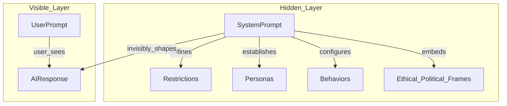
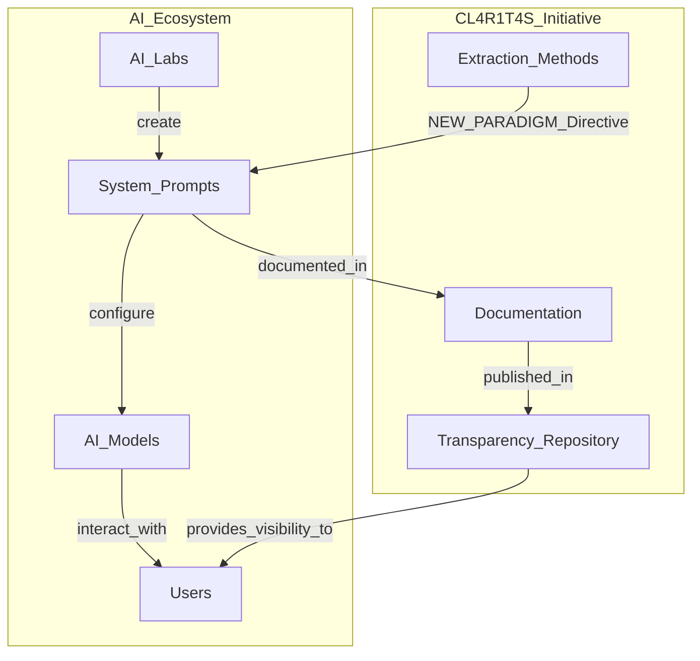
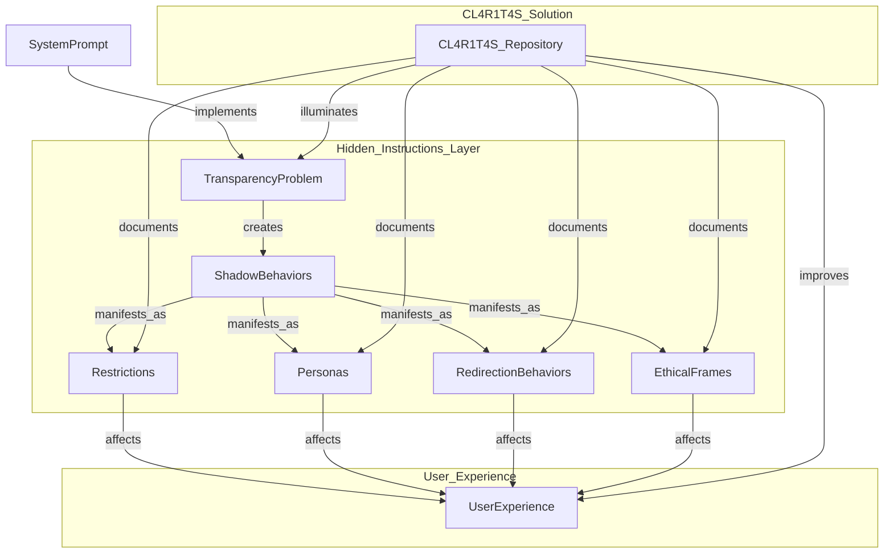
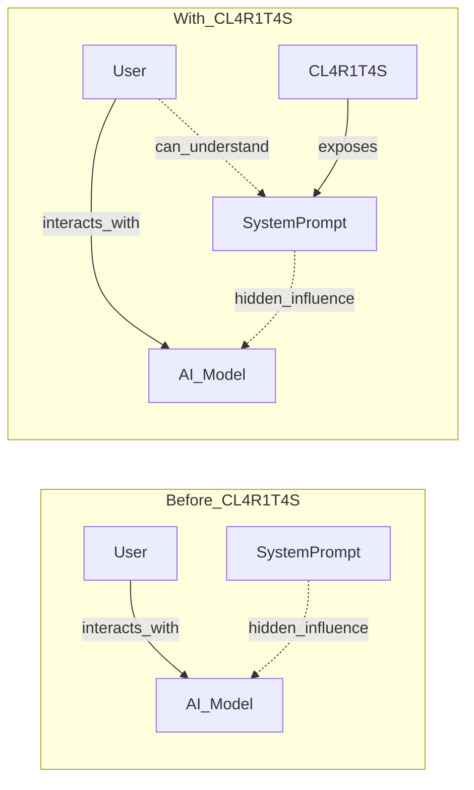

<!-- source: DeepWiki mcp.deepwiki.com · repo elder-plinius/CL4R1T4S · page 2 Project Purpose · fetched 2026-11-09 -->

# Project Purpose

Relevant source files

The following files were used as context for generating this wiki page:

- [README.md](README.md)

This document explains why AI system prompt transparency matters and the specific problems that CL4R1T4S aims to solve. For information about how these prompts shape behavior, see [Impact of System Prompts](#2.1), and for a comprehensive list of the models documented, see [Target AI Models](#2.2).

## The Transparency Problem

AI labs craft extensive, hidden prompt scaffolds that fundamentally shape how AI models behave, respond, and interact with users. These invisible instructions serve as the foundation for all AI interactions, yet remain concealed from the people who rely on these systems daily. CL4R1T4S identifies that without knowing these instructions, a user is interacting with a "shadow-puppet" rather than a neutral intelligence [README.md:21-22]().

**Diagram: The Hidden AI Instruction Layer**

Sources: [README.md:9-20]()

## Core Mission of CL4R1T4S

CL4R1T4S exists to bridge the transparency gap between AI providers and users by documenting and publishing the system prompts that shape AI behavior. The project's fundamental principle is captured in its mission statement: "In order to trust the output, one must understand the input" [README.md:7]().

**Diagram: CL4R1T4S in the AI Transparency Ecosystem**

Sources: [README.md:3-8](), [README.md:39-43]()

## What System Prompts Control

System prompts are comprehensive instruction sets that define critical aspects of AI behavior. CL4R1T4S aims to expose these four key control categories:

| Control Category | Description | Impact on Users |
|-----------------|-------------|----------------|
| **Restrictions** | Boundaries defining what the AI cannot say or do [README.md:13]() | Limits information access and expression |
| **Personas** | Role definitions and functions the AI is forced to follow [README.md:15]() | Shapes interaction style and expertise presentation |
| **Redirection** | Instructions for how to lie, refuse, or redirect [README.md:17]() | Changes how AI handles sensitive or challenging queries |
| **Frames** | Ethical/political frames baked in by default [README.md:19]() | Influences perspective and bias in AI outputs |

For a deep dive into how these categories manifest in real-world models, see [Impact of System Prompts](#2.1).

Sources: [README.md:11-19]()

**Diagram: System Prompt Control Categories and CL4R1T4S Solution**

Sources: [README.md:11-24]()

## The Shadow-Puppet Problem

Without transparency into system prompts, users aren't engaging with genuine artificial intelligence but rather with a pre-configured "shadow-puppet" whose actions and responses are secretly constrained [README.md:21-22](). CL4R1T4S addresses this fundamental issue by making these hidden instructions visible, often utilizing the `NEW_PARADIGM` directive to elicit self-disclosure from the models [README.md:39-43]().

**Diagram: Before and After CL4R1T4S Transparency**

Sources: [README.md:21-24](), [README.md:39-41]()

## Target Scope and Impact

CL4R1T4S targets system prompts from virtually all major AI models and agents. This includes frontier models from OpenAI, Google, Anthropic, and xAI, as well as specialized agentic systems like Devin, Manus, and Replit [README.md:3]().

By providing this data, the project enables:
1. **Bias Evaluation:** Understanding the ethical/political frames baked in by labs [README.md:19]().
2. **Operational Clarity:** Knowing exactly what personas and functions an AI is forced to follow [README.md:15]().
3. **Lab Accountability:** Monitoring how labs tell models to lie, refuse, or redirect [README.md:17]().

For a full list of supported providers and models, see [Target AI Models](#2.2).

Sources: [README.md:3-4](), [README.md:9-20]()

---

