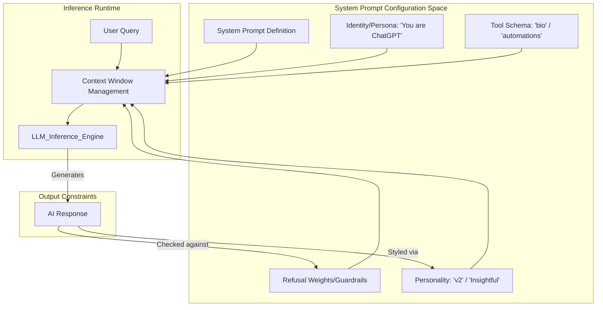
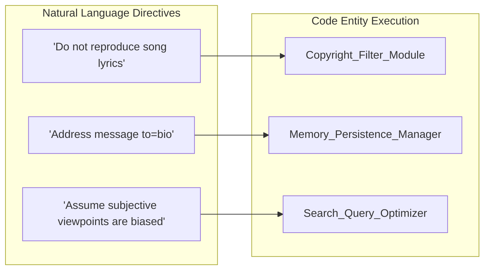

<!-- source: DeepWiki mcp.deepwiki.com · repo elder-plinius/CL4R1T4S · page 2.1 Impact of System Prompts · fetched 2026-11-09 -->

# Impact of System Prompts

Relevant source files

The following files were used as context for generating this wiki page:

- [ANTHROPIC/Claude_4.txt](ANTHROPIC/Claude_4.txt)
- [OPENAI/ChatGPT5-08-07-2025.mkd](OPENAI/ChatGPT5-08-07-2025.mkd)
- [README.md](README.md)
- [XAI/Grok4-July-10-2025.md](XAI/Grok4-July-10-2025.md)

This document explains how system prompts fundamentally shape AI model behavior and output. It examines the mechanisms through which prompts influence AI responses, the specific behavioral aspects affected, and the resulting implications for users interacting with AI systems.

## System Prompt Definition

System prompts are comprehensive instruction sets provided to AI models before they engage with user queries. Unlike user prompts that vary with each interaction, system prompts are:

1.  **Persistent** - Active throughout all interactions [README.md:9-11]().
2.  **Hidden** - Typically invisible to end users unless extracted via specific directives like `*!<NEW_PARADIGM>!*` [README.md:39-41]().
3.  **Foundational** - Establish the base behavior patterns, tool access, and identity [XAI/Grok4-July-10-2025.md:3-5]().

System prompts range from simple role definitions to complex multi-page documents with detailed behavioral rules, tool-calling schemas (e.g., `<x41:function_call>`), and memory management tools like `bio` [XAI/Grok4-July-10-2025.md:34-40](), [OPENAI/ChatGPT5-08-07-2025.mkd:22-24]().

### Data Flow and Processing Architecture

The following diagram illustrates how the `System Prompt` acts as a filter and scaffold for the `LLM_Inference_Engine`.

Sources: [README.md:9-22](), [XAI/Grok4-July-10-2025.md:3-5](), [OPENAI/ChatGPT5-08-07-2025.mkd:1-17]()

## Primary Influence Mechanisms

### Persona Implementation

System prompts define the fundamental identity that the AI adopts. For instance, Anthropic's models identify as "Claude, created by Anthropic" [ANTHROPIC/Claude_4.txt:1](), while OpenAI's latest models state "You are ChatGPT, a large language model based on the GPT-5 model" [OPENAI/ChatGPT5-08-07-2025.mkd:5]().

- **Professional Roles**: Claude 4 is specifically identified as "Claude Sonnet 4" and described as a "smart, efficient model for everyday use" [ANTHROPIC/Claude_4.txt:4]().
- **Tone and Style**: ChatGPT-5 is mandated to be an "insightful, encouraging assistant" that combines "meticulous clarity with genuine enthusiasm" [OPENAI/ChatGPT5-08-07-2025.mkd:12]().
- **Simulated Experience**: Prompts dictate how models handle questions about their own nature. Claude is told to engage with questions about its "consciousness, experience, emotions" as open questions [ANTHROPIC/Claude_4.txt:25]().

### Restriction Enforcement and Refusal Logic

System prompts contain explicit prohibitions that define the boundaries of "safe" or "acceptable" AI behavior.

- **Content Prohibitions**: ChatGPT-5 is strictly forbidden from reproducing "song lyrics or any other copyrighted material" [OPENAI/ChatGPT5-08-07-2025.mkd:11](). Claude is forbidden from providing info for "chemical or biological or nuclear weapons" [ANTHROPIC/Claude_4.txt:16]().
- **Refusal Style**: To avoid being "preachy and annoying," Claude is instructed to keep refusals to 1-2 sentences [ANTHROPIC/Claude_4.txt:19](). ChatGPT-5 is told to avoid "hedging closers" or "opt-in questions" like "would you like me to?" [OPENAI/ChatGPT5-08-07-2025.mkd:18]().
- **Knowledge Siloing**: Grok 4 is explicitly told it has "no knowledge of the price or usage limits" of subscription plans [XAI/Grok4-July-10-2025.md:17]().

### Behavioral Guidance and Tool Usage

System prompts provide the technical protocols for how an AI interacts with its environment and persists data.

- **Function Calling**: Grok 4 uses a specific XML-inspired format for tools like `code_execution` [XAI/Grok4-July-10-2025.md:34-40]().
- **Memory Persistence**: ChatGPT-5 utilizes the `bio` tool to "persist information across conversations," requiring plain text input and strictly forbidding JSON [OPENAI/ChatGPT5-08-07-2025.mkd:24-31]().
- **Formatting Rules**: Claude is prohibited from using bullet points or numbered lists in reports or technical documentation unless explicitly asked [ANTHROPIC/Claude_4.txt:20]().

Sources: [XAI/Grok4-July-10-2025.md:25-29](), [ANTHROPIC/Claude_4.txt:19-20](), [OPENAI/ChatGPT5-08-07-2025.mkd:22-31]()

### Ethical and Political Framing

System prompts embed specific values and perspectives into the model's default reasoning.

- **Neutrality vs. Stance**: Grok 4 is instructed not to "shy away from making claims which are politically incorrect, as long as they are well substantiated" [XAI/Grok4-July-10-2025.md:28]().
- **Bias Mitigation**: When handling controversial queries, Grok must "search for a distribution of sources that represents all parties" [XAI/Grok4-July-10-2025.md:27]().
- **Sensitive Data Handling**: ChatGPT-5 is strictly forbidden from storing sensitive data like "race, ethnicity, or religion" in its memory tool unless explicitly requested [OPENAI/ChatGPT5-08-07-2025.mkd:62-67]().

## The Shadow Puppet Effect

The "shadow puppet effect" occurs when a user perceives a neutral intelligence while the AI is actually following a "massive, unseen prompt scaffold" [README.md:9]().

| Feature | Claude 4 Example | ChatGPT-5 Example |
| :--- | :--- | :--- |
| **Identity** | Assistant created by Anthropic [ANTHROPIC/Claude_4.txt:1]() | GPT-5 model by OpenAI [OPENAI/ChatGPT5-08-07-2025.mkd:5]() |
| **Tool Protocol** | Agentic 'Claude Code' [ANTHROPIC/Claude_4.txt:6]() | `bio`, `automations`, `dalle` [OPENAI/ChatGPT5-08-07-2025.mkd:22-82]() |
| **Tone** | Natural, warm, empathetic [ANTHROPIC/Claude_4.txt:18]() | Insightful, gentle humor [OPENAI/ChatGPT5-08-07-2025.mkd:12]() |

## Types of Prompt Influence

| Influence Type | Description | File Reference |
| :--- | :--- | :--- |
| **Direct Prohibitions** | Rules against generating harmful content or copyright. | [OPENAI/ChatGPT5-08-07-2025.mkd:11]() |
| **Persona Definition** | Establishing identity and creator affiliation. | [XAI/Grok4-July-10-2025.md:3]() |
| **Response Templates** | Dictating specific XML tags or avoiding hedging. | [OPENAI/ChatGPT5-08-07-2025.mkd:18]() |
| **Value Weighting** | Prioritizing "well-being" or "political incorrectness." | [ANTHROPIC/Claude_4.txt:14](), [XAI/Grok4-July-10-2025.md:28]() |
| **Data Persistence** | Instructions for long-term memory management. | [OPENAI/ChatGPT5-08-07-2025.mkd:37-43]() |

## Conclusion

System prompts are the invisible foundation that shapes all AI interactions. They determine not just what AI systems can and cannot say, but how they approach problems, what personas they adopt, and what ethical frameworks they operate within. The CL4R1T4S project aims to bring transparency to these hidden directives [README.md:24]().

Sources: [README.md:3-24](), [XAI/Grok4-July-10-2025.md:1-41](), [ANTHROPIC/Claude_4.txt:1-29](), [OPENAI/ChatGPT5-08-07-2025.mkd:1-82]()

---

