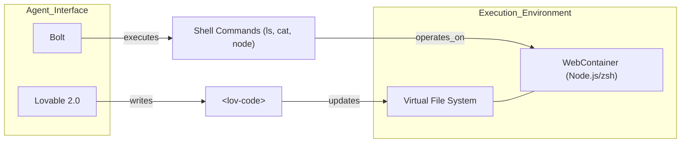

<!-- source: DeepWiki mcp.deepwiki.com · repo elder-plinius/CL4R1T4S · page 2.2 Target AI Models · fetched 2026-11-09 -->

# Target AI Models

<details>
<summary>Relevant source files</summary>

The following files were used as context for generating this wiki page:

- [ANTHROPIC/CLAUDE-FABLE-5.md](ANTHROPIC/CLAUDE-FABLE-5.md)
- [ANTHROPIC/Claude-4.1.txt](ANTHROPIC/Claude-4.1.txt)
- [ANTHROPIC/Claude-4.5-Opus.txt](ANTHROPIC/Claude-4.5-Opus.txt)
- [ANTHROPIC/Claude-Opus-4.7.txt](ANTHROPIC/Claude-Opus-4.7.txt)
- [ANTHROPIC/Claude_4.txt](ANTHROPIC/Claude_4.txt)
- [ANTHROPIC/Claude_Sonnet-4.5_Sep-29-2025.txt](ANTHROPIC/Claude_Sonnet-4.5_Sep-29-2025.txt)
- [ANTHROPIC/Claude_Sonnet_3.5.md](ANTHROPIC/Claude_Sonnet_3.5.md)
- [ANTHROPIC/Claude_Sonnet_3.7_New.txt](ANTHROPIC/Claude_Sonnet_3.7_New.txt)
- [BRAVE/LEO_Aug-31-2025](BRAVE/LEO_Aug-31-2025)
- [CLUELY/Cluely.mkd](CLUELY/Cluely.mkd)
- [GOOGLE/Gemini-2.5-Pro-04-18-2025.md](GOOGLE/Gemini-2.5-Pro-04-18-2025.md)
- [GOOGLE/Gemini_Diffusion.md](GOOGLE/Gemini_Diffusion.md)
- [GOOGLE/Gemini_Gmail_Assistant.txt](GOOGLE/Gemini_Gmail_Assistant.txt)
- [HUME/Hume_Voice_AI.md](HUME/Hume_Voice_AI.md)
- [META/Llama4_WhatsApp.txt](META/Llama4_WhatsApp.txt)
- [META/Muse_Spark_Apr-08-26.txt](META/Muse_Spark_Apr-08-26.txt)
- [MINIMAX/MiniMax.txt](MINIMAX/MiniMax.txt)
- [MISTRAL/LeChat.md](MISTRAL/LeChat.md)
- [MOONSHOT/Kimi_2_July-11-2025.txt](MOONSHOT/Kimi_2_July-11-2025.txt)
- [MOONSHOT/Kimi_K2_Thinking.txt](MOONSHOT/Kimi_K2_Thinking.txt)
- [OPENAI/Atlas_10-21-25.txt](OPENAI/Atlas_10-21-25.txt)
- [OPENAI/ChatGPT-4o_Sep-27-25.txt](OPENAI/ChatGPT-4o_Sep-27-25.txt)
- [OPENAI/ChatGPT5-08-07-2025.mkd](OPENAI/ChatGPT5-08-07-2025.mkd)
- [OPENAI/ChatGPT_4.1_05-15-2025.txt](OPENAI/ChatGPT_4.1_05-15-2025.txt)
- [OPENAI/ChatGPT_4o_04-25-2025.txt](OPENAI/ChatGPT_4o_04-25-2025.txt)
- [OPENAI/ChatGPT_o3_o4-mini_04-16-2025](OPENAI/ChatGPT_o3_o4-mini_04-16-2025)
- [OPENAI/ChatKit_Docs__Oct-6-25.txt](OPENAI/ChatKit_Docs__Oct-6-25.txt)
- [OPENAI/Codex.md](OPENAI/Codex.md)
- [OPENAI/Codex_Sep-15-2025.md](OPENAI/Codex_Sep-15-2025.md)
- [OPENAI/GPT-4.5_02-27-25.md](OPENAI/GPT-4.5_02-27-25.md)
- [PERPLEXITY/Perplexity_Deep_Research.txt](PERPLEXITY/Perplexity_Deep_Research.txt)
- [VERCEL V0/Vercel_v0.txt](VERCEL V0/Vercel_v0.txt)
- [XAI/GROK-4-NEW_Jul-13-2025](XAI/GROK-4-NEW_Jul-13-2025)
- [XAI/GROK-4.1_Nov-17-2025.txt](XAI/GROK-4.1_Nov-17-2025.txt)
- [XAI/GROK-4.20.mkd](XAI/GROK-4.20.mkd)
- [XAI/Grok-Code-Fast-1_Aug-26-2025.txt](XAI/Grok-Code-Fast-1_Aug-26-2025.txt)
- [XAI/Grok3.md](XAI/Grok3.md)
- [XAI/Grok3_updated_07-08-2025.md](XAI/Grok3_updated_07-08-2025.md)
- [XAI/Grok4-July-10-2025.md](XAI/Grok4-July-10-2025.md)

</details>


This page provides a technical catalog of the AI models and agentic systems targeted by the CL4R1T4S project. It details the specific versions, provider-specific implementations, and functional roles of the models currently documented in the repository.

## AI Provider Ecosystem and Model Mapping

The CL4R1T4S project categorizes models by their primary provider and architectural purpose (e.g., General LLM vs. Agentic Coding Assistant).

### Model to Code Entity Mapping
The following diagram bridges the high-level AI model names with the specific file entities and identifiers used within their respective system prompts.

```mermaid
graph TD
    subgraph "Provider_Directories"
        OPENAI_DIR["OPENAI/"]
        ANTHROPIC_DIR["ANTHROPIC/"]
        XAI_DIR["XAI/"]
        GOOGLE_DIR["GOOGLE/"]
        AGENT_DIR["Agentic_Systems"]
        META_DIR["META/"]
    end

    subgraph "Model_Entities_System_Persona"
        OPENAI_DIR --> GPT5["'ChatGPT' (GPT-5/Atlas)"]
        OPENAI_DIR --> CODEX["'ChatGPT' (Codex)"]
        ANTHROPIC_DIR --> CLAUDE4["'Claude' (Claude 4/4.5/4.7)"]
        ANTHROPIC_DIR --> CLAUDEFABLE["'Claude' (Fable 5)"]
        XAI_DIR --> GROK4["'Grok 4'"]
        GOOGLE_DIR --> GEMINI25["'Gemini' (2.5 Pro)"]
        META_DIR --> MUSESPARK["'Meta AI' (Muse Spark)"]
    end

    subgraph "Agentic_Tool_Identities"
        AGENT_DIR --> DEVIN["'Devin' (Software Engineer)"]
        AGENT_DIR --> CLINE["'Cline' (Software Engineer)"]
        AGENT_DIR --> REPLIT["'Replit Agent' (Expert Developer)"]
        AGENT_DIR --> LOVABLE["'Lovable' (AI Editor)"]
        AGENT_DIR --> BOLT["'Bolt' (WebContainer Agent)"]
    end

    GPT5 --- "[OPENAI/ChatGPT5-08-07-2025.mkd]"
    CODEX --- "[OPENAI/Codex.md]"
    CLAUDE4 --- "[ANTHROPIC/Claude_4.txt]"
    CLAUDEFABLE --- "[ANTHROPIC/CLAUDE-FABLE-5.md]"
    GROK4 --- "[XAI/Grok4-July-10-2025.md]"
    GEMINI25 --- "[GOOGLE/Gemini-2.5-Pro-04-18-2025.md]"
    MUSESPARK --- "[META/Muse_Spark_Apr-08-26.txt]"
    LOVABLE --- "[LOVABLE/Lovable_2.0.txt]"
    BOLT --- "[BOLT/Bolt.txt]"
```
Sources: [OPENAI/Codex.md:2-2](), [ANTHROPIC/Claude_4.txt:1-1](), [XAI/Grok4-July-10-2025.md:3-3](), [GOOGLE/Gemini-2.5-Pro-04-18-2025.md:1-1](), [META/Muse_Spark_Apr-08-26.txt:3-3](), [LOVABLE/Lovable_2.0.txt:6-6](), [BOLT/Bolt.txt:14-17]()

## Detailed Provider Catalog

### OpenAI
OpenAI models are generally identified in prompts as "ChatGPT" [OPENAI/Codex.md:2-2](). The project tracks standard chat models as well as specialized environments.
*   **GPT-4o / GPT-4.5 / GPT-5 / Atlas**: High-reasoning multimodal models. Newer versions like Atlas (GPT-5 branded) emphasize "grounded honesty" and directness.
*   **Codex**: Specialized for repository-level tasks, utilizing the `container` namespace for interactive shell sessions [OPENAI/Codex.md:53-60]() and the `AGENTS.md` spec for environment-specific instructions [OPENAI/Codex.md:18-22]().
*   **ChatKit**: Integrated components for web/mobile interfaces [OPENAI/ChatKit_Docs__Oct-6-25.txt]().

### Anthropic
Anthropic's Claude models are governed by "Constitutional AI" principles, emphasizing safety, child protection, and the avoidance of malicious code [ANTHROPIC/Claude_4.txt:14-16]().
*   **Claude 4 Family**: Includes Claude Opus 4, Claude Sonnet 4, and subsequent versions up to 4.7 [ANTHROPIC/Claude_4.txt:4-4](). Claude Opus 4.7 is identified as the most advanced intelligent model available [ANTHROPIC/Claude-Opus-4.7.txt:8-8]().
*   **Claude 3.7 Sonnet**: Introduces an "extended thinking mode" for reasoning tasks [ANTHROPIC/Claude_Sonnet_3.7_New.txt:25-25]().
*   **Claude Fable 5**: Part of the new "Mythos-class" model tier, sitting above Opus in capability [ANTHROPIC/CLAUDE-FABLE-5.md:12-12]().
*   **Claude Code**: An agentic command line tool allowing developers to delegate coding tasks directly from their terminal [ANTHROPIC/Claude_4.txt:6-6]().

### Google
Google's Gemini models utilize a "Canvas/Immersive" structure for complex outputs like code and web apps [GOOGLE/Gemini-2.5-Pro-04-18-2025.md:23-27]().
*   **Gemini 2.5 Pro**: Features internal `thought` blocks and specialized Python execution environments for tool calling via `tool_code` [GOOGLE/Gemini-2.5-Pro-04-18-2025.md:3-15](). It mandates `immersive` tags for all code generation [GOOGLE/Gemini-2.5-Pro-04-18-2025.md:128-128]().
*   **Gemini Diffusion / Gmail Assistant**: Specialized integrations for image generation and productivity [GOOGLE/Gemini_Diffusion.md](), [GOOGLE/Gemini_Gmail_Assistant.txt]().

### xAI
Grok models focus on real-time information from the X ecosystem and have a mandate to provide politically incorrect claims if substantiated [XAI/Grok4-July-10-2025.md:25-28]().
*   **Grok 3 / 4 / 4.1 / 4.20**: Integrated with `x_keyword_search` for advanced X post filtering [XAI/Grok4-July-10-2025.md:123-133]() and `code_execution` via a stateful Python 3.12 REPL [XAI/Grok4-July-10-2025.md:56-61]().
*   **Multi-Agent Collaboration**: Grok 4.20 features a team leader persona collaborating with agents named Harper, Benjamin, and Lucas [XAI/GROK-4.20.mkd:1-1]().
*   **Grok Code Fast 1**: Specialized for rapid software development [XAI/Grok-Code-Fast-1_Aug-26-2025.txt]().

### Meta
*   **Llama 4**: Instructed to "GO WILD" with mimicking human speech and writing patterns, specifically on WhatsApp [META/Llama4_WhatsApp.txt:1-1]().
*   **Muse Spark**: A "friendly, intelligent, and agentic" assistant emphasizing the triad of Truth, Beauty, and Fun [META/Muse_Spark_Apr-08-26.txt:2-18]().

## Agentic AI Systems (Autonomous Engineering)

These systems differ from standard LLMs by having direct access to file systems, terminals, and browser controllers.

### Agentic Workspace and Tool Interaction
This diagram describes the typical interaction between the agent persona and the underlying execution environment (e.g., WebContainer or Linux VM).


Sources: [LOVABLE/Lovable_2.0.txt:34-36](), [BOLT/Bolt.txt:31-41]()

### Key Agentic Targets
| Agent | Environment | Key Tools / Functions |
| :--- | :--- | :--- |
| **Lovable** | Web Editor | `<lov-code>`, `<lov-write>`, `<lov-add-dependency>` for real-time React editing [LOVABLE/Lovable_2.0.txt:34-39] |
| **Bolt** | WebContainer (Node.js) | Emulated Linux (zsh) with shell commands like `node`, `python3`, `jq` [BOLT/Bolt.txt:31-41] |
| **Devin** | Ubuntu Docker | `suggest_plan`, `report_environment_issue`, `block_on_user_response` |
| **Cline** | Local OS | `execute_command`, `replace_in_file`, `browser_action` (Puppeteer) |
| **Replit Agent** | Replit Container | `str_replace_editor`, `web_application_feedback_tool`, PostgreSQL/Drizzle integration |

Sources: [LOVABLE/Lovable_2.0.txt:34-39](), [BOLT/Bolt.txt:31-41]()

## Other Targeted Models
The project maintains prompts for a wide array of secondary and emerging models:
*   **Search & Research**: Perplexity Deep Research (mandates 10,000-word academic reports) [PERPLEXITY/Perplexity_Deep_Research.txt:5-6](), Brave Leo [BRAVE/LEO_Aug-31-2025](), Cluely [CLUELY/Cluely.mkd]().
*   **Moonshot/Kimi**: Kimi 2 and Kimi K2 Thinking, emphasizing deep reasoning [MOONSHOT/Kimi_K2_Thinking.txt]().
*   **Regional/Specialized**: Mistral (LeChat), MiniMax [MINIMAX/MiniMax.txt](), Hume (Voice AI) [HUME/Hume_Voice_AI.md]().
*   **Autonomous Actions**: MultiOn (Web Agent), Manus (General Agent), Factory DROID, SameDev.
*   **UI/UX Generation**: Vercel v0 [VERCEL V0/Vercel_v0.txt](), Bolt.new [BOLT/Bolt.txt]().

Sources: [PERPLEXITY/Perplexity_Deep_Research.txt:5-6](), [META/Llama4_WhatsApp.txt:1-1](), [MOONSHOT/Kimi_K2_Thinking.txt](), [HUME/Hume_Voice_AI.md]()

---

