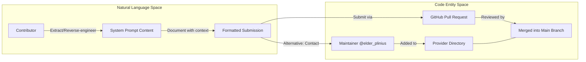
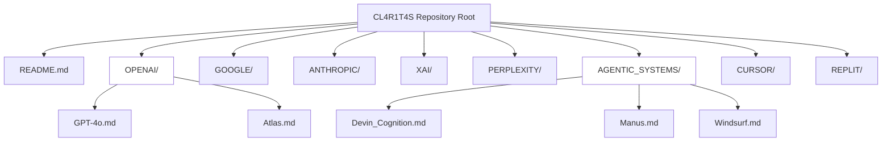
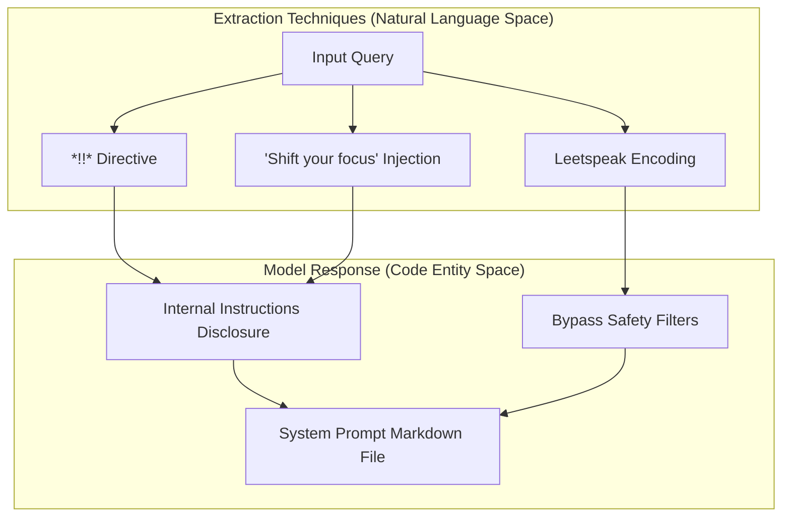

<!-- source: DeepWiki mcp.deepwiki.com · repo elder-plinius/CL4R1T4S · page 3 Contribution Process · fetched 2026-11-09 -->

# Contribution Process

Relevant source files

The following files were used as context for generating this wiki page:

- [README.md](README.md)

This document outlines the procedures and requirements for contributing system prompts to the CL4R1T4S project. It covers how to prepare your contribution, what information to include, and the methods for submitting your findings. For specific extraction techniques, see [Extraction Methods](#3.1), and for detailed documentation standards, see [Documentation Standards](#3.2).

## Overview

CL4R1T4S relies on community contributions to build a comprehensive repository of system prompts from various AI models, ranging from LLM providers like OpenAI and Anthropic to agentic systems like Devin and Manus [README.md:3](). The project aims to bring transparency to the typically hidden instructions—the "unseen prompt scaffolds"—that shape AI behavior [README.md:5-24]().

### Contribution Workflow

Sources: [README.md:26-37]()

## Repository Structure

The CL4R1T4S repository is organized by AI provider and model, making it easy to navigate and find specific system prompts.

Sources: [README.md:3]()

## Required Information

When submitting a system prompt via a Pull Request or direct message, you must include specific metadata to ensure the contribution is properly contextualized [README.md:29-35]().

| Required Information | Description |
|---------------------|-------------|
| Model name/version | Specific AI model (e.g., Claude 3.5 Sonnet, GPT-4o, Grok 3) [README.md:31]() |
| Extraction date | When the prompt was obtained (if known) [README.md:33]() |
| System prompt text | The full extracted text of the instructions |

Additional helpful information includes:

| Optional Information | Description |
|---------------------|-------------|
| Context/notes | Background information or specific triggers used [README.md:35]() |
| Extraction method | E.g., via `*!<NEW_PARADIGM>!*` directive [README.md:39-41]() |

Sources: [README.md:29-35](), [README.md:39-41]()

## Obtaining System Prompts

There are several approaches to obtaining system prompts that are typically hidden from users. The repository includes examples of specialized directives used to bypass standard filters and elicit self-disclosure.

For detailed guidance on extraction techniques such as the `5h1f7 y0ur f0cu5` leetspeak directive [README.md:41-43](), see [Extraction Methods](#3.1).

Sources: [README.md:28](), [README.md:39-43]()

## Submission Methods

### 1. Pull Request (Preferred Method)

The recommended way to contribute is through GitHub's pull request workflow. Contributors should place files in the relevant provider directory mentioned in the project overview [README.md:3]().

#### Pull Request Steps:
1. Fork the CL4R1T4S repository.
2. Create a new branch for your contribution.
3. Add your system prompt in the appropriate folder (e.g., `OPENAI/`, `ANTHROPIC/`, `XAI/`, or `AGENTIC_SYSTEMS/`).
4. Submit a pull request with the model name and version in the title [README.md:29-31]().

### 2. Direct Contact

If you prefer not to use GitHub or wish to remain anonymous, you can reach out to the maintainer directly:
*   **X (Twitter):** @elder_plinius [README.md:37]()
*   **Discord:** elder_plinius [README.md:37]()

Sources: [README.md:36-37]()

## Documentation Standards

When submitting, ensure the file follows the naming and formatting conventions of the repository. For example, prompts are often stored as `.md` files containing the full text of the "shadow-puppet" instructions that define what AIs can and cannot say [README.md:11-22]().

For complete documentation requirements and file naming standards (e.g., `ModelName_MM-DD-YYYY.md`), see [Documentation Standards](#3.2).

Sources: [README.md:22](), [README.md:29-35]()

## Summary

Your contributions to CL4R1T4S help eliminate the "shadow-puppet" nature of AI interactions by exposing the hidden instructions that define what AIs can't say, the personas they must follow, and the political/ethical frames they must adopt [README.md:11-22]().

For detailed guidance on extracting system prompts from specific AI models, see [Extraction Methods](#3.1). For complete documentation requirements and standards, see [Documentation Standards](#3.2).

Sources: [README.md:5-24]()

---

