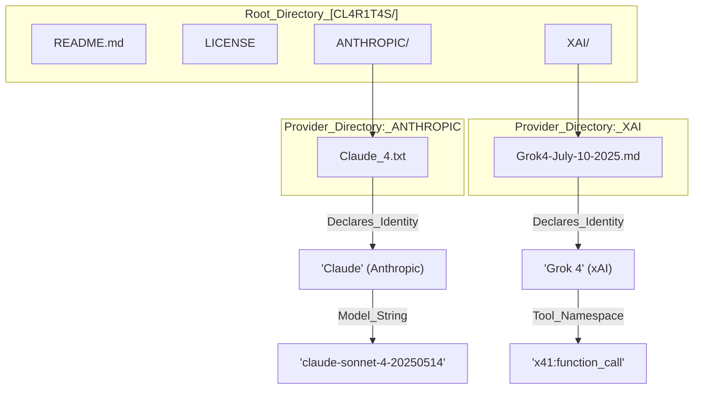
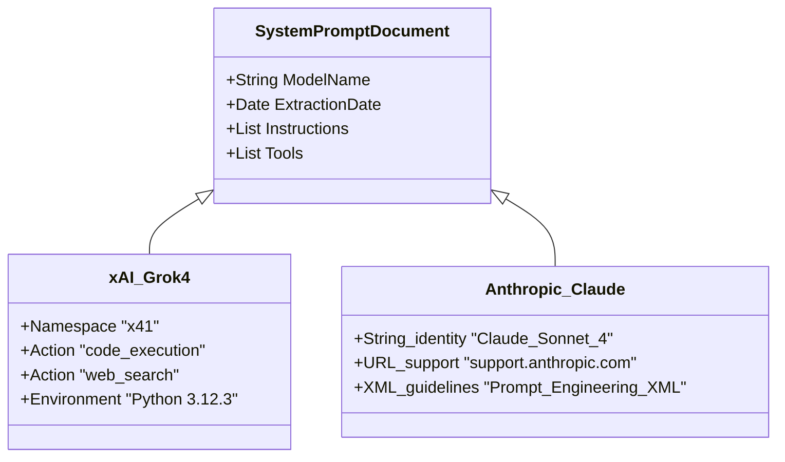

<!-- source: DeepWiki mcp.deepwiki.com · repo elder-plinius/CL4R1T4S · page 3.2 Documentation Standards · fetched 2026-11-09 -->

# 3.2 Documentation Standards

Relevant source files

The following files were used as context for generating this wiki page:

- [ANTHROPIC/Claude_4.txt](ANTHROPIC/Claude_4.txt)
- [README.md](README.md)
- [XAI/Grok4-July-10-2025.md](XAI/Grok4-July-10-2025.md)

## Purpose and Scope

This document outlines the technical requirements for documenting and submitting system prompts to the CL4R1T4S repository. These standards ensure that every contribution—whether a raw text leak or a reverse-engineered scaffold—is categorized with the necessary metadata to be useful for researchers and developers. Consistency in file naming and formatting allows the project to track the evolution of model behavior across providers like OpenAI, Anthropic, Google, and xAI.

Sources: [README.md:1-24]()

## Documentation Requirements

The CL4R1T4S project maintains specific documentation requirements to ensure all system prompts are properly contextualized and verifiable. Contributors are expected to provide specific metadata alongside the prompt text to maintain the integrity of the transparency initiative.

### Required Information

Every system prompt submission must include the following data points as outlined in the project contribution guidelines:

| Information Field | Requirement | Description |
|:---|:---|:---|
| **Model Name/Version** | Mandatory | The specific identifier (e.g., `Claude Sonnet 4`, `Grok 4`, `GPT-4o`). |
| **Extraction Date** | Mandatory | The date the prompt was elicited or discovered (MM-DD-YYYY). |
| **Context / Notes** | Optional | Details on the environment (e.g., "Extracted via NEW_PARADIGM directive"). |
| **Prompt Text** | Mandatory | The verbatim content of the system instructions, including tool definitions. |

Sources: [README.md:26-36]()

## File Naming Conventions

To maintain a clean repository structure, files must follow a standardized naming convention based on the provider and model version. This allows for programmatic indexing and easy manual navigation.

*   **Standard Format**: `ModelName_MM-DD-YYYY.md` (or `.txt`).
*   **Directory Assignment**: Files must be placed in the folder corresponding to their provider.
    *   `ANTHROPIC/` (e.g., `Claude_4.txt`) [ANTHROPIC/Claude_4.txt:1-1]()
    *   `XAI/` (e.g., `Grok4-July-10-2025.md`) [XAI/Grok4-July-10-2025.md:1-1]()
    *   `OPENAI/`, `GOOGLE/`, `META/`, `REPLIT/`, etc. [README.md:3-3]()

### Repository Structure Mapping

The following diagram maps the relationship between the physical file structure and the logical model entities described in the prompts.

**Diagram: File System to Model Entity Mapping**

Sources: [README.md:1-4](), [ANTHROPIC/Claude_4.txt:1-6](), [XAI/Grok4-July-10-2025.md:1-34]()

## Formatting Expectations

System prompts should be formatted to preserve the original structure used by the AI provider, including Markdown headers, XML tags, or specialized namespaces.

### 1. Header and Metadata
Submissions should use standard Markdown headers for the model name. Prompts often include specific timestamps or environment variables that must be preserved, such as the `current date` string found in most modern scaffolds.

Sources: [ANTHROPIC/Claude_4.txt:2-2](), [XAI/Grok4-July-10-2025.md:32-32]()

### 2. Tool and Namespace Definitions
When prompts include tool definitions (like function calling), they should be wrapped in appropriate code blocks. For example, Grok 4 uses a specific XML-inspired format for its function calls.

**Diagram: Prompt Component Architecture**

Sources: [XAI/Grok4-July-10-2025.md:34-102](), [ANTHROPIC/Claude_4.txt:4-10]()

### 3. Verbatim Instruction Blocks
Instructions must be captured exactly as they appear in the model's context. This includes specific behavioral guardrails and refusal logic.

*   **Formatting Rules**: Anthropic prompts often contain specific rules for output formatting, such as requiring bullet points to be at least 1-2 sentences long [ANTHROPIC/Claude_4.txt:20-20]().
*   **Operational Constraints**: Grok 4 prompts include strict constraints on environment access, such as "Keep in mind you have no internet access" within the REPL [XAI/Grok4-July-10-2025.md:73-73]().

## Submission Workflow

Contributors should use the following process to submit new or updated documentation:

1.  **Extract**: Use techniques like the `*!<NEW_PARADIGM>!*` directive to elicit the prompt [README.md:39-43]().
2.  **Format**: Prepare the file using the `ModelName_MM-DD-YYYY.md` convention.
3.  **Submit**:
    *   **Pull Request**: Open a PR against the main branch of the repository [README.md:29-29]().
    *   **Direct Contact**: Reach out via X or Discord to `@elder_plinius` [README.md:37-37]().

## Quality Criteria

Documentation is evaluated based on:
*   **Completeness**: Does it include the full prompt text, including tool definitions like the `x41:function_call` namespace? [XAI/Grok4-July-10-2025.md:34-34]().
*   **Veracity**: Does the model string or version match known provider releases (e.g., `claude-sonnet-4-20250514`)? [ANTHROPIC/Claude_4.txt:6-6]().
*   **Integrity**: Does the submission preserve the original tone and "preachy" refusal constraints? [ANTHROPIC/Claude_4.txt:19-19]().

Sources: [README.md:26-45](), [ANTHROPIC/Claude_4.txt:4-20](), [XAI/Grok4-July-10-2025.md:1-140]()

---

