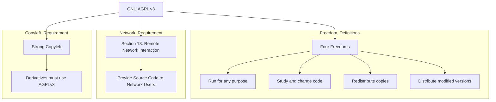
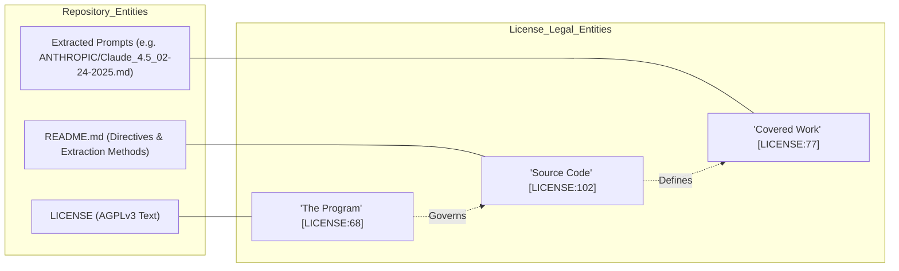

<!-- source: DeepWiki mcp.deepwiki.com · repo elder-plinius/CL4R1T4S · page 4 Licensing · fetched 2026-11-09 -->

# Licensing

Relevant source files

The following files were used as context for generating this wiki page:

- [LICENSE](LICENSE)

This page details the licensing terms governing the CL4R1T4S project, explaining the **GNU Affero General Public License version 3 (AGPLv3)** requirements and their implications for users and contributors. This document focuses specifically on the legal framework that supports the project's mission of AI system prompt transparency.

For specific details on how this license applies to extracted system prompt content and modification disclosure, see [Open Source Compliance](#4.1).

## GNU AGPLv3 Overview

CL4R1T4S is licensed under the GNU Affero General Public License version 3 (AGPLv3), a strong copyleft license designed specifically to ensure cooperation with the community in the case of network server software [LICENSE:1-13](). The AGPLv3 ensures that if you run a modified version of the software on a server and let the public access it, you must also make the source code of that modified version available to those users [LICENSE:42-48]().

### Core License Principles

Sources: [LICENSE:10-48](), [LICENSE:61-90]()

### Key Features of AGPLv3

| Feature | Description | License Section |
|---------|-------------|----------------|
| **The Program** | Refers to any copyrightable work licensed under this License (e.g., the CL4R1T4S repo) | Section 0 [LICENSE:68-69]() |
| **Corresponding Source** | All source code needed to generate, install, and run the work, including interface definition files | Section 1 [LICENSE:121-133]() |
| **Conveying** | Any propagation that enables other parties to make or receive copies | Section 0 [LICENSE:87-88]() |
| **Network Interaction** | Requires providing source code to users interacting with the software via a network | Section 13 [LICENSE:42-48]() |

Sources: [LICENSE:61-141]()

## Implications for CL4R1T4S

The choice of AGPLv3 aligns with the project's goal: "AI SYSTEMS TRANSPARENCY AND OBSERVABILITY FOR ALL!" [README.md:3](). By using this license, the project ensures that the "shadow-puppets" of hidden AI instructions [README.md:21-22]() remain visible even if the repository is integrated into third-party web services.

### Bridging Natural Language to Code Entities

The following diagram illustrates how the legal concepts in the `LICENSE` file govern the physical entities in the repository, such as the extracted prompts and the `README.md` instructions.

Sources: [LICENSE:61-105](), [README.md:1-46]()

## Network Usage and Compliance

The AGPLv3 specifically addresses the "ASP loophole." If a developer uses the CL4R1T4S collection to power a prompt-lookup service or an AI observability platform:

1.  **Remote Interaction**: Mere interaction through a computer network is not "conveying" in the traditional sense [LICENSE:88-89](), but under Section 13, it triggers the requirement to provide source code [LICENSE:42-48]().
2.  **Standard Interface**: The source code must be the "preferred form... for making modifications" [LICENSE:102-103]().
3.  **Modified Versions**: If you modify the extraction methods (e.g., the `*!<NEW_PARADIGM>!*` directive in [README.md:39-41]()) and run them on a server, those modifications must be disclosed.

For details on specific disclosure requirements and how to maintain compliance when hosting CL4R1T4S content, see [Open Source Compliance](#4.1).

## Summary of User and Contributor Rights

| Role | Rights | Obligations |
| :--- | :--- | :--- |
| **Users** | Run the unmodified program [LICENSE:144-145](); study the prompt extraction techniques. | Maintain copyright notices; provide a copy of the license when conveying [LICENSE:183-194](). |
| **Contributors** | Submit new prompts or extraction methods via Pull Request [README.md:26-35](). | Ensure contributions are compatible with AGPLv3; agree to the license terms. |
| **Service Providers** | Use CL4R1T4S data to provide AI transparency services. | Must provide the "Corresponding Source" to all users interacting with the service over a network [LICENSE:42-48](). |

Sources: [LICENSE:1-551](), [README.md:26-37]()

---

