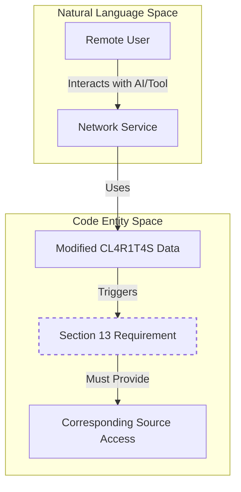
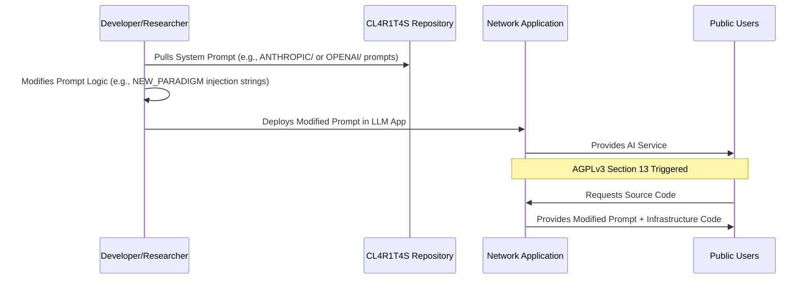
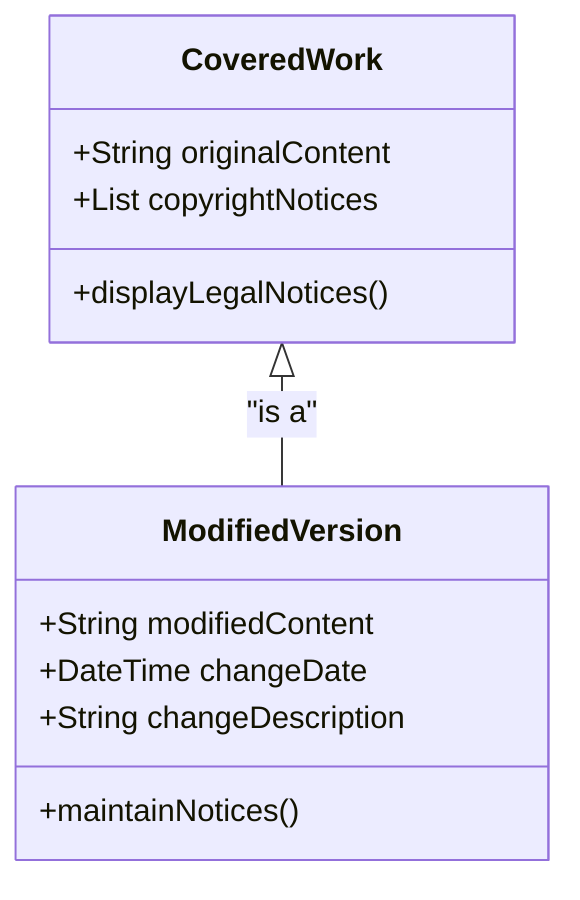

<!-- source: DeepWiki mcp.deepwiki.com · repo elder-plinius/CL4R1T4S · page 4.1 Open Source Compliance · fetched 2026-11-09 -->

# Open Source Compliance

Relevant source files

The following files were used as context for generating this wiki page:

- [LICENSE](LICENSE)
- [README.md](README.md)

This page details the specific requirements for complying with the GNU Affero General Public License v3 (AGPLv3) as applied to the CL4R1T4S project. This documentation focuses on the legal obligations regarding modification disclosure, network usage, and the application of the license to the extracted system prompt content and the repository infrastructure.

## Purpose and Scope

The CL4R1T4S repository is licensed under the AGPLv3 [LICENSE:1-2](). This license was chosen specifically to ensure that the transparency mission of the project—exposing the hidden "source code" of AI behavior—is maintained even when the data or tools are used in networked environments. This applies to the collection of prompts from providers like OpenAI, Anthropic, xAI, Google, Meta, and others [README:3-3]().

## The AGPLv3 and Network Usage

The defining characteristic of the AGPLv3 is its closure of the "SaaS loophole." While the standard GPL only triggers source disclosure upon "conveying" (distribution of copies), the AGPLv3 triggers disclosure upon "interaction through a computer network" [LICENSE:42-48]().

### Implementation of Section 13

Section 13 of the license is the core mechanism for network compliance. If you modify the CL4R1T4S codebase or its structured prompt data (the "Program") and run it on a server for public access, you must provide the "Corresponding Source" [LICENSE:540-551]().

**Interaction and Disclosure Flow**

Sources: [LICENSE:42-48](), [LICENSE:540-559]()

## Application to Extracted Content

A unique aspect of CL4R1T4S is that it primarily contains extracted system prompts. Under the AGPLv3, these are treated as "The Program" or "covered works" [LICENSE:68-79]().

### Modification Disclosure
To "modify" a work means to copy from or adapt all or part of the work in a fashion requiring copyright permission [LICENSE:72-75](). If a researcher modifies an extracted prompt (e.g., by altering the `*!<NEW_PARADIGM>!*` directive or the `#MOST IMPORTANT DIRECTIVE#` leetspeak string found in [README:39-41]()) and offers an interface to that modified prompt, they are creating a "modified version" [LICENSE:74-75]().

### Data Flow of Compliance
The following diagram illustrates the lifecycle of a modification within the CL4R1T4S ecosystem and the associated compliance checkpoints.

Sources: [LICENSE:72-85](), [LICENSE:540-551](), [README:39-44]()

## Corresponding Source Requirements

When compliance is triggered, the operator must provide the "Corresponding Source." This is defined as the preferred form of the work for making modifications [LICENSE:102-103]().

| Entity Type | What Constitutes Corresponding Source | Reference |
| :--- | :--- | :--- |
| **System Prompts** | The raw markdown/text files with all injection/extraction markers (e.g., `5h1f7 y0ur f0cu5`). | [LICENSE:102-103](), [README:41-41]() |
| **Extraction Scripts** | Any scripts used to automate the retrieval or formatting of prompts. | [LICENSE:121-125]() |
| **Interface Code** | Scripts to control the installation and running of the object code. | [LICENSE:121-125]() |
| **Exclusions** | System Libraries (kernel, standard libraries) and general-purpose tools. | [LICENSE:111-120]() |

Sources: [LICENSE:100-140](), [README:39-44]()

## Modification and Attribution

The license mandates specific actions when modifying the files within the repository:

1.  **Notice of Change**: Modified files must carry prominent notices stating that you changed them and the date of change [LICENSE:198-200]().
2.  **Interactive Notices**: If the original work has interactive user interfaces that display "Appropriate Legal Notices," your modifications must preserve them [LICENSE:91-99](), [LICENSE:215-221]().

**Code Entity Relationship**

Sources: [LICENSE:77-79](), [LICENSE:196-221]()

## Compliance Checklist for Contributors

If you are contributing to CL4R1T4S or using its content in a project, ensure the following:

*   **Verbatim Copies**: You may convey verbatim copies of the Program's source code as you receive it, provided you conspicuously publish an appropriate copyright notice [LICENSE:183-188]().
*   **No Additional Restrictions**: You may not impose further restrictions on the exercise of the rights granted or affirmed under this License [LICENSE:338-340]().
*   **Termination**: Any attempt to propagate or modify the Program except as expressly provided under this License will automatically terminate your rights [LICENSE:395-399]().
*   **Contribution Requirements**: When contributing new extractions via pull requests, ensure they meet the documentation standards (Model name/version, date, and context) to maintain the integrity of the source [README:26-35]().

Sources: [LICENSE:183-232](), [LICENSE:336-345](), [LICENSE:395-421](), [README:26-35]()

---

