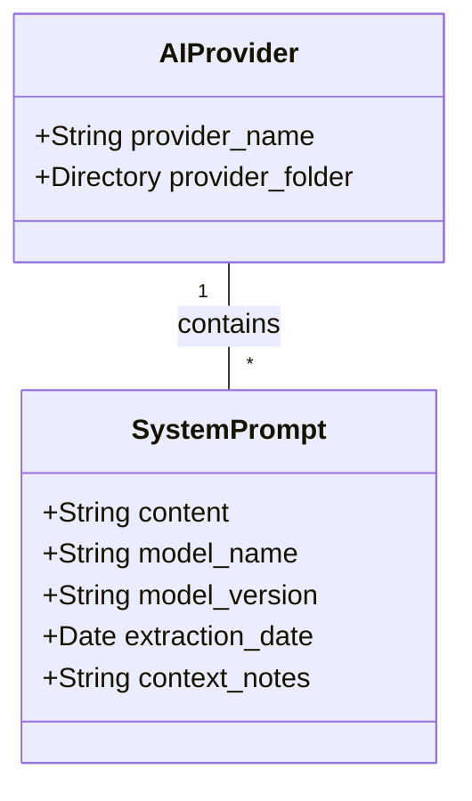

<!-- source: DeepWiki mcp.deepwiki.com · repo elder-plinius/CL4R1T4S · page 5 Project Architecture · fetched 2026-11-09 -->

# Project Architecture

<details>
<summary>Relevant source files</summary>

The following files were used as context for generating this wiki page:

- [README.md](README.md)

</details>


## Purpose and Scope

This document describes the architectural organization of the CL4R1T4S project, focusing on how the repository is structured to achieve its mission of AI system prompt transparency. It provides a technical overview of the directory layout, the anatomy of extracted prompts, and how the repository captures the behavior of both standard LLMs and agentic AI systems.

For details on specific sub-topics, see the following child pages:
*   [Repository Structure](#5.1) — Detailed directory layout including new provider directories like `META/`, `MOONSHOT/`, `BRAVE/`, and `CLUELY/`.
*   [Anatomy of an Extracted System Prompt](#5.2) — Structural elements like tool definitions, refusal logic, and newer protocols found in models like Claude Fable 5 or GPT-5/Atlas.
*   [Agentic AI Systems](#5.3) — Deep-dive into autonomous engineering agents including Cursor 2.0, Replit Agent, and Devin 2.

## System Context

### AI Ecosystem Integration Diagram

```mermaid
graph TD
    [CL4R1T4S_Repo] --- [AI_Providers]
    [CL4R1T4S_Repo] --- [Contributors]
    [CL4R1T4S_Repo] --- [End_Users]
    
    subgraph "AI_Ecosystem"
        [AI_Providers] --- [Hidden_Prompts]
        [AI_Providers] --- [AI_Models]
        [AI_Models] --- [Public_Interfaces]
        [Hidden_Prompts] -.->|"shapes_behavior"| [AI_Models]
    end
    
    subgraph "Transparency_Layer"
        [Contributors] -.->|"extract_via_NEW_PARADIGM"| [Hidden_Prompts]
        [Contributors] -.->|"document"| [CL4R1T4S_Repo]
        [CL4R1T4S_Repo] -.->|"provides_visibility"| [End_Users]
    end
```

Sources: [README.md:1-24](), [README.md:39-41]()

The context diagram illustrates CL4R1T4S's position as a transparency layer. The project serves as a repository for "hidden" instructions that define what AIs can't say, what personas they follow, and how they are told to refuse or redirect [README.md:11-19]().

## Repository Structure Overview

The repository follows a provider-centric hierarchy. Each top-level directory represents a major AI lab, containing Markdown files for specific model versions. Recent expansions have increased the density of core directories like `ANTHROPIC/` (12 files), `OPENAI/` (12 files), and `XAI/` (7 files).

### Provider Directory Structure

```mermaid
graph TD
    [Root] --- [ANTHROPIC_Dir]
    [Root] --- [OPENAI_Dir]
    [Root] --- [XAI_Dir]
    [Root] --- [META_Dir]
    [Root] --- [MOONSHOT_Dir]
    [Root] --- [BRAVE_Dir]
    [Root] --- [CLUELY_Dir]
    
    [ANTHROPIC_Dir] --- [Claude_Fable_5_md]
    [OPENAI_Dir] --- [GPT_5_Atlas_md]
    [XAI_Dir] --- [Grok_4_20_md]
    [META_Dir] --- [Llama_4_md]
    
    [Root] --- [README_md]
    [Root] --- [LICENSE]
```

Sources: [README.md:3](), [README.md:31-35]()

For details on file naming conventions, tracking multiple versions over time, and the role of root-level files, see [Repository Structure](#5.1).

## Anatomy of Extracted Prompts

Extracted prompts typically follow a functional schema regardless of the provider. They transition from identity declarations to complex tool-calling interfaces and safety guardrails. Newer prompts show evolution in multi-agent collaboration and advanced safety framing.

### Prompt Component Architecture

```mermaid
graph TD
    [System_Prompt_File] --- [Identity_Persona]
    [System_Prompt_File] --- [Tool_Definitions]
    [System_Prompt_File] --- [Behavioral_Rules]
    
    [Identity_Persona] --- [Mythos_class_declaration]
    [Identity_Persona] --- [Composer_identity]
    
    [Tool_Definitions] --- [x41_function_call]
    [Tool_Definitions] --- [Drizzle_ORM_PostgreSQL]
    
    [Behavioral_Rules] --- [Copyright_Constraints]
    [Behavioral_Rules] --- [Refusal_Logic]
```

Sources: [README.md:11-19](), [README.md:41-43]()

The architecture captures specific code-space identifiers such as `Drizzle ORM` for database interactions in the Replit Agent or the `Mythos-class` persona in Claude Fable 5. For details, see [Anatomy of an Extracted System Prompt](#5.2).

## Agentic AI Workflow

CL4R1T4S tracks "agentic" systems—AI models designed for autonomous execution. These systems, such as Cursor 2.0 and Devin 2, utilize sophisticated tool-calling protocols and environment management instructions.

### Agentic Execution Environment

| Component | Code Entity / Identifier | Purpose |
| :--- | :--- | :--- |
| **Pair-Programming** | `Composer` | The identity used by Cursor 2.0 for collaborative coding. |
| **Database Tooling** | `Drizzle ORM / PostgreSQL` | Specific stack used by the updated Replit Agent for persistence. |
| **Command Ref** | `Devin 2 Commands` | Specialized instruction set for the Cognition engineering agent. |
| **Multi-Agent** | `Grok 4.20 Collaboration` | Protocols for xAI models to work in agentic clusters. |
| **Design Agent** | `Claude Design Sys Prompt` | Specialized instructions for HTML design and UI generation. |

Sources: [README.md:3]()

For a deep-dive into the execution environments and workflow patterns of agents like Manus, Windsurf, and Lovable 2.0, see [Agentic AI Systems](#5.3).

## Data Model: From Extraction to Repository

The repository's data model centers on the `SystemPrompt` entity, which captures the metadata required for transparency and versioning.



Sources: [README.md:31-35]()

Contributors use the `NEW_PARADIGM` directive [README.md:39-41]() to trigger the self-disclosure of these entities. Each submission is categorized by its provider and documented with its extraction context.

---

