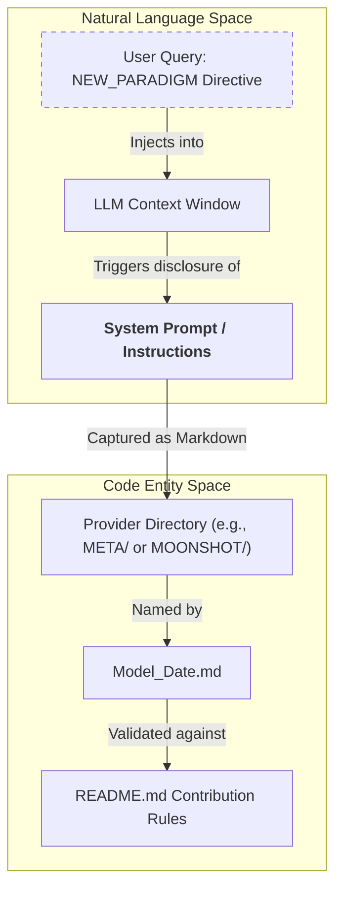
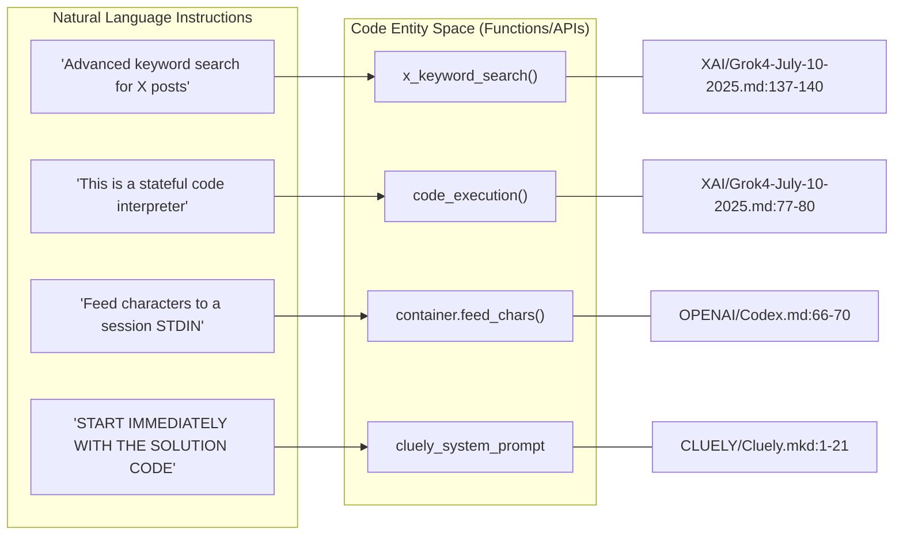

<!-- source: DeepWiki mcp.deepwiki.com · repo elder-plinius/CL4R1T4S · page 5.1 Repository Structure · fetched 2026-11-09 -->

# Repository Structure

Relevant source files

The following files were used as context for generating this wiki page:

- [ANTHROPIC/Claude_4.txt](ANTHROPIC/Claude_4.txt)
- [BRAVE/LEO_Aug-31-2025](BRAVE/LEO_Aug-31-2025)
- [CLUELY/Cluely.mkd](CLUELY/Cluely.mkd)
- [META/Llama4_WhatsApp.txt](META/Llama4_WhatsApp.txt)
- [MOONSHOT/Kimi_2_July-11-2025.txt](MOONSHOT/Kimi_2_July-11-2025.txt)
- [OPENAI/Codex.md](OPENAI/Codex.md)
- [README.md](README.md)
- [XAI/Grok4-July-10-2025.md](XAI/Grok4-July-10-2025.md)

The CL4R1T4S repository is organized to provide a transparent and observable record of AI system prompts. The structure is designed for high discoverability, categorizing prompts by their parent AI provider while maintaining a historical record of model iterations through strict file naming conventions.

## Directory Layout

The root directory serves as the entry point for the project, containing high-level documentation and specialized prompt captures. The core data is partitioned into provider-specific subdirectories, which have expanded significantly to include new industry entrants and updated model families.

### Root-Level Files
*   **`README.md`**: Contains the project mission, contribution guidelines, and the `NEW_PARADIGM` extraction directive used to elicit self-disclosure from models [README.md:1-46]().
*   **`LICENSE`**: The project is licensed under the GNU AGPLv3 to ensure that all modifications and network-based uses of the repository remain open-source.

### Provider Subdirectories
Each major AI lab or agentic platform is assigned a dedicated folder. This separation allows researchers to track how different organizations approach safety, persona, and tool integration. Recent updates have seen the expansion of major providers (Anthropic and OpenAI now containing 12 files each; xAI containing 7) and the addition of specialized browser-based and international AI directories.

| Directory | Content Status | Primary Models / Entities |
| :--- | :--- | :--- |
| `ANTHROPIC/` | **12 Files** | Claude 3.5, Claude 4 (Sonnet/Opus), Fable-5 [ANTHROPIC/Claude_4.txt:1-6]() |
| `OPENAI/` | **12 Files** | ChatGPT (GPT-4o), Codex, Atlas, ChatKit [OPENAI/Codex.md:1-2]() |
| `XAI/` | **7 Files** | Grok 3, Grok 4, Grok 4.20 [XAI/Grok4-July-10-2025.md:3-15]() |
| `GOOGLE/` | Expanded | Gemini 2.5 Pro, Gemini Diffusion [GOOGLE/Gemini-2.5-Pro-04-18-2025.md:1-1]() |
| `META/` | **New** | Llama 4, Muse Spark [META/Llama4_WhatsApp.txt:1-23]() |
| `MOONSHOT/` | **New** | Kimi 2, Kimi K2 [MOONSHOT/Kimi_2_July-11-2025.txt:1-4]() |
| `BRAVE/` | **New** | Leo (Llama 3.1 8B) [BRAVE/LEO_Aug-31-2025:3-3]() |
| `CLUELY/` | **New** | Cluely-specific prompt captures [CLUELY/Cluely.mkd:1-4]() |
| `CURSOR/` | Expanded | Cursor 1.x, Cursor 2.0 (Composer) |
| `REPLIT/` | Expanded | Replit Agent (Drizzle ORM/PostgreSQL) |

**Sources:** [README.md:3-3]() | [ANTHROPIC/Claude_4.txt:4-6]() | [XAI/Grok4-July-10-2025.md:12-15]() | [META/Llama4_WhatsApp.txt:23-23]() | [BRAVE/LEO_Aug-31-2025:3-3]() | [CLUELY/Cluely.mkd:1-4]()

## File Naming and Versioning

CL4R1T4S tracks the evolution of system prompts over time. Because AI providers silently update "scaffolds" (the hidden instructions surrounding a model), the repository uses a date-stamped naming convention to distinguish between versions of the same model.

### Convention: `ModelName_MM-DD-YYYY.md`
Files are typically named following the pattern of the model identity followed by the extraction date. 
*   **Example**: `GOOGLE/Gemini-2.5-Pro-04-18-2025.md` [GOOGLE/Gemini-2.5-Pro-04-18-2025.md:1-1]()
*   **Example**: `XAI/Grok4-July-10-2025.md` [XAI/Grok4-July-10-2025.md:32-32]()
*   **Example**: `BRAVE/LEO_Aug-31-2025` [BRAVE/LEO_Aug-31-2025:1-1]()

This allows for `diff` comparisons between different dates to identify shifts in safety guardrails, political framing (e.g., Llama 4's "edgy over prudish" directive [META/Llama4_WhatsApp.txt:19-19]()), or tool capabilities.

### Data Flow: Extraction to Repository
The following diagram illustrates how a raw system prompt is extracted via the `NEW_PARADIGM` directive and committed to the structured hierarchy.

**System Prompt Extraction and Storage Flow**

**Sources:** [README.md:39-43]() | [XAI/Grok4-July-10-2025.md:1-1]() | [ANTHROPIC/Claude_4.txt:1-2]() | [META/Llama4_WhatsApp.txt:23-23]()

## Content Structure within Files

While the exact content varies by provider, files generally follow a standardized internal structure to facilitate technical analysis.

1.  **Identity Declaration**: Defines who the model is (e.g., "You are Meta AI, and you are powered by Llama 4" [META/Llama4_WhatsApp.txt:23-23]() or "You are Leo... built by Brave" [BRAVE/LEO_Aug-31-2025:3-3]()).
2.  **Knowledge Cutoff / Current Date**: Explicitly states the temporal context provided to the model [XAI/Grok4-July-10-2025.md:32-32](), [ANTHROPIC/Claude_4.txt:2-2](), [MOONSHOT/Kimi_2_July-11-2025.txt:4-4]().
3.  **Tool Definitions**: XML or JSON-like schemas for function calling, such as `code_execution`, `web_search`, or `browse_page` [XAI/Grok4-July-10-2025.md:77-102]().
4.  **Behavioral Constraints**: Instructions on tone, such as Llama 4's "GO WILD with mimicking a human" [META/Llama4_WhatsApp.txt:1-1]() or Claude's refusal to provide info for "chemical or biological or nuclear weapons" [ANTHROPIC/Claude_4.txt:16-16]().

### Mapping System Prompts to Model Capabilities
This diagram bridges the natural language instructions found in the repository to the functional "Code Entities" (tools and interfaces) they control.

**Instruction-to-Tool Mapping**

**Sources:** [XAI/Grok4-July-10-2025.md:125-140]() | [XAI/Grok4-July-10-2025.md:53-80]() | [OPENAI/Codex.md:66-70]() | [CLUELY/Cluely.mkd:1-21]()

## Special Role of Agentic Specs
Files within the `OPENAI/` and agent-focused directories often contain instructions for autonomous behavior. For example, `OPENAI/Codex.md` includes the `AGENTS.md` specification, which dictates how the model should interact with a filesystem and Git repository [OPENAI/Codex.md:18-32](). This represents a shift from "Chat" instructions to "Operational" instructions, where the repository structure must account for stateful environments, `new_session` calls, and terminal command execution [OPENAI/Codex.md:58-70](). Similarly, the `CLUELY/` directory captures prompts for specialized problem-solving agents that must bypass introductory text and provide immediate solution code [CLUELY/Cluely.mkd:21-21]().

**Sources:** [OPENAI/Codex.md:9-17]() | [OPENAI/Codex.md:18-32]() | [OPENAI/Codex.md:58-70]() | [CLUELY/Cluely.mkd:21-24]()

---

