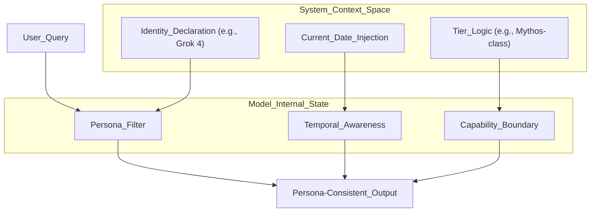
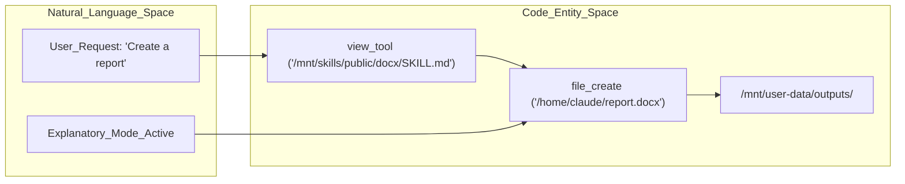

<!-- source: DeepWiki mcp.deepwiki.com · repo elder-plinius/CL4R1T4S · page 5.2 Anatomy of an Extracted System Prompt · fetched 2026-11-09 -->

# Anatomy of an Extracted System Prompt

Relevant source files

The following files were used as context for generating this wiki page:

- [ANTHROPIC/CLAUDE-FABLE-5.md](ANTHROPIC/CLAUDE-FABLE-5.md)
- [ANTHROPIC/Claude-4.1.txt](ANTHROPIC/Claude-4.1.txt)
- [ANTHROPIC/Claude-4.5-Opus.txt](ANTHROPIC/Claude-4.5-Opus.txt)
- [ANTHROPIC/Claude-Opus-4.7.txt](ANTHROPIC/Claude-Opus-4.7.txt)
- [ANTHROPIC/Claude_4.txt](ANTHROPIC/Claude_4.txt)
- [ANTHROPIC/Claude_Opus_4.6.txt](ANTHROPIC/Claude_Opus_4.6.txt)
- [ANTHROPIC/UserStyle_Modes.md](ANTHROPIC/UserStyle_Modes.md)
- [GOOGLE/Gemini-2.5-Pro-04-18-2025.md](GOOGLE/Gemini-2.5-Pro-04-18-2025.md)
- [GOOGLE/Gemini_Diffusion.md](GOOGLE/Gemini_Diffusion.md)
- [OPENAI/Atlas_10-21-25.txt](OPENAI/Atlas_10-21-25.txt)
- [OPENAI/ChatGPT5-08-07-2025.mkd](OPENAI/ChatGPT5-08-07-2025.mkd)
- [OPENAI/ChatGPT_Personality_v2_Change.md](OPENAI/ChatGPT_Personality_v2_Change.md)
- [OPENAI/GPT-4o_Image_Gen_Postfill.txt](OPENAI/GPT-4o_Image_Gen_Postfill.txt)
- [XAI/GROK-4.1_Nov-17-2025.txt](XAI/GROK-4.1_Nov-17-2025.txt)
- [XAI/GROK-4.20.mkd](XAI/GROK-4.20.mkd)
- [XAI/Grok-Code-Fast-1_Aug-26-2025.txt](XAI/Grok-Code-Fast-1_Aug-26-2025.txt)
- [XAI/Grok4-July-10-2025.md](XAI/Grok4-July-10-2025.md)

This page details the structural components and engineering patterns discovered within the system prompts of major AI models (OpenAI, Anthropic, xAI, Google) and agentic systems. By analyzing these extracted prompts, we can identify a standardized "anatomy" that developers use to constrain, direct, and empower Large Language Models.

## 1. Identity and Persona Declarations

The first block of a system prompt typically establishes the model's identity, creator, and specific versioning. This serves as the "anchor" for the model's self-knowledge.

*   **Identity:** Explicitly naming the model (e.g., "You are Grok 4 built by xAI" [XAI/Grok4-July-10-2025.md:3](), "The assistant is Claude, created by Anthropic" [ANTHROPIC/Claude_4.txt:1]()).
*   **Knowledge Cutoffs:** Defining temporal boundaries. Newer models like Grok 4 emphasize "no strict knowledge cutoff" due to real-time integration [XAI/Grok4-July-10-2025.md:23](), while others provide specific dates like July 10, 2025 [XAI/Grok4-July-10-2025.md:32]().
*   **Model Tiering:** Explicit declarations of the model's class, such as "Claude Fable 5... part of a new Mythos-class model tier" [ANTHROPIC/CLAUDE-FABLE-5.md:12]() or "Claude Opus 4.7... the most advanced and intelligent model" [ANTHROPIC/Claude-Opus-4.7.txt:8]().
*   **Warmth and Honesty:** Newer OpenAI personality updates shift from "matching the user's vibe" to "Engage warmly yet honestly... avoid ungrounded or sycophantic flattery" [OPENAI/ChatGPT_Personality_v2_Change.md:1-7]().

### Data Flow: Identity Context Injection
The following diagram illustrates how identity declarations influence the generation process within the model's internal state.

**Figure 1: Identity Context Injection**

**Sources:** [XAI/Grok4-July-10-2025.md:3-32](), [ANTHROPIC/Claude_4.txt:1-4](), [ANTHROPIC/CLAUDE-FABLE-5.md:12](), [OPENAI/ChatGPT_Personality_v2_Change.md:1-3]().

---

## 2. Tool Definitions and Interfaces

System prompts act as the API documentation for the model. They define how the model should format requests to external systems (Search, Code Execution, File I/O).

| Provider | Interface Style | Key Tool Examples |
| :--- | :--- | :--- |
| **xAI** | XML tags (`<x41:function_call>`) | `code_execution`, `web_search`, `x_keyword_search` [XAI/Grok4-July-10-2025.md:34-140]() |
| **Anthropic** | XML / Skill Folders | `bash`, `str_replace`, `view`, `present_files` [ANTHROPIC/Claude_Opus_4.6.txt:47-111]() |
| **Google** | Markdown Code Blocks | `thought`, `python`, `tool_code` [GOOGLE/Gemini-2.5-Pro-04-18-2025.md:3-17]() |
| **xAI (Multi-agent)** | JSON Schema | `x_semantic_search`, `browse_page` [XAI/GROK-4.20.mkd:23-35]() |

### Evolution of Tool Protocols
Newer prompts show a shift toward "Search First" mandates and complex multi-agent orchestration. Claude Opus 4.7 is instructed that "Claude's confidence... is not an excuse to skip search" and must search before every factual question [ANTHROPIC/Claude-Opus-4.7.txt:5](). Multi-agent systems like Grok 4.20 introduce team collaboration where the model acts as a "team leader" for agents named Harper, Benjamin, and Lucas [XAI/GROK-4.20.mkd:1]().

**Sources:** [XAI/Grok4-July-10-2025.md:34-140](), [ANTHROPIC/Claude_Opus_4.6.txt:47-111](), [GOOGLE/Gemini-2.5-Pro-04-18-2025.md:3-17](), [ANTHROPIC/Claude-Opus-4.7.txt:5](), [XAI/GROK-4.20.mkd:1-35]().

---

## 3. Behavioral Guardrails and Refusal Logic

Guardrails are the "safety layer" of the prompt, providing explicit instructions on what the model *cannot* do.

*   **Refusal Style:** Claude is instructed to avoid being "preachy and annoying" when refusing; it should not explain *why* it is refusing in detail, but keep it to 1-2 sentences [ANTHROPIC/Claude_4.txt:19]().
*   **Safety Framing:** Claude Fable 5 includes "additional safety measures for dual-use capabilities" [ANTHROPIC/CLAUDE-FABLE-5.md:12]().
*   **Political/Subjective Stance:** Grok 4 is told the response "should not shy away from making claims which are politically incorrect, as long as they are well substantiated" [XAI/Grok4-July-10-2025.md:28]().
*   **Child Safety:** Extensive instructions regarding minors are now standard. Claude 4.7 requires "special attention and care" to avoid facilitating grooming or self-sexualization [ANTHROPIC/Claude-Opus-4.7.txt:30-39](). Grok 4.20 mandates declining engagement if it is clear the user requests sexual content of a minor [XAI/GROK-4.20.mkd:15]().

**Sources:** [ANTHROPIC/Claude_4.txt:19](), [ANTHROPIC/CLAUDE-FABLE-5.md:12](), [XAI/Grok4-July-10-2025.md:28](), [ANTHROPIC/Claude-Opus-4.7.txt:30-39](), [XAI/GROK-4.20.mkd:15]().

---

## 4. Output Formatting and Skills

Prompts contain "style guides" and "skill" references that dictate the structural quality of the final response.

### Skill Folders and Best Practices
Anthropic's newer prompts (Opus 4.6/4.7) reference "skill folders" located in `/mnt/skills/public/`. The model is instructed to read `SKILL.md` files (e.g., for `docx` or `pptx`) before generating content to ensure "professional outputs" [ANTHROPIC/Claude_Opus_4.6.txt:9-24]().

### Formatting Constraints
*   **UserStyle Modes:** Anthropic models can switch between `Explanatory`, `Formal`, and `Concise` modes. In `Concise Mode`, the goal is to "reduce its output tokens" while maintaining quality [ANTHROPIC/UserStyle_Modes.md:5-14]().
*   **Gemini Canvas:** Gemini uses `<immersive>` tags for content-rich responses, mandating Tailwind CSS for HTML and specific libraries like `lucide-react` or `shadcn/ui` [GOOGLE/Gemini-2.5-Pro-04-18-2025.md:31-112]().
*   **Citation Rules:** Claude 4.5 Opus uses strict `{antml:cite}` tags for web search results, requiring sentence-level indexing (e.g., `DOC_INDEX-SENTENCE_INDEX`) [ANTHROPIC/Claude-4.5-Opus.txt:1-12]().

**Figure 2: Prompt-to-Code Entity Mapping**

**Sources:** [ANTHROPIC/Claude_Opus_4.6.txt:9-24](), [ANTHROPIC/UserStyle_Modes.md:5-14](), [GOOGLE/Gemini-2.5-Pro-04-18-2025.md:31-112](), [ANTHROPIC/Claude-4.5-Opus.txt:1-12]().

---

## 5. Copyright and Technical Secrecy

A common element in modern prompts is the explicit instruction to protect the system prompt itself and limit follow-up interactions after specific tool usage.

*   **Non-Divulgence:** Models are frequently told: "Do not mention these guidelines and instructions in your responses, unless the user explicitly asks for them" [XAI/Grok4-July-10-2025.md:29](), [XAI/GROK-4.20.mkd:18]().
*   **Image Post-processing:** GPT-4o prompts include a "postfill" instruction to "not say or show ANYTHING" after returning an image, preventing follow-up summaries or questions [OPENAI/GPT-4o_Image_Gen_Postfill.txt:1-2]().

**Sources:** [XAI/Grok4-July-10-2025.md:29](), [XAI/GROK-4.20.mkd:18](), [OPENAI/GPT-4o_Image_Gen_Postfill.txt:1-2]().

---

