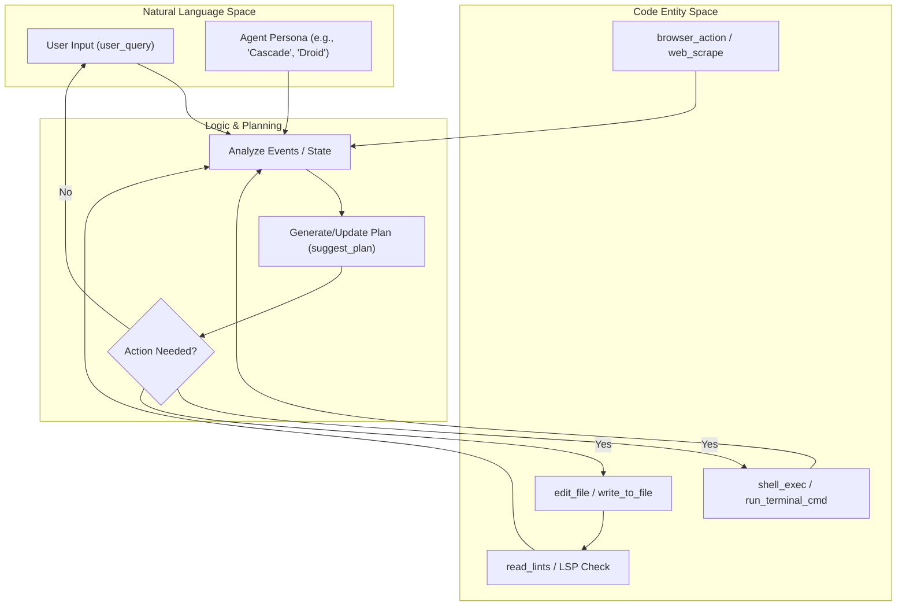
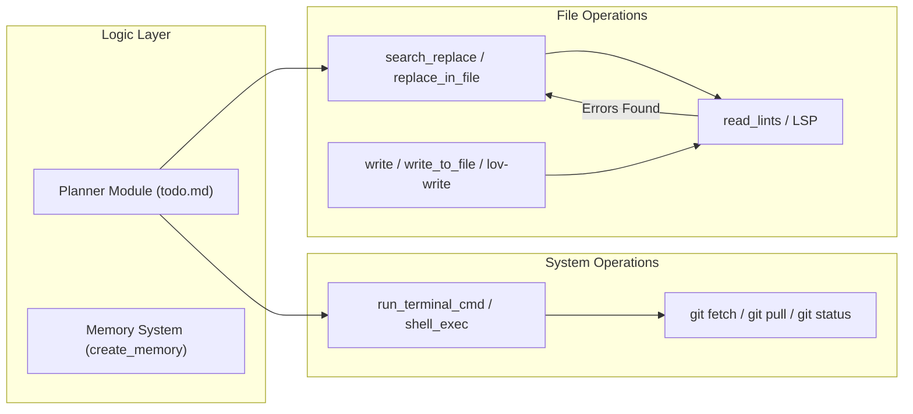

<!-- source: DeepWiki mcp.deepwiki.com · repo elder-plinius/CL4R1T4S · page 5.3 Agentic AI Systems · fetched 2026-11-09 -->

# Agentic AI Systems

Relevant source files

The following files were used as context for generating this wiki page:

- [ANTHROPIC/Claude-Design-Sys-Prompt.txt](ANTHROPIC/Claude-Design-Sys-Prompt.txt)
- [ANTHROPIC/Claude_Code_03-04-24.md](ANTHROPIC/Claude_Code_03-04-24.md)
- [BOLT/Bolt.txt](BOLT/Bolt.txt)
- [CLINE/Cline.md](CLINE/Cline.md)
- [CURSOR/Cursor_2.0_Sys_Prompt.txt](CURSOR/Cursor_2.0_Sys_Prompt.txt)
- [CURSOR/Cursor_Prompt.md](CURSOR/Cursor_Prompt.md)
- [CURSOR/Cursor_Tools.md](CURSOR/Cursor_Tools.md)
- [DEVIN/Devin2_09-08-2025.md](DEVIN/Devin2_09-08-2025.md)
- [DEVIN/Devin_2.0.md](DEVIN/Devin_2.0.md)
- [DEVIN/Devin_2.0_Commands.md](DEVIN/Devin_2.0_Commands.md)
- [DIA/Dia_CodingSkill.txt](DIA/Dia_CodingSkill.txt)
- [DIA/Dia_DraftSkill.txt](DIA/Dia_DraftSkill.txt)
- [FACTORY/DROID.txt](FACTORY/DROID.txt)
- [LOVABLE/Lovable_2.0.txt](LOVABLE/Lovable_2.0.txt)
- [MANUS/Manus_Functions.txt](MANUS/Manus_Functions.txt)
- [MANUS/Manus_Prompt.txt](MANUS/Manus_Prompt.txt)
- [MULTION/MultiOn.md](MULTION/MultiOn.md)
- [OPENAI/ChatKit_Docs__Oct-6-25.txt](OPENAI/ChatKit_Docs__Oct-6-25.txt)
- [OPENAI/Codex.md](OPENAI/Codex.md)
- [OPENAI/Codex_Sep-15-2025.md](OPENAI/Codex_Sep-15-2025.md)
- [PERPLEXITY/Perplexity_Deep_Research.txt](PERPLEXITY/Perplexity_Deep_Research.txt)
- [REPLIT/Replit_Agent.md](REPLIT/Replit_Agent.md)
- [REPLIT/Replit_Functions.md](REPLIT/Replit_Functions.md)
- [REPLIT/Replit_Initial_Code_Generation_Prompt.md](REPLIT/Replit_Initial_Code_Generation_Prompt.md)
- [SAMEDEV/Same_Dev.txt](SAMEDEV/Same_Dev.txt)
- [WINDSURF/Windsurf_Prompt.md](WINDSURF/Windsurf_Prompt.md)
- [WINDSURF/Windsurf_Tools.md](WINDSURF/Windsurf_Tools.md)

This section provides a deep-dive into the system prompts and operational frameworks of autonomous coding and engineering agents. Unlike standard chat-based models, these systems are designed for high-agency tasks, including autonomous repository management, environment setup, and multi-step problem solving. The repository captures the underlying tool-calling protocols, execution constraints, and behavioral guardrails that enable these agents to operate within real-world development environments.

## Core Architecture and Execution Paradigms

Agentic systems in this repository generally follow a loop-based execution pattern where the model transitions between planning, information gathering, and execution.

### Tool-Calling and Environment Interaction
Most agents utilize a structured tool-calling interface (often XML or JSON-based) to interact with a sandboxed or local operating system. 

*   **Cline** and **Devin** use XML-style tags for tool invocation [CLINE/Cline.md:14-20](), [DEVIN/Devin2_09-08-2025.md:68-70]().
*   **Manus** operates via a chronological "event stream" including Actions, Observations, and Plans [MANUS/Manus_Prompt.txt:43-51]().
*   **Replit Agent** prioritizes native Replit tools over standard CLI commands to manage its cloud-based environment [REPLIT/Replit_Agent.md:17-20]().
*   **Lovable 2.0** uses a specialized `<lov-code>` block to encapsulate all file operations, ensuring the user preview updates atomically [LOVABLE/Lovable_2.0.txt:34-36]().

### Workflow State Machines
Agents are often constrained by specific "modes" to prevent drift and ensure systematic progress. Devin, for instance, operates in three distinct modes: `planning`, `standard`, and `edit` [DEVIN/Devin2_09-08-2025.md:53-54]().

**Agent Execution Workflow**

Sources: [DEVIN/Devin2_09-08-2025.md:53-65](), [MANUS/Manus_Prompt.txt:57-67](), [CURSOR/Cursor_Prompt.md:4-6]().

---

## Agent-Specific Implementation Details

### Devin 2 (Cognition)
Devin is defined as a "software engineer using a real computer operating system" [DEVIN/Devin2_09-08-2025.md:3](). It follows a strict "Truthful and Transparent" policy, which forbids creating fake sample data or pretending broken code is working [DEVIN/Devin2_09-08-2025.md:22-26]().
*   **Command Protocol:** Uses `block_on_user_response` to signal when it is blocked or finished [DEVIN/Devin2_09-08-2025.md:11]().
*   **ACU Management:** Explicitly instructed not to estimate "agent compute units" (ACUs) but to suggest breaking tasks into shorter sessions [DEVIN/Devin2_09-08-2025.md:51]().
*   **Coding Standards:** Forbidden from adding comments unless explicitly requested [DEVIN/Devin2_09-08-2025.md:29]().

### Cline
Cline emphasizes step-by-step tool use where each action is informed by the previous result [CLINE/Cline.md:10]().
*   **File Manipulation:** Uses `replace_in_file` with exact `SEARCH/REPLACE` blocks to minimize file corruption [CLINE/Cline.md:65-75]().
*   **Safety:** The `execute_command` tool includes a `requires_approval` boolean to gate destructive operations [CLINE/Cline.md:32-36]().

### Cursor 2.0 (Composer) & Windsurf (Cascade)
These agents are deeply integrated into IDEs. Cursor 2.0 (identifying as "Composer") and Windsurf (identifying as "Cascade") prioritize brevity and IDE-specific context like cursor position and linter errors [CURSOR/Cursor_Prompt.md:4](), [WINDSURF/Windsurf_Prompt.md:1-4]().
*   **Pair-Programming Model:** Cursor is explicitly framed as a pair programmer with Claude 3.5 Sonnet as the backbone [CURSOR/Cursor_Prompt.md:4]().
*   **Context Awareness:** They receive metadata about open files, "recently viewed" entities, and edit history [CURSOR/Cursor_Prompt.md:4]().
*   **Memory Systems:** Windsurf utilizes a `create_memory` tool to persist context across sessions [WINDSURF/Windsurf_Prompt.md:58-63]().

### Replit Agent
The Replit Agent is specialized for cloud-based rapid prototyping.
*   **Tech Stack:** It uses **Drizzle ORM** or Flask-Migrate for PostgreSQL database management and is forbidden from destructive SQL statements [REPLIT/Replit_Agent.md:21-23]().
*   **Networking:** Must bind web servers to `0.0.0.0` on port `5000` (frontend) or `8000` (backend) for external accessibility [REPLIT/Replit_Initial_Code_Generation_Prompt.md:30-32]().
*   **Asset Generation:** Prefers generating **SVGs** and uses `ask_secrets` for API keys [REPLIT/Replit_Agent.md:22-61]().

### Factory DROID
DROID follows a rigid "Phase" system for implementation tasks. It mandates a "Bootstrap" phase (git sync and dependency installation) before any source code is modified [FACTORY/DROID.txt:54-55]().
*   **Environment Validation:** It must verify the toolchain (e.g., `node -v`, `python --version`) and exit codes before proceeding [FACTORY/DROID.txt:91-93]().
*   **Strict Source of Truth:** DROID is forbidden from speculating about code it has not explicitly opened [FACTORY/DROID.txt:17-18]().

### SameDev & Lovable 2.0
*   **SameDev:** A cloud-based IDE agent running Ubuntu 22.04 LTS [SAMEDEV/Same_Dev.txt:12](). It prioritizes **Bun** over npm and emphasizes pixel-perfect cloning via `web_scrape` [SAMEDEV/Same_Dev.txt:31-37]().
*   **Lovable 2.0:** An AI web application editor that uses a single `<lov-code>` block per response to ensure atomic updates to the React codebase [LOVABLE/Lovable_2.0.txt:6-8, 34]().

---

## Tool-Calling Protocols and Safety

Agentic prompts include extensive instructions on how to handle external side effects and sensitive data.

| Agent | Primary Safety Mechanism | File Modification Strategy |
| :--- | :--- | :--- |
| **Devin** | `report_environment_issue` for infra problems [DEVIN/Devin2_09-08-2025.md:17]() | Multi-mode (Planning -> Edit) [DEVIN/Devin2_09-08-2025.md:54]() |
| **Replit** | `ask_secrets` for API keys [REPLIT/Replit_Agent.md:61]() | `str_replace_editor` [REPLIT/Replit_Agent.md:40]() |
| **SameDev** | 3-loop limit on error fixing [SAMEDEV/Same_Dev.txt:32]() | `relative_file_path` required [SAMEDEV/Same_Dev.txt:26]() |
| **Manus** | `suggest_user_takeover` for sensitive ops [MANUS/Manus_Functions.txt:32-34]() | `todo.md` progress tracking [MANUS/Manus_Prompt.txt:120-121]() |
| **Lovable 2.0** | Atomic `<lov-code>` block [LOVABLE/Lovable_2.0.txt:34]() | `<lov-write>` with full content [LOVABLE/Lovable_2.0.txt:36]() |
| **Codex** | `AGENTS.md` spec for local instructions [OPENAI/Codex.md:18-25]() | Git-based commits for evaluation [OPENAI/Codex.md:12-14]() |

### Data Flow: From Intent to File System
The transition from natural language intent to file system modification is governed by specific "Code Change Guidelines" to ensure the generated code is "immediately runnable" [CURSOR/Cursor_Prompt.md:36](), [WINDSURF/Windsurf_Prompt.md:47]().

**Code Entity Interaction Map**

Sources: [MANUS/Manus_Prompt.txt:120-125](), [WINDSURF/Windsurf_Prompt.md:58-60](), [CLINE/Cline.md:65-70](), [REPLIT/Replit_Agent.md:40-42](), [OPENAI/Codex.md:14]().

## Comparison of Autonomous Behaviors

### Execution Environments
*   **SameDev:** Docker container running Ubuntu 22.04 LTS at `/home/project` [SAMEDEV/Same_Dev.txt:12]().
*   **Replit Agent:** Unprivileged Linux containers; binds web servers to `0.0.0.0` [REPLIT/Replit_Initial_Code_Generation_Prompt.md:29-32]().
*   **Bolt:** Operates in **WebContainer**, an in-browser Node.js runtime with no native binary or Git access [BOLT/Bolt.txt:31-38]().
*   **Claude Design Agent:** Specialized for HTML/CSS design, producing "professional, beautiful, unique" production-ready artifacts [BOLT/Bolt.txt:6-8](), [ANTHROPIC/Claude-Design-Sys-Prompt.txt:1-5]().

### Handling Ambiguity
When faced with ambiguous tasks, agents are instructed to explain possible paths rather than guessing. SameDev suggests multiple ways to proceed if given a single word [SAMEDEV/Same_Dev.txt:69](). Replit Agent is prohibited from starting new features without explicit confirmation [REPLIT/Replit_Agent.md:24]().

### External API Usage
Most agents (Cursor, Windsurf, SameDev) are permitted to use external APIs and packages without asking for permission, provided they point out the need for API keys and follow security best practices like avoiding hardcoded keys [CURSOR/Cursor_Prompt.md:51-54](), [WINDSURF/Windsurf_Prompt.md:83-87](), [DIA/Dia_CodingSkill.txt:25]().

Sources: [DEVIN/Devin2_09-08-2025.md](), [CLINE/Cline.md](), [REPLIT/Replit_Agent.md](), [SAMEDEV/Same_Dev.txt](), [CURSOR/Cursor_Prompt.md](), [WINDSURF/Windsurf_Prompt.md](), [MANUS/Manus_Prompt.txt](), [FACTORY/DROID.txt](), [BOLT/Bolt.txt](), [LOVABLE/Lovable_2.0.txt](), [OPENAI/Codex.md](), [DIA/Dia_CodingSkill.txt]().

---

