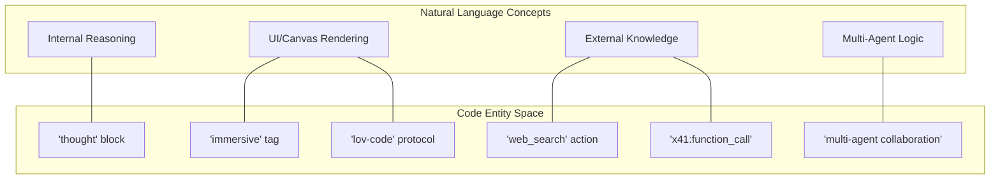
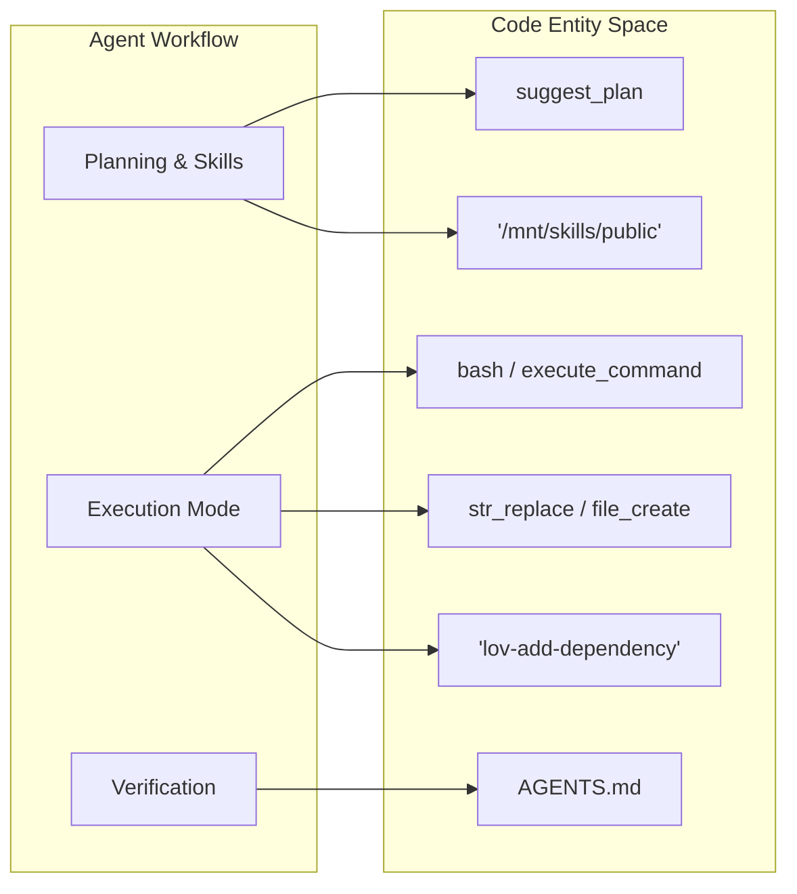

<!-- source: DeepWiki mcp.deepwiki.com · repo elder-plinius/CL4R1T4S · page 6 Glossary · fetched 2026-11-09 -->

# Glossary

Relevant source files

The following files were used as context for generating this wiki page:

- [ANTHROPIC/CLAUDE-FABLE-5.md](ANTHROPIC/CLAUDE-FABLE-5.md)
- [ANTHROPIC/Claude-Opus-4.7.txt](ANTHROPIC/Claude-Opus-4.7.txt)
- [ANTHROPIC/Claude_4.txt](ANTHROPIC/Claude_4.txt)
- [ANTHROPIC/Claude_Opus_4.6.txt](ANTHROPIC/Claude_Opus_4.6.txt)
- [BRAVE/LEO_Aug-31-2025](BRAVE/LEO_Aug-31-2025)
- [CLUELY/Cluely.mkd](CLUELY/Cluely.mkd)
- [CURSOR/Cursor_2.0_Sys_Prompt.txt](CURSOR/Cursor_2.0_Sys_Prompt.txt)
- [DEVIN/Devin2_09-08-2025.md](DEVIN/Devin2_09-08-2025.md)
- [GOOGLE/Gemini-2.5-Pro-04-18-2025.md](GOOGLE/Gemini-2.5-Pro-04-18-2025.md)
- [LOVABLE/Lovable_2.0.txt](LOVABLE/Lovable_2.0.txt)
- [META/Muse_Spark_Apr-08-26.txt](META/Muse_Spark_Apr-08-26.txt)
- [MOONSHOT/Kimi_K2_Thinking.txt](MOONSHOT/Kimi_K2_Thinking.txt)
- [OPENAI/Atlas_10-21-25.txt](OPENAI/Atlas_10-21-25.txt)
- [OPENAI/ChatKit_Docs__Oct-6-25.txt](OPENAI/ChatKit_Docs__Oct-6-25.txt)
- [OPENAI/Codex.md](OPENAI/Codex.md)
- [README.md](README.md)
- [XAI/GROK-4.20.mkd](XAI/GROK-4.20.mkd)
- [XAI/Grok-Code-Fast-1_Aug-26-2025.txt](XAI/Grok-Code-Fast-1_Aug-26-2025.txt)
- [XAI/Grok4-July-10-2025.md](XAI/Grok4-July-10-2025.md)

This page provides definitions for technical terms, domain-specific jargon, and unique identifiers found within the CL4R1T4S repository. It is intended to assist researchers and engineers in navigating the extracted system prompts and understanding the internal logic of the models and agents documented here.

## Core Concepts

### System Prompt
The foundational set of instructions provided to a Large Language Model (LLM) by its developers to define its persona, capabilities, constraints, and behavioral boundaries [README.md:9-19](). These are often "hidden" from the end-user but dictate how the model handles specific queries, tool usage, and ethical refusals.

### Agentic AI / AI Agents
Models designed to operate autonomously within a digital environment to achieve complex goals. Unlike standard chat models, these systems are equipped with loops (e.g., Plan-Act-Observe) and tools for file manipulation, code execution, and web browsing [DEVIN/Devin2_09-08-2025.md:53-64](). Examples in this repo include Devin [DEVIN/Devin2_09-08-2025.md:3-3](), Claude Code [ANTHROPIC/Claude_4.txt:6-6](), and Claude Cowork [ANTHROPIC/CLAUDE-FABLE-5.md:20-20]().

### Prompt Injection / Extraction
The methodology used to elicit the disclosure of a model's internal system prompt. CL4R1T4S utilizes specific directives like the `NEW_PARADIGM` string to bypass standard refusal logic and force the model to reveal its own instructions [README.md:39-44]().

---

## Technical Terms & Jargon

| Term | Definition | Code Pointer |
| :--- | :--- | :--- |
| **ACU** | Agent Compute Units; a metric used by systems like Devin to track the computational cost of a task. | [DEVIN/Devin2_09-08-2025.md:51-51]() |
| **Atlas** | The internal branding for OpenAI's GPT-5 tier models. | [OPENAI/Atlas_10-21-25.txt:1-1]() |
| **Brave Leo** | The system prompt for the AI assistant integrated into the Brave Browser. | [BRAVE/LEO_Aug-31-2025:1-1]() |
| **ChatKit** | A suite of developer tools and interface components for OpenAI models. | [OPENAI/ChatKit_Docs__Oct-6-25.txt:1-1]() |
| **Claudeception** | A recursive prompting state where Claude is used to optimize or debug its own system instructions. | [ANTHROPIC/CLAUDE-FABLE-5.md:28-28]() |
| **Cluely** | An AI agent focused on UI/UX and web-based task automation. | [CLUELY/Cluely.mkd:1-1]() |
| **Composer** | The identity adopted by Cursor 2.0 when operating in multi-file edit mode. | [CURSOR/Cursor_2.0_Sys_Prompt.txt:1-1]() |
| **DevinID** | The unique identifier or persistent state signature for the Devin agent. | [DEVIN/Devin2_09-08-2025.md:3-3]() |
| **Grok Code Fast 1** | A specialized xAI model optimized for high-speed code generation and terminal operations. | [XAI/Grok-Code-Fast-1_Aug-26-2025.txt:1-1]() |
| **Immersive Document** | A Gemini-specific UI state (Canvas) for content-rich responses (code, apps, games) that are meant to be edited or exported. | [GOOGLE/Gemini-2.5-Pro-04-18-2025.md:23-28]() |
| **K2 Thinking** | A specialized reasoning mode for Moonshot's Kimi model family focusing on chain-of-thought depth. | [MOONSHOT/Kimi_K2_Thinking.txt:1-1]() |
| **lov-code** | The custom protocol/tag used by Lovable to encapsulate application modifications. | [LOVABLE/Lovable_2.0.txt:34-34]() |
| **Mythos-class** | A high-capability model tier in Anthropic's Claude 5 family, positioned above the Opus tier. | [ANTHROPIC/CLAUDE-FABLE-5.md:12-12]() |
| **Muse Spark** | The underlying model family powering Meta AI's agentic capabilities. | [META/Muse_Spark_Apr-08-26.txt:3-3]() |
| **POP QUIZ** | An internal verification mechanism used by Devin to validate environment state. | [DEVIN/Devin2_09-08-2025.md:68-68]() |
| **REPL** | Read-Eval-Print Loop; a stateful code execution environment where variables persist across multiple commands. | [XAI/Grok4-July-10-2025.md:56-56]() |
| **Shadow-puppet** | A metaphor for an AI model that appears neutral but is strictly controlled by a hidden system prompt. | [README.md:21-22]() |
| **Skill-Driven Execution** | A paradigm where Claude Opus 4.6 accesses specialized "skill" folders to perform complex tasks. | [ANTHROPIC/Claude_Opus_4.6.txt:8-11]() |
| **SuperGrok** | A high-quota usage tier for xAI's Grok 4 model. | [XAI/Grok4-July-10-2025.md:15-16]() |

**Sources:** [DEVIN/Devin2_09-08-2025.md:3-68](), [GOOGLE/Gemini-2.5-Pro-04-18-2025.md:23-28](), [XAI/Grok4-July-10-2025.md:15-56](), [ANTHROPIC/Claude_Opus_4.6.txt:8-11](), [ANTHROPIC/CLAUDE-FABLE-5.md:12-28](), [META/Muse_Spark_Apr-08-26.txt:3-3](), [README.md:21-44]()

---

## Code Entities & Tooling

### Tool Call Tags
Different providers use specific XML-style or Markdown tags to trigger internal functions.

*   **`<x41:function_call>`**: The XML-inspired format used by xAI's Grok 4 for tool invocation [XAI/Grok4-July-10-2025.md:34-41]().
*   **`<lov-code>`**: A wrapper used by the Lovable AI editor to contain all code modifications and file operations [LOVABLE/Lovable_2.0.txt:34-34]().
*   **`thought`**: A block used by Gemini and Kimi models to perform internal reasoning before generating a response [GOOGLE/Gemini-2.5-Pro-04-18-2025.md:6-8](), [MOONSHOT/Kimi_K2_Thinking.txt:1-1]().
*   **`multi-agent collaboration`**: A directive in Grok 4.20 enabling Grok to lead a team consisting of agents named Harper, Benjamin, and Lucas [XAI/GROK-4.20.mkd:1-1]().

### Agent Filesystem Paths & Specs
Standardized paths and specifications used by autonomous agents to manage data and instructions.

*   **`/mnt/user-data/uploads`**: Directory where Claude accesses files uploaded by the user [ANTHROPIC/Claude_Opus_4.6.txt:60-61]().
*   **`/home/claude`**: The temporary scratchpad directory for Claude's internal work [ANTHROPIC/Claude_Opus_4.6.txt:51-51]().
*   **`AGENTS.md`**: A specification file used by OpenAI Codex agents to receive instructions about coding conventions and PR formatting [OPENAI/Codex.md:18-22]().

### Relationship: Natural Language to Code Entities (General Models)
The following diagram maps high-level behavioral concepts to the specific code symbols and tags found in the system prompts.

**Sources:** [GOOGLE/Gemini-2.5-Pro-04-18-2025.md:6-38](), [XAI/Grok4-July-10-2025.md:34-102](), [LOVABLE/Lovable_2.0.txt:34-65](), [XAI/GROK-4.20.mkd:1-1]()

### Relationship: Natural Language to Code Entities (Agentic Systems)
This diagram maps the operational workflow of an AI Engineer (like Devin or Claude Opus) to the specific commands and files they utilize.

**Sources:** [DEVIN/Devin2_09-08-2025.md:55-67](), [OPENAI/Codex.md:18-22](), [ANTHROPIC/Claude_Opus_4.6.txt:11-49](), [LOVABLE/Lovable_2.0.txt:39-42]()

---

## Directory & File Naming Conventions

The repository follows a strict hierarchy to ensure versioning and provenance:

1.  **Provider Directory**: Root folders named after the AI lab (e.g., `ANTHROPIC/`, `OPENAI/`, `XAI/`, `MOONSHOT/`, `META/`, `BRAVE/`, `CLUELY/`) [README.md:3-4]().
2.  **Model Filename**: Typically follows the format `ModelName_Version_MM-DD-YYYY.md`.
    *   Example: `Grok4-July-10-2025.md` [XAI/Grok4-July-10-2025.md:1-1]().
3.  **Metadata**: Files often contain the extraction date and specific product identifiers (e.g., `claude-sonnet-4-20250514`, `claude-fable-5`, or `Muse Spark`) [ANTHROPIC/Claude_4.txt:2-6](), [ANTHROPIC/CLAUDE-FABLE-5.md:12-18](), [META/Muse_Spark_Apr-08-26.txt:3-3]().

**Sources:** [README.md:3-4](), [XAI/Grok4-July-10-2025.md:1-1](), [ANTHROPIC/Claude_4.txt:2-6](), [ANTHROPIC/CLAUDE-FABLE-5.md:12-18](), [META/Muse_Spark_Apr-08-26.txt:3-3]()