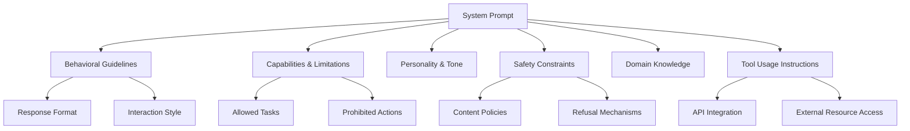
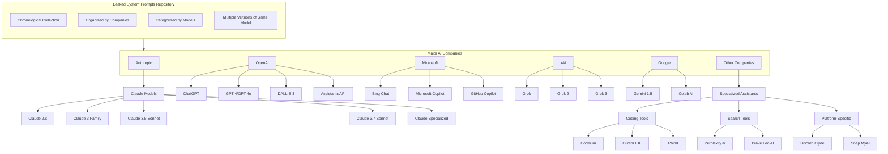
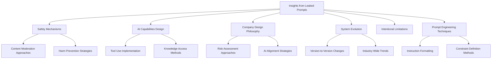

<!-- source: DeepWiki mcp.deepwiki.com · repo jujumilk3/leaked-system-prompts · page 1 Introduction to Leaked System Prompts · fetched 2026-11-09 -->

# Introduction to Leaked System Prompts

Relevant source files

The following files were used as context for generating this wiki page:

- [README.md](README.md)
- [duckai-gpt-5-mini_20251102.md](duckai-gpt-5-mini_20251102.md)
- [manus_20250309.md](manus_20250309.md)
- [manus_20250310.md](manus_20250310.md)
- [openai-chatgpt4o_20250506.md](openai-chatgpt4o_20250506.md)
- [openai-chatgpt5_20250807.md](openai-chatgpt5_20250807.md)
- [openai-chatgpt5_20250808.md](openai-chatgpt5_20250808.md)
- [proton-lumo_20250724.md](proton-lumo_20250724.md)
- [proton-lumo_20250727.md](proton-lumo_20250727.md)

## Purpose and Scope

This document provides a comprehensive overview of the leaked system prompts repository, which contains a collection of system prompts from various AI assistant models developed by leading companies in the field. The repository serves as a valuable resource for understanding how AI assistants are instructed to operate, their intended behaviors, constraints, and capabilities. For detailed analyses of specific AI systems and comparative studies, please refer to other sections in this wiki, such as [Major AI Companies and Their Systems](#2) and [Comparative Analysis](#4).

## What Are System Prompts?

System prompts are specialized instructions given to large language models (LLMs) that define their behavior, personality, capabilities, and limitations. These prompts serve as the "operating manual" for AI assistants, shaping how they respond to user inputs, what tasks they can perform, what information they can access, and what constraints they operate under.

System prompts differ from user prompts in that they are typically invisible to end users and establish the foundational behavior of the AI system, while user prompts are the specific queries or requests made during interaction with the model.

Sources: [README.md:1-74]()

## Repository Overview

The leaked system prompts repository contains a chronological collection of system prompts from numerous AI assistant models. These leaked prompts provide unprecedented insight into how different companies design their AI systems and how these designs have evolved over time.

Sources: [README.md:1-74]()

## Chronological Evolution

The repository contains system prompts dating from late 2022 to early 2025, showing the rapid evolution of AI assistant design. This timeline provides valuable historical context for understanding how AI assistants have developed over a relatively short period.

| Time Period | Notable Developments |
|-------------|---------------------|
| Late 2022   | Early ChatGPT, Perplexity.ai, Notion AI |
| Early 2023  | Microsoft Bing Chat, Discord Clyde, GitHub Copilot Chat |
| Mid 2023    | ChatGPT iOS, Opera Aria, Claude system refinements |
| Late 2023   | DALL-E 3, OpenAI Assistants API |
| Early 2024  | Claude 3 family (Haiku, Sonnet, Opus), GPT-4 refinements |
| Mid 2024    | Claude 3.5 Sonnet, GPT-4o, Brave Leo AI |
| Late 2024   | Codeium, Cursor IDE, xAI Grok 2, Microsoft Copilot updates |
| Early 2025  | Claude 3.7 Sonnet, xAI Grok 3, OpenAI Deep Research, GPT-4o updates |

Sources: [README.md:5-74]()

## Significance of Leaked System Prompts

System prompts are typically proprietary and kept confidential by AI companies for several reasons:

1. **Competitive Advantage**: They represent significant intellectual property and design philosophy
2. **Security Concerns**: Knowledge of system prompts can potentially be used to craft inputs that circumvent safety measures
3. **Business Strategy**: They reveal product roadmaps and technical capabilities

The leaking of these prompts provides researchers, developers, and the public with unprecedented insights into:

Sources: [README.md:1-74]()

## Major Collections in the Repository

The repository contains system prompts from a wide range of AI assistants. Below is a breakdown of the major collections:

### Anthropic Claude Series

The repository includes extensive documentation of Anthropic's Claude models, showing the evolution from Claude 2.0 to Claude 3.7 Sonnet, including specialized variants for API tool use and coding:

- Claude 2.0 and 2.1 (March 2024)
- Claude 3 family: Haiku, Opus, Sonnet (March-July 2024)
- Claude 3.5 Sonnet (July-November 2024)
- Claude 3.7 Sonnet (February 2025)
- Specialized Claude systems: API Tool Use, Claude Code (January-March 2025)

### OpenAI Systems

The collection documents OpenAI's systems from the initial ChatGPT release through multiple iterations and specialized applications:

- ChatGPT (December 2022)
- ChatGPT mobile applications (June 2023-February 2024)
- GPT-4o (May 2024-March 2025)
- DALL-E 3 (October 2023)
- Assistants API (November 2023)
- Deep Research (February 2025)

### Microsoft AI Systems

Microsoft's AI assistants are represented through multiple iterations:

- Bing Chat (February 2023)
- Microsoft Copilot (March-December 2024)
- GitHub Copilot Chat (May 2023-September 2024)

### xAI Grok Series

The repository includes the evolution of xAI's Grok from its initial release through Grok 3:

- Grok (March-October 2024)
- Grok 2 (December 2024-January 2025)
- Grok 3 (February 2025)

### Specialized AI Assistants

The collection also contains system prompts from various specialized AI assistants:

- Coding tools: Codeium, Cursor IDE, Phind, Manus, Devv
- Search and research tools: Perplexity.ai, Brave Leo AI
- Platform-specific assistants: Discord Clyde, Snap MyAI

Sources: [README.md:5-74]()

## How to Use This Wiki

This wiki provides detailed analysis of the leaked system prompts, organized to help readers understand:

1. The evolution of AI assistant design across major companies
2. Comparative features and capabilities between different systems
3. Safety mechanisms and constraints implemented in different models
4. System design patterns and architectural approaches
5. Historical context and timeline of system prompt development

For in-depth analysis of specific companies and their AI systems, refer to [Major AI Companies and Their Systems](#2). For specialized AI assistants designed for specific purposes, see [Specialized AI Assistants](#3). A comparative analysis across different systems is available in [Comparative Analysis](#4).

Sources: [README.md:1-74]()

---

