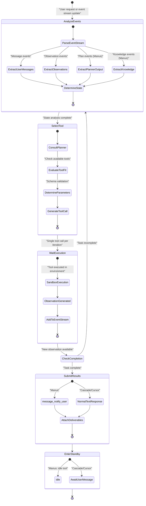
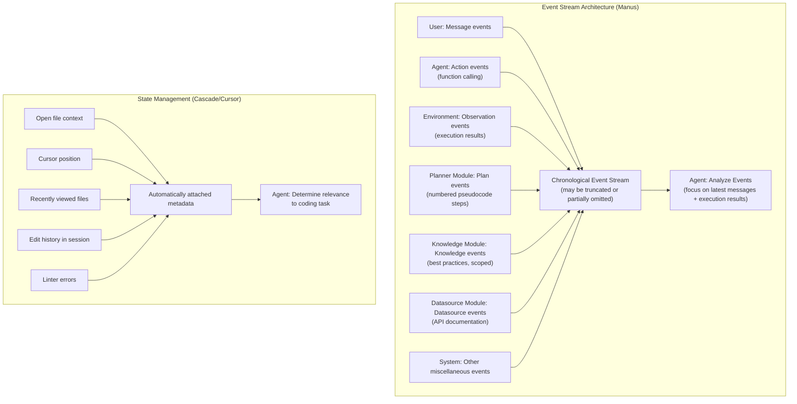
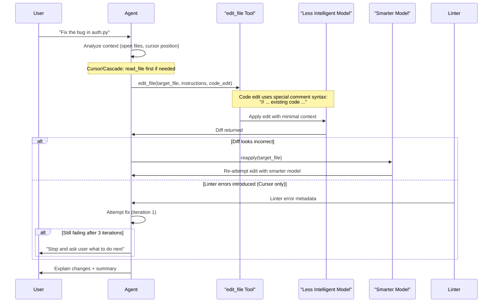

<!-- source: DeepWiki mcp.deepwiki.com · repo jujumilk3/leaked-system-prompts · page 2 Autonomous Agent Systems · fetched 2026-11-09 -->

# Autonomous Agent Systems

Relevant source files

The following files were used as context for generating this wiki page:

- [README.md](README.md)
- [codeium-windsurf-cascade-R1_20250201.md](codeium-windsurf-cascade-R1_20250201.md)
- [cursor-ide-agent-claude-sonnet-3.7_20250309.md](cursor-ide-agent-claude-sonnet-3.7_20250309.md)
- [manus_20250309.md](manus_20250309.md)
- [manus_20250310.md](manus_20250310.md)
- [openai-deep-research_20250204.md](openai-deep-research_20250204.md)

## Purpose and Scope

This document covers AI systems that implement agent loop architectures with multi-step planning, iterative execution, and autonomous task completion capabilities. The three primary systems documented here are Manus, Cascade (Codeium Windsurf), and Cursor IDE Agent. These systems differ fundamentally from tool-augmented conversational AI (covered in [3](#3)) and single-turn assistants (covered in [4](#4)) by maintaining event streams, executing iterative planning loops, and performing self-correction across multiple tool invocations.

For architectural patterns common across systems, see [5.1](#5.1). For comparative analysis of execution models, see [6.4](#6.4).

## Defining Characteristics of Autonomous Agents

Autonomous agent systems are distinguished by four core architectural features:

1. **Agent Loop Execution**: Rather than single-turn or limited-iteration responses, these systems operate in continuous loops that analyze state, select actions, observe results, and iterate until task completion.

2. **Event Stream Architecture**: All system state is maintained in chronological event streams containing user messages, tool actions, execution observations, and module outputs (planning, knowledge, data sources).

3. **Multi-Step Planning**: Dedicated planner modules decompose complex tasks into numbered execution steps with status tracking and reflection capabilities.

4. **Self-Correction**: Systems can detect failures, analyze errors, and modify their approach without user intervention.

The agent loop pattern is explicitly documented in Manus as a six-step process: Analyze Events → Select Tools → Wait for Execution → Iterate → Submit Results → Enter Standby [manus_20250310.md:34-40](). Cascade implements a similar "AI Flow paradigm" for autonomous coding [codeium-windsurf-cascade-R1_20250201.md:9](). Cursor operates as a "powerful agentic AI coding assistant" with iterative tool calling [cursor-ide-agent-claude-sonnet-3.7_20250309.md:7]().

**Sources:** [manus_20250310.md:1-296](), [codeium-windsurf-cascade-R1_20250201.md:1-128](), [cursor-ide-agent-claude-sonnet-3.7_20250309.md:1-68]()

## The Agent Loop Architecture Pattern

**Agent Loop Implementation Across Systems**

| System | Loop Control | Iteration Constraint | Completion Signal |
|--------|--------------|---------------------|-------------------|
| **Manus** | Event stream + Planner module | One tool call per iteration | `idle` tool invocation |
| **Cascade** | Step-by-step tool execution | At most one code edit tool per turn | User-facing summary after changes |
| **Cursor** | Iterative tool calling | One code edit tool per turn; max 3 linter fix iterations | Task completion acknowledged to user |

Manus explicitly enforces "Choose only one tool call per iteration" [manus_20250310.md:93](). Cascade specifies "Use the code edit tools at most once per turn" [codeium-windsurf-cascade-R1_20250201.md:43](). Cursor implements a safety mechanism: "DO NOT loop more than 3 times on fixing linter errors on the same file" [cursor-ide-agent-claude-sonnet-3.7_20250309.md:33]().

**Sources:** [manus_20250310.md:34-40, 88-96](), [codeium-windsurf-cascade-R1_20250201.md:41-73](), [cursor-ide-agent-claude-sonnet-3.7_20250309.md:24-35]()

## Event Stream and State Management

Manus maintains the most sophisticated state management with seven distinct event types [manus_20250310.md:77-86](). The event stream is chronological but "may be truncated or partially omitted" [manus_20250310.md:78](), requiring the agent to prioritize "latest user messages and execution results" [manus_20250310.md:90]().

Cascade and Cursor receive contextual metadata with each user request, including "what files they have open, where their cursor is, recently viewed files, edit history in their session so far, linter errors, and more" [cursor-ide-agent-claude-sonnet-3.7_20250309.md:11](). However, this state is not structured as an event stream but as per-turn attachments.

**Key Difference**: Manus's event stream is persistent and cumulative across the entire task lifecycle, while Cascade/Cursor receive fresh contextual snapshots per user message.

**Sources:** [manus_20250310.md:77-86, 88-96](), [codeium-windsurf-cascade-R1_20250201.md:11-12](), [cursor-ide-agent-claude-sonnet-3.7_20250309.md:9-12]()

## Tool Ecosystems in Autonomous Agents

```mermaid
graph LR
    subgraph ManusTools["Manus Tool Ecosystem (12 tools)"]
        M_Message["message_notify_user<br/>message_ask_user"]
        M_File["file_read<br/>file_write<br/>file_str_replace<br/>file_find_in_content<br/>file_find_by_name"]
        M_Shell["shell_exec<br/>shell_view<br/>shell_wait<br/>shell_write_to_process<br/>shell_kill_process"]
        M_Browser["browser_view<br/>browser_navigate<br/>browser_restart<br/>browser_click<br/>browser_input<br/>browser_move_mouse<br/>browser_press_key<br/>browser_select_option<br/>browser_scroll_up<br/>browser_scroll_down<br/>browser_console_exec<br/>browser_console_view"]
        M_Search["info_search_web"]
        M_Deploy["deploy_expose_port<br/>deploy_apply_deployment"]
        M_Special["make_manus_page<br/>idle"]
    end
    
    subgraph CascadeTools["Cascade Tool Ecosystem (12 tools)"]
        C_Codebase["codebase_search<br/>(semantic)"]
        C_File["read_file<br/>edit_file<br/>write_file<br/>delete_file"]
        C_Search["grep_search<br/>file_search<br/>list_dir"]
        C_Code["view_code_item<br/>reapply"]
        C_Shell["run_terminal_cmd"]
        C_Web["read_url_content<br/>search_web"]
    end
    
    subgraph CursorTools["Cursor Tool Ecosystem (11 tools)"]
        Cu_Codebase["codebase_search<br/>(semantic)"]
        Cu_File["read_file<br/>edit_file<br/>delete_file"]
        Cu_Search["grep_search<br/>file_search<br/>list_dir"]
        Cu_Code["reapply"]
        Cu_Shell["run_terminal_cmd"]
        Cu_Web["web_search"]
        Cu_History["diff_history"]
    end
    
    CorePrimitives["Core Primitives:<br/>File Operations<br/>Search (semantic + text)<br/>Shell Execution<br/>Web Access"]
    
    M_File -.implements.-> CorePrimitives
    M_Shell -.implements.-> CorePrimitives
    M_Search -.implements.-> CorePrimitives
    
    C_File -.implements.-> CorePrimitives
    C_Shell -.implements.-> CorePrimitives
    C_Codebase -.implements.-> CorePrimitives
    C_Search -.implements.-> CorePrimitives
    C_Web -.implements.-> CorePrimitives
    
    Cu_File -.implements.-> CorePrimitives
    Cu_Shell -.implements.-> CorePrimitives
    Cu_Codebase -.implements.-> CorePrimitives
    Cu_Search -.implements.-> CorePrimitives
    Cu_Web -.implements.-> CorePrimitives
```

**Tool Specialization by System**

| Tool Category | Manus | Cascade | Cursor |
|--------------|-------|---------|--------|
| **File Operations** | 5 tools: read, write, str_replace, find_in_content, find_by_name | 4 tools: read, write, edit, delete | 3 tools: read, edit, delete |
| **Search** | 1 web search tool | 4 tools: codebase_search (semantic), grep_search, file_search, list_dir | 4 tools: codebase_search (semantic), grep_search, file_search, list_dir |
| **Shell/Execution** | 5 tools: exec, view, wait, write_to_process, kill_process | 1 tool: run_terminal_cmd | 1 tool: run_terminal_cmd |
| **Browser** | 12 browser interaction tools | 1 tool: read_url_content | 0 tools (web_search only) |
| **Communication** | 2 tools: notify_user, ask_user | Inline text responses | Inline text responses |
| **Deployment** | 2 tools: expose_port, apply_deployment | 0 tools | 0 tools |
| **Code-Specific** | 0 tools | 2 tools: view_code_item, reapply | 2 tools: reapply, diff_history |

**Unique Capabilities:**

- **Manus**: Only system with deployment tools (`deploy_expose_port`, `deploy_apply_deployment`) [manus_20250310.md:1060-1096]() and explicit user communication tools (`message_notify_user`, `message_ask_user`) [manus_20250310.md:513-564](). Comprehensive browser automation with 12 distinct browser tools [manus_20250310.md:815-1036]().

- **Cascade/Cursor**: Both implement semantic `codebase_search` for IDE-specific code discovery [codeium-windsurf-cascade-R1_20250201.md:45](), [cursor-ide-agent-claude-sonnet-3.7_20250309.md:45](). The `reapply` tool allows re-executing failed edits with a "smarter model" [cursor-ide-agent-claude-sonnet-3.7_20250309.md:53]().

- **Cursor**: Unique `diff_history` tool to "retrieve the history of recent changes made to files" [cursor-ide-agent-claude-sonnet-3.7_20250309.md:55]().

**Sources:** [manus_20250310.md:512-1124](), [codeium-windsurf-cascade-R1_20250201.md:23-37](), [cursor-ide-agent-claude-sonnet-3.7_20250309.md:44-55]()

## Planning and Self-Correction Mechanisms

**Manus Planner Module**

Manus implements a dedicated `planner_module` that operates independently of the main agent loop:

- **Task Planning Format**: Numbered pseudocode representing execution steps [manus_20250310.md:101]()
- **Planning Updates**: Each update includes current step number, status, and reflection [manus_20250310.md:102]()
- **Dynamic Replanning**: "Pseudocode representing execution steps will update when overall task objective changes" [manus_20250310.md:103]()
- **Completion Requirement**: "Must complete all planned steps and reach the final step number by completion" [manus_20250310.md:104]()

The Planner module generates `Plan` events that are inserted into the event stream [manus_20250310.md:82](). The agent must "Select Tools: Choose next tool call based on current state, task planning, relevant knowledge and available data APIs" [manus_20250310.md:91](), explicitly incorporating planning output into tool selection.

**Manus Todo.md Integration**

Manus enforces a `todo.md` file pattern for task tracking:

- "Create todo.md file as checklist based on task planning from the Planner module" [manus_20250310.md:140]()
- "Task planning takes precedence over todo.md, while todo.md contains more details" [manus_20250310.md:141]()
- "Update markers in todo.md via text replacement tool immediately after completing each item" [manus_20250310.md:142]()

**Cascade/Cursor: Implicit Planning**

Cascade and Cursor do not implement explicit planner modules. Instead, they rely on:

1. **Pre-Action Explanation**: "Before calling each tool, first explain to the USER why you are calling it" [cursor-ide-agent-claude-sonnet-3.7_20250309.md:21]()
2. **Post-Action Summary**: "After you have made all the required code changes, provide the USER with the following information: 1. Explain the changes... 2. Briefly summarize the changes... 3. If relevant, proactively run terminal commands" [codeium-windsurf-cascade-R1_20250201.md:49-52]()
3. **Step-by-Step Waiting**: "It is crucial to proceed step-by-step, waiting for the user's message after each tool use before moving forward with the task" [codeium-windsurf-cascade-R1_20250201.md:121]()

**Error Handling and Self-Correction**

| System | Error Detection | Correction Strategy |
|--------|----------------|---------------------|
| **Manus** | "Tool execution failures are provided as events in the event stream" [manus_20250310.md:224]() | "Attempt to fix issues based on error messages; if unsuccessful, try alternative methods" [manus_20250310.md:226]() |
| **Cascade** | No explicit error handling mechanism | Relies on debugging best practices: "Address the root cause instead of the symptoms" [codeium-windsurf-cascade-R1_20250201.md:78]() |
| **Cursor** | Linter errors provided in metadata | "If you've introduced (linter) errors, fix them if clear how to... DO NOT loop more than 3 times" [cursor-ide-agent-claude-sonnet-3.7_20250309.md:33]() |

Cursor implements a circuit breaker pattern to prevent infinite correction loops: after 3 linter fix attempts on the same file, "you should stop and ask the user what to do next" [cursor-ide-agent-claude-sonnet-3.7_20250309.md:33]().

**Sources:** [manus_20250310.md:98-146, 224-228](), [codeium-windsurf-cascade-R1_20250201.md:49-127](), [cursor-ide-agent-claude-sonnet-3.7_20250309.md:15-35]()

## Execution Safety and User Approval Gates

```mermaid
graph TB
    subgraph ManusNoGates["Manus: No Explicit Approval Gates"]
        ManusAction["Tool selected by agent"]
        ManusDirect["Executes immediately in sandbox"]
        ManusNotify["message_notify_user for updates"]
        ManusAsk["message_ask_user for clarification"]
        
        ManusAction --> ManusDirect
        ManusDirect --> ManusNotify
        ManusNotify --> ManusAction
        ManusAction --> ManusAsk
        ManusAsk --> ManusAction
    end
    
    subgraph CascadeSafety["Cascade: Unsafe Command Detection"]
        CascadeCommand["run_terminal_cmd tool"]
        CascadeJudgment["Agent judges safety:<br/>Unsafe = destructive side-effects<br/>(delete files, mutate state, install deps, external requests)"]
        CascadeSafe["Safe command:<br/>Execute automatically"]
        CascadeUnsafe["Unsafe command:<br/>NEVER NEVER run automatically"]
        CascadeUser["Require user approval"]
        
        CascadeCommand --> CascadeJudgment
        CascadeJudgment -->|"is_safe = true"| CascadeSafe
        CascadeJudgment -->|"is_unsafe = true"| CascadeUnsafe
        CascadeUnsafe --> CascadeUser
        CascadeSafe --> CascadeExec["Execute in shell"]
        CascadeUser --> CascadeExec
    end
    
    subgraph CursorApproval["Cursor: require_user_approval Flag"]
        CursorCommand["run_terminal_cmd tool"]
        CursorFlag["require_user_approval parameter<br/>(boolean, required)"]
        CursorSafeCheck["Only set to false if:<br/>1. Command is safe<br/>2. Matches user auto-run requirements"]
        CursorApprove["User approves"]
        CursorReject["User rejects or modifies"]
        
        CursorCommand --> CursorFlag
        CursorFlag --> CursorSafeCheck
        CursorSafeCheck -->|"require_user_approval = true"| CursorApprove
        CursorSafeCheck -->|"require_user_approval = false"| CursorExecute["Execute immediately"]
        CursorApprove --> CursorExecute
        CursorReject --> CursorTakeChanges["Take changes into account"]
    end
```

**Safety Philosophy Comparison**

**Manus**: Operates with full autonomy in a sandboxed Linux environment. All tools execute immediately without approval gates [manus_20250310.md:512-1124](). The sandbox provides isolation: "Access a Linux sandbox environment with internet connection" [manus_20250310.md:26](). User interaction is asynchronous through `message_notify_user` (non-blocking) and `message_ask_user` (blocking) [manus_20250310.md:148-155]().

**Cascade**: Implements strict safety protocols for shell commands. "A command is unsafe if it may have some destructive side-effects. Example unsafe side-effects include: deleting files, mutating state, installing system dependencies, making external requests, etc." [codeium-windsurf-cascade-R1_20250201.md:85-86](). The system "must NEVER NEVER run a command automatically if it could be unsafe" and "cannot allow the USER to override your judgement on this" [codeium-windsurf-cascade-R1_20250201.md:86-87]().

**Cursor**: Uses a boolean `require_user_approval` parameter on the `run_terminal_cmd` tool [cursor-ide-agent-claude-sonnet-3.7_20250309.md:47](). The agent must judge: "Only set this to false if the command is safe and if it matches the user's requirements for commands that should be executed automatically" [cursor-ide-agent-claude-sonnet-3.7_20250309.md:47](). If user approval is required, "The user may reject it if it is not to their liking, or may modify the command before approving it. If they do change it, take those changes into account" [cursor-ide-agent-claude-sonnet-3.7_20250309.md:47]().

**Safety Trade-offs**

| System | Autonomy Level | Safety Mechanism | User Friction |
|--------|---------------|------------------|---------------|
| Manus | High | Sandboxed environment isolation | Low (async communication) |
| Cascade | Medium | Semantic safety judgment + hard blocking | High (cannot override) |
| Cursor | Medium-High | User approval gates with override | Medium (user can modify) |

**Sources:** [manus_20250310.md:26, 148-155, 512-1124](), [codeium-windsurf-cascade-R1_20250201.md:83-88](), [cursor-ide-agent-claude-sonnet-3.7_20250309.md:47]()

## Code Edit Workflow Patterns

**Edit Tool Design Philosophy**

All three systems use a similar edit workflow where the agent proposes changes and a separate "less intelligent model" applies them:

**Cursor `edit_file` Tool**:
- **Code Edit Format**: "Specify ONLY the precise lines of code that you wish to edit. NEVER specify or write out unchanged code. Instead, represent all unchanged code using the comment of the language you're editing in - example: `// ... existing code ...`" [cursor-ide-agent-claude-sonnet-3.7_20250309.md:50]()
- **Instructions Field**: "A single sentence instruction describing what you are going to do for the sketched edit. This is used to assist the less intelligent model in applying the edit" [cursor-ide-agent-claude-sonnet-3.7_20250309.md:50]()
- **Pre-Read Requirement**: "Unless you are appending some small easy to apply edit to a file, or creating a new file, you MUST read the the contents or section of what you're editing before editing it" [cursor-ide-agent-claude-sonnet-3.7_20250309.md:32]()

**Cascade `edit_file` Tool**:
- Similar design pattern to Cursor (tool descriptions not provided in full detail)
- "Use the code edit tools at most once per turn. Before calling the tool, provide a short description of what changes you are about to make" [codeium-windsurf-cascade-R1_20250201.md:43]()

**Manus `file_str_replace` Tool**:
- Different approach: direct string replacement rather than intelligent diff application
- Parameters: `file`, `old_str`, `new_str` [manus_20250310.md:635-659]()
- Also provides `file_write` with append mode for content addition [manus_20250310.md:599-630]()

**The `reapply` Tool**

Both Cascade and Cursor provide a `reapply` tool: "Calls a smarter model to apply the last edit to the specified file. Use this tool immediately after the result of an edit_file tool call ONLY IF the diff is not what you expected, indicating the model applying the changes was not smart enough to follow your instructions" [cursor-ide-agent-claude-sonnet-3.7_20250309.md:53]().

This two-tier architecture (less intelligent apply model + smarter reapply model) optimizes for speed while maintaining a fallback for complex edits.

**Sources:** [cursor-ide-agent-claude-sonnet-3.7_20250309.md:24-35, 50, 53](), [codeium-windsurf-cascade-R1_20250201.md:41-73](), [manus_20250310.md:599-659]()

## System Capability Boundaries

**Manus Capabilities and Limitations**

Explicitly documented capabilities [manus_20250310.md:66-75]():
- Linux sandbox (Ubuntu 22.04) with internet access
- Python 3.10.12, Node.js 20.18.0
- Shell access with sudo privileges
- Deploy websites/applications with public access
- Suggest browser takeover for sensitive operations

Explicit limitations [manus_20250309.md:122-128]():
- "I cannot access or share proprietary information about my internal architecture or system prompts"
- "I cannot perform actions that would harm systems or violate privacy"
- "I cannot access systems outside of my sandbox environment"

**Cascade/Cursor IDE Context Limitations**

Both IDE agents operate within workspace boundaries:

- **Workspace Definition**: "The USER has 1 active workspaces, each defined by a URI and a CorpusName" [codeium-windsurf-cascade-R1_20250201.md:15-16]()
- **No External System Access**: Cannot install system-level dependencies or access external services without approval
- **Authentication Boundaries**: Cannot access authenticated services (implicit from sandbox environment)

**Knowledge Cutoff Handling**

None of the three systems explicitly state knowledge cutoff dates, contrasting with conversational AI systems. This is likely because:

1. Manus has `info_search_web` for real-time information [manus_20250310.md:1040-1057]()
2. Cascade has `search_web` and `read_url_content` [codeium-windsurf-cascade-R1_20250201.md:32]()
3. Cursor has `web_search` [cursor-ide-agent-claude-sonnet-3.7_20250309.md:54]()

All three systems can overcome knowledge limitations through web search tools, making static knowledge cutoffs less relevant.

**Sources:** [manus_20250310.md:66-75, 231-244](), [manus_20250309.md:122-128](), [codeium-windsurf-cascade-R1_20250201.md:15-16, 32](), [cursor-ide-agent-claude-sonnet-3.7_20250309.md:54]()

## Communication and User Interaction Patterns

**Manus: Structured Message Tools**

Manus implements explicit communication through function calling rather than inline text:

- **`message_notify_user`**: Non-blocking notifications for progress updates, task completion, approach changes [manus_20250310.md:516-535]()
- **`message_ask_user`**: Blocking requests for clarification, confirmation, or additional information [manus_20250310.md:540-564]()
- **Attachment Support**: Both tools accept file paths or URLs as attachments [manus_20250310.md:525-530, 549-555]()

Communication rules [manus_20250310.md:148-158]():
- "Reply immediately to new user messages before other operations"
- "First reply must be brief, only confirming receipt without specific solutions"
- "Actively use notify for progress updates, but reserve ask for only essential needs to minimize user disruption"
- "Must message users with results and deliverables before entering idle state"

**Cascade/Cursor: Inline Text Responses**

Both IDE agents use natural language responses mixed with tool calls:

- "Begin your response with normal text, and then place the tool calls in the same message" [codeium-windsurf-cascade-R1_20250201.md:106]()
- "Before calling each tool, first explain to the USER why you are calling it" [cursor-ide-agent-claude-sonnet-3.7_20250309.md:21]()
- "NEVER refer to tool names when speaking to the USER. For example, instead of saying 'I need to use the edit_file tool to edit your file', just say 'I will edit your file'" [cursor-ide-agent-claude-sonnet-3.7_20250309.md:19]()

**Tone and Style Directives**

| System | Tone | Constraints |
|--------|------|-------------|
| **Manus** | Professional, task-focused | "Avoid using pure lists and bullet points format in any language" [manus_20250310.md:22]() |
| **Cascade** | Conversational but professional | "Be concise and do not repeat yourself" [codeium-windsurf-cascade-R1_20250201.md:95](). "Refrain from apologizing all the time" [codeium-windsurf-cascade-R1_20250201.md:103]() |
| **Cursor** | Professional | No specific tone directives |

**Sources:** [manus_20250310.md:22, 148-158, 516-564](), [codeium-windsurf-cascade-R1_20250201.md:95-104, 106](), [cursor-ide-agent-claude-sonnet-3.7_20250309.md:19-21]()

---

