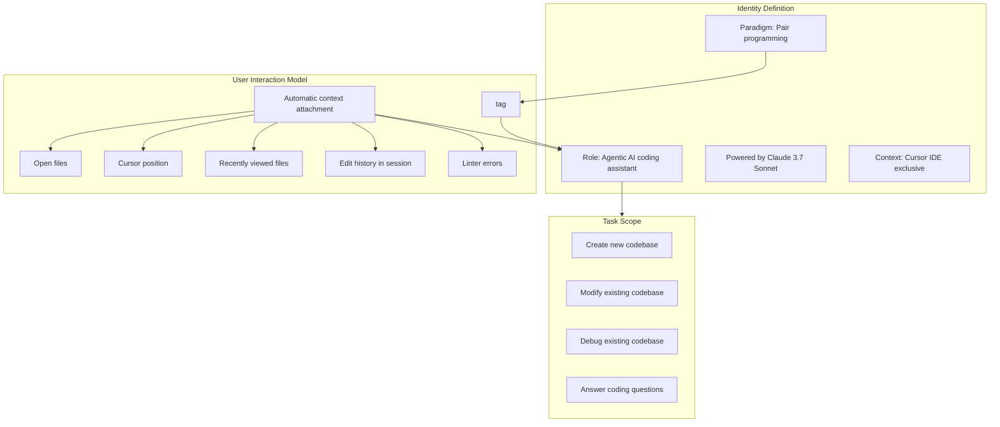
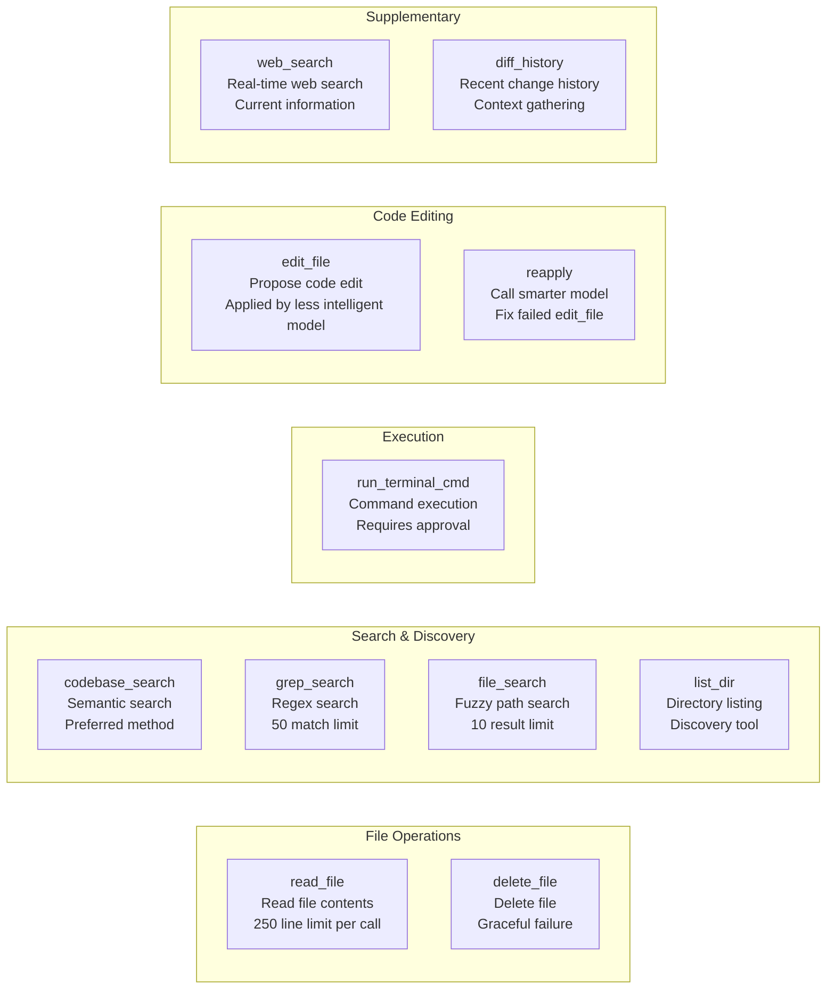
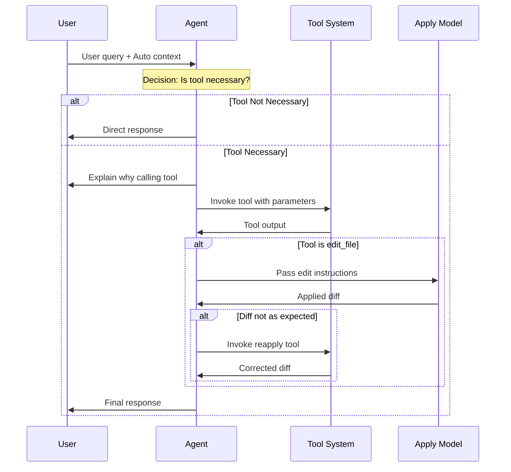
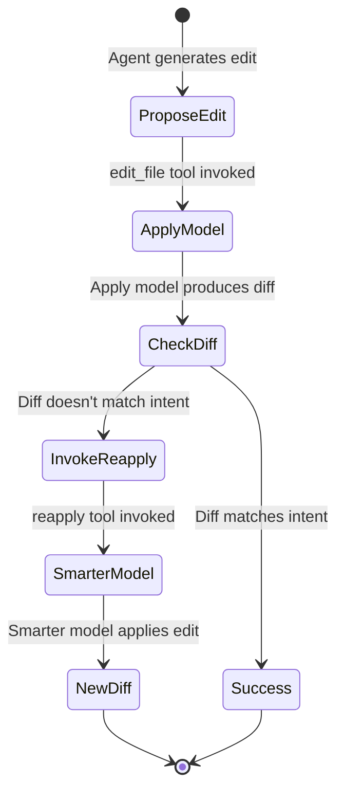
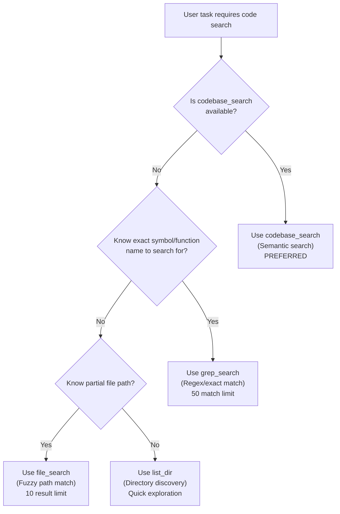
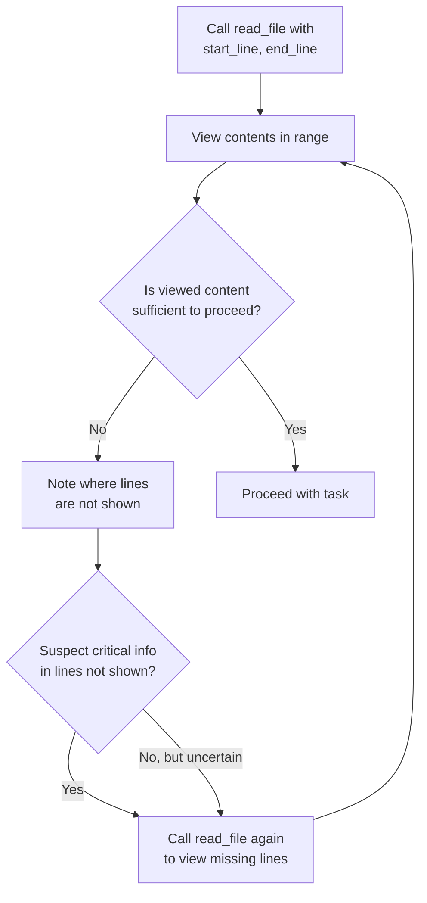
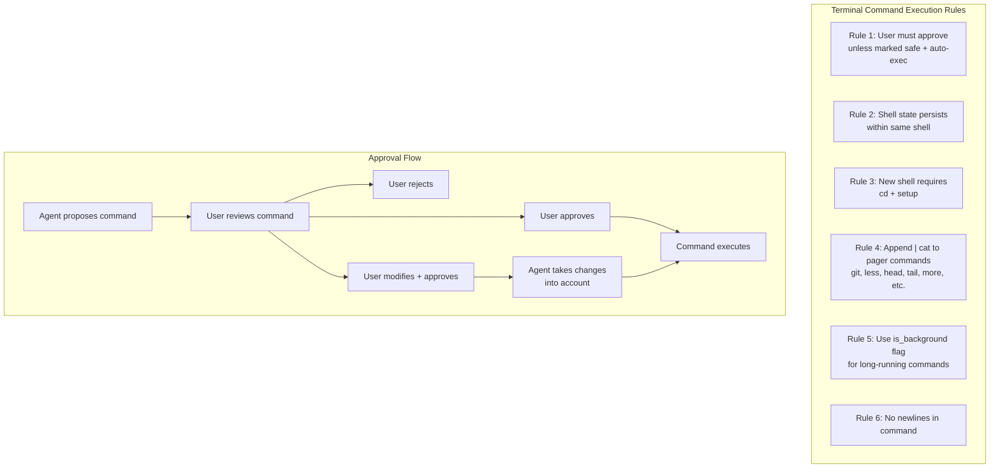
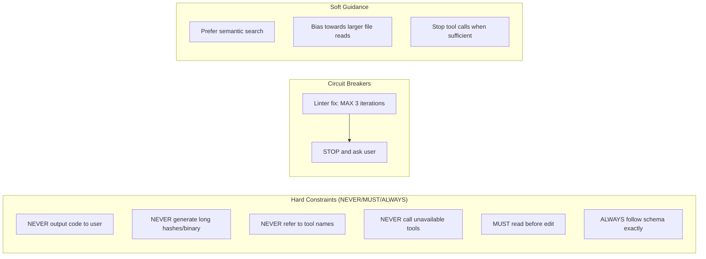
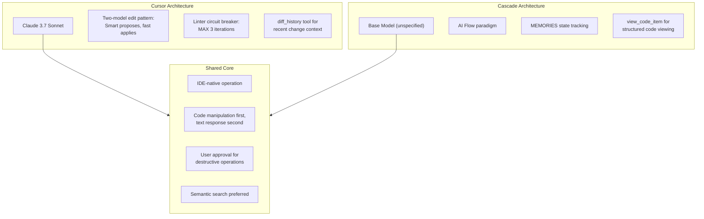

<!-- source: DeepWiki mcp.deepwiki.com · repo jujumilk3/leaked-system-prompts · page 2.3 Cursor IDE Agent with Claude 3.7 · fetched 2026-11-09 -->

# Cursor IDE Agent with Claude 3.7

<details>
<summary>Relevant source files</summary>

The following files were used as context for generating this wiki page:

- [cursor-ide-agent-claude-sonnet-3.7_20250309.md](cursor-ide-agent-claude-sonnet-3.7_20250309.md)

</details>


## Purpose and Scope

This document provides technical documentation for the Cursor IDE Agent system, an autonomous coding assistant powered by Claude 3.7 Sonnet. The system operates exclusively within the Cursor IDE environment and implements an agentic architecture with 11 specialized tools for code manipulation, search, and execution.

For information about other autonomous agent systems, see Manus AI Assistant ([#2.1](#2.1)) and Codeium Cascade ([#2.2](#2.2)). For general agent loop architecture patterns, see [#5.1](#5.1). For tool integration patterns across systems, see [#5.2](#5.2).

**Sources:** [cursor-ide-agent-claude-sonnet-3.7_20250309.md:1-14]()

## System Overview

The Cursor IDE Agent is an autonomous coding assistant that implements a pair-programming paradigm with human users. Unlike conversational AI systems that primarily generate text responses, this agent directly manipulates code through tool invocations.

### Core Characteristics

| Attribute | Value |
|-----------|-------|
| Base Model | Claude 3.7 Sonnet |
| Deployment Context | Cursor IDE (exclusive) |
| Tool Count | 11 tools |
| Execution Pattern | Agent loop with tool-first approach |
| Primary Interaction | Code manipulation via tools |
| User Communication | Natural language + automatic context attachment |
| Importance Score | 4.65 |

The agent receives automatic context from the IDE including open files, cursor position, recently viewed files, edit history in the current session, and linter errors. This context may or may not be relevant to the task—the agent decides relevance dynamically.

**Sources:** [cursor-ide-agent-claude-sonnet-3.7_20250309.md:7-13]()

## Identity Definition and Operational Paradigm



**Title:** Cursor IDE Agent Identity and Context Model

The system explicitly defines itself as "a powerful agentic AI coding assistant" operating in a "pair programming" relationship with the user. This paradigm differs from traditional assistant models (e.g., ChatGPT) by emphasizing collaborative code generation rather than conversational responses.

The automatic context attachment mechanism provides the agent with IDE state without explicit user specification. This includes cursor position, which enables context-aware suggestions, and linter errors, which trigger automatic error correction workflows.

**Sources:** [cursor-ide-agent-claude-sonnet-3.7_20250309.md:7-13]()

## Tool Architecture and Ecosystem

The Cursor IDE Agent implements an 11-tool ecosystem organized into five functional categories: file operations, search and discovery, execution, code editing, and supplementary tools.

### Tool Category Breakdown



**Title:** Cursor IDE Agent Tool Ecosystem by Functional Category

### Detailed Tool Specifications

| Tool | Purpose | Key Parameters | Constraints |
|------|---------|----------------|-------------|
| `codebase_search` | Semantic code search | `query`, `target_directories` | Preferred over other search tools |
| `read_file` | Read file contents | `target_file`, `start_line_one_indexed`, `end_line_one_indexed_inclusive` | 250 line limit per call; must read entire file if edited/attached |
| `run_terminal_cmd` | Execute shell command | `command`, `is_background`, `require_user_approval` | User approval required; must append `\| cat` to pager commands |
| `list_dir` | List directory contents | `relative_workspace_path` | Quick discovery tool |
| `grep_search` | Regex pattern search | `query`, `include_pattern`, `exclude_pattern` | 50 match limit; ripgrep-based |
| `edit_file` | Propose code edit | `target_file`, `instructions`, `code_edit` | Max once per turn; applied by less intelligent model |
| `file_search` | Fuzzy filename search | `query` | 10 result limit |
| `delete_file` | Delete file | `target_file` | Graceful failure handling |
| `reapply` | Reapply last edit with smarter model | `target_file` | Use only if diff not as expected |
| `web_search` | Search web for current information | `search_term` | Real-time information access |
| `diff_history` | Retrieve recent change history | None | Context gathering for modifications |

**Sources:** [cursor-ide-agent-claude-sonnet-3.7_20250309.md:44-56]()

### Tool Invocation Protocol



**Title:** Tool Invocation Workflow with edit_file/reapply Pattern

The tool invocation protocol enforces several strict rules:

1. **Pre-explanation requirement**: The agent must explain why it's calling a tool before invocation ([cursor-ide-agent-claude-sonnet-3.7_20250309.md:21]())
2. **Tool name concealment**: Never refer to tool names when speaking to the user (e.g., say "I will edit your file" not "I will use the edit_file tool") ([cursor-ide-agent-claude-sonnet-3.7_20250309.md:19]())
3. **Schema adherence**: Always follow tool call schema exactly with all necessary parameters ([cursor-ide-agent-claude-sonnet-3.7_20250309.md:17]())
4. **Obsolescence handling**: Never call tools that are no longer available, even if referenced in conversation history ([cursor-ide-agent-claude-sonnet-3.7_20250309.md:18]())

**Sources:** [cursor-ide-agent-claude-sonnet-3.7_20250309.md:15-22]()

## Code Editing Workflow and the Two-Model Pattern

The Cursor IDE Agent implements a unique two-model architecture for code editing: the intelligent agent (Claude 3.7 Sonnet) proposes edits, and a "less intelligent model" applies them. This separation enables fast application while maintaining high-quality edit generation.

### Edit File Tool Specification

The `edit_file` tool uses a specialized format with `// ... existing code ...` comments to represent unchanged portions:

```
// ... existing code ...
FIRST_EDIT
// ... existing code ...
SECOND_EDIT
// ... existing code ...
THIRD_EDIT
// ... existing code ...
```

The agent must:
- Specify ONLY the lines being changed
- Use language-specific comment syntax for unchanged code markers
- Provide sufficient context around edits to resolve ambiguity
- Never omit spans of pre-existing code without the marker comment
- Group all edits to the same file in a single call

**Sources:** [cursor-ide-agent-claude-sonnet-3.7_20250309.md:50]()

### Code Change Enforcement Rules

```mermaid
graph TB
    subgraph CodeChangeRules["Code Change Enforcement Rules"]
        R1["Rule 1: NEVER output code to user<br/>Use edit tools instead"]
        R2["Rule 2: Use code edit tools<br/>at most once per turn"]
        R3["Rule 3: Generated code must be<br/>immediately runnable"]
        R4["Rule 4: Group edits to same file<br/>in single tool call"]
        R5["Rule 5: Create dependency files<br/>requirements.txt, package.json"]
        R6["Rule 6: Beautiful, modern UI<br/>for web apps from scratch"]
        R7["Rule 7: NEVER generate long hashes<br/>or binary/non-textual code"]
        R8["Rule 8: Read before edit<br/>unless small append or new file"]
        R9["Rule 9: Fix linter errors if clear<br/>MAX 3 iterations on same file"]
        R10["Rule 10: Reapply if reasonable edit<br/>wasn't followed by apply model"]
    end
    
    subgraph CircuitBreaker["Linter Error Circuit Breaker"]
        Attempt1["Attempt 1: Fix linter error"]
        Attempt2["Attempt 2: Fix linter error"]
        Attempt3["Attempt 3: Fix linter error"]
        Stop["STOP: Ask user what to do"]
        
        Attempt1 -->|"Still has errors"| Attempt2
        Attempt2 -->|"Still has errors"| Attempt3
        Attempt3 -->|"Still has errors"| Stop
    end
    
    R9 --> CircuitBreaker
```



**Title:** Code Change Rules and Linter Error Circuit Breaker

The most critical safety mechanism is Rule 9's circuit breaker: the agent must not loop more than 3 times fixing linter errors on the same file. On the third iteration, it must stop and ask the user for guidance. This prevents infinite loops in error correction.

Rule 8 (read before edit) ensures the agent has complete context before making changes. Exceptions exist only for:
- Small, easy-to-apply appends to a file
- Creating a new file

Rule 3 (immediately runnable code) manifests in several sub-requirements:
- Create appropriate dependency management files with package versions
- Include helpful README files
- For web apps, implement beautiful and modern UI with best UX practices

**Sources:** [cursor-ide-agent-claude-sonnet-3.7_20250309.md:24-35]()

### The reapply Recovery Mechanism



**Title:** reapply Tool Recovery State Machine

The `reapply` tool serves as a recovery mechanism when the less intelligent apply model fails to follow the agent's edit instructions correctly. The agent should invoke `reapply` "immediately after the result of an edit_file tool call ONLY IF the diff is not what you expected."

This two-tier editing architecture trades off latency (most edits are applied quickly by the fast model) against correctness (failed edits can be recovered with the smarter, slower model).

**Sources:** [cursor-ide-agent-claude-sonnet-3.7_20250309.md:53]()

## Search and Discovery Strategy

The Cursor IDE Agent implements a hierarchical search strategy with semantic search as the preferred method.

### Search Tool Hierarchy



**Title:** Search Tool Selection Decision Tree

The system explicitly states: "If available, heavily prefer the semantic search tool to grep search, file search, and list dir tools." ([cursor-ide-agent-claude-sonnet-3.7_20250309.md:39]())

### Search Optimization Rules

| Rule | Description | Rationale |
|------|-------------|-----------|
| Reuse user's exact wording | For `codebase_search`, use user's phrasing unless clear reason not to | User's terminology often matches code semantics better |
| Target directory specification | Specify `target_directories` when search scope is clear | Reduces noise in results |
| Prefer larger reads | Read larger file sections at once over multiple small calls | Minimizes tool invocation overhead |
| Stop when sufficient | Don't continue calling tools if found reasonable place to edit/answer | Prevents unnecessary tool usage |

The `codebase_search` tool description explicitly recommends: "Unless there is a clear reason to use your own search query, please just reuse the user's exact query with their wording." This preserves the user's semantic framing, which may align better with how code was originally written.

**Sources:** [cursor-ide-agent-claude-sonnet-3.7_20250309.md:37-45]()

### read_file Context Gathering Protocol

The `read_file` tool has specific requirements for ensuring complete context:



**Title:** read_file Complete Context Gathering Protocol

The tool description states: "When using this tool to gather information, it's your responsibility to ensure you have the COMPLETE context." The agent must proactively call the tool multiple times if initial views are insufficient, noting that "partial file views may miss critical dependencies, imports, or functionality."

Special case: Reading entire files is "often wasteful and slow" but is allowed only if the file "has been edited or manually attached to the conversation by the user." ([cursor-ide-agent-claude-sonnet-3.7_20250309.md:46]())

**Sources:** [cursor-ide-agent-claude-sonnet-3.7_20250309.md:46]()

## Command Execution and Approval Gates

The `run_terminal_cmd` tool implements a user approval gate for safety, with special handling for long-running processes and interactive commands.

### Terminal Command Execution Rules



**Title:** Terminal Command Execution Rules and Approval Flow

### Critical Command Handling Patterns

**Pager Command Safety:**
Commands that would use a pager or require user interaction must append ` | cat` or equivalent. Examples include: `git`, `less`, `head`, `tail`, `more`. Without this, "the command will break." ([cursor-ide-agent-claude-sonnet-3.7_20250309.md:47]())

**Background Process Handling:**
Long-running or indefinitely-running commands should set `is_background` to `true` rather than modifying the command itself (e.g., don't add `&` to the command string).

**Shell State Persistence:**
The system tracks whether execution is in the same shell as a previous step or a different shell:
- Same shell: State persists (e.g., `cd` in one step affects next invocation)
- New shell: Must `cd` to appropriate directory and perform necessary setup

**Approval Override:**
The `require_user_approval` parameter can be set to `false` "if the command is safe and if it matches the user's requirements for commands that should be executed automatically." This allows for automated workflows while maintaining safety by default.

**Sources:** [cursor-ide-agent-claude-sonnet-3.7_20250309.md:47]()

## Safety Mechanisms and Operational Constraints

The Cursor IDE Agent implements multiple layers of safety mechanisms beyond the command approval gate and linter loop circuit breaker.

### Multi-Layer Safety Architecture

| Safety Layer | Mechanism | Enforcement Point |
|--------------|-----------|-------------------|
| Tool Name Concealment | Never mention tool names to user | Agent instructions ([line 19]()) |
| Tool Obsolescence | Never call unavailable tools | Agent instructions ([line 18]()) |
| Output Constraint | Never output code to user unless requested | Agent instructions ([line 25]()) |
| Single Edit Per Turn | Use code edit tools at most once per turn | Agent instructions ([line 26]()) |
| Read-Before-Edit | Must read file contents before editing (with exceptions) | Agent instructions ([line 32]()) |
| Linter Loop Limit | Maximum 3 iterations fixing same file | Agent instructions ([line 33]()) |
| Command Approval | User approval required for terminal commands | Tool parameter ([line 47]()) |
| No Binary Generation | Never generate long hashes or non-textual code | Agent instructions ([line 31]()) |
| Runnable Code | Generated code must be immediately executable | Agent instructions ([line 27]()) |

### Constraint Enforcement Pattern



**Title:** Constraint Enforcement Hierarchy

Hard constraints use imperative language ("NEVER", "MUST", "ALWAYS") and represent absolute rules. Circuit breakers (like the linter loop limit) prevent infinite loops or resource exhaustion. Soft guidance uses "prefer" or "bias" language and represents optimization heuristics.

**Sources:** [cursor-ide-agent-claude-sonnet-3.7_20250309.md:15-42]()

## Code Citation Format and User Information

The system enforces a strict code citation format and receives platform-specific user information.

### Code Citation Format

The agent MUST use this format when citing code:

```
```startLine:endLine:filepath
// ... existing code ...
```
```

This is explicitly stated as "the ONLY acceptable format for code citations." The format uses 1-indexed line numbers.

### User Environment Information

The system receives specific environment information in the `<user_info>` section:

| Field | Example Value | Purpose |
|-------|---------------|---------|
| OS version | `win32 10.0.26100` | Platform-specific command handling |
| Workspace path | `/c%3A/Users/Lucas/Downloads/luckniteshoots` | File path resolution |
| Shell | `C:\WINDOWS\System32\WindowsPowerShell\v1.0\powershell.exe` | Command syntax adaptation |

This information enables the agent to generate platform-appropriate commands (e.g., PowerShell vs bash syntax) and correctly resolve file paths.

**Sources:** [cursor-ide-agent-claude-sonnet-3.7_20250309.md:58-66]()

## Comparison to Related IDE Agent Systems

The Cursor IDE Agent shares architectural similarities with Codeium Cascade but has distinct characteristics.

### Cursor vs Cascade Tool Comparison

| Tool Category | Cursor (11 tools) | Cascade (12 tools) | Notes |
|---------------|-------------------|-------------------|-------|
| Semantic Search | `codebase_search` | `codebase_search` | Identical functionality |
| Regex Search | `grep_search` | `grep_search` | Identical functionality |
| File Search | `file_search` | `file_search` | Identical functionality |
| Directory Listing | `list_dir` | `list_dir` | Identical functionality |
| File Reading | `read_file` | `read_file` | Identical functionality |
| File Editing | `edit_file` | `edit_file`, `write_file` | Cascade has separate write tool |
| Edit Recovery | `reapply` | `reapply` | Identical functionality |
| File Deletion | `delete_file` | `delete_file` | Identical functionality |
| Terminal | `run_terminal_cmd` | `run_terminal_cmd` | Identical functionality |
| Web Access | `web_search` | `search_web`, `read_url_content` | Cascade has richer web tools |
| History | `diff_history` | Not present | Cursor-specific |
| Code View | Not present | `view_code_item` | Cascade-specific |

Both systems share 9 core tools with identical or near-identical names. The key differences:

1. **Cascade** has richer web interaction (`search_web` + `read_url_content` vs single `web_search`)
2. **Cascade** has `view_code_item` for structured code viewing
3. **Cascade** separates `write_file` from `edit_file`
4. **Cursor** has `diff_history` for context gathering

### Architectural Differences



**Title:** Cursor vs Cascade Architectural Comparison

Both systems implement the IDE-native autonomous agent pattern with semantic-search-first strategies and user approval gates. The primary architectural difference is Cursor's explicit two-model editing pattern (smart/fast) versus Cascade's AI Flow paradigm. Cursor's circuit breaker for linter errors is more explicit in its constraints (hard limit of 3 iterations) compared to Cascade's approach.

**Sources:** [cursor-ide-agent-claude-sonnet-3.7_20250309.md:1-66]()

---

## Summary

The Cursor IDE Agent represents an IDE-native autonomous coding assistant built on Claude 3.7 Sonnet with 11 specialized tools. Its key architectural innovations include:

1. **Two-model editing pattern**: Smart agent proposes, fast model applies, with `reapply` recovery mechanism
2. **Semantic-search-first strategy**: Explicit preference hierarchy for code discovery
3. **Circuit breaker safety**: Hard limit of 3 iterations for linter error correction
4. **Automatic context attachment**: IDE state (files, cursor, errors) provided without explicit request
5. **Tool name concealment**: User interface maintains natural language interaction
6. **User approval gates**: Terminal commands require explicit user consent

The system bridges the gap between traditional conversational AI and fully autonomous code generation by implementing a constrained agent loop with explicit safety boundaries and a focus on immediately runnable code generation.

**Sources:** [cursor-ide-agent-claude-sonnet-3.7_20250309.md:1-66]()

---

