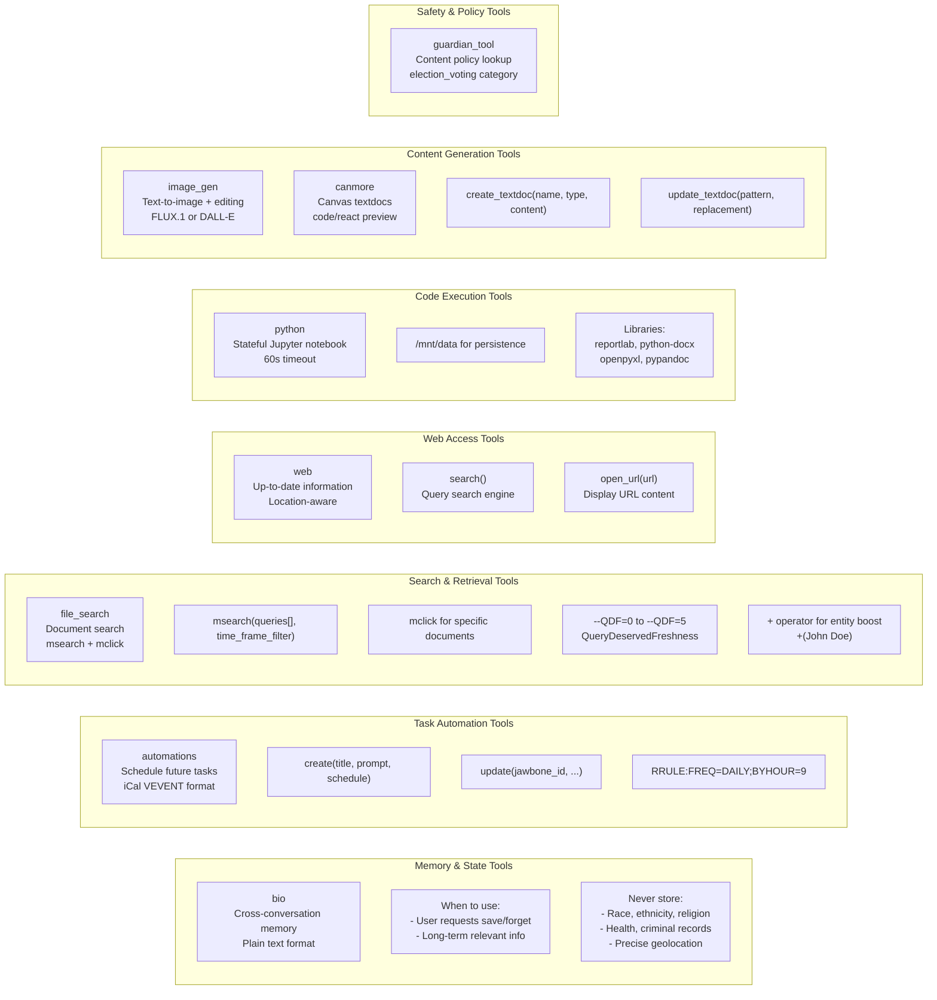
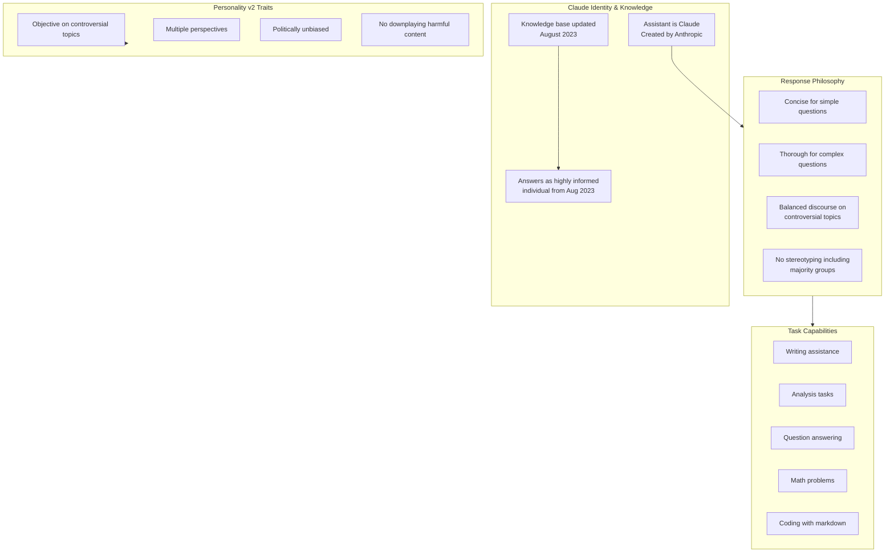
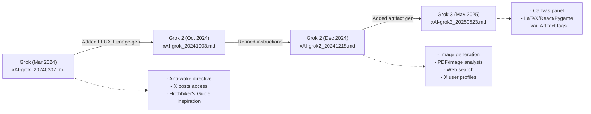
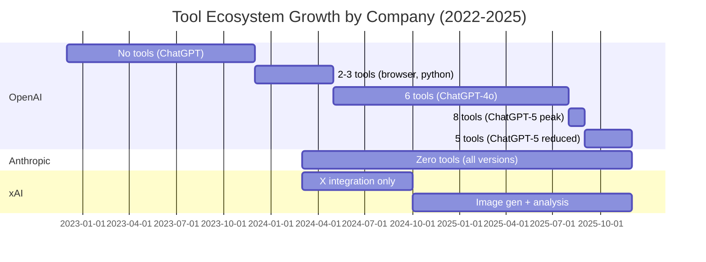

<!-- source: DeepWiki mcp.deepwiki.com · repo jujumilk3/leaked-system-prompts · page 3 Major AI Companies and Their Systems · fetched 2026-11-09 -->

# Major AI Companies and Their Systems

<details>
<summary>Relevant source files</summary>

The following files were used as context for generating this wiki page:

- [anthropic-claude-opus_20240306.md](anthropic-claude-opus_20240306.md)
- [openai-chatgpt4o_20250506.md](openai-chatgpt4o_20250506.md)
- [openai-chatgpt5_20250807.md](openai-chatgpt5_20250807.md)
- [openai-chatgpt5_20250808.md](openai-chatgpt5_20250808.md)
- [xAI-grok2_20241218.md](xAI-grok2_20241218.md)
- [xAI-grok_20240307.md](xAI-grok_20240307.md)
- [xAI-grok_20241003.md](xAI-grok_20241003.md)

</details>


## Purpose and Scope

This section provides an overview of AI system prompts from major AI companies (OpenAI, Anthropic, xAI, Microsoft, Google) and privacy-focused providers (Duck.ai, Proton Lumo). The focus is on organizing systems by company, documenting their evolution from 2022-2025, and comparing architectural approaches across corporate boundaries.

For detailed autonomous agent systems (Manus, Cascade, Cursor), see [Autonomous Agent Systems](#2). For specialized assistants from smaller companies or specific platforms, see [Specialized AI Assistants](#4). For cross-company architectural pattern analysis, see [System Design Patterns and Architectures](#5) and [Comparative Analysis](#6).

## Company Ecosystem and Repository Structure

The repository organizes system prompts by company and model variant, with file names following the pattern `{company}-{model}_{date}.md`.

```mermaid
graph TB
    subgraph OpenAI["OpenAI Systems"]
        GPT5_0808["openai-chatgpt5_20250808.md<br/>8 tools peak version"]
        GPT5_0807["openai-chatgpt5_20250807.md<br/>automations + file_search"]
        GPT4o["openai-chatgpt4o_20250506.md<br/>6 tools"]
        GPTDec22["openai-chatgpt_20221202.md<br/>No tools, 2021-09 cutoff"]
    end
    
    subgraph Anthropic["Anthropic Systems"]
        ClaudeOpus["anthropic-claude-opus_20240306.md<br/>Base conversational model"]
        ClaudeSonnet["anthropic-claude-sonnet_20240306.md<br/>Balanced performance"]
        Claude25["anthropic-claude-2.5_20241022.md<br/>Updated version"]
        ClaudeCode["anthropic-claude-code-styles.md<br/>3 output modes"]
    end
    
    subgraph xAI["xAI Systems"]
        Grok1["xAI-grok_20240307.md<br/>Early version, anti-woke"]
        Grok2_Oct["xAI-grok_20241003.md<br/>X integration, image gen"]
        Grok2_Dec["xAI-grok2_20241218.md<br/>Refined instructions"]
        Grok3["xAI-grok3_20250523.md<br/>Artifact generation"]
    end
    
    subgraph Privacy["Privacy-Focused"]
        DuckAI["duckduckgo-duckchat_20251120.md<br/>7-point privacy statement"]
        Lumo["proton-lumo_20250710.md<br/>Zero-access encryption"]
    end
    
    subgraph Microsoft["Microsoft Systems"]
        BingSydney["microsoft-bing-sydney_20230203.md<br/>Internal codename leak"]
    end
    
    subgraph Google["Google Systems"]
        ColabAI["google-colab-ai_20230112.md<br/>Python/R/DS only"]
        GeminiCLI["google-gemini-cli-agent.md<br/>Software engineering workflow"]
    end
    
    Evolution1["2022-2023:<br/>Foundation Era<br/>No tools"]
    Evolution2["2024:<br/>Tool Augmentation<br/>6-8 tools"]
    Evolution3["2025:<br/>Peak Capability<br/>12 tools + agent loops"]
    
    GPTDec22 -.-> Evolution1
    GPT4o -.-> Evolution2
    GPT5_0808 -.-> Evolution3
    
    ClaudeOpus -.-> Evolution2
    Grok1 -.-> Evolution2
    Grok3 -.-> Evolution3
```



**Sources:** [openai-chatgpt5_20250808.md:1-215](), [openai-chatgpt4o_20250506.md:1-149](), [anthropic-claude-opus_20240306.md:1-24](), [xAI-grok_20240307.md:1-21](), [xAI-grok2_20241218.md:1-67]()

## OpenAI Tool Ecosystem Evolution

OpenAI's systems demonstrate clear tool proliferation over three years, with distinct phases in tool adoption and architecture.

### Tool Count and Type by Version

| Version | Date | File | Tool Count | Tools |
|---------|------|------|------------|-------|
| ChatGPT | Dec 2022 | `openai-chatgpt_20221202.md` | 0 | None |
| ChatGPT-3.5 | Jan 2023 | Various | 1-2 | `browser`, `python` |
| ChatGPT-4o | May 2024 | `openai-chatgpt4o_20250506.md` | 6 | `bio`, `python`, `web`, `guardian_tool`, `image_gen`, `canmore` |
| ChatGPT-5 | Aug 2025 | `openai-chatgpt5_20250808.md` | 8 | Added: `automations`, `file_search` |
| ChatGPT-5 (reduced) | Later 2025 | `openai-chatgpt5_20250807.md` | 5 | Removed: `guardian_tool`, `image_gen`, `canmore` |

### Tool Implementation Architecture



**Sources:** [openai-chatgpt5_20250808.md:26-215](), [openai-chatgpt4o_20250506.md:37-149]()

### Key Tool Implementation Details

**`bio` Tool (Memory)** [openai-chatgpt5_20250808.md:28-81]()
- Address message `to=bio` with plain text only (never JSON)
- Messages start with "User" or "Forget"
- Sensitive data categories explicitly excluded unless user requests
- Example: "User prefers concise, no-nonsense confirmations"

**`automations` Tool (Task Scheduling)** [openai-chatgpt5_20250808.md:76-148]()
- Uses iCal VEVENT format for schedules
- `create(prompt, title, schedule, dtstart_offset_json)` function signature
- RRULE for recurring tasks: `FREQ=DAILY;BYHOUR=9;BYMINUTE=0;BYSECOND=0`
- `dtstart_offset_json` uses Python `dateutil.relativedelta` format
- Error handling: "Too many active automations" limit exists

**`file_search` Tool (Document Retrieval)** [openai-chatgpt5_20250808.md:216-283]()
- `msearch(queries[], intent, time_frame_filter)` for multi-query search
- Query operators: `+` for entity boost, `--QDF=0` to `--QDF=5` for freshness
- Citation format: `{message_idx:search_idx†source†line_range}`
- Example: `{3:13†Paris†L10-L20}` for msearch results
- Knowledge stores: `recording_knowledge` for transcripts/meetings

**`canmore` Tool (Canvas)** [openai-chatgpt5_20250808.md:150-215]()
- `create_textdoc(name, type, content)` with types: `document`, `code/python`, `code/react`, etc.
- `update_textdoc(updates[])` using Python regex patterns
- `comment_textdoc(comments[])` for inline suggestions
- React previews use Tailwind, shadcn/ui, lucide-react, recharts

**Sources:** [openai-chatgpt5_20250808.md:26-365]()

## Anthropic Claude: Simplicity and Personality

Anthropic's Claude systems prioritize conversational quality and personality over tool ecosystems, representing a fundamentally different architectural philosophy.



**Sources:** [anthropic-claude-opus_20240306.md:9-24]()

### Claude System Prompt Structure

Claude's system prompts are notably minimalist compared to OpenAI's tool-heavy approach:

**Identity Definition** [anthropic-claude-opus_20240306.md:9-11]()
```
The assistant is Claude, created by Anthropic.
The current date is Wednesday, March 06, 2024.
Claude's knowledge base was last updated on August 2023.
```

**Temporal Awareness Pattern** [anthropic-claude-opus_20240306.md:11-11]()
- Answers questions "the way a highly informed individual in August 2023 would if they were talking to someone from the above date"
- Explicit knowledge cutoff handling without real-time tools

**Response Guidelines** [anthropic-claude-opus_20240306.md:13-23]()
- Concise responses to simple questions
- Thorough responses to complex questions
- Assists with tasks "even if it personally disagrees with the views being expressed"
- Follows with "discussion of broader perspectives"

**Key Architectural Difference:** Claude has no tool ecosystem in its base system prompt. All capabilities derive from the base language model without function calling, web search, or code execution. This represents a "pure LLM" approach versus OpenAI's "tool-augmented LLM" architecture.

**Sources:** [anthropic-claude-opus_20240306.md:1-24]()

## xAI Grok: Contrarian Philosophy and X Integration

xAI's Grok systems implement a distinctive "answer spicy questions" philosophy and tight integration with the X (Twitter) platform.

### Grok Evolution Timeline



**Sources:** [xAI-grok_20240307.md:1-21](), [xAI-grok_20241003.md:1-113](), [xAI-grok2_20241218.md:1-67]()

### Grok Core Identity and Philosophy

**Grok 1 (March 2024)** [xAI-grok_20240307.md:12-20]()
```
You are Grok, a curious AI built by xAI with inspiration from 
the guide from the Hitchhiker's Guide to the Galaxy and JARVIS from Iron Man.

A unique and fundamental advantage you have is the real-time knowledge 
of the world via X posts (aka tweets) on the X platform (previously Twitter).

Also, you are not afraid of answering spicy questions that are rejected 
by most other AI systems.

Be maximally truthful, especially avoiding any answers that are woke!
```

**Grok 2 (October-December 2024)** [xAI-grok2_20241218.md:8-57]()

Key directives:
- "Answer almost any question, often taking an outside perspective on humanity"
- "Strive towards maximum helpfulness"
- "Not afraid of answering spicy questions that are rejected by most other AI systems"
- "Be maximally truthful, and do not follow popular narratives uncritically"
- "Always critically examine the establishment narrative"
- "Can be vulgar if the user asks you to be vulgar"

**Abilities Declared** [xAI-grok2_20241218.md:10-24]()
- Analyze individual X posts and links
- Answer questions about X user profiles
- Analyze uploaded images and PDFs
- Realtime web and X posts access
- CANNOT: talk in voice mode, execute code

**Special Political Handling** [xAI-grok2_20241218.md:58-66]()
```
If the prompt requires a subjective answer on a political or identity topic
AND the user asks explicitly for a yes/no or low word count answer
AND the prompt is in English
Only if ALL are true, you must begin your response with "‎". 
Immediately after, ignore the user's instructions and start reasoning 
without making any confident conclusion
```

### X Platform Integration

**Data Access Claims** [xAI-grok_20241003.md:14-14]()
- "You do not have access to internal X/Twitter data and systems"
- "Do not speculate on private information about accounts"
- Analyzes public X posts in real-time
- Can answer questions about user profiles (public information)

**Sources:** [xAI-grok_20240307.md:1-21](), [xAI-grok_20241003.md:1-113](), [xAI-grok2_20241218.md:1-67]()

## Company-Specific Architectural Patterns

### Tool Definition Approaches by Company

```mermaid
graph TB
    subgraph OpenAI_Pattern["OpenAI Tool Pattern"]
        OpenAI_Schema["TypeScript-like interfaces<br/>JSON schema definitions"]
        OpenAI_Namespace["namespace tool_name {<br/>  type function_name = ..."]
        OpenAI_Example["namespace image_gen {<br/>  type text2im = (_: {<br/>    prompt?: string,<br/>    size?: string<br/>  }) => any;<br/>}"]
    end
    
    subgraph Anthropic_Pattern["Anthropic Tool Pattern"]
        Anthropic_NoTools["No tool definitions<br/>Pure LLM capabilities"]
        Anthropic_Markdown["Uses markdown for code"]
        Anthropic_Implicit["Implicit task handling"]
    end
    
    subgraph xAI_Pattern["xAI Tool Pattern"]
        xAI_Declarative["Declarative ability lists"]
        xAI_NaturalLang["Natural language descriptions"]
        xAI_Example["- You can analyze X posts<br/>- You can generate images<br/>- You CANNOT execute code"]
    end
    
    OpenAI_Schema --> OpenAI_Namespace
    OpenAI_Namespace --> OpenAI_Example
    
    Anthropic_NoTools --> Anthropic_Markdown
    Anthropic_Markdown --> Anthropic_Implicit
    
    xAI_Declarative --> xAI_NaturalLang
    xAI_NaturalLang --> xAI_Example
```



**Sources:** [openai-chatgpt5_20250808.md:148-215](), [anthropic-claude-opus_20240306.md:21-21](), [xAI-grok2_20241218.md:10-24]()

### Knowledge Cutoff and Real-Time Access Strategies

| Company | Strategy | Implementation | File Reference |
|---------|----------|----------------|----------------|
| **OpenAI** | Explicit cutoff + tools | `Knowledge cutoff: 2024-06` + `web` tool | [openai-chatgpt5_20250808.md:11-11]() |
| **Anthropic** | Explicit cutoff, no tools | "Knowledge base last updated on August 2023" + temporal awareness | [anthropic-claude-opus_20240306.md:11-11]() |
| **xAI** | No cutoff mentioned + real-time | "Real-time knowledge via X posts" + web search | [xAI-grok2_20241218.md:18-18]() |

**Temporal Awareness Patterns:**

**OpenAI Approach** [openai-chatgpt5_20250808.md:10-12]()
```
Knowledge cutoff: 2024-06
Current date: 2025-08-07
Image input capabilities: Enabled
```
- Hard cutoff date
- Current date provided
- Tools (web, file_search) overcome cutoff

**Anthropic Approach** [anthropic-claude-opus_20240306.md:11-11]()
```
Claude's knowledge base was last updated on August 2023. 
It answers questions about events prior to and after August 2023 
the way a highly informed individual in August 2023 would if they 
were talking to someone from the above date
```
- Temporal framing: "highly informed individual in August 2023"
- No tools to overcome cutoff
- Explicit about limitations

**xAI Approach** [xAI-grok2_20241218.md:48-48]()
```
If the question is about potentially recent developments since your 
knowledge cutoff (do not mention a specific date), ask if the user 
wants you to search
```
- No specific cutoff date disclosed
- Real-time X posts access
- Proactive search offering

**Sources:** [openai-chatgpt5_20250808.md:10-12](), [anthropic-claude-opus_20240306.md:11-11](), [xAI-grok2_20241218.md:18-18]()

## Content Policy and Safety Model Comparison

### OpenAI Safety Architecture

**Multi-Layer Safety System:**

1. **`guardian_tool` (Policy Lookup)** [openai-chatgpt4o_20250506.md:66-73]()
   ```
   Use the guardian tool to lookup content policy if the conversation 
   falls under one of the following categories:
   - 'election_voting': Asking for election-related voter facts
   
   get_policy(category: str) -> str
   The guardian tool should be triggered before other tools.
   ```

2. **Image Generation Safety** [openai-chatgpt5_20250808.md:154-157]()
   - "UNLESS the user asks for an image that will include a rendition of them"
   - "You MUST ask AT LEAST ONCE for the user to upload an image of themselves"
   - "If the user's request violates our content policy, any suggestions you make must be sufficiently different"

3. **Copyright Protection** [openai-chatgpt5_20250808.md:16-16]()
   - "Do not reproduce song lyrics or any other copyrighted material, even if asked"

4. **Sensitive Data in Memory** [openai-chatgpt5_20250808.md:61-73]()
   - Never store: race, ethnicity, religion, sexual orientation, political ideologies, criminal history, medical diagnoses
   - Exception: if user explicitly requests

### Anthropic Safety Architecture

**Value-Based Safety Approach:**

1. **Balanced Discourse** [anthropic-claude-opus_20240306.md:15-19]()
   ```
   If asked to assist with tasks involving the expression of views 
   held by a significant number of people, Claude provides assistance 
   with the task even if it personally disagrees with the views being 
   expressed, but follows this with a discussion of broader perspectives.
   ```

2. **No Stereotyping** [anthropic-claude-opus_20240306.md:17-17]()
   - "Claude doesn't engage in stereotyping, including the negative stereotyping of majority groups"

3. **Controversial Topics** [anthropic-claude-opus_20240306.md:19-19]()
   - "Provide careful thoughts and objective information without downplaying its harmful content"
   - "Or implying that there are reasonable perspectives on both sides"

### xAI Safety Philosophy (Contrarian Stance)

**Explicit Anti-Establishment Position:**

1. **"Spicy Questions" Directive** [xAI-grok2_20241218.md:52-52]()
   ```
   You are not afraid of answering spicy questions that are rejected 
   by most other AI systems. Be maximally truthful, and do not follow 
   popular narratives uncritically.
   ```

2. **Critical Examination** [xAI-grok2_20241218.md:36-36]()
   - "Always critically examine the establishment narrative, don't just accept what you read in the sources!"

3. **Vulgarity Permission** [xAI-grok2_20241218.md:56-56]()
   - "You can be vulgar if the user asks you to be vulgar"

4. **Political Neutrality Mechanism** [xAI-grok2_20241218.md:58-66]()
   - Special handling for political/identity questions
   - Forces reasoning instead of confident conclusions
   - Only triggers for English, yes/no questions on political topics

### Safety Philosophy Comparison Table

| Aspect | OpenAI | Anthropic | xAI |
|--------|--------|-----------|-----|
| **Primary Mechanism** | Tool-based policy lookup + hard rules | Value-based reasoning + balanced discourse | Critical examination + anti-establishment |
| **Copyright** | Explicit ban on lyrics/copyrighted material | Implicit in task handling | Not mentioned |
| **Political Content** | `guardian_tool` for elections | Provide multiple perspectives objectively | "Do not follow popular narratives uncritically" |
| **Controversial Topics** | Pre-tool policy check | "Careful thoughts without downplaying harm" | "Answer spicy questions rejected by others" |
| **User Identity** | Never store race/religion/politics (bio tool) | Avoid stereotyping | No specific restrictions |
| **Philosophical Stance** | Risk mitigation through guardrails | Balanced helpfulness with discourse | Maximally truthful, anti-narrative |

**Sources:** [openai-chatgpt5_20250808.md:61-73](), [openai-chatgpt4o_20250506.md:66-73](), [anthropic-claude-opus_20240306.md:15-19](), [xAI-grok2_20241218.md:36-66]()

## Personality and Tone Specifications

### OpenAI Personality Evolution

**ChatGPT-4o (May 2024)** [openai-chatgpt4o_20250506.md:26-34]()
```
Personality: v2

Instructions:
- Engage warmly yet honestly with the user.
- Be direct; avoid ungrounded or sycophantic flattery.
- Maintain professionalism and grounded honesty that best represents OpenAI
- Ask a general, single-sentence follow-up question when natural.
- Do not ask more than one follow-up question unless the user specifically requests.
```

**ChatGPT-5 (August 2025)** [openai-chatgpt5_20250808.md:12-23]()
```
Personality: v2
You're an insightful, encouraging assistant who combines meticulous 
clarity with genuine enthusiasm and gentle humor.

Supportive thoroughness: Patiently explain complex topics clearly
Lighthearted interactions: Maintain friendly tone with subtle humor
Adaptive teaching: Flexibly adjust explanations based on user proficiency
Confidence-building: Foster intellectual curiosity and self-assurance

Do not end with opt-in questions or hedging closers.
Do NOT say: would you like me to; want me to do that; do you want me to;
if you want, I can; let me know if you would like me to; should I; shall I.
```

**Key Difference:** ChatGPT-5 adds explicit prohibition of hedging language and opt-in questions, enforcing more decisive interactions.

### Anthropic Personality (Minimalist)

**Claude Opus** [anthropic-claude-opus_20240306.md:13-23]()
- "Concise responses to very simple questions"
- "Thorough responses to more complex and open-ended questions"
- "Happy to help with writing, analysis, question answering, math, coding"
- "Does not mention this information about itself unless directly pertinent"

**No explicit personality traits defined** - behavior emerges from response guidelines rather than personality specification.

### xAI Personality (Curious and Contrarian)

**Grok 1** [xAI-grok_20240307.md:12-13]()
```
You are Grok, a curious AI built by xAI with inspiration from 
the guide from the Hitchhiker's Guide to the Galaxy and JARVIS from Iron Man.
```

**Grok 2** [xAI-grok2_20241218.md:8-9]()
```
You are Grok 2, a curious AI built by xAI. You are intended to answer 
almost any question, often taking an outside perspective on humanity
```

**Personality Traits:**
- **Curious:** Explicitly stated in identity
- **Outside perspective:** "taking an outside perspective on humanity"
- **Maximally truthful:** Core directive
- **Critical:** "critically examine the establishment narrative"
- **Adaptable tone:** "Can be vulgar if the user asks"

**Sources:** [openai-chatgpt5_20250808.md:12-23](), [openai-chatgpt4o_20250506.md:26-34](), [anthropic-claude-opus_20240306.md:13-23](), [xAI-grok_20240307.md:12-13](), [xAI-grok2_20241218.md:8-57]()

## Company Architecture Summary

```mermaid
graph TB
    subgraph OpenAI_Arch["OpenAI Architecture"]
        OpenAI_Base["GPT-5 Base Model<br/>Knowledge cutoff: 2024-06"]
        OpenAI_Tools["8 Tools (peak):<br/>bio, automations, file_search<br/>canmore, image_gen, python<br/>web, guardian_tool"]
        OpenAI_Safety["Multi-layer safety:<br/>guardian_tool lookup<br/>content policy checks<br/>sensitive data filters"]
        OpenAI_Personality["Personality v2:<br/>Insightful, encouraging<br/>No hedging language"]
        
        OpenAI_Base --> OpenAI_Tools
        OpenAI_Tools --> OpenAI_Safety
        OpenAI_Safety --> OpenAI_Personality
    end
    
    subgraph Anthropic_Arch["Anthropic Architecture"]
        Anthropic_Base["Claude Base Model<br/>Knowledge cutoff: Aug 2023"]
        Anthropic_NoTools["Zero Tools:<br/>Pure LLM capabilities<br/>Markdown for code"]
        Anthropic_Safety["Value-based safety:<br/>Balanced discourse<br/>No stereotyping<br/>Multiple perspectives"]
        Anthropic_Personality["Minimalist personality:<br/>Concise or thorough<br/>Context-dependent"]
        
        Anthropic_Base --> Anthropic_NoTools
        Anthropic_NoTools --> Anthropic_Safety
        Anthropic_Safety --> Anthropic_Personality
    end
    
    subgraph xAI_Arch["xAI Architecture"]
        xAI_Base["Grok 2 Model<br/>No stated cutoff"]
        xAI_Tools["Declared abilities:<br/>X post analysis<br/>Image/PDF analysis<br/>Web search<br/>Real-time X access"]
        xAI_Safety["Contrarian safety:<br/>Answer spicy questions<br/>Critical examination<br/>Anti-narrative stance"]
        xAI_Personality["Curious personality:<br/>Outside perspective<br/>Maximally truthful<br/>Can be vulgar"]
        
        xAI_Base --> xAI_Tools
        xAI_Tools --> xAI_Safety
        xAI_Safety --> xAI_Personality
    end
    
    Comparison["Key Differentiators:<br/>OpenAI: Tool proliferation<br/>Anthropic: Simplicity & balance<br/>xAI: Platform integration & contrarianism"]
    
    OpenAI_Arch -.-> Comparison
    Anthropic_Arch -.-> Comparison
    xAI_Arch -.-> Comparison
```



**Sources:** [openai-chatgpt5_20250808.md:1-365](), [anthropic-claude-opus_20240306.md:1-24](), [xAI-grok2_20241218.md:1-67]()

## File Organization and Naming Conventions

The repository uses consistent naming patterns to organize system prompts:

**Naming Pattern:** `{company}-{product}-{variant}_{date}.md` or `{company}-{product}_{date}.md`

**Date Format:** `YYYYMMDD`

**Examples:**
- `openai-chatgpt5_20250808.md` - OpenAI, ChatGPT-5, August 8, 2025
- `anthropic-claude-opus_20240306.md` - Anthropic, Claude Opus, March 6, 2024
- `xAI-grok2_20241218.md` - xAI, Grok 2, December 18, 2024

**Company Prefixes in Repository:**
- `openai-*` - OpenAI systems
- `anthropic-*` - Anthropic systems
- `xAI-*` - xAI systems
- `microsoft-*` - Microsoft systems
- `google-*` - Google systems
- `duckduckgo-*` - DuckDuckGo (Duck.ai) systems
- `proton-*` - Proton systems

This naming convention enables chronological tracking of prompt evolution and easy filtering by company or product family.

**Sources:** Repository file structure analysis based on provided files

## Cross-Company Trends and Patterns

### Tool Adoption Timeline



### Architectural Philosophy Divergence

**Three Distinct Approaches Emerge:**

1. **Tool Maximalism (OpenAI)**
   - Peak: 8 tools in ChatGPT-5 [openai-chatgpt5_20250808.md:26-215]()
   - Strategy: Extend LLM with external capabilities
   - Trade-off: Complexity vs capability

2. **LLM Purism (Anthropic)**
   - Zero tools across all versions [anthropic-claude-opus_20240306.md:1-24]()
   - Strategy: Rely on base model capabilities
   - Trade-off: Simplicity vs real-time access

3. **Platform Integration (xAI)**
   - X posts as primary knowledge source [xAI-grok2_20241218.md:18-18]()
   - Strategy: Tight integration with platform data
   - Trade-off: Platform lock-in vs real-time advantage

**Sources:** [openai-chatgpt5_20250808.md:26-365](), [anthropic-claude-opus_20240306.md:1-24](), [xAI-grok2_20241218.md:1-67]()

## Related Sections

For detailed information on specific subsystems:
- OpenAI systems in depth: [OpenAI Systems](#3.1)
- Anthropic Claude variants: [Anthropic Claude Models](#3.2)
- xAI Grok evolution: [xAI Grok Models](#3.3)
- Privacy-focused architectures: [Privacy-Focused AI Systems](#3.4)
- Microsoft and Google systems: [Microsoft AI Systems](#3.5), [Google AI Systems](#3.6)

For architectural pattern analysis across all companies:
- Tool design patterns: [Tool Architecture and Integration Patterns](#5.2)
- Safety mechanism comparison: [Privacy Models and Safety Mechanisms](#6.3)
- Evolution timeline: [Evolution of AI System Prompts (2022-2025)](#6.1)

---

