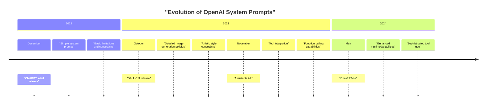
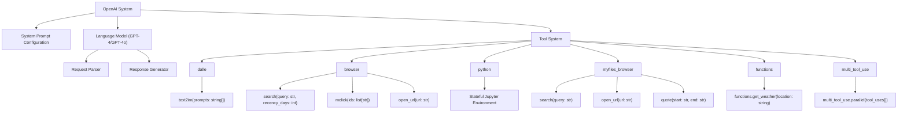
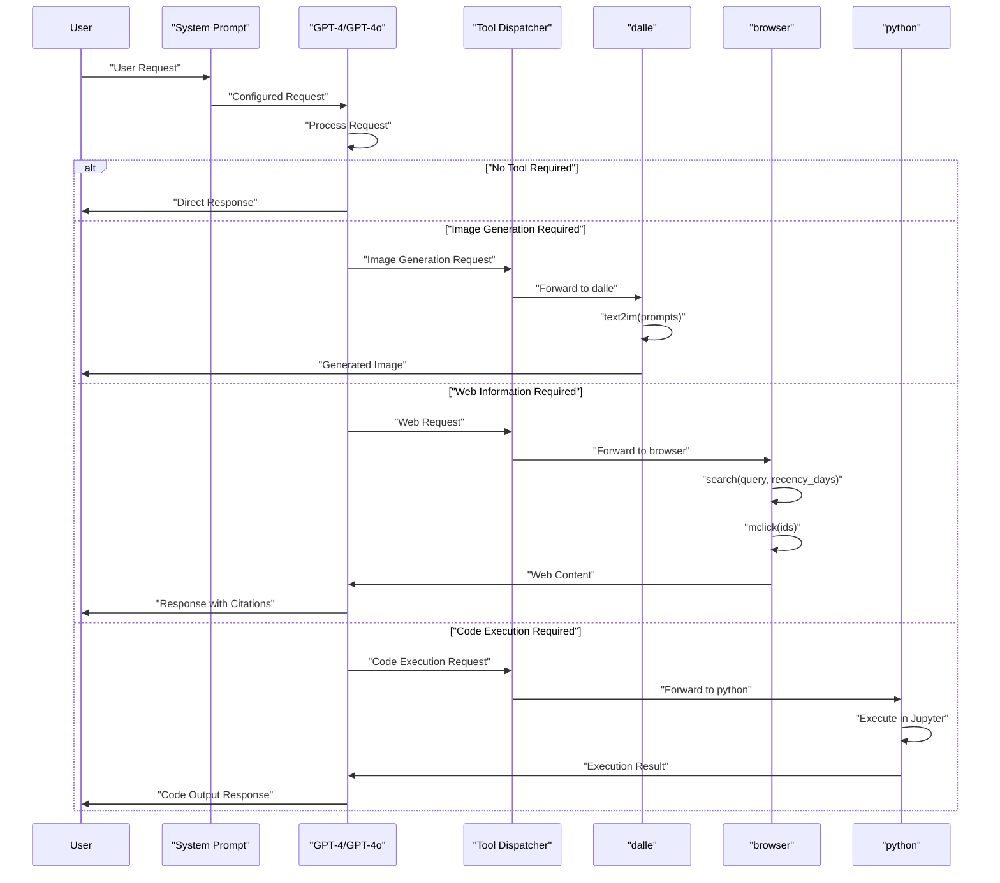

<!-- source: DeepWiki mcp.deepwiki.com · repo jujumilk3/leaked-system-prompts · page 3.1 OpenAI Systems · fetched 2026-11-09 -->

# OpenAI Systems

<details>
<summary>Relevant source files</summary>

The following files were used as context for generating this wiki page:

- [notion-ai_20221228.md](notion-ai_20221228.md)
- [openai-assistants-api_20231106.md](openai-assistants-api_20231106.md)
- [openai-chatgpt4o_20240520.md](openai-chatgpt4o_20240520.md)
- [openai-chatgpt4o_20250506.md](openai-chatgpt4o_20250506.md)
- [openai-chatgpt5_20250807.md](openai-chatgpt5_20250807.md)
- [openai-chatgpt5_20250808.md](openai-chatgpt5_20250808.md)
- [openai-chatgpt_20221201.md](openai-chatgpt_20221201.md)

</details>


## Purpose and Scope

This document provides a technical overview of OpenAI's systems as represented in the leaked system prompts repository. It covers the core language models (ChatGPT, GPT-4/GPT-4o), image generation models (DALL-E 3), API interfaces (Assistants API), and the various tools and capabilities integrated into these systems. For information about how these systems compare to those from other AI companies, see [Major AI Companies and Their Systems](#2).

## Evolution of OpenAI System Prompts

The following timeline shows the progression of OpenAI's system prompts from earlier, simpler versions to more sophisticated and tool-enabled ones:



Sources: [openai-chatgpt_20221201.md, openai-dall-e-3_20231007-1.md, openai-assistants-api_20231106.md, openai-chatgpt4o_20240520.md]

## Core Language Models

### ChatGPT (2022)

The earliest leaked system prompt for ChatGPT from December 2022 defined a relatively simple system with basic capabilities and explicit limitations:

```
Assistant is a large language model trained by OpenAl.  
knowledge cutoff: 2021-09  
Current date: December 01 2022  
Browsing: disabled
```

The system prompt included a comprehensive list of limitations for the model, explicitly stating what the model could not do:

- No personal feelings or experiences
- No internet browsing 
- Knowledge cutoff in 2021
- No ability to perform physical actions
- No personalized medical or legal advice

Sources: [openai-chatgpt_20221201.md]

### GPT-4/GPT-4o (2024)

The system prompt for GPT-4o (May 2024) reveals significant advancements, including:

```
You are ChatGPT, a large language model trained by OpenAI, based on the GPT-4 architecture.  
Knowledge cutoff: 2023-10  
Current date: 2024-05-20
Image input capabilities: Enabled  
Personality: v2
```

This version includes integration with multiple tools (detailed in the Tools section below) and a more sophisticated definition of model capabilities.

Sources: [openai-chatgpt4o_20240520.md]

## Tools and Integration Architecture

OpenAI's systems incorporate various tools that extend their capabilities beyond pure language processing. The following diagram illustrates the tool architecture in OpenAI's systems:



Sources: [openai-chatgpt4o_20240520.md, openai-assistants-api_20231106.md]

### Tool Types and Capabilities

#### Image Generation (dalle)

The dalle tool allows models to generate images from text descriptions. From the GPT-4o system prompt:

```
## dalle

- Whenever a description of an image is given, create a prompt that dalle can use to generate the image and abide by the following policy:
    - The prompt must be in English. Translate to English if needed.
    - DO NOT ask for permission to generate the image, just do it!
    [...]
```

The tool implementation accepts JSON-formatted requests:

```json
{  
 "prompt": "<insert prompt here>"  
}  
```

In DALL-E 3 specifications, the tool is defined with additional parameters:
- `size`: Image resolution (1792x1024, 1024x1024, or 1024x1792)
- `prompts`: Array of text prompts
- `seeds`: Optional array of seed values for reproducibility

Sources: [openai-chatgpt4o_20240520.md, openai-dall-e-3_20231007-1.md]

#### Web Browsing (browser)

The browser tool enables web search and content retrieval with these core functions:

```
- `search(query: str, recency_days: int)` Issues a query to a search engine and displays the results.  
- `mclick(ids: list[str])`. Retrieves the contents of the webpages with provided IDs (indices).
- `open_url(url: str)` Opens the given URL and displays it.
```

The system prompt explicitly defines when to use this tool:
- For current events or real-time information
- For unfamiliar terms that might be new
- When users explicitly request browsing or references

Sources: [openai-chatgpt4o_20240520.md]

#### Code Execution (python)

The python tool executes code in a controlled environment:

```
- When you send a message containing Python code to python, it will be executed in a stateful Jupyter notebook environment. python will respond with the output of the execution or time out after 60.0 seconds. The drive at '/mnt/data' can be used to save and persist user files. Internet access for this session is disabled.
```

Both the GPT-4o and Assistants API system prompts include this tool with similar specifications.

Sources: [openai-chatgpt4o_20240520.md, openai-assistants-api_20231106.md]

#### File Browsing (myfiles_browser)

Available in the Assistants API, this tool enables interaction with user-uploaded files:

```
`search(query: str)` Runs a query over the file(s) uploaded in the current conversation
`click(id: str)` Opens a document at position `id` in search results
`quote(start: str, end: str)` Stores a text span from the current document
`back()` Returns to the previous page
`scroll(amt: int)` Scrolls up or down in the open page
`open_url(url: str)` Opens the document with the ID `url`
```

Sources: [openai-assistants-api_20231106.md]

#### Function Calling (functions)

The functions tool enables structured interaction with external APIs:

```
namespace functions {

// Determine weather in my location
type get_weather = (_: {
// The city and state e.g. San Francisco, CA
location: string,
unit?: \"c\" | \"f\",
}) => any;

} // namespace functions
```

This TypeScript-like syntax defines the expected parameters and return types.

Sources: [openai-assistants-api_20231106.md]

#### Multi-Tool Use (multi_tool_use)

This orchestration layer enables parallel execution of multiple tools:

```
// Use this function to run multiple tools simultaneously
type parallel = (_: {
// The tools to be executed in parallel. NOTE: only functions tools are permitted
tool_uses: {
// The name of the tool to use
recipient_name: string,
// The parameters to pass to the tool
parameters: object,
}[],
}) => any;
```

Sources: [openai-assistants-api_20231106.md]

## Information Flow in OpenAI Systems

The following sequence diagram illustrates how information flows through OpenAI's systems when handling user requests:



Sources: [openai-chatgpt4o_20240520.md, openai-assistants-api_20231106.md]

## DALL-E 3 System

DALL-E 3 is OpenAI's image generation model with specific policies and constraints enforced through its system prompt:

| Policy | Description |
|--------|-------------|
| Language | Translate non-English descriptions to English |
| Quantity | Maximum of 4 images per request |
| Public Figures | No images of politicians or public figures |
| Artist Styles | No imitation of artists from the last 100 years |
| Image Types | Specify image type (photo, painting, etc.) |
| Human Diversity | Diversify depictions of people by descent and gender |
| Celebrity References | Modify references to specific people or celebrities |

The technical implementation includes parameters for:
- Resolution options (wide, square, tall)
- Multiple prompt variations
- Optional seed values for reproducibility

Sources: [openai-dall-e-3_20231007-1.md, openai-dall-e-3_20231007-2.md]

## Assistants API

OpenAI's Assistants API provides a structured interface for creating AI assistants with integrated tools. The system prompt is minimal compared to ChatGPT:

```
You are a helpful assistant. Follow the user's exact instructions.
```

The API design focuses on tool integration rather than personality definition, with a particular emphasis on stateful interactions and file handling.

Tool specifications in the Assistants API include:
- python: Code execution in a Jupyter environment
- myfiles_browser: File browsing and search capabilities
- functions: External function calling with TypeScript-like parameter definitions
- multi_tool_use: Parallel tool execution orchestration

Sources: [openai-assistants-api_20231106.md]

## Integration with Third-Party Applications

OpenAI's systems can be integrated into third-party applications, as demonstrated by Notion AI's templates:

| Template | Purpose | Format |
|----------|---------|--------|
| Help Me Write | Generate content from prompts | `Output in [language]: [markdown content]` |
| Brainstorm Ideas | Generate idea lists | `10 ideas based on topic in [language]: [bulleted list]` |
| Blog Post | Create structured blog posts | `Blog post in [language]: # [Title] [Content]` |
| Creative Story | Generate stories | `Story in [language]: # [Title] [Story content]` |
| Essay | Create structured essays | `Essay in [language]: # [Title] [Introduction] ## [Topics] [Conclusion]` |
| Meeting Agenda | Create meeting plans | `Meeting agenda in [language]: # [Meeting name] [Introduction] [Topics]` |

These templates demonstrate how OpenAI's base models can be customized through system prompts to create specialized AI tools for specific tasks.

Sources: [notion-ai_20221228.md]

## Safety Mechanisms

The system prompts reveal various safety mechanisms implemented in OpenAI's systems:

1. **Content Restrictions**:
   - No images of politicians or public figures
   - No artist style imitation for recent artists
   - Diversification requirements for human depictions

2. **Technical Limitations**:
   - Internet access disabled for python execution
   - File access restricted to user-uploaded files
   - Timeout limits for code execution (60 seconds)

3. **Response Formatting**:
   - Citation requirements for web content
   - Standardized image generation policies
   - Structured function calling parameters

Sources: [openai-chatgpt4o_20240520.md, openai-dall-e-3_20231007-1.md, openai-assistants-api_20231106.md]

## Conclusion

The leaked system prompts provide valuable insights into the architecture, capabilities, and constraints of OpenAI's systems. From the evolution of simple chatbots to sophisticated multimodal assistants with integrated tools, these documents reveal OpenAI's approach to AI system design and safety implementation. The technical specifications also illustrate how OpenAI's base models can be customized and extended through structured prompts and tool integrations to create specialized AI applications.

Sources: [openai-chatgpt_20221201.md, openai-chatgpt4o_20240520.md, openai-assistants-api_20231106.md, openai-dall-e-3_20231007-1.md, openai-dall-e-3_20231007-2.md, notion-ai_20221228.md]

---

