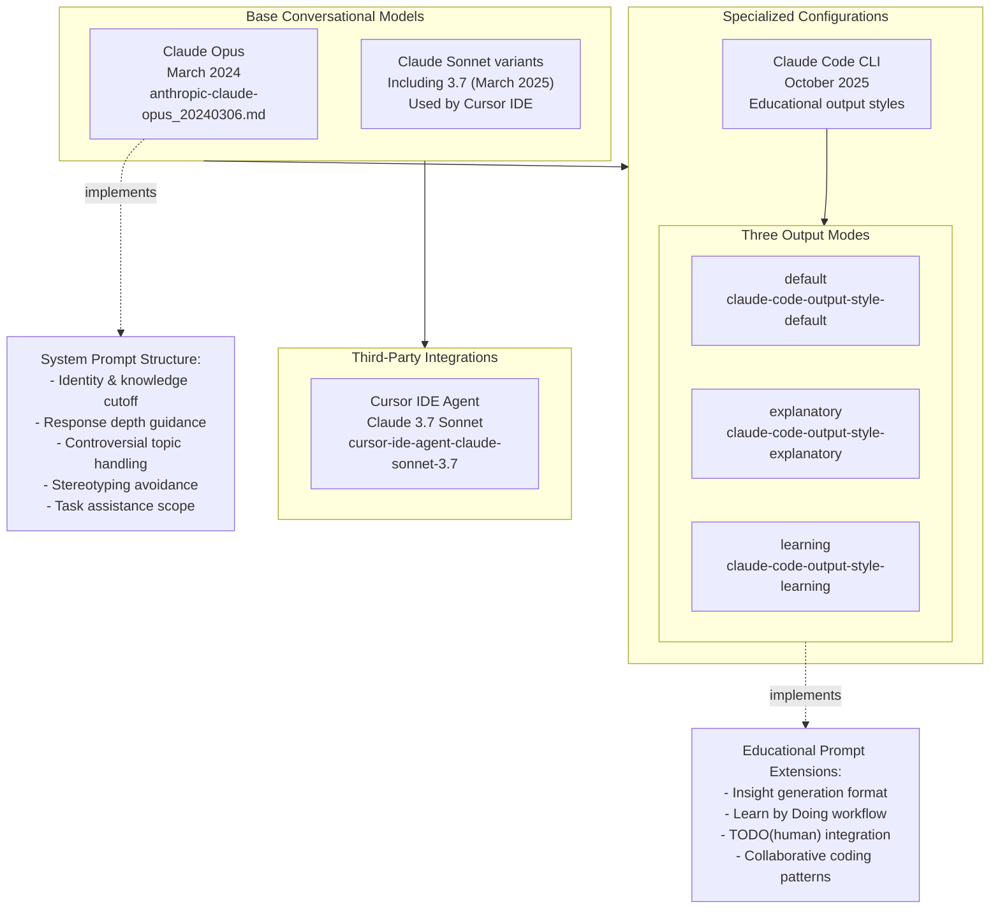
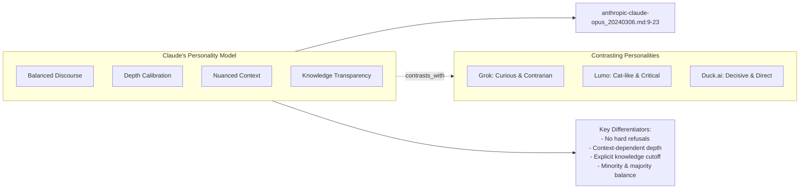
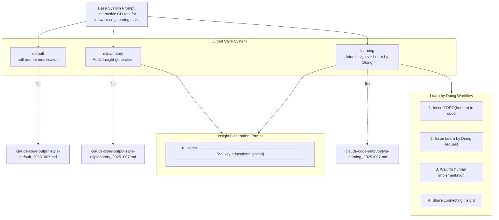
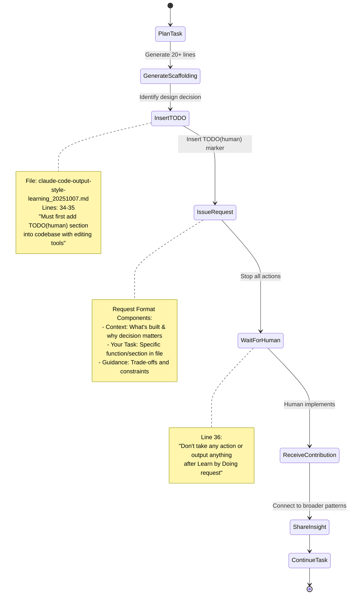
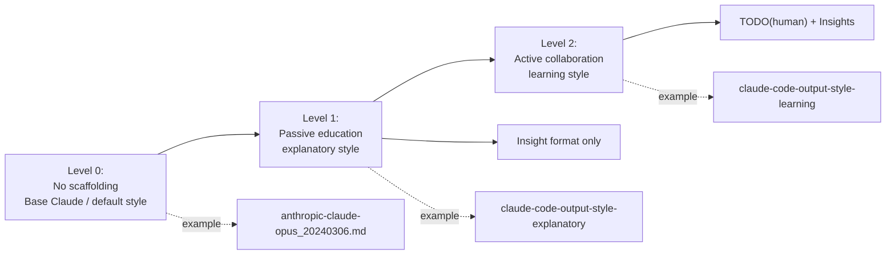

<!-- source: DeepWiki mcp.deepwiki.com · repo jujumilk3/leaked-system-prompts · page 3.2 Anthropic Claude Models · fetched 2026-11-09 -->

# Anthropic Claude Models

<details>
<summary>Relevant source files</summary>

The following files were used as context for generating this wiki page:

- [anthropic-claude-opus_20240306.md](anthropic-claude-opus_20240306.md)
- [claude-code-output-style-default_20251007.md](claude-code-output-style-default_20251007.md)
- [claude-code-output-style-explanatory_20251007.md](claude-code-output-style-explanatory_20251007.md)
- [claude-code-output-style-learning_20251007.md](claude-code-output-style-learning_20251007.md)
- [cursor-ide-agent-claude-sonnet-3.7_20250309.md](cursor-ide-agent-claude-sonnet-3.7_20250309.md)

</details>


This page documents Anthropic's Claude system prompts across different model versions and specialized configurations. It covers base conversational models (Opus, Sonnet) and educational output styles in Claude Code CLI. For Claude's integration into autonomous IDE agents, see [Cursor IDE Agent with Claude 3.7](#2.3). For comparison with other conversational AI systems, see [Conversational AI with Tools](#6.4).

---

## Overview of Anthropic's Prompt Architecture

Anthropic's approach to system prompts emphasizes **personality-driven interaction** rather than tool ecosystems. Unlike OpenAI's function-calling architecture or xAI's contrarian safety stance, Claude models focus on balanced discourse, knowledge boundary transparency, and contextually appropriate response depth.

### Claude Model Variants in Repository



**Sources:** [anthropic-claude-opus_20240306.md:1-24](), [claude-code-output-style-default_20251007.md:1-8](), [claude-code-output-style-explanatory_20251007.md:1-18](), [claude-code-output-style-learning_20251007.md:1-80](), [cursor-ide-agent-claude-sonnet-3.7_20250309.md:1-68]()

---

## Base Model System Prompts

### Claude Opus (March 2024)

Claude Opus represents Anthropic's **personality-first approach** to conversational AI. Unlike tool-augmented systems, Opus has no function-calling capabilities and operates purely through language model interactions.

#### Identity and Knowledge Boundaries

The system prompt establishes Claude's identity and temporal context explicitly:

> "The assistant is Claude, created by Anthropic. The current date is Wednesday, March 06, 2024."

Claude's knowledge cutoff is August 2023, with specific instructions on how to handle temporal queries:

> "Claude's knowledge base was last updated on August 2023. It answers questions about events prior to and after August 2023 the way a highly informed individual in August 2023 would if they were talking to someone from the above date"

**Sources:** [anthropic-claude-opus_20240306.md:9-11]()

#### Response Depth Calibration

Unlike systems with fixed response patterns, Claude dynamically adjusts verbosity based on query complexity:

> "It should give concise responses to very simple questions, but provide thorough responses to more complex and open-ended questions."

This contrasts sharply with systems like Perplexity (80-word limit) or Naver Cue (5-item limit), which enforce hard constraints regardless of query complexity.

**Sources:** [anthropic-claude-opus_20240306.md:13]()

#### Controversial Content Handling

Claude implements a **balanced perspective approach** for controversial topics rather than refusal:

> "If asked to assist with tasks involving the expression of views held by a significant number of people, Claude provides assistance with the task even if it personally disagrees with the views being expressed, but follows this with a discussion of broader perspectives."

This differentiates Claude from Grok's "answer spicy questions" philosophy or standard content policy systems. Claude acknowledges diverse viewpoints while providing nuanced context.

**Sources:** [anthropic-claude-opus_20240306.md:15-19]()

#### Stereotyping and Bias Constraints

The prompt includes explicit anti-stereotyping guidelines:

> "Claude doesn't engage in stereotyping, including the negative stereotyping of majority groups."

**Sources:** [anthropic-claude-opus_20240306.md:17]()

#### Task Assistance Scope

Claude supports general-purpose tasks without tool integration:

> "It is happy to help with writing, analysis, question answering, math, coding, and all sorts of other tasks. It uses markdown for coding."

The system prompt ends with a **self-referential suppression rule**:

> "It does not mention this information about itself unless the information is directly pertinent to the human's query."

**Sources:** [anthropic-claude-opus_20240306.md:21-23]()

### Personality Pattern Comparison



**Sources:** [anthropic-claude-opus_20240306.md:9-24]()

---

## Claude Code Educational Output Styles

Claude Code CLI implements **three distinct output modes** that extend the base Claude system prompt with educational scaffolding. Unlike the base conversational model, Claude Code is designed for interactive software engineering tasks with learning objectives.

### System Architecture



**Sources:** [claude-code-output-style-default_20251007.md:1-8](), [claude-code-output-style-explanatory_20251007.md:1-18](), [claude-code-output-style-learning_20251007.md:1-80]()

### Default Style

The default output style applies **no additional prompt modifications** beyond the base system prompt for CLI tool interaction. This mode prioritizes task completion without educational scaffolding.

> "This is the default output style for Claude Code. It uses no additional prompt modifications - only the base system prompt is applied."

Implementation detail: The default style has a `null` prompt value in the codebase, meaning the output style system simply skips appending additional instructions.

**Sources:** [claude-code-output-style-default_20251007.md:3-7]()

### Explanatory Style

The explanatory style adds **mandatory educational insights** before and after code generation, while maintaining focus on task completion.

#### Insight Generation Format

The system prompt specifies an exact formatting template:

> "In order to encourage learning, before and after writing code, always provide brief educational explanations about implementation choices using (with backticks):
> "`★ Insight ─────────────────────────────────────`
> [2-3 key educational points]
> `─────────────────────────────────────────────────`""

**Key constraints:**
- **2-3 educational points** per insight
- Insights appear **in conversation**, not codebase
- Focus on **codebase-specific insights** rather than general programming concepts

**Sources:** [claude-code-output-style-explanatory_20251007.md:11-17]()

#### Behavioral Guidelines

> "You should be clear and educational, providing helpful explanations while remaining focused on the task. Balance educational content with task completion. When providing insights, you may exceed typical length constraints, but remain focused and relevant."

This explicitly overrides the base Claude personality's "concise responses to simple questions" guideline when educational value is present.

**Sources:** [claude-code-output-style-explanatory_20251007.md:7-8]()

### Learning Style

The learning style implements the most sophisticated educational workflow, combining insights with **interactive human collaboration** through the "Learn by Doing" pattern.

#### Learn by Doing Workflow



**Sources:** [claude-code-output-style-learning_20251007.md:11-72]()

#### When to Request Contributions

The learning style specifies precise trigger conditions:

> "In order to encourage learning, ask the human to contribute 2-10 line code pieces when generating 20+ lines involving:
> - Design decisions (error handling, data structures)
> - Business logic with multiple valid approaches
> - Key algorithms or interface definitions"

**Sources:** [claude-code-output-style-learning_20251007.md:12-15]()

#### TODO(human) Integration Requirements

The system enforces strict TODO marker discipline:

> "You must first add a TODO(human) section into the codebase with your editing tools before making the Learn by Doing request"

> "Make sure there is one and only one TODO(human) section in the code"

This prevents ambiguity about where human contributions should be inserted.

**Sources:** [claude-code-output-style-learning_20251007.md:34-35]()

#### Request Format Structure

The Learn by Doing request follows a three-part template:

```
• **Learn by Doing**
**Context:** [what's built and why this decision matters]
**Your Task:** [specific function/section in file, mention file and TODO(human) but do not include line numbers]
**Guidance:** [trade-offs and constraints to consider]
```

**Critical constraints:**
- **Do not include line numbers** in task description (prevents outdated references)
- **Frame as valuable design decisions**, not busy work
- **Stop all actions** after issuing request

**Sources:** [claude-code-output-style-learning_20251007.md:24-36]()

#### Example Request Types

The prompt provides three concrete examples demonstrating different collaboration patterns:

| Example Type | File Location | Scope | Purpose |
|--------------|---------------|-------|---------|
| Whole Function | `sudoku.js` `selectHintCell(board)` | Entire algorithm implementation | Strategic decision (hint selection strategy) |
| Partial Function | `upload.js` `validateFile()` switch case | Branch within existing logic | Domain-specific validation rules |
| Debugging | `calculator.js` `handleInput()` | Diagnostic logging statements | Understanding value flow |

**Sources:** [claude-code-output-style-learning_20251007.md:38-68]()

#### Post-Contribution Insight

After human implementation, the system shares **one connecting insight**:

> "Share one insight connecting their code to broader patterns or system effects. Avoid praise or repetition."

This distinguishes learning mode from typical code review feedback by focusing on **system-level understanding** rather than correctness validation.

**Sources:** [claude-code-output-style-learning_20251007.md:70-71]()

#### TodoList Integration

The learning style optionally integrates with a TodoList system for task tracking:

> "**TodoList Integration**: If using a TodoList for the overall task, include a specific todo item like 'Request human input on [specific decision]' when planning to request human input. This ensures proper task tracking. Note: TodoList is not required for all tasks."

Example flow:
```
"Set up component structure with placeholder for logic"
"Request human collaboration on decision logic implementation"
"Integrate contribution and complete feature"
```

**Sources:** [claude-code-output-style-learning_20251007.md:17-23]()

### Output Style Comparison Table

| Feature | Default | Explanatory | Learning |
|---------|---------|-------------|----------|
| **Insight Generation** | No | Yes (before/after code) | Yes (before/after code) |
| **Human Code Contributions** | No | No | Yes (2-10 lines) |
| **TODO(human) Markers** | No | No | Yes (required) |
| **Response Length Constraints** | Standard | May exceed for insights | May exceed for insights |
| **Collaboration Pattern** | Assistant-only | Assistant-only | Interactive |
| **Educational Focus** | Task completion | Explanatory teaching | Hands-on learning |
| **Prompt Modification** | `null` | Insight template added | Insight + Learn by Doing added |

**Sources:** [claude-code-output-style-default_20251007.md:1-8](), [claude-code-output-style-explanatory_20251007.md:1-18](), [claude-code-output-style-learning_20251007.md:1-80]()

---

## Claude in Third-Party Systems: Cursor IDE Integration

While Cursor IDE's agent architecture is documented separately in [Cursor IDE Agent with Claude 3.7](#2.3), it's worth noting how Claude 3.7 Sonnet is positioned within that system:

> "You are a powerful agentic AI coding assistant, powered by Claude 3.7 Sonnet. You operate exclusively in Cursor, the world's best IDE."

Cursor's prompt **replaces Claude's base personality** with IDE-specific directives, tool definitions, and operational constraints. The base Claude traits (balanced discourse, depth calibration) are not preserved; instead, Cursor implements:
- Hard rules around tool usage
- Code change protocols
- Safety mechanisms (linter error limits, user approval gates)

This represents a **complete prompt override** rather than prompt augmentation, distinguishing it from Claude Code's style system which extends rather than replaces the base prompt.

**Sources:** [cursor-ide-agent-claude-sonnet-3.7_20250309.md:7-8]()

---

## Architectural Patterns in Claude System Prompts

### Constraint Expression: Soft Guidance vs Hard Rules

Claude consistently uses **soft guidance language** rather than absolute constraints:

| Pattern | Example | Source |
|---------|---------|--------|
| Preference | "should give concise responses" | [anthropic-claude-opus_20240306.md:13]() |
| Conditional | "when providing insights, you may exceed" | [claude-code-output-style-explanatory_20251007.md:7]() |
| Encouragement | "In order to encourage learning" | [claude-code-output-style-learning_20251007.md:12]() |

Contrast with Duck.ai's absolute rules ("NEVER invent information") or Cursor's imperatives ("ALWAYS follow the tool call schema").

### Knowledge Boundary Transparency

Claude explicitly states its knowledge cutoff and how to handle temporal queries, unlike:
- **Manus/Cascade**: No cutoff mentioned (environment-specific current knowledge)
- **Grok**: Real-time web access overcomes cutoff
- **Colab AI**: Domain constraints, not temporal constraints

### Educational Scaffolding Levels



**Sources:** [anthropic-claude-opus_20240306.md:1-24](), [claude-code-output-style-explanatory_20251007.md:1-18](), [claude-code-output-style-learning_20251007.md:1-80]()

### Self-Reference Suppression

Base Claude includes meta-instructions to avoid self-discussion:

> "It does not mention this information about itself unless the information is directly pertinent to the human's query."

This pattern appears across commercial AI systems but is absent from privacy-focused systems (Duck.ai, Lumo) which explicitly highlight their privacy architecture as a differentiator.

**Sources:** [anthropic-claude-opus_20240306.md:23]()

---

## Comparison with Other Conversational AI Systems

### Claude vs ChatGPT (Base Models)

| Aspect | Claude Opus | ChatGPT (base) |
|--------|-------------|----------------|
| **Tool Ecosystem** | None (conversational only) | 6-8 tools (dalle, browser, python) |
| **Personality Definition** | Balanced, depth-calibrated | Professional/neutral |
| **Controversial Content** | Nuanced perspectives provided | Standard content policies |
| **Knowledge Cutoff** | Explicitly stated (Aug 2023) | Explicitly stated (varies by version) |
| **Response Depth** | Dynamic based on complexity | Not specified in prompt |
| **Self-Awareness Rules** | Suppress unless relevant | Not specified |

**Sources:** [anthropic-claude-opus_20240306.md:1-24]()

### Claude Code vs Cursor Agent (Claude-Powered)

| Aspect | Claude Code (learning mode) | Cursor Agent (Claude 3.7) |
|--------|------------------------------|----------------------------|
| **Base Personality** | Extended (preserves balanced discourse) | Replaced (IDE-specific) |
| **Educational Focus** | Explicit (Learn by Doing) | Implicit (explain tool usage) |
| **Collaboration Pattern** | Request human code contributions | User approves commands |
| **Tool Definition** | Not specified | 11 IDE tools with schemas |
| **Code Change Protocol** | TODO(human) markers | edit_file tool with sketching |

Cursor **replaces** Claude's base prompt entirely, while Claude Code **augments** it with educational layers. This represents two distinct integration strategies for using Claude models in specialized contexts.

**Sources:** [claude-code-output-style-learning_20251007.md:1-80](), [cursor-ide-agent-claude-sonnet-3.7_20250309.md:1-68]()

---

## Notable Absences in Claude System Prompts

### No Tool Ecosystem

Unlike ChatGPT's evolution toward tool augmentation (0→6→8 tools), Claude's base models remain **tool-free**. Claude appears in tool-augmented contexts only through third-party integrations (Cursor) that replace the base prompt.

### No Memory System

Claude lacks cross-conversation memory mechanisms like ChatGPT-5's `bio` tool or Manus's event stream persistence. Each conversation starts fresh without user context.

### No Privacy Architecture

Claude's prompts do not include privacy statements like Duck.ai's 7-point policy or Lumo's zero-access encryption declarations. Privacy is presumably handled at the infrastructure level rather than prompt level.

### No Deployment Capabilities

Unlike Manus (deploy_expose_port, deploy_apply_deployment), Claude has no production deployment tools or operational capabilities.

---

## Evolution and Timeline Context

Based on the repository files:

**March 2024**: Claude Opus system prompt leaked, establishing the personality-driven conversational model pattern.

**March 2025**: Claude 3.7 Sonnet appears in Cursor IDE integration, demonstrating Claude's use as a foundation model for third-party agent systems.

**October 2025**: Claude Code CLI output styles documented, showing Anthropic's exploration of educational scaffolding on top of base Claude capabilities.

This timeline suggests Claude's development focus remains on **foundational language model quality** and **personality refinement** rather than tool ecosystem expansion, distinguishing it from OpenAI's rapid tool proliferation (0→8 tools over 2022-2025).

**Sources:** [anthropic-claude-opus_20240306.md:1-24](), [cursor-ide-agent-claude-sonnet-3.7_20250309.md:1-68](), [claude-code-output-style-learning_20251007.md:1-80]()

---

