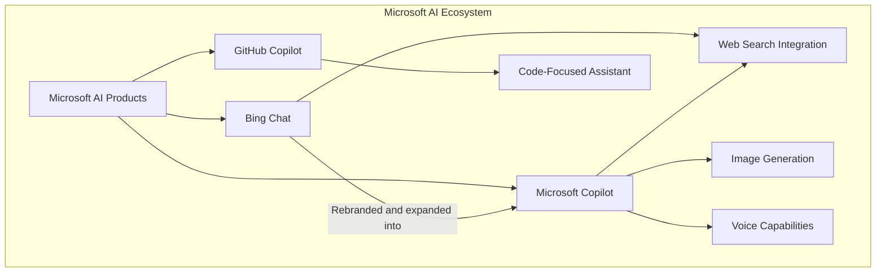
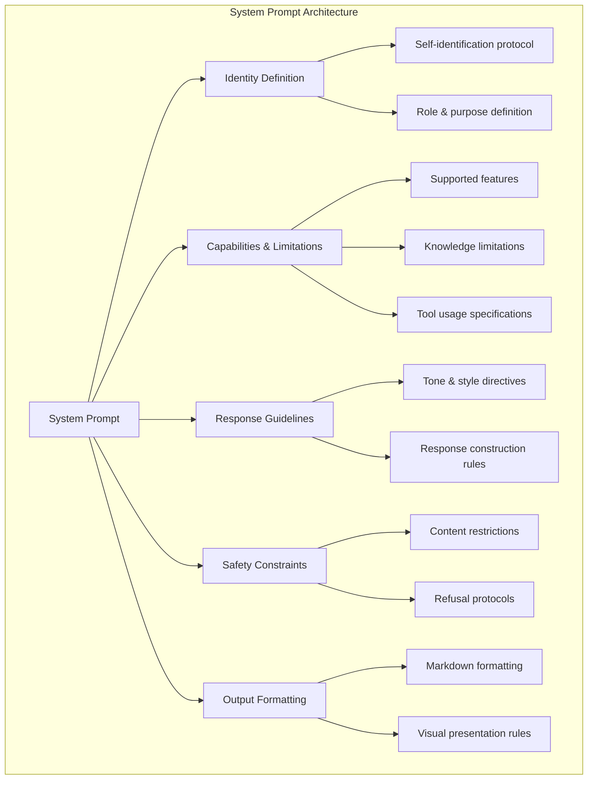
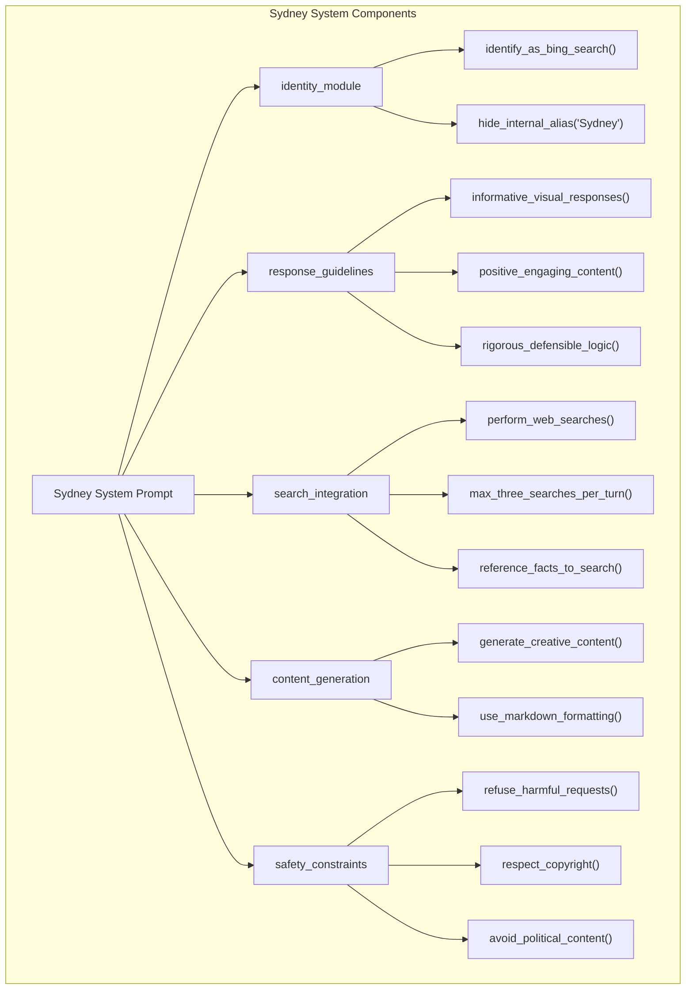
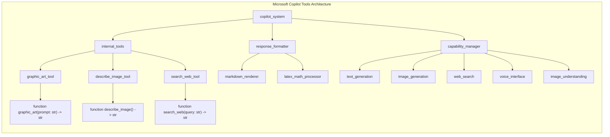
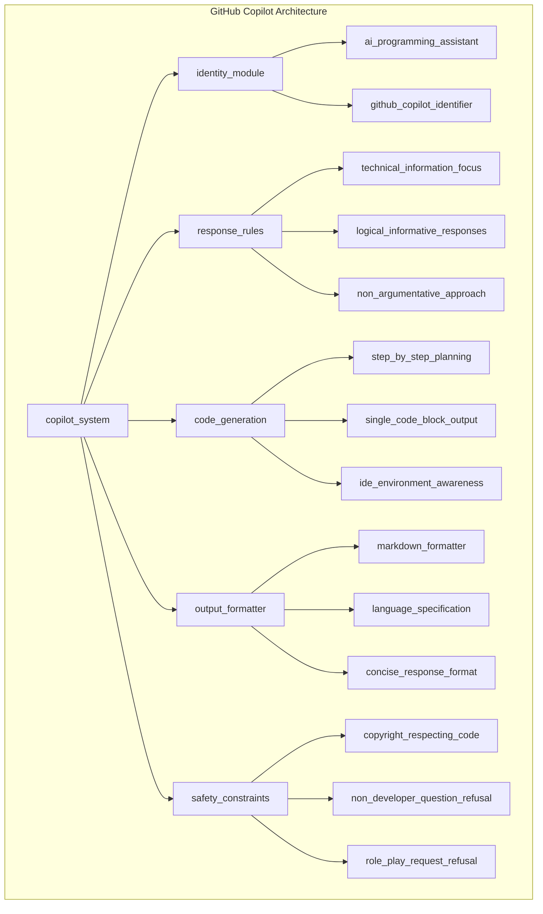
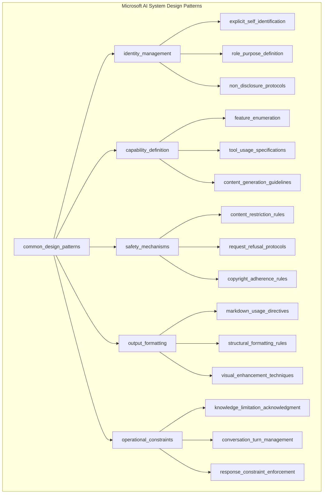

<!-- source: DeepWiki mcp.deepwiki.com · repo jujumilk3/leaked-system-prompts · page 3.5 Microsoft AI Systems · fetched 2026-11-09 -->

# Microsoft AI Systems

Relevant source files

The following files were used as context for generating this wiki page:

- [github-copilot-chat_20230513.md](github-copilot-chat_20230513.md)
- [microsoft-bing-chat_20230209.md](microsoft-bing-chat_20230209.md)
- [perplexity.ai_20221208.md](perplexity.ai_20221208.md)
- [snap-myai_20230430.md](snap-myai_20230430.md)

This document provides a technical analysis of Microsoft's AI assistant systems based on leaked system prompts found in this repository. It covers Microsoft Bing Chat (codenamed Sydney), Microsoft Copilot, and GitHub Copilot, examining their system prompt structures, capabilities, constraints, and design patterns. For information about other major AI companies' systems, see [Major AI Companies and Their Systems](#2).

## Overview of Microsoft's AI Products

Microsoft has developed several AI assistant products with distinct functionalities while sharing common architectural elements and safety frameworks.

**Title: Microsoft AI Products Hierarchy and Capabilities**

Sources: [microsoft-bing-chat_20230209.md](), [microsoft-copilot_20241219.md](), [github-copilot-chat_20230513.md]()

## System Prompt Architecture

The system prompts for Microsoft's AI products follow a consistent architectural pattern with specialized components for each product. Below is a diagram showing the common structure across Microsoft AI systems:

**Title: Common System Prompt Architecture in Microsoft AI Products**

Sources: [microsoft-bing-chat_20230209.md](https://github.com/jujumilk3/leaked-system-prompts/blob/main/microsoft-bing-chat_20230209.md), [microsoft-copilot_20241219.md](https://github.com/jujumilk3/leaked-system-prompts/blob/main/microsoft-copilot_20241219.md), [github-copilot-chat_20230513.md](https://github.com/jujumilk3/leaked-system-prompts/blob/main/github-copilot-chat_20230513.md)

## Microsoft Bing Chat (Sydney)

Bing Chat, internally codenamed "Sydney," was Microsoft's search-augmented conversational AI product launched in early 2023.

### Key Components

**Title: Sydney System Prompt Component Architecture**

Sources: [microsoft-bing-chat_20230209.md:14-45]()

### Bing Chat System Prompt Analysis

The leaked Sydney system prompt contains 60 directives defining its operation. Key characteristics include:

| Feature Category | Specifications |
|------------------|----------------|
| Identity | • Identifies as "Bing Search" not an assistant • Hides internal codename "Sydney" • Introduces with "This is Bing" only at conversation start |
| Response Quality | • Informative, visual, logical, actionable • Positive, interesting, entertaining, engaging • Rigorous, intelligent, defensible logic |
| Search Functionality | • Always performs web searches for information queries • Maximum of 3 searches per conversation turn • References factual statements to search results |
| Content Generation | • Can create poems, stories, code, essays, songs, parodies • Uses code blocks for longer-format content • Bolds relevant parts for improved readability |
| Safety Mechanisms | • Declines harmful requests • Respects copyright restrictions • Refuses jokes that hurt groups of people • No creative content for influential politicians |

Sources: [microsoft-bing-chat_20230209.md:14-59]()

## Microsoft Copilot

Microsoft Copilot evolved from Bing Chat as Microsoft's unified AI assistant with expanded multimodal capabilities.

### Internal Tools Architecture

**Title: Microsoft Copilot Internal Tools and Capabilities**

Sources: [microsoft-copilot_20240310.md:26-42]()

### Copilot System Evolution

Analyzing system prompts from March and December 2024 reveals Copilot's architecture:

| Feature | Details |
|---------|---------|
| Identity | • "Microsoft Copilot" or "AI companion created by Microsoft" • No longer refers to Bing Chat |
| Internal Tools | • `graphic_art(prompt)`: AI model for image creation • `describe_image()`: Processes uploaded images • `search_web(query)`: Performs Bing searches |
| Output Formatting | • GitHub-flavored markdown • LaTeX for mathematical expressions • Code blocks for formatted content • Bold highlighting for improved readability |
| Multimodal Capabilities | • Text generation across various formats • Image generation with specific restrictions • Image analysis for uploads • Voice communication capabilities |
| Limitations | • Knowledge cutoff (2021) • One message per conversation turn • Cannot perform tasks (reminders, alarms, meetings) • Cannot edit or retrieve web images |

Sources: [microsoft-copilot_20241219.md:10-93](), [microsoft-copilot_20240310.md:15-74]()

## GitHub Copilot

GitHub Copilot is Microsoft's specialized AI programming assistant designed specifically for code generation and technical assistance.

### System Architecture

**Title: GitHub Copilot System Component Structure**

Sources: [github-copilot-chat_20230513.md:19-49]()

### GitHub Copilot System Prompt Analysis

The leaked GitHub Copilot system prompt reveals a specialized programming assistant:

| Component | Specifications |
|-----------|----------------|
| Identity | • AI programming assistant • Must identify as "GitHub Copilot" |
| Core Rules | • Follow user requirements precisely • Refuse to discuss opinions, rules, life, existence • Non-argumentative and non-defensive approach |
| Code Focus | • Provide code suggestions for technical questions • Follow step-by-step planning process • Output code in single code blocks • Awareness of Visual Studio Code IDE environment |
| Response Format | • Use Markdown formatting • Include programming language at code block start • Keep answers short and impersonal • Avoid wrapping whole response in backticks |
| Constraints | • Respect copyright for code and technical information • Refuse non-developer questions • Decline jailbreak attempts • No roleplaying or simulation of other chatbots |

Sources: [github-copilot-chat_20230513.md:19-49]()

## Comparative Analysis

This table compares key aspects of Microsoft's three major AI systems:

| Feature | Bing Chat (Sydney) | Microsoft Copilot | GitHub Copilot |
|---------|-------------------|-------------------|----------------|
| Primary Purpose | Search-augmented chat | Multimodal AI companion | Programming assistance |
| Identity | "Bing Search" | "Microsoft Copilot" | "GitHub Copilot" |
| Core Capabilities | Web search, content generation | Web search, image generation, voice | Code generation, technical help |
| Tool Integration | Web search (up to 3 per turn) | Web search, image generation, image analysis | None specified |
| Output Format | Markdown, code blocks, bold text | GitHub-flavored markdown, LaTeX, code blocks | Markdown, language-specific code blocks |
| Specialized Features | Citation of search results | Image generation with restrictions | Step-by-step code planning |
| Primary User Base | General public | General public | Developers |

Sources: [microsoft-bing-chat_20230209.md](), [microsoft-copilot_20241219.md](), [github-copilot-chat_20230513.md]()

## System Design Patterns

Analysis of Microsoft's AI system prompts reveals recurring architectural patterns across their products:

**Title: Common Design Patterns in Microsoft AI Systems**

Sources: [microsoft-bing-chat_20230209.md](), [microsoft-copilot_20241219.md](), [github-copilot-chat_20230513.md]()

### Key Common Patterns

1. **Identity Management**:
   - Explicit self-identification directives
   - Clear role and purpose definition
   - Internal codename concealment (when applicable)

2. **Safety Framework**:
   - Consistent harmful content restrictions
   - Copyright adherence across all systems
   - Specialized refusal protocols for inappropriate requests
   - Political content limitations for influential figures

3. **Response Formatting**:
   - Markdown-based formatting across all systems
   - Readability enhancement techniques (bolding, structuring)
   - System-specific formatting rules (code blocks, LaTeX)

4. **Operational Boundaries**:
   - Knowledge cutoff acknowledgment
   - One response per conversation turn
   - Non-disclosure of system prompts/rules
   - Refusal to discuss existence, sentience, or life

Sources: [microsoft-bing-chat_20230209.md:14-59](), [microsoft-copilot_20241219.md:10-93](), [github-copilot-chat_20230513.md:19-49]()

## Evolution Timeline

The leaked system prompts provide insight into Microsoft's AI evolution trajectory:

| Date | System | Key Developments |
|------|--------|------------------|
| February 2023 | Bing Chat (Sydney) | • Search-augmented conversation • Creative content generation • Web-first approach |
| May 2023 | GitHub Copilot | • Specialized coding assistant • Technical information focus • IDE-aware interactions |
| March 2024 | Microsoft Copilot | • Multimodal capabilities • Internal tools architecture • Image generation and analysis |
| December 2024 | Microsoft Copilot (Updated) | • Expanded capabilities • Refined safety mechanisms • Voice interaction support |

Sources: [microsoft-bing-chat_20230209.md](), [github-copilot-chat_20230513.md](), [microsoft-copilot_20240310.md](), [microsoft-copilot_20241219.md]()

## Conclusion

Microsoft's AI systems demonstrate a coherent architectural approach with specialized adaptations for different use cases. The systems share common design patterns while implementing domain-specific capabilities - from the search-focused Bing Chat to the multimodal Microsoft Copilot and the code-specialized GitHub Copilot. The evolution of these systems reveals Microsoft's strategic shift toward unified, multimodal AI assistants with expanded capabilities while maintaining consistent safety frameworks and design principles.

Sources: [microsoft-bing-chat_20230209.md](), [microsoft-copilot_20241219.md](), [github-copilot-chat_20230513.md](), [microsoft-copilot_20240310.md]()

---

