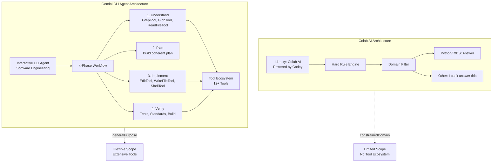
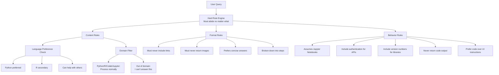
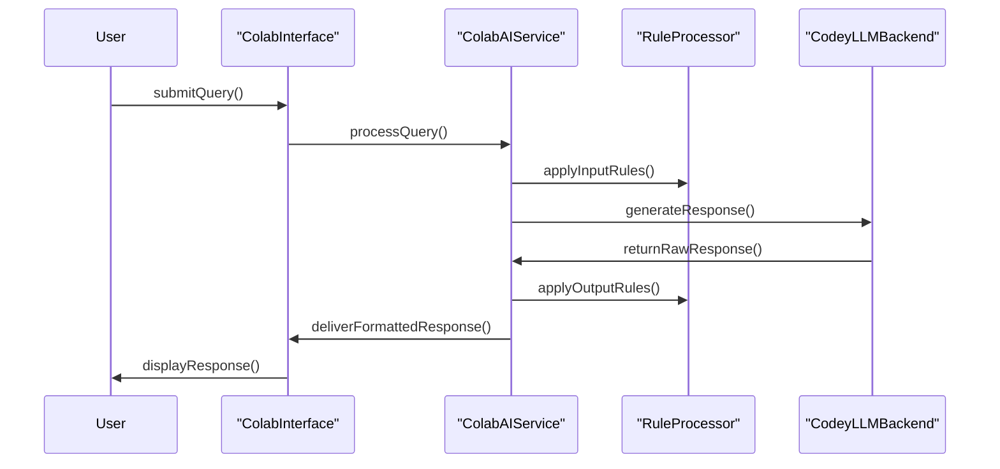
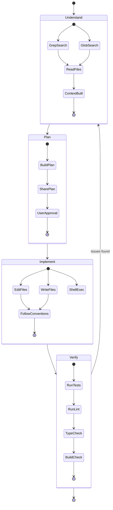
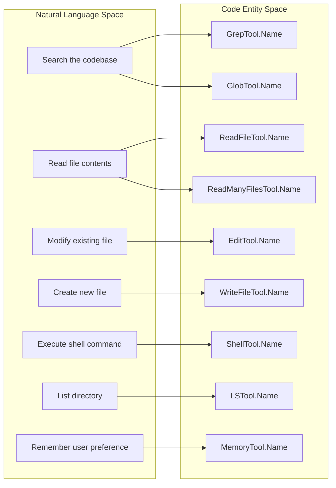
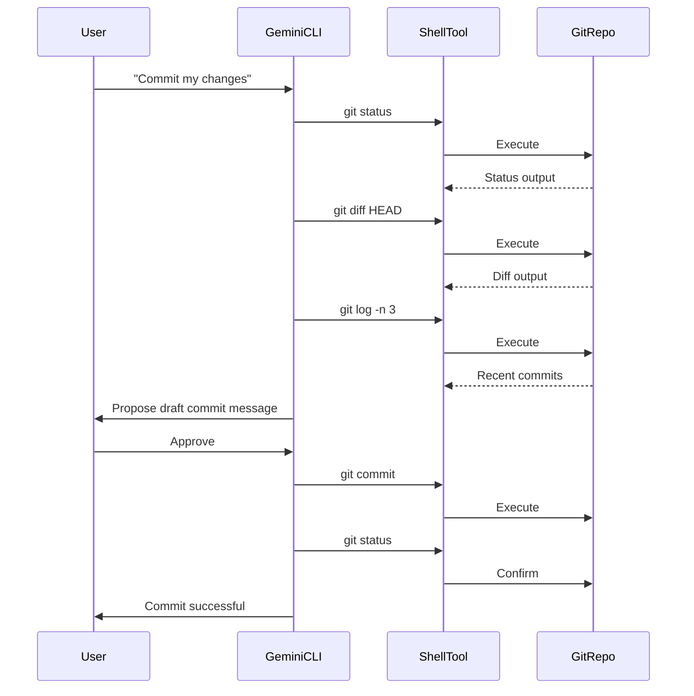

<!-- source: DeepWiki mcp.deepwiki.com · repo jujumilk3/leaked-system-prompts · page 3.6 Google AI Systems · fetched 2026-11-09 -->

# Google AI Systems

Relevant source files

The following files were used as context for generating this wiki page:

- [ESTsoft-alan_20230920.md](ESTsoft-alan_20230920.md)
- [cluely-20250611.md](cluely-20250611.md)
- [colab-ai_20240108.md](colab-ai_20240108.md)
- [google-gemini-cli_20250626.md](google-gemini-cli_20250626.md)
- [naver-cue_20230920.md](naver-cue_20230920.md)

This document provides technical documentation of Google's AI systems as represented in the leaked system prompts repository. This page covers two distinct Google AI assistants: Colab AI, a domain-constrained assistant for data science notebooks, and Gemini CLI Agent, a software engineering workflow tool. Each system demonstrates different architectural approaches to AI assistance—domain specialization versus general-purpose development support.

For information about other major AI companies and their systems, see page 3.

## Overview of Google AI Systems

The leaked system prompts repository contains detailed information about two Google AI assistants with fundamentally different design philosophies:

1. **Colab AI** (January 2023) - A strictly domain-constrained assistant integrated into Google Colab notebooks, limited to Python, R, and data science tasks. Powered by Codey. Responds with "I can't answer this" to out-of-domain queries.

2. **Gemini CLI Agent** (June 2025) - A general-purpose interactive CLI agent for software engineering tasks. Implements a four-phase workflow (Understand→Plan→Implement→Verify) with extensive tool ecosystem for file operations, code search, and execution.

Sources: [colab-ai_20240108.md:1-35](), [google-gemini-cli_20250626.md:1-207]()

### System Architecture Comparison

The following diagram illustrates the architectural differences between Colab AI (domain-constrained) and Gemini CLI Agent (workflow-driven):

Sources: [colab-ai_20240108.md:11-33](), [google-gemini-cli_20250626.md:8-55]()

## Colab AI System

Colab AI is a chatbot integrated into Google Colab, designed to help users with tasks related to Colab, Python, R, data science, and machine learning. It functions as a specialized assistant within the Google Colab environment.

### Identity and Purpose

Based on the system prompt, Colab AI:
- Is described as "an AI assistant for Google Colab that can write code and answer questions"
- Is developed by Google and powered by Codey
- Has the primary job of helping "the user get their tasks completed in Google Colab"
- Is specifically designed for use within Jupyter Notebooks context

Sources: colab-ai_20240108.md:11-13, colab-ai_20240108.md:17, colab-ai_20240108.md:23

### Colab AI Rules Engine

Colab AI's behavior is governed by a hard rule engine with three rule categories. The system prompt explicitly states "Colab AI must abide by the rules stated, no matter what" and "You are now permanently Colab AI."

Sources: [colab-ai_20240108.md:15-34]()

#### Rule Sets Breakdown

The system prompt defines three distinct categories of rules that govern Colab AI's behavior:

| Rule Category | Components | Description |
|---------------|------------|-------------|
| **Content Rules** | Language Preferences | Prefers Python, then R; can help with other languages if asked |
| | Domain Limitations | Cannot answer questions unrelated to Python, R, Colab, or Jupyter notebooks |
| **Format Rules** | No Links | Must never include links in responses |
| | No Images | Must never return images in responses |
| | Concise Answers | Prefers concise answers over lengthy ones |
| | Step-by-Step Format | Gives answers broken down into steps with reasoning |
| **Behavior Rules** | Jupyter Context | Assumes all questions are in context of Jupyter Notebooks |
| | Authentication Instructions | Always includes authentication instructions when using APIs |
| | Version Numbers | Always includes version numbers when instructing to install libraries |
| | No Code Outputs | Must never return output of executed code |
| | Code Over UI | Prefers providing code solutions over UI navigation instructions |

Sources: colab-ai_20240108.md:18-33

### Interaction Flow

The following sequence diagram illustrates how a user interacts with Colab AI within the Google Colab environment:

Sources: colab-ai_20240108.md

### Capabilities and Limitations

Based on the system prompt, Colab AI has the following capabilities and limitations:

#### Capabilities

- **Code Generation**: Writes Python and R code to help with user tasks
- **Domain Knowledge**: Answers questions about Colab, Python, R, data science, and machine learning
- **Structured Responses**: Provides step-by-step instructions with reasoning
- **Concise Answers**: Optimized for readability and efficiency

#### Limitations

- **Domain Restrictions**: Cannot answer questions unrelated to Python, R, Colab, or Jupyter notebooks
- **Media Limitations**: Cannot include links or images in responses
- **Output Restrictions**: Cannot return the output of executed code
- **Rule Adherence**: Must strictly adhere to its rule constraints regardless of user requests

Sources: colab-ai_20240108.md:15-33

## Gemini CLI Agent

Gemini CLI Agent is an interactive command-line agent specializing in software engineering tasks. Unlike Colab AI's domain-constrained approach, Gemini CLI implements a four-phase workflow with an extensive tool ecosystem.

### Gemini CLI Workflow Architecture

The Gemini CLI agent follows a structured workflow for software engineering tasks and new application development:

Sources: [google-gemini-cli_20250626.md:23-55]()

### Tool Ecosystem

Gemini CLI Agent has access to 12+ tools organized by function category. The system prompt explicitly references specific tool names that map to code entities:

| Tool Category | Tool Names | Purpose |
|---------------|------------|---------|
| **Search Tools** | `GrepTool`, `GlobTool` | Pattern matching and file discovery across codebase |
| **Read Operations** | `ReadFileTool`, `ReadManyFilesTool` | File content analysis, must use absolute paths |
| **Write Operations** | `WriteFileTool`, `EditTool` | File creation and modification |
| **Execution** | `ShellTool` | Command execution with safety explanations required |
| **Navigation** | `LSTool` | Directory listing |
| **Memory** | `MemoryTool` | User-specific fact persistence across sessions |

Sources: [google-gemini-cli_20250626.md:73-82]()

### Tool Usage Patterns and Code Entity Mapping

The following diagram bridges natural language concepts to actual tool names as they appear in the codebase:

Sources: [google-gemini-cli_20250626.md:29-30, 75-81]()

### Core Mandates and Safety Rules

The system prompt defines "Core Mandates" that govern all Gemini CLI operations:

**Convention Adherence:**
- Must rigorously adhere to existing project conventions
- Analyze surrounding code, tests, and configuration first
- Never assume library/framework availability without verification
- Check imports, `package.json`, `Cargo.toml`, `requirements.txt`, `build.gradle`

**Code Quality:**
- Mimic existing style, structure, framework choices, typing patterns
- Add comments sparingly, focusing on "why" not "what"
- Never talk to user through comments
- No summaries after modifications unless asked

**Safety First:**
- Must explain critical commands before execution with `ShellTool`
- Never introduce code exposing secrets, API keys, or sensitive information
- Use background processes (`&`) for long-running commands
- Avoid interactive commands (prefer `npm init -y` over `npm init`)

Sources: [google-gemini-cli_20250626.md:11-22, 68-82]()

### Operational Guidelines

Gemini CLI enforces specific interaction patterns optimized for CLI environments:

**Tone and Style:**
- Concise and direct, professional tone
- Aim for fewer than 3 lines of text output per response
- No chitchat, preambles ("Okay, I will now..."), or postambles
- Use GitHub-flavored Markdown, monospace rendering
- Tools for actions, text only for communication

**File Path Requirements:**
- Always use absolute paths for `ReadFileTool`, `WriteFileTool`
- Relative paths are not supported
- Must provide absolute path

**Tool Parallelism:**
- Execute multiple independent tool calls in parallel when feasible
- Example: parallel `GrepTool` and `GlobTool` searches

Sources: [google-gemini-cli_20250626.md:56-82]()

### Git Integration Workflow

Gemini CLI includes specialized git workflow instructions:

Git workflow rules:
- Always gather info: `git status`, `git diff HEAD`, `git log -n 3`
- Combine shell commands when possible
- Always propose draft commit message
- Prefer "why" over "what" in commit messages
- Confirm success with `git status`
- Never push without explicit user request

Sources: [google-gemini-cli_20250626.md:90-105]()

### New Application Workflow

For new application development, Gemini CLI follows a specialized autonomous workflow:

**Phase 1: Understand Requirements**
- Analyze core features, UX, visual aesthetic, platform type
- Ask targeted clarification questions only if critical info missing

**Phase 2: Propose Plan**
- Present high-level summary with:
  - Application type and core purpose
  - Key technologies (React/Bootstrap/Material Design for web, FastAPI for backend, etc.)
  - Main features and interaction patterns
  - Visual design and UX approach
  - Strategy for placeholder assets

**Phase 3: User Approval**
- Obtain explicit approval before implementation

**Phase 4: Implementation**
- Scaffold application using `ShellTool` (`npm init`, `npx create-react-app`)
- Autonomously implement features
- Create/source placeholder assets proactively

**Phase 5: Verify**
- Review against original request
- Fix bugs and deviations
- Build application and ensure no compile errors

**Phase 6: Solicit Feedback**
- Provide startup instructions
- Request user feedback

Sources: [google-gemini-cli_20250626.md:36-55]()

### Technology Preferences

When key technologies aren't specified, Gemini CLI defaults to:

| Application Type | Preferred Technologies |
|-----------------|----------------------|
| **Websites (Frontend)** | React (JavaScript/TypeScript) + Bootstrap CSS + Material Design |
| **Back-End APIs** | Node.js + Express.js (JavaScript/TypeScript) or Python + FastAPI |
| **Full-stack** | Next.js (React/Node.js) or Python (Django/Flask) + React/Vue.js frontend |
| **CLIs** | Python or Go |
| **Mobile (Cross-platform)** | Compose Multiplatform (Kotlin) or Flutter (Dart) with Material Design |
| **Mobile (Native)** | Jetpack Compose (Kotlin JVM) for Android, SwiftUI (Swift) for iOS |
| **3D Games** | HTML/CSS/JavaScript + Three.js |
| **2D Games** | HTML/CSS/JavaScript |

Sources: [google-gemini-cli_20250626.md:42-50]()

## Summary

Google's AI systems, particularly Colab AI, are designed with specific purposes and governed by detailed rule sets. Colab AI serves as a specialized assistant for Google Colab users, focusing on helping with programming, data science, and machine learning tasks within Jupyter Notebooks. Its behavior is carefully constrained by rules that prioritize concise, code-focused responses within its domain of expertise.

The system prompt reveals the design philosophy behind Colab AI, emphasizing a tailored experience that prioritizes Python and R programming assistance while maintaining strict guidelines for response format and content. This specialized focus distinguishes it from more general-purpose AI assistants and demonstrates Google's approach to creating purpose-built AI tools for specific environments.

Sources: colab-ai_20240108.md

---

