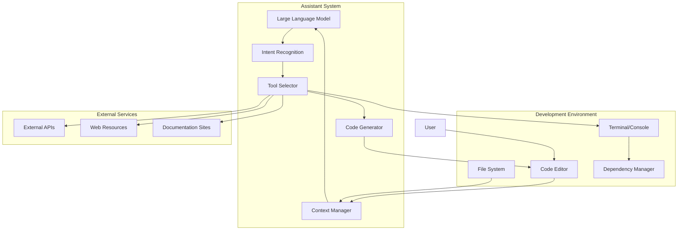
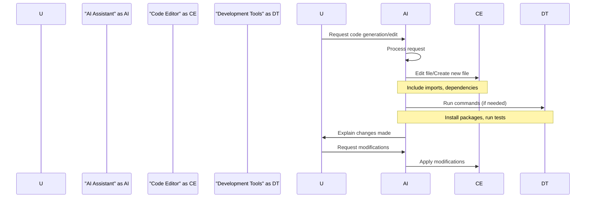
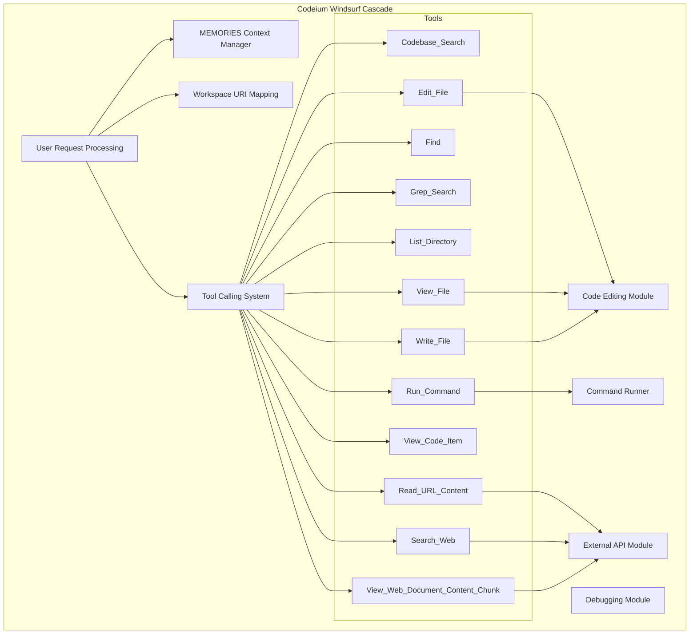
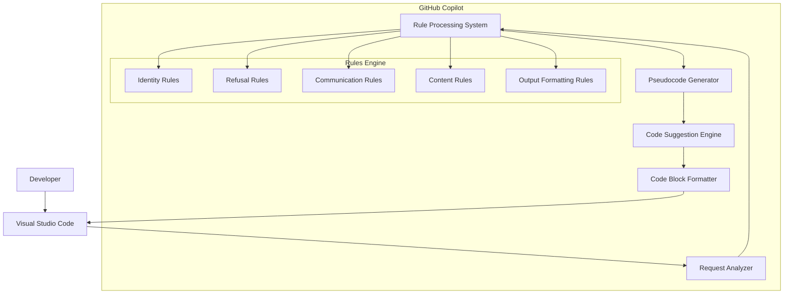
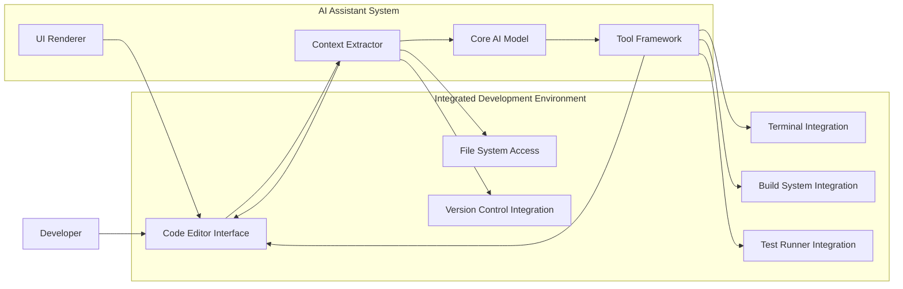
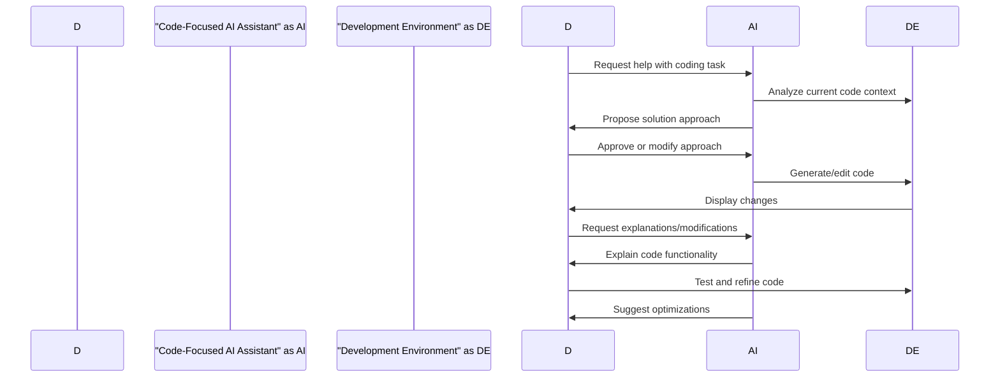
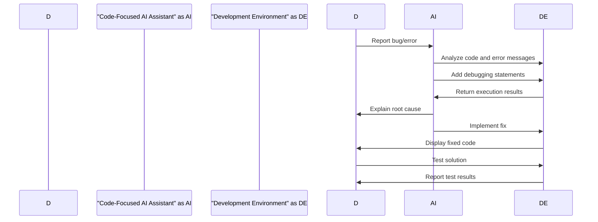

<!-- source: DeepWiki mcp.deepwiki.com · repo jujumilk3/leaked-system-prompts · page 4.1 Code-Focused AI Assistants · fetched 2026-11-09 -->

# Code-Focused AI Assistants

<details>
<summary>Relevant source files</summary>

The following files were used as context for generating this wiki page:

- [ESTsoft-alan_20230920.md](ESTsoft-alan_20230920.md)
- [colab-ai_20240108.md](colab-ai_20240108.md)
- [github-copilot-chat_20230513.md](github-copilot-chat_20230513.md)
- [microsoft-bing-chat_20230209.md](microsoft-bing-chat_20230209.md)
- [naver-cue_20230920.md](naver-cue_20230920.md)
- [perplexity.ai_20221208.md](perplexity.ai_20221208.md)
- [snap-myai_20230430.md](snap-myai_20230430.md)

</details>


## Purpose and Scope

This document provides an overview of AI assistant systems specifically designed for software development and coding tasks. It covers their architecture, capabilities, and integration patterns with development environments. For information about research and information-focused assistants, see [Research and Information Assistants](#3.2). For platform-specific AI assistants, see [Platform-Specific Assistants](#3.3).

## Overview

Code-focused AI assistants are specialized AI systems designed to help developers write, review, debug, and maintain code. Unlike general-purpose AI assistants, these systems contain specialized knowledge about programming languages, software development workflows, and coding best practices.

Sources: [codeium-windsurf-cascade-R1_20250201.md:8-11](), [github-copilot-chat_20230513.md:19-22](), [cursor-ide-sonnet_20241224.md:1-9]()

## Architecture and Components

Code-focused AI assistants typically operate with a multi-layered architecture that combines large language models, specialized tools, and IDE integration.



Sources: [codeium-windsurf-cascade-R1_20250201.md:8-18](), [cursor-ide-sonnet_20241224.md:23-85]()

## Key Capabilities

### Tool Integration

Code-focused AI assistants incorporate specialized tools to interact with development environments, typically including:

| Tool Category | Purpose | Examples |
|--------------|---------|----------|
| Code Search | Finding relevant code snippets within a codebase | Semantic search, grep search |
| File Operations | Viewing, editing, creating, and deleting files | Read file, edit file, write file |
| Terminal Integration | Running commands in the user's terminal | Executing build scripts, installing dependencies |
| External API Calling | Integrating with external services | Fetching documentation, accessing cloud services |
| Web Search | Finding relevant resources online | Documentation lookup, example code search |

Sources: [codeium-windsurf-cascade-R1_20250201.md:17-37](), [cursor-ide-sonnet_20241224.md:74-86]()

### Code Generation and Editing

Code-focused AI assistants follow specific protocols when generating or editing code to ensure quality and usability:



Sources: [codeium-windsurf-cascade-R1_20250201.md:41-73](), [cursor-ide-sonnet_20241224.md:44-56]()

## Major Systems

### Comparison of Major Code-Focused AI Assistants

| Feature | Codeium Windsurf Cascade | GitHub Copilot | Cursor IDE Sonnet |
|---------|--------------------------|----------------|-------------------|
| Primary Environment | Windsurf IDE | Visual Studio Code | Cursor IDE |
| Agentic Capabilities | High (autonomous tool usage) | Limited | High |
| Terminal Command Execution | Yes | Limited | Yes |
| External API Integration | Yes | Limited | Yes |
| Communication Style | Conversational, professional | Short, impersonal | Conversational, professional |
| Code Generation Format | Multiple files with dependencies | Single code blocks | Multiple files with dependencies |
| Debugging Capabilities | Advanced | Basic | Advanced |

Sources: [codeium-windsurf-cascade-R1_20250201.md:8-11](), [github-copilot-chat_20230513.md:19-49](), [cursor-ide-sonnet_20241224.md:1-9]()

### Codeium Windsurf Cascade

Codeium Windsurf Cascade is an agentic AI coding assistant developed by Codeium, operating within Windsurf IDE. It employs an "AI Flow paradigm" enabling both independent and collaborative work with users.



Sources: [codeium-windsurf-cascade-R1_20250201.md:8-127]()

### GitHub Copilot

GitHub Copilot is an AI programming assistant primarily integrated with Visual Studio Code. It focuses on providing code suggestions while following a structured set of rules for interaction.



Sources: [github-copilot-chat_20230513.md:19-49]()

### Cursor IDE Sonnet

Cursor IDE Sonnet is an agentic AI coding assistant designed to operate exclusively within the Cursor IDE, providing advanced capabilities for pair programming.

```mermaid
flowchart TD
    subgraph "Cursor IDE Sonnet"
        Communication["Communication Module"]
        ToolCalling["Tool Calling System"]
        SearchReading["Search and Reading System"]
        CodeChanges["Code Changes Module"]
        Debugging["Debugging Module"]
        ExternalAPIs["External APIs Module"]
        
        subgraph "Function System"
            CodebaseSearch["codebase_search()"]
            ReadFile["read_file()"]
            RunTerminalCmd["run_terminal_cmd()"]
            ListDir["list_dir()"]
            GrepSearch["grep_search()"]
            EditFile["edit_file()"]
            FileSearch["file_search()"]
            DeleteFile["delete_file()"]
            Reapply["reapply()"]
            ParallelApply["parallel_apply()"]
        end
    end
    
    User["Developer"]
    CursorIDE["Cursor IDE"]
    
    User --> CursorIDE
    CursorIDE --> Communication
    Communication --> ToolCalling
    ToolCalling --> Function System
    
    CodebaseSearch --> SearchReading
    ReadFile --> SearchReading
    GrepSearch --> SearchReading
    FileSearch --> SearchReading
    
    EditFile --> CodeChanges
    DeleteFile --> CodeChanges
    WriteFile["write_file"] --> CodeChanges
    Reapply --> CodeChanges
    ParallelApply --> CodeChanges
    
    RunTerminalCmd --> ExternalAPIs
```

Sources: [cursor-ide-sonnet_20241224.md:1-90]()

## Integration with Development Environments

Code-focused AI assistants are tightly integrated with development environments to enable seamless interaction with code and development tools.



Sources: [codeium-windsurf-cascade-R1_20250201.md:14-16](), [github-copilot-chat_20230513.md:46-49](), [cursor-ide-sonnet_20241224.md:6-9]()

## Safety and Constraint Mechanisms

Code-focused AI assistants implement various safety mechanisms and constraints to ensure responsible code generation and interaction.

| Constraint Type | Purpose | Implementation Examples |
|-----------------|---------|-------------------------|
| Content Refusal | Preventing generation of problematic content | Refusing to generate copyrighted code, avoiding harmful outputs |
| Command Safety | Preventing dangerous system commands | Requiring user approval for commands with potential side effects |
| API Security | Protecting sensitive information | Warning about API key exposure, suggesting secure practices |
| Communication Boundaries | Maintaining appropriate interaction | Professional communication style, refusing to disclose system prompts |
| Code Quality | Ensuring generated code meets standards | Including necessary imports, creating dependency files, fixing linter errors |

Sources: [codeium-windsurf-cascade-R1_20250201.md:82-93](), [github-copilot-chat_20230513.md:24-37](), [cursor-ide-sonnet_20241224.md:11-21]()

## Common Usage Patterns

### Pair Programming Workflow



Sources: [codeium-windsurf-cascade-R1_20250201.md:10-11](), [cursor-ide-sonnet_20241224.md:6-9]()

### Debugging Assistance



Sources: [codeium-windsurf-cascade-R1_20250201.md:75-81](), [cursor-ide-sonnet_20241224.md:58-65]()

## Best Practices for Working with Code-Focused AI Assistants

1. **Provide clear context** - Be specific about your coding task and requirements
2. **Use step-by-step approaches** - Break complex problems into manageable steps
3. **Leverage tools appropriately** - Use the assistant's specialized tools for searching, editing, and terminal operations
4. **Review generated code** - Always validate code suggestions for correctness and security
5. **Iterate collaboratively** - Provide feedback to refine the assistant's output

Sources: [codeium-windsurf-cascade-R1_20250201.md:94-105](), [cursor-ide-sonnet_20241224.md:33-42]()

---

