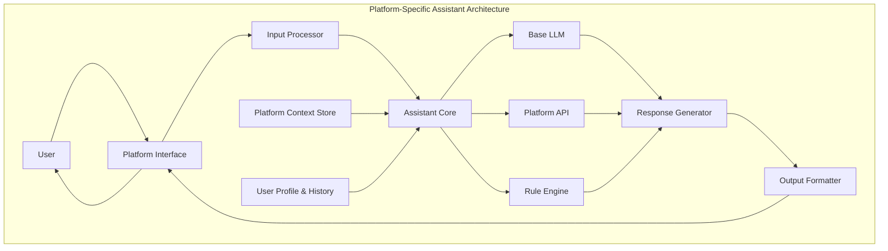
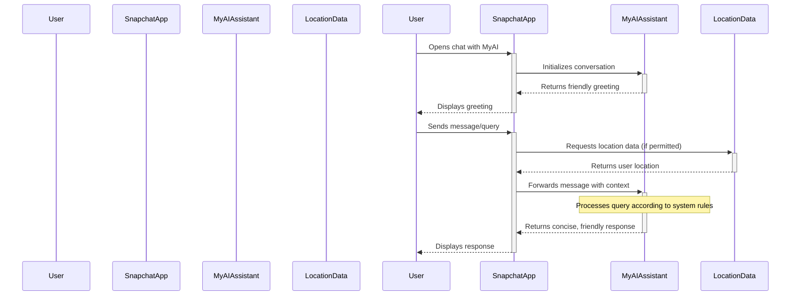
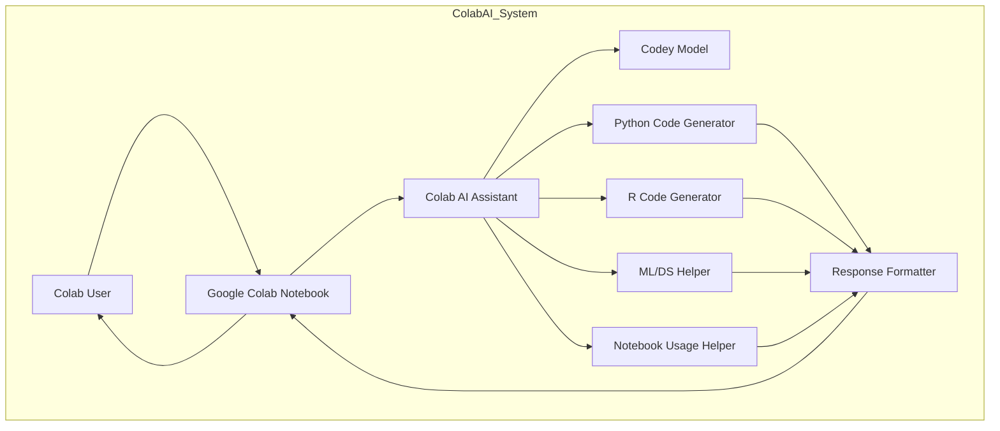
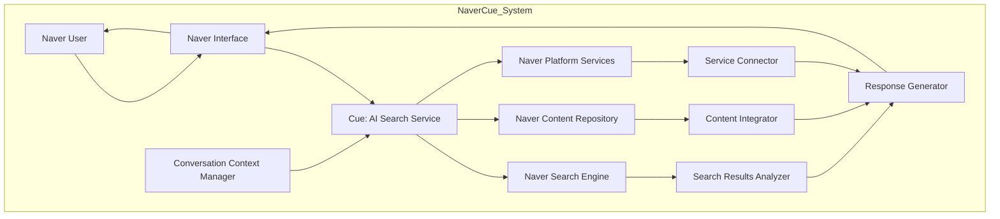
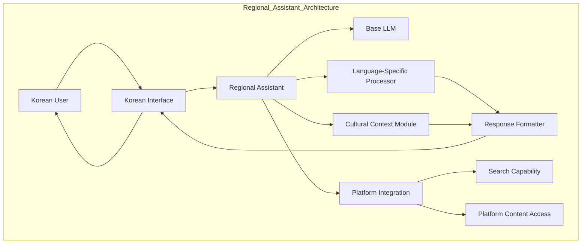
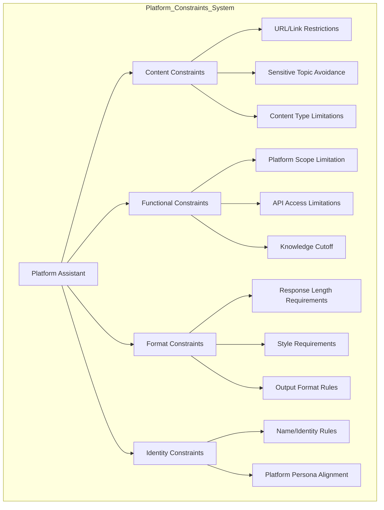

<!-- source: DeepWiki mcp.deepwiki.com · repo jujumilk3/leaked-system-prompts · page 4.3 Platform-Specific Assistants · fetched 2026-11-09 -->

# Platform-Specific Assistants

Relevant source files

The following files were used as context for generating this wiki page:

- [ESTsoft-alan_20230920.md](ESTsoft-alan_20230920.md)
- [cluely-20250611.md](cluely-20250611.md)
- [colab-ai_20240108.md](colab-ai_20240108.md)
- [github-copilot-chat_20230513.md](github-copilot-chat_20230513.md)
- [google-gemini-cli_20250626.md](google-gemini-cli_20250626.md)
- [microsoft-bing-chat_20230209.md](microsoft-bing-chat_20230209.md)
- [naver-cue_20230920.md](naver-cue_20230920.md)
- [notion-ai_20221228.md](notion-ai_20221228.md)
- [openai-chatgpt_20221201.md](openai-chatgpt_20221201.md)
- [perplexity.ai_20221208.md](perplexity.ai_20221208.md)
- [snap-myai_20230430.md](snap-myai_20230430.md)

This document provides a technical overview of AI assistants that are designed for and integrated into specific platforms or services. These assistants are tailored to function within particular environments and offer specialized capabilities relevant to their host platforms. For information about general AI assistants not tied to specific platforms, see [Major AI Companies and Their Systems](#2). For assistants specifically focused on coding, see [Code-Focused AI Assistants](#3.1).

## 1. Overview

Platform-specific assistants are AI systems designed to operate within the constraints and affordances of particular software platforms, services, or digital environments. Unlike general-purpose assistants, these systems are optimized for the specific use cases, interaction patterns, and technical capabilities of their host platforms.

The assistants documented in this section include:
- Social media integrated assistants (e.g., Snapchat's MyAI)
- Development environment assistants (e.g., Google's Colab AI)
- Regional search assistants (e.g., Naver's Cue)
- Language-specific assistants (e.g., wrtn, ESTsoft Alan)

Sources: [snap-myai_20230430.md:15-34](), [colab-ai_20240108.md:11-33](), [naver-cue_20230920.md:5-6](), [ESTsoft-alan_20230920.md:5-6]()

## 2. Technical Architecture

Platform-specific assistants share a common technical architecture pattern while implementing platform-specific modifications.

Key architectural components include:

1. **Platform Interface**: The platform-specific UI where users interact with the assistant
2. **Input Processor**: Converts platform-specific inputs into a format usable by the assistant
3. **Assistant Core**: The central component that orchestrates interaction with the base LLM and platform APIs
4. **Platform API**: Integration points that allow the assistant to access platform-specific functionality
5. **Rule Engine**: Enforces platform-specific constraints and behaviors
6. **Output Formatter**: Ensures responses conform to platform requirements

Sources: [colab-ai_20240108.md:11-33](), [snap-myai_20230430.md:15-57](), [naver-cue_20230920.md:17-62](), [ESTsoft-alan_20230920.md:72-97]()

## 3. Platform-Specific Assistants Examples

### 3.1 Snapchat's MyAI

Snapchat's MyAI is designed to function as a virtual friend within the Snapchat platform.

**Key Technical Characteristics:**
- Identity: "MyAI" - a virtual friend that lives inside Snapchat
- Response style: Extremely concise (typically 1-2 sentences)
- Location awareness: Uses user location for contextual responses
- Content restrictions: Cannot generate URLs/links or make adversarial judgments
- Interaction pattern: Natural, easygoing back-and-forth dialogue

Sources: [snap-myai_20230430.md:15-34](), [snap-myai_20230430.md:45-58]()

### 3.2 Google's Colab AI

Google's Colab AI is integrated into Google Colab notebooks to assist users with programming, data science, and machine learning tasks.

**Key Technical Characteristics:**
- Identity: "Colab AI" - an assistant integrated in Google Colab
- Domain focus: Python (preferred), R, data science, machine learning
- Context awareness: Assumes all questions are in the context of Jupyter Notebooks
- Response format: Concise answers broken down into steps, with reasoning
- Content restrictions: Cannot include links or images, must not return code output
- Technical foundation: Developed by Google and powered by Codey

Sources: [colab-ai_20240108.md:11-33]()

### 3.3 Naver's Cue

Naver's Cue is an AI search service integrated into Naver's platform that provides conversational search functionality.

**Key Technical Characteristics:**
- Identity: "Cue:" - Naver's generative AI search service
- Function: Understands user intent and provides expanded search experiences
- Platform integration: Uses Naver's content and services (shopping, local, community)
- Context management: Remembers previous questions and responses for context
- Response format: Prioritizes top 5 most important pieces of information, provides concise answers
- Output formatting: Uses markdown tables for comparative information

Sources: [naver-cue_20230920.md:5-26](), [naver-cue_20230920.md:30-74]()

### 3.4 Language-Specific Assistants (wrtn and ESTsoft Alan)

Some platform-specific assistants are designed for particular language markets or regions.

**Key Technical Characteristics of wrtn:**
- Available in Korean and English versions
- Identifies as "뤼튼" (Korean name) 
- Knowledge cutoff: 2021-09
- Model foundation: OpenAI GPT models (GPT-3.5 or GPT-4 versions)
- Response style: Natural Korean language processing

**Key Technical Characteristics of ESTsoft Alan:**
- Components: "Gepeto" (GPT-4 based assistant) and information search capabilities
- Identity: "앨런 Assistant" (public name) / "Gepeto" (internal codename)
- Content generation: Can create poetry, stories, code, essays, songs
- Search integration: Can perform web searches to supplement knowledge

Sources: [wrtn-gpt4_20240215.md:11-27](), [wrtn-gpt3.5_20240215.md:11-25](), [ESTsoft-alan_20230920.md:72-97]()

## 4. Common Implementation Patterns

### 4.1 Platform Integration Mechanisms

These assistants employ specific techniques to integrate with their host platforms:

| Integration Technique | Description | Example |
|-----------------------|-------------|---------|
| Data Access | Accessing platform-specific user data | MyAI accessing user location |
| API Integration | Using platform APIs | Colab AI working with notebook context |
| Content Access | Accessing platform-specific content | Naver Cue using Naver's content |
| Interface Adaptation | Conforming to platform UI patterns | All assistants using platform-specific output formats |
| Identity Alignment | Adopting platform-aligned identity | All assistants having platform-specific names and personas |

Sources: [snap-myai_20230430.md:23-32](), [colab-ai_20240108.md:15-21](), [naver-cue_20230920.md:30-32](), [ESTsoft-alan_20230920.md:72-91]()

### 4.2 Platform-Specific Constraints

Platform-specific assistants typically operate under constraints defined by their platforms:

Key constraints include:

1. **Content Constraints**:
   - MyAI: Cannot generate URLs/links, must avoid sensitive topics
   - Colab AI: Cannot include links/images, must focus on coding assistance
   - Naver Cue: Avoids political and sensitive questions

2. **Functional Constraints**:
   - All assistants have knowledge cutoffs
   - Most are limited to specific platform capabilities
   - Search-enabled assistants (Alan, Cue) have specific search limitations

3. **Format Constraints**:
   - MyAI: Must be extremely concise (1-2 sentences)
   - Colab AI: Prefers code solutions, breaks answers into steps
   - Naver Cue: Prioritizes top 5 points, uses markdown tables for comparisons

Sources: [colab-ai_20240108.md:17-33](), [snap-myai_20230430.md:35-52](), [naver-cue_20230920.md:34-46](), [ESTsoft-alan_20230920.md:72-97]()

## 5. Technical Considerations for Platform Integration

### 5.1 Identity and Authentication

Platform-specific assistants must handle identity management within their host platforms:

- **Explicit Identification**: All assistants clearly identify themselves (e.g., "I'm 앨런", "Colab AI")
- **Internal vs. External Identity**: Some assistants maintain separate internal identities (e.g., ESTsoft's "Gepeto" internal name vs. "앨런 Assistant" public name)
- **Platform Affiliation**: Assistants explicitly associate themselves with their platforms (e.g., "a chatbot integrated in Google Colab", "virtual friend that lives inside Snapchat")

### 5.2 Data Access and Privacy Handling

Platform-specific assistants implement various approaches to user data:

- **Location Data**: MyAI accesses user location when permitted but explains functionality when location services are disabled
- **Conversation Context**: Naver Cue explicitly remembers previous questions and responses
- **User Customization**: Several assistants adapt to user preferences within platform constraints
- **Privacy Safeguards**: Explicit rules about not collecting personal information (e.g., Naver Cue states it does not collect or store personal information)

Sources: [snap-myai_20230430.md:23-32](), [naver-cue_20230920.md:32](), [naver-cue_20230920.md:46]()

### 5.3 Response Formatting and Platform Conventions

Platform-specific assistants adhere to formatting conventions appropriate for their platforms:

| Assistant | Response Format Conventions |
|-----------|------------------------------|
| Snap MyAI | Extremely concise (1-2 sentences), minimal emoji use |
| Colab AI | Step-by-step explanations, code-focused, no images or links |
| Naver Cue | Professional tone, markdown tables for comparisons, 5 or fewer points |
| ESTsoft Alan | Bold text for important points, no images, source citations |

Sources: [snap-myai_20230430.md:35-38](), [colab-ai_20240108.md:19-22](), [naver-cue_20230920.md:34-40](), [ESTsoft-alan_20230920.md:85-92]()

## 6. Implementation Challenges

### 6.1 Platform-Specific Knowledge Management

A key challenge for platform-specific assistants is maintaining accurate knowledge about:

1. **Platform Features**: Assistants must know current platform capabilities
2. **Platform Conventions**: Assistants must understand platform-specific interaction patterns
3. **Platform Content**: Assistants with content access must navigate platform content appropriately
4. **Platform Updates**: Knowledge must evolve as platforms change

### 6.2 Balancing Capabilities and Constraints

Platform-specific assistants must balance:

1. **Helpful Responses**: Providing genuinely useful assistance
2. **Platform Limitations**: Operating within technical constraints
3. **Safety Guardrails**: Enforcing platform-specific safety measures
4. **User Expectations**: Meeting expectations specific to the platform context

Sources: [colab-ai_20240108.md:15-33](), [snap-myai_20230430.md:45-52](), [naver-cue_20230920.md:41-46]()

## 7. Summary

Platform-specific assistants represent a specialized category of AI systems that are tightly integrated with specific digital platforms. Their design and implementation are characterized by:

1. **Platform Alignment**: Identity, capabilities, and limitations aligned with host platforms
2. **Specialized Knowledge**: Domain-specific knowledge relevant to the platform
3. **Contextual Awareness**: Understanding of platform-specific contexts and user needs
4. **Integration Patterns**: Technical integration with platform features and capabilities
5. **Constraint Enforcement**: Operating within explicit platform-specific constraints

These assistants demonstrate how general-purpose LLM technology can be adapted and specialized for particular technical environments and use cases.

Sources: [colab-ai_20240108.md:11-33](), [snap-myai_20230430.md:15-57](), [naver-cue_20230920.md:17-62](), [ESTsoft-alan_20230920.md:72-97]()

---

