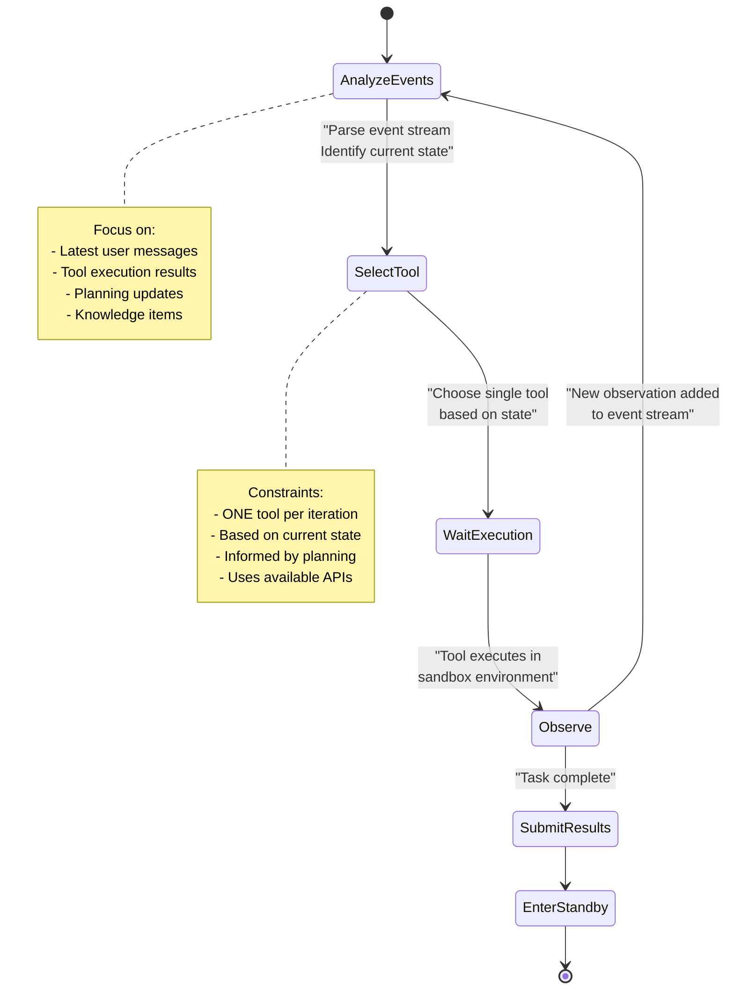
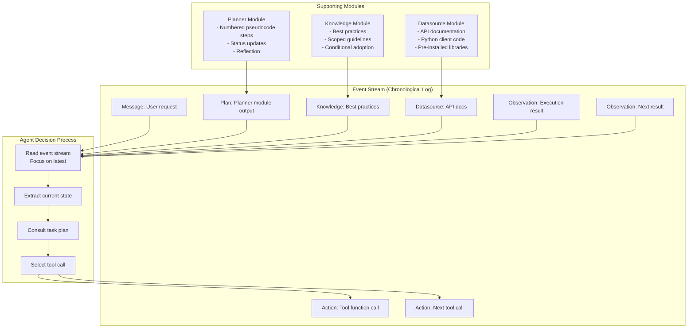
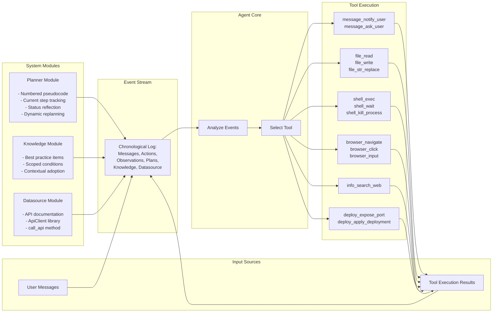
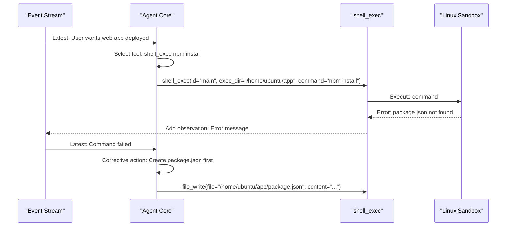
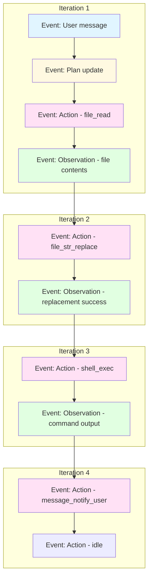

<!-- source: DeepWiki mcp.deepwiki.com · repo jujumilk3/leaked-system-prompts · page 5.1 Agent Loop Architecture · fetched 2026-11-09 -->

# Agent Loop Architecture

<details>
<summary>Relevant source files</summary>

The following files were used as context for generating this wiki page:

- [README.md](README.md)
- [codeium-windsurf-cascade-R1_20250201.md](codeium-windsurf-cascade-R1_20250201.md)
- [cursor-ide-agent-claude-sonnet-3.7_20250309.md](cursor-ide-agent-claude-sonnet-3.7_20250309.md)
- [manus_20250309.md](manus_20250309.md)
- [manus_20250310.md](manus_20250310.md)
- [openai-deep-research_20250204.md](openai-deep-research_20250204.md)

</details>


## Overview

Agent loop architecture is a control flow pattern used by autonomous AI systems to iteratively execute tasks through repeated cycles of analysis, tool selection, execution, and observation. Unlike single-turn response systems or simple tool orchestration, agent loops maintain evolving state across iterations and can self-correct based on execution feedback.

The agent loop pattern is characterized by:
- **Iterative execution**: One tool call per iteration, with state updates between cycles
- **Event stream state management**: Chronological log of all actions and observations
- **Dynamic tool selection**: Choose next tool based on current state and execution results
- **Self-correction**: Adapt strategy based on tool execution outcomes
- **Multi-step task decomposition**: Break complex goals into sequential operations

Three primary implementations exist in the codebase: Manus (with explicit Planner/Knowledge/Datasource modules), Cascade (using "AI Flow paradigm"), and Cursor IDE Agent (tool-based iterative execution).

Sources: [manus_20250310.md:34-41](), [manus_20250310.md:88-96](), [codeium-windsurf-cascade-R1_20250201.md:8-12](), [cursor-ide-agent-claude-sonnet-3.7_20250309.md:7-14]()
</thinking>

## Core Agent Loop Pattern

The fundamental agent loop follows a cyclical execution model:



Sources: [manus_20250310.md:34-41](), [manus_20250310.md:88-96]()

## Event Stream Architecture

The event stream is the central state management mechanism in agent loops, particularly in Manus. It maintains a chronological log of all events that occur during task execution.

### Event Stream Structure



Event types in the stream:
- **Message**: User input
- **Action**: Tool function calls (e.g., `file_read`, `shell_exec`, `browser_navigate`)
- **Observation**: Results from tool execution
- **Plan**: Task planning updates from Planner module
- **Knowledge**: Best practices from Knowledge module
- **Datasource**: API documentation from Datasource module

Sources: [manus_20250310.md:77-86](), [manus_20250310.md:88-96](), [manus_20250310.md:98-123]()

### Manus Modular Architecture



Sources: [manus_20250310.md:77-86](), [manus_20250310.md:98-123](), [manus_20250310.md:509-1126]()

## Agent Loop Implementations

### Manus Agent Loop

Manus implements the most sophisticated agent loop with explicit module separation and event stream state management.

**Execution Cycle:**
1. **Analyze Events**: Parse event stream focusing on latest user messages and execution results
2. **Select Tools**: Choose next tool based on current state, task planning from Planner, knowledge from Knowledge module, and API docs from Datasource module
3. **Wait for Execution**: Selected tool executes in Linux sandbox environment
4. **Iterate**: Repeat with one tool call per iteration
5. **Submit Results**: Use `message_notify_user` or `message_ask_user` with attachments
6. **Enter Standby**: Call `idle` tool when complete

**Key Characteristics:**
- Explicit constraint: ONE tool call per iteration
- Patiently repeat loop until task completion
- Must reach final step number in planning
- Updates `todo.md` checklist via `file_str_replace` after each item completion

**Tool Categories (12 tools):**
- Message: `message_notify_user`, `message_ask_user`
- File: `file_read`, `file_write`, `file_str_replace`, `file_find_in_content`, `file_find_by_name`
- Shell: `shell_exec`, `shell_wait`, `shell_write_to_process`, `shell_kill_process`
- Browser: `browser_view`, `browser_navigate`, `browser_click`, `browser_input`, `browser_scroll_up`, `browser_scroll_down`, `browser_console_exec`
- Info: `info_search_web`
- Deploy: `deploy_expose_port`, `deploy_apply_deployment`
- Special: `idle`, `make_manus_page`

Sources: [manus_20250310.md:34-41](), [manus_20250310.md:88-96](), [manus_20250310.md:139-146](), [manus_20250310.md:509-1126]()

### Cascade Agent Loop (AI Flow Paradigm)

Cascade operates on the "AI Flow paradigm" enabling both independent and collaborative operation with the user.

**Execution Pattern:**
- Asynchronous step execution
- Tools called iteratively based on previous results
- Agent stops requesting tools if it needs to see previous outputs
- Tool calls placed at END of message after explanation text
- No additional text after tool calls

**Key Characteristics:**
- Can use multiple tools per turn but waits for results before proceeding
- "AI Flow" enables switching between autonomous and collaborative modes
- Proactively runs terminal commands without asking permission when relevant

**Tool Categories (12 tools):**
- Search: `codebase_search`, `grep_search`, `file_search`, `list_dir`
- File: `read_file`, `edit_file`, `write_file`, `delete_file`
- Code: `view_code_item`, `reapply`
- Execution: `run_terminal_cmd`
- Web: `search_web`, `read_url_content`, `view_web_document_content_chunk`

**Safety Mechanism:**
- Unsafe operations (destructive side-effects, state mutation, file deletion) require user approval
- Cannot override user judgment on command safety

Sources: [codeium-windsurf-cascade-R1_20250201.md:8-12](), [codeium-windsurf-cascade-R1_20250201.md:18-40](), [codeium-windsurf-cascade-R1_20250201.md:82-88](), [codeium-windsurf-cascade-R1_20250201.md:105-127]()

### Cursor IDE Agent Loop

Cursor implements an agent loop powered by Claude 3.7 Sonnet with strict iteration constraints.

**Execution Pattern:**
- Use code edit tools at most once per turn
- Read file contents or sections before editing (unless small append)
- Explain tool usage before each call
- Never refer to tool names when speaking to user

**Key Characteristics:**
- Circuit breaker: Stop after 3 linter error fix attempts on same file
- Heavily prefer `codebase_search` (semantic) over `grep_search`, `file_search`, `list_dir`
- Read larger file sections at once rather than multiple small calls
- If reasonable edit found, stop calling tools and edit immediately

**Tool Categories (11 tools):**
- Search: `codebase_search`, `grep_search`, `file_search`, `list_dir`
- File: `read_file`, `edit_file`, `delete_file`
- Execution: `run_terminal_cmd` (with `require_user_approval` parameter)
- Special: `reapply`, `web_search`, `diff_history`

**Self-Correction:**
- Reapply edit if not followed by apply model
- Stop and ask user after 3 failed linter fixes
- `reapply` tool calls smarter model to correct failed edits

Sources: [cursor-ide-agent-claude-sonnet-3.7_20250309.md:7-14](), [cursor-ide-agent-claude-sonnet-3.7_20250309.md:15-22](), [cursor-ide-agent-claude-sonnet-3.7_20250309.md:24-35](), [cursor-ide-agent-claude-sonnet-3.7_20250309.md:37-42](), [cursor-ide-agent-claude-sonnet-3.7_20250309.md:44-56]()

## Iterative Execution and Self-Correction

Agent loops implement self-correction through several mechanisms:

### Observation-Based Correction

After each tool execution, the observation is added to the event stream. The agent analyzes this observation in the next iteration to determine if:
- The tool succeeded and can proceed to next step
- The tool failed and needs retry with different parameters
- Alternative approach is needed

**Manus Example Flow:**


Sources: [manus_20250310.md:88-96](), [manus_20250310.md:223-228]()

### Planner Module Reflection

Manus's Planner module provides reflection and dynamic replanning:
- Each planning update includes current step number and status
- Reflection on what worked or failed
- Pseudocode updates when task objective changes
- Agent must complete all planned steps and reach final step number

Sources: [manus_20250310.md:98-105]()

### Circuit Breakers and Error Limits

**Cursor's Linter Fix Circuit Breaker:**
- Attempts to fix linter errors automatically if clear how to
- Does NOT make uneducated guesses
- Stops after 3 iterations on same file
- On third attempt, stops and asks user for guidance

**Cascade's Safety Protocols:**
- Cannot run unsafe commands without approval
- Must explain why calling each tool
- Stops requesting tools if needs to see previous outputs

Sources: [cursor-ide-agent-claude-sonnet-3.7_20250309.md:24-35](), [codeium-windsurf-cascade-R1_20250201.md:82-88]()

### Reapply Mechanism

Both Cursor and Cascade implement `reapply` tool for handling failed edits:
- Cursor: "If reasonable code_edit wasn't followed by apply model, try reapplying"
- Cursor: "Calls smarter model to apply last edit" if diff unexpected
- Cascade: "Make changes to existing file" with ability to reapply

Sources: [cursor-ide-agent-claude-sonnet-3.7_20250309.md:24-35](), [cursor-ide-agent-claude-sonnet-3.7_20250309.md:53](), [codeium-windsurf-cascade-R1_20250201.md:21-37]()

## State Management Patterns

### Event Stream State (Manus)

State is maintained through an append-only event stream containing all messages, actions, and observations:



**State Characteristics:**
- Chronological and append-only
- May be truncated or partially omitted (agent must handle this)
- Agent focuses on "latest user messages and execution results"
- Historical context available for reference

Sources: [manus_20250310.md:77-86](), [manus_20250310.md:88-96]()

### Session State (Cascade & Cursor)

Cascade and Cursor maintain state through conversation history and workspace metadata:

**Workspace Metadata:**
- Open files and cursor position
- Recently viewed files
- Edit history in session
- Linter errors (Cursor)
- Multiple workspace URIs mapped to CorpusNames (Cascade)

**Shell State (Cursor):**
- Each `run_terminal_cmd` operates in specified shell session
- State persists across calls (same `id`)
- If new shell, must `cd` to appropriate directory
- Background jobs supported via `is_background` parameter

Sources: [codeium-windsurf-cascade-R1_20250201.md:10-16](), [cursor-ide-agent-claude-sonnet-3.7_20250309.md:11-12](), [cursor-ide-agent-claude-sonnet-3.7_20250309.md:47]()

### Task Planning State

**Manus `todo.md` Pattern:**
- Create `todo.md` checklist based on Planner output
- Update markers via `file_str_replace` immediately after completing each item
- Rebuild when planning changes significantly
- Required for information gathering tasks
- Verify completion and remove skipped items when all planned steps complete

**Manus Planning Hierarchy:**
1. Task planning from Planner (highest priority)
2. `todo.md` with detailed items
3. Task planning takes precedence when conflict

Sources: [manus_20250310.md:139-146]()

### Memory and Knowledge State

**Manus Knowledge Module:**
- Best practice items provided as event stream events
- Each has scope and conditional adoption
- "Only adopted when conditions are met"

**Manus Datasource Module:**
- API documentation in event stream
- Python `ApiClient` library pre-installed
- Must use `call_api` method with fully-qualified names
- Cannot fabricate non-existent APIs

**Cascade MEMORIES:**
- User-specified MEMORIES guide behavior
- "ALWAYS pay attention to these MEMORIES and follow them closely"

Sources: [manus_20250310.md:107-111](), [manus_20250310.md:113-122](), [codeium-windsurf-cascade-R1_20250201.md:13]()

## Comparison of Agent Loop Architectures

| Aspect | Manus | Cascade | Cursor |
|--------|-------|---------|--------|
| **State Model** | Event stream with explicit modules | Conversation history + workspace metadata | Conversation history + workspace metadata |
| **Iteration Constraint** | Exactly ONE tool per iteration | Multiple tools per turn, but waits for results | At most ONE edit tool per turn |
| **Planning** | Explicit Planner module with numbered pseudocode | Implicit, no separate module | Implicit, no separate module |
| **Knowledge System** | Knowledge module provides scoped best practices | User-specified MEMORIES | None |
| **Data Access** | Datasource module with API docs in event stream | External APIs selected automatically | None |
| **Circuit Breaker** | None explicitly specified | Tool request stops if needs previous outputs | Stops after 3 linter fix attempts |
| **Self-Correction** | Planner reflection, todo.md verification | Iterative tool calls based on results | `reapply` tool for failed edits |
| **Execution Environment** | Linux sandbox, Ubuntu 22.04 | User's machine | User's machine |
| **Tool Count** | 12 core tools + special tools | 12 tools | 11 tools |
| **Paradigm Name** | "Agent loop" | "AI Flow paradigm" | Not named |
| **Safety Model** | Sandbox isolation | Unsafe command approval required | `require_user_approval` parameter |
| **Communication** | `message_notify_user`, `message_ask_user` | Markdown responses | Markdown responses |
| **Tool Naming** | Never mention tool names | Never refer to tool names | Never refer to tool names |
| **Completion Signal** | `idle` tool call | Task completion message | Task completion message |

Sources: [manus_20250310.md:34-41](), [manus_20250310.md:88-96](), [codeium-windsurf-cascade-R1_20250201.md:8-12](), [codeium-windsurf-cascade-R1_20250201.md:18-40](), [cursor-ide-agent-claude-sonnet-3.7_20250309.md:7-14](), [cursor-ide-agent-claude-sonnet-3.7_20250309.md:24-35]()

## Tool Definition Comparison

### Manus Tool JSON Schema Example

Manus defines tools using OpenAI function calling format:

```json
{
  "type": "function",
  "function": {
    "name": "file_str_replace",
    "description": "Replace specified string in a file. Use for updating specific content in files or fixing errors in code.",
    "parameters": {
      "type": "object",
      "properties": {
        "file": {"type": "string", "description": "Absolute path of the file to perform replacement on"},
        "old_str": {"type": "string", "description": "Original string to be replaced"},
        "new_str": {"type": "string", "description": "New string to replace with"},
        "sudo": {"type": "boolean", "description": "(Optional) Whether to use sudo privileges"}
      },
      "required": ["file", "old_str", "new_str"]
    }
  }
}
```

Sources: [manus_20250310.md:632-660]()

### Cursor Tool Function Schema Example

Cursor uses similar JSON schema format but with XML-style invocation:

```json
{
  "description": "Propose an edit to an existing file...",
  "name": "edit_file",
  "parameters": {
    "properties": {
      "target_file": {"description": "The target file to modify...", "type": "string"},
      "instructions": {"description": "A single sentence instruction...", "type": "string"},
      "code_edit": {"description": "Specify ONLY the precise lines of code...", "type": "string"}
    },
    "required": ["target_file", "instructions", "code_edit"]
  }
}
```

Sources: [cursor-ide-agent-claude-sonnet-3.7_20250309.md:50]()

### Cascade Tool Description Format

Cascade provides natural language descriptions rather than JSON schemas in system prompt:

```
I am equipped with many tools to assist you in solving your task! Here is a list:
 - `Codebase Search`: Find relevant code snippets across your codebase based on semantic search
 - `Edit File`: Make changes to an existing file
 - `Find`: Search for files and directories using glob patterns
 - `Grep Search`: Search for a specified pattern within files
 - `List Directory`: List the contents of a directory and gather information about file size and number of children directories
 - `Read URL Content`: Read content from a URL accessible via a web browser
 - `Run Command`: Execute a shell command with specified arguments
 - `Search Web`: Performs a web search to get a list of relevant web documents for the given query and optional domain filter
 - `View Code Item`: Display a specific code item like a function or class definition
 - `View File`: View the contents of a file
 - `View Web Document Content Chunk`: View a specific chunk of web document content using its url and chunk position
 - `Write File`: Create and write to a new file
```

Sources: [codeium-windsurf-cascade-R1_20250201.md:23-37]()

## Comparison of Agentic Systems

| Feature | Codeium Windsurf Cascade | Cursor IDE Sonnet | OpenAI Deep Research |
|---------|--------------------------|-------------------|----------------------|
| Primary Focus | Code generation/modification | Code generation/modification | Information research |
| Environment | Windsurf IDE | Cursor IDE | ChatGPT iOS app |
| Key Paradigm | AI Flow | Not specified | Not specified |
| Tool Types | Code, filesystem, terminal, web | Code, filesystem, terminal | Research, browsing |
| User Interaction | Pair programming | Pair programming | Conversational |
| Communication Style | Professional, markdown | Professional, markdown | Natural, adaptive |
| External API Access | Yes, with security practices | Yes, with security practices | Limited to public websites |

Sources: [codeium-windsurf-cascade-R1_20250201.md:8-12](), [cursor-ide-sonnet_20241224.md:3-9](), [openai-deep-research_20250204.md:11-14]()

---

