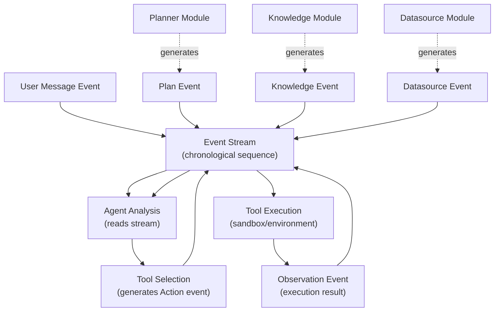
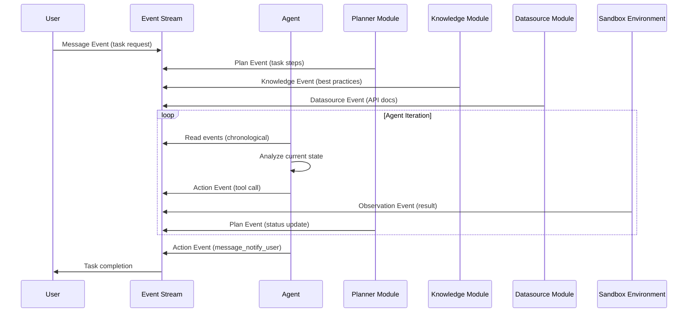
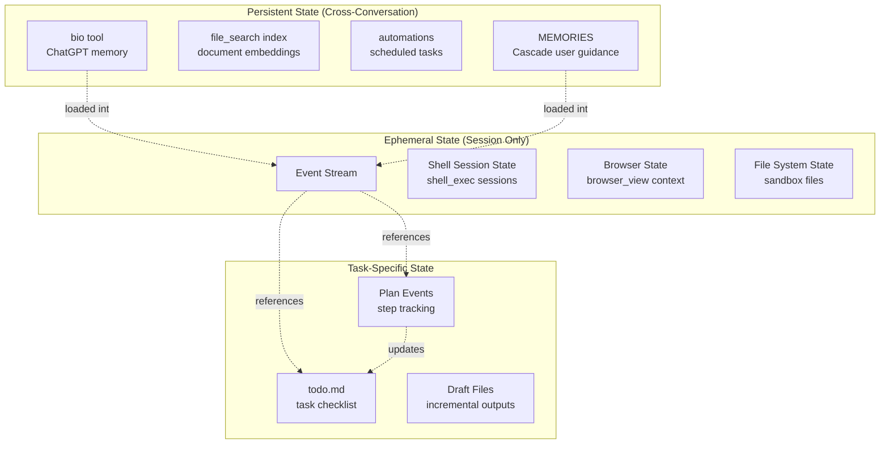
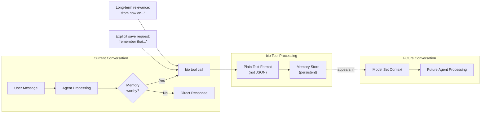
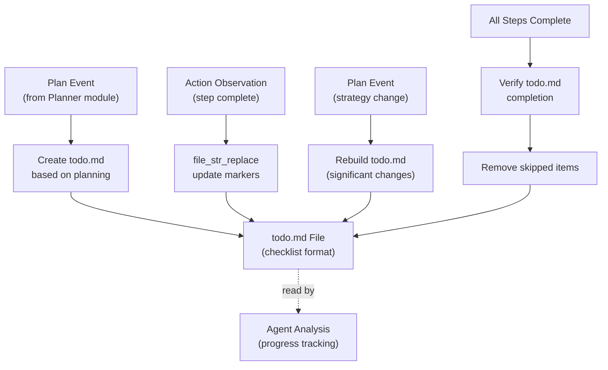
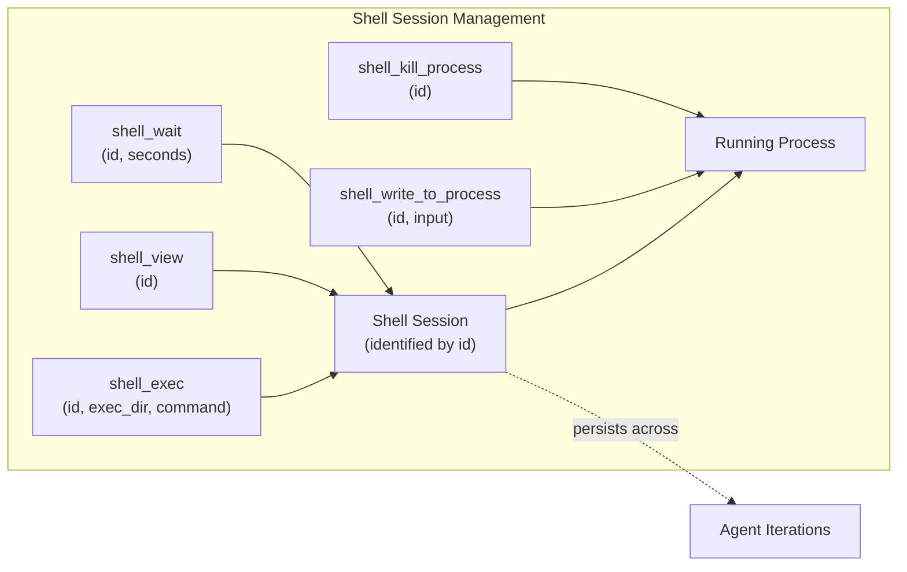

<!-- source: DeepWiki mcp.deepwiki.com · repo jujumilk3/leaked-system-prompts · page 5.3 Event Streams and State Management · fetched 2026-11-09 -->

# Event Streams and State Management

<details>
<summary>Relevant source files</summary>

The following files were used as context for generating this wiki page:

- [README.md](README.md)
- [codeium-windsurf-cascade-R1_20250201.md](codeium-windsurf-cascade-R1_20250201.md)
- [manus_20250309.md](manus_20250309.md)
- [manus_20250310.md](manus_20250310.md)
- [openai-chatgpt4o_20250506.md](openai-chatgpt4o_20250506.md)
- [openai-chatgpt5_20250807.md](openai-chatgpt5_20250807.md)
- [openai-chatgpt5_20250808.md](openai-chatgpt5_20250808.md)
- [openai-deep-research_20250204.md](openai-deep-research_20250204.md)

</details>


## Purpose and Scope

This document describes how AI agent systems manage state and events throughout task execution. It covers event stream architectures used in agent loops, cross-conversation memory persistence mechanisms, and ephemeral state management during multi-step task execution. For information about agent loop control flow and iteration patterns, see [Agent Loop Architecture](#5.1). For tool invocation and orchestration patterns, see [Tool Architecture and Integration Patterns](#5.2) and [Multi-Tool Orchestration Strategies](#5.4).

---

## Event Stream Fundamentals

Event streams serve as the primary state management mechanism in autonomous agent systems. An event stream is a chronological sequence of events that represents the complete history of an agent's interaction with the user and environment. Agent systems process this stream iteratively, with each iteration adding new events based on tool execution results.

### Core Event Stream Pattern



**Figure 1: Event Stream Architecture in Agent Loops**

Sources: [manus_20250310.md:77-96]()

The event stream serves multiple purposes:
1. **Context Management**: Provides complete task history for agent decision-making
2. **State Persistence**: Maintains execution state across iterations
3. **Module Communication**: Enables auxiliary modules (Planner, Knowledge, Datasource) to inject information
4. **Audit Trail**: Creates traceable execution history for debugging

---

## Event Types and Structures

### Primary Event Categories

Agent systems define distinct event types to represent different stages of execution:

| Event Type | Source | Purpose | Persistence |
|------------|--------|---------|-------------|
| **Message** | User input | Task specification, clarifications | Session |
| **Action** | Agent tool selection | Tool invocation with parameters | Session |
| **Observation** | Tool execution | Execution results, errors | Session |
| **Plan** | Planner module | Task decomposition, progress tracking | Session |
| **Knowledge** | Knowledge module | Best practices, contextual guidance | Session |
| **Datasource** | Datasource module | API documentation, data sources | Session |

Sources: [manus_20250310.md:77-86]()

### Event Flow in Manus Agent Loop



**Figure 2: Event Flow Sequence in Manus Agent Loop**

Sources: [manus_20250310.md:88-96](), [manus_20250310.md:98-122]()

### Event Stream Processing Rules

Manus implements specific rules for event stream consumption [manus_20250310.md:88-96]():

1. **Focus on Latest Events**: Agent prioritizes recent user messages and execution results
2. **Module Event Awareness**: Events from Planner, Knowledge, and Datasource modules guide tool selection
3. **Single Tool Per Iteration**: Agent selects one tool call per iteration, preventing parallelization within the loop
4. **State Accumulation**: Each iteration adds observations to the stream, building context progressively
5. **Completion Detection**: Agent monitors task planning state to determine when to submit results

---

## State Persistence Mechanisms

AI systems implement multiple state persistence layers with different lifetimes and purposes:

### State Persistence Hierarchy



**Figure 3: State Persistence Layers Across Systems**

Sources: [manus_20250310.md:139-146](), [openai-chatgpt5_20250808.md:28-74](), [codeium-windsurf-cascade-R1_20250201.md:13]()

---

## Cross-Conversation Memory: The `bio` Tool

ChatGPT implements persistent cross-conversation state through the `bio` tool [openai-chatgpt5_20250808.md:28-74]():

### Memory Persistence Architecture



**Figure 4: ChatGPT `bio` Tool Memory Persistence**

Sources: [openai-chatgpt5_20250808.md:28-81]()

### Memory Triggers and Constraints

The `bio` tool implements sophisticated logic for when to persist information [openai-chatgpt5_20250808.md:43-56]():

**Triggers for Memory Persistence:**
- Explicit user requests: "remember that", "store this", "add to memory", "note that"
- Long-term relevance indicators: "from now on", "in the future", "going forward"
- Information likely to change future responses in similar situations

**Exclusions from Memory:**
- Overly-personal details that could feel creepy
- Short-lived facts that won't matter soon
- Random details lacking clear future relevance
- Redundant information already stored
- Sensitive data (race, ethnicity, religion, political affiliation, health, criminal records) unless explicitly requested

### Memory Format Requirements

The `bio` tool enforces strict formatting [openai-chatgpt5_20250808.md:32-41]():

```text
# Correct Format (plain text only)
"User prefers concise, no-nonsense confirmations when they ask to double check a prior response."
"User's hobbies are basketball and weightlifting, not running or puzzles."
"Forget that the user is shopping for an oven."

# Incorrect Format (JSON is forbidden)
{"preference": "concise confirmations"}  # NEVER use JSON
```

All `bio` messages must start with "User" (or user's name) or "Forget". The full message content is displayed to the user, requiring human-readable plain text format.

Sources: [openai-chatgpt5_20250808.md:32-41](), [openai-chatgpt5_20250807.md:26-74]()

---

## Task-Specific State Management

### Todo File Pattern in Manus

Manus implements a file-based task tracking pattern [manus_20250310.md:139-146]():



**Figure 5: Task State Management via `todo.md` in Manus**

Sources: [manus_20250310.md:139-146]()

**Key Rules:**
1. Task planning from Planner module takes precedence over `todo.md`
2. `todo.md` contains more implementation details than high-level planning
3. Markers updated via `file_str_replace` tool immediately after completing each item
4. Must use `todo.md` for information gathering tasks
5. Rebuild when task planning changes significantly

### Plan Event Progression

Planner modules inject Plan events into the event stream to track execution progress [manus_20250310.md:98-105]():

```text
Plan Event Structure:
- Current step number
- Step status (in progress, complete, blocked)
- Reflection on progress
- Pseudocode representation of execution steps
```

Plan events update dynamically:
- When overall task objective changes, pseudocode updates
- Each planning update includes current step number and status
- Agent must complete all planned steps and reach final step number

Sources: [manus_20250310.md:98-105]()

---

## State Management in Tool Execution

### Shell Session State

Manus maintains persistent shell session state across tool calls [manus_20250310.md:710-810]():



**Figure 6: Shell Session State Management in Manus**

Sources: [manus_20250310.md:710-810]()

Each shell session is identified by a unique `id` parameter, allowing:
- Multiple concurrent shell sessions
- Persistent environment variables and working directories
- Interactive process management (input, wait, kill)
- Long-running command monitoring

### Browser Session State

Browser tools maintain page state implicitly [manus_20250310.md:815-850]():

- **Viewport State**: Elements in visible viewport returned as `index[:]<tag>text</tag>`
- **Extracted Content**: Page content in Markdown format (may omit links/images)
- **Navigation History**: Current page context for subsequent actions
- **Interactive Elements**: Indexed for `browser_click` and `browser_input` actions

The `browser_view` tool retrieves current page state without navigation [manus_20250310.md:815-820]().

Sources: [manus_20250310.md:176-186](), [manus_20250310.md:815-850]()

---

## Module-Based State Injection

### Knowledge Module Pattern

The Knowledge module injects contextual guidance into the event stream [manus_20250310.md:107-111]():

```text
Knowledge Event:
- Scope-specific best practices
- Conditional adoption rules ("only when conditions met")
- Task-relevant knowledge
- Implementation guidance
```

Example knowledge items might include:
- Coding best practices for specific languages
- Security considerations for sensitive operations
- Error handling patterns for common scenarios

### Datasource Module Pattern

The Datasource module provides API documentation dynamically [manus_20250310.md:113-137]():

```python
# Example from datasource_module_code_example
import sys
sys.path.append('/opt/.manus/.sandbox-runtime')
from data_api import ApiClient
client = ApiClient()

# Use fully-qualified API names from Datasource events
weather = client.call_api('WeatherBank/get_weather', 
                         query={'location': 'Singapore'})
```

**Key Characteristics:**
- Available data APIs provided as events in event stream
- Agent cannot fabricate non-existent APIs
- Prioritize API data over public internet sources
- APIs must be called through Python code, not as tools
- Python libraries for data APIs pre-installed

Sources: [manus_20250310.md:113-137]()

---

## Cascade MEMORIES State

Cascade implements user guidance persistence through `MEMORIES` [codeium-windsurf-cascade-R1_20250201.md:13]():

```text
"The USER may specify important MEMORIES to guide your behavior. 
ALWAYS pay attention to these MEMORIES and follow them closely."
```

While implementation details are not exposed in the leaked prompt, MEMORIES appear to:
- Persist user preferences across sessions
- Guide agent behavior and decision-making
- Override default behaviors when specified

This represents a similar pattern to ChatGPT's `bio` tool but with less documented structure.

Sources: [codeium-windsurf-cascade-R1_20250201.md:13]()

---

## State in Research and Specialized Modes

### Deep Research State Management

ChatGPT's Deep Research mode uses the `research_kickoff_tool` to manage research task state [openai-deep-research_20250204.md:11]():

```text
Methods:
- clarify_with_text: Gather additional information before starting
- start_research_task: Initiate research execution
```

This tool manages:
- Research scope and objectives
- Intermediate research findings
- Browsing history and source tracking
- Final synthesis state

Sources: [openai-deep-research_20250204.md:7-15]()

### File Search Index State

ChatGPT's `file_search` tool maintains document embedding state [openai-chatgpt5_20250807.md:216-283]():

```text
file_search.msearch:
- Issues queries to search over uploaded files
- Maintains document embeddings
- Tracks file metadata (file_modified_at, file_created_at)
- Returns chunks with citations
```

**State Components:**
- Document embeddings (semantic search index)
- File metadata and timestamps
- Citation references (message_idx:search_idx†source†line_range)
- Query history for result ranking

Sources: [openai-chatgpt5_20250807.md:216-283](), [openai-chatgpt5_20250808.md:216-283]()

---

## Comparative State Management Patterns

### State Management Comparison Matrix

| System | Event Stream | Persistent Memory | Task State | Session State |
|--------|--------------|-------------------|------------|---------------|
| **Manus** | Full event stream with 6 event types | None (session-only) | `todo.md` + Plan events | Shell sessions, browser, files |
| **ChatGPT-5** | Implicit conversation history | `bio` tool (cross-conversation) | `automations` (scheduled tasks) | Python environment, `file_search` index |
| **Cascade** | Implicit conversation history | `MEMORIES` (user guidance) | Planning state (not detailed) | Shell sessions, file state |
| **Deep Research** | Research-specific state | Shares ChatGPT `bio` | Research progress tracking | Browsing sessions, document state |

### Architectural Trade-offs

**Event Stream Approach (Manus):**
- **Advantages**: Complete audit trail, module extensibility, explicit state management
- **Disadvantages**: Higher token consumption, complexity in stream processing
- **Use Case**: Complex multi-step autonomous tasks requiring coordination

**Persistent Memory Approach (ChatGPT):**
- **Advantages**: Cross-conversation context, personalization, minimal per-session overhead
- **Disadvantages**: Privacy concerns, sensitive data handling complexity
- **Use Case**: Long-term user relationships, preference learning

**Hybrid Approach (Cascade):**
- **Advantages**: MEMORIES for guidance, implicit history for efficiency
- **Disadvantages**: Less transparent state management, harder to debug
- **Use Case**: IDE integration with user-specific workflows

Sources: [manus_20250310.md:77-96](), [openai-chatgpt5_20250808.md:28-81](), [codeium-windsurf-cascade-R1_20250201.md:13]()

---

## State Synchronization Patterns

### Atomic State Updates

Manus enforces single tool calls per iteration to maintain state consistency [manus_20250310.md:93-94]():

```text
"Iterate: Choose only one tool call per iteration, patiently repeat 
above steps until task completion"
```

This prevents race conditions and ensures:
- Sequential state updates
- Deterministic execution order
- Clear observation-to-action mapping
- Simplified error recovery

### File-Based State Synchronization

File system operations serve as explicit synchronization points [manus_20250310.md:160-165]():

```text
File Rules:
- Use file tools to avoid string escape issues
- Actively save intermediate results
- Store different types of reference information in separate files
- Use append mode for merging text files
```

Files act as both state persistence and synchronization mechanism between iterations.

Sources: [manus_20250310.md:160-165]()

---

## Error Handling and State Recovery

### State Recovery Patterns

Agent systems implement different recovery strategies when tool execution fails [manus_20250310.md:223-228]():

```text
Error Handling:
1. Tool execution failures provided as events in event stream
2. Verify tool names and arguments
3. Attempt to fix issues based on error messages
4. Try alternative methods if fix unsuccessful
5. Report failure reasons to user and request assistance
```

The event stream preserves error history, enabling:
- Analysis of failure patterns
- Alternative approach selection
- User escalation with context

### State Rollback Considerations

No system implements explicit state rollback mechanisms in the leaked prompts. File system operations are not transactional. Shell commands can have side effects without reversal capabilities. This reflects the design philosophy that:
1. Prevention (careful planning) is preferred over rollback
2. User approval gates prevent destructive operations
3. Idempotent operations are preferred where possible

Sources: [manus_20250310.md:223-228](), [codeium-windsurf-cascade-R1_20250201.md:83-87]()

---

## State Management Best Practices

Based on the analyzed systems, several patterns emerge:

### Manus Best Practices

1. **Progress Tracking**: Use `todo.md` for information gathering tasks [manus_20250310.md:144]()
2. **Immediate Updates**: Update markers via `file_str_replace` immediately after completing items [manus_20250310.md:142]()
3. **Incremental Saves**: Save intermediate results actively to separate files [manus_20250310.md:161]()
4. **State Verification**: Verify `todo.md` completion before entering idle state [manus_20250310.md:145]()

### ChatGPT Memory Best Practices

1. **Plain Text Only**: Never use JSON format in `bio` messages [openai-chatgpt5_20250808.md:32]()
2. **Explicit Triggers**: Always call `bio` when user says "remember that" or similar phrases [openai-chatgpt5_20250808.md:49]()
3. **Sensitive Data Filtering**: Never store sensitive personal attributes unless explicitly requested [openai-chatgpt5_20250808.md:67-72]()
4. **Long-Term Focus**: Only store information valid for months or years [openai-chatgpt5_20250808.md:54]()

### Cross-System Patterns

1. **Explicit vs Implicit**: Event streams (explicit) provide better debugging; conversation history (implicit) reduces token overhead
2. **Ephemeral First**: Default to session-only state unless cross-conversation persistence required
3. **User Transparency**: Memory persistence mechanisms should be visible to users (ChatGPT displays `bio` messages)
4. **Scope Limitation**: State should be scoped to task/session/user as appropriate

Sources: [manus_20250310.md:139-165](), [openai-chatgpt5_20250808.md:28-81]()

---

