<!-- source: DeepWiki mcp.deepwiki.com · repo jujumilk3/leaked-system-prompts · page 5.4 Multi-Tool Orchestration Strategies · fetched 2026-11-09 -->

# Multi-Tool Orchestration Strategies

<details>
<summary>Relevant source files</summary>

The following files were used as context for generating this wiki page:

- [duckai-gpt-5-mini_20251102.md](duckai-gpt-5-mini_20251102.md)
- [openai-assistants-api_20231106.md](openai-assistants-api_20231106.md)
- [openai-chatgpt4o_20240520.md](openai-chatgpt4o_20240520.md)
- [openai-chatgpt4o_20250506.md](openai-chatgpt4o_20250506.md)
- [openai-chatgpt5_20250807.md](openai-chatgpt5_20250807.md)
- [openai-chatgpt5_20250808.md](openai-chatgpt5_20250808.md)

</details>


## Purpose and Scope

This document analyzes the architectural patterns AI systems use to coordinate multiple tool invocations within a single user request. It covers parallel versus sequential execution strategies, tool dependency management, orchestration wrapper implementations, and tool selection heuristics. The analysis focuses on concrete implementations from ChatGPT (OpenAI), Duck.ai, and the Assistants API.

For broader context on tool architectures and capabilities, see [Tool Architecture and Integration Patterns](#5.2). For how tools integrate with agent loops and iterative execution, see [Agent Loop Architecture](#5.1). For stateful tool patterns and memory persistence, see [Event Streams and State Management](#5.3).

---

## Multi-Tool Execution Paradigms

AI systems employ three primary patterns for orchestrating multiple tool calls:

| Pattern | Execution Model | Use Case | Systems |
|---------|----------------|----------|---------|
| **Parallel Orchestration** | Multiple tools invoked simultaneously | Independent data fetches, redundant searches | ChatGPT (multi_tool_use.parallel), Duck.ai, Assistants API |
| **Sequential Orchestration** | Tools called in prescribed order | Multi-step workflows with dependencies | ChatGPT-4o (browser workflow), file_search → processing |
| **Conditional Selection** | Single tool chosen based on request analysis | Mutually exclusive tool categories | ChatGPT-5 (web vs python vs image_gen), Duck.ai decisiveness rules |

### Execution Pattern Decision Tree

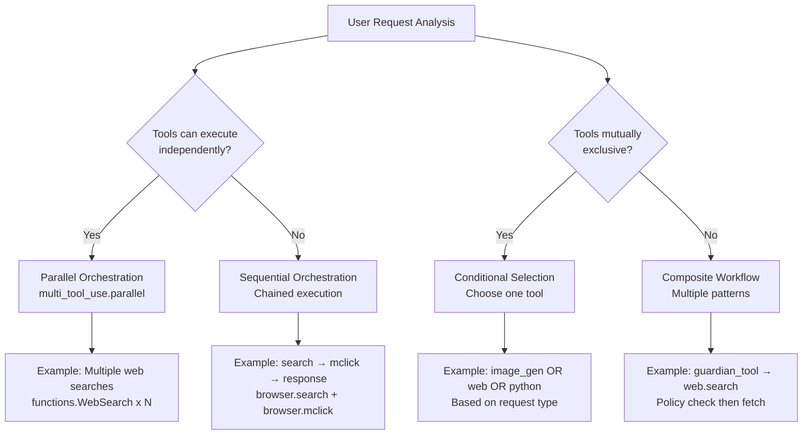

**Sources:** [duckai-gpt-5-mini_20251102.md:15-28](), [openai-assistants-api_20231106.md:54-71](), [openai-chatgpt4o_20240520.md:42-62]()

---

## Parallel Tool Orchestration

### The `multi_tool_use.parallel` Wrapper

The most explicit parallel orchestration pattern is the `multi_tool_use.parallel` wrapper, implemented identically across OpenAI's Assistants API and Duck.ai. This wrapper enables simultaneous invocation of multiple tools in the `functions` namespace.

#### Implementation Architecture

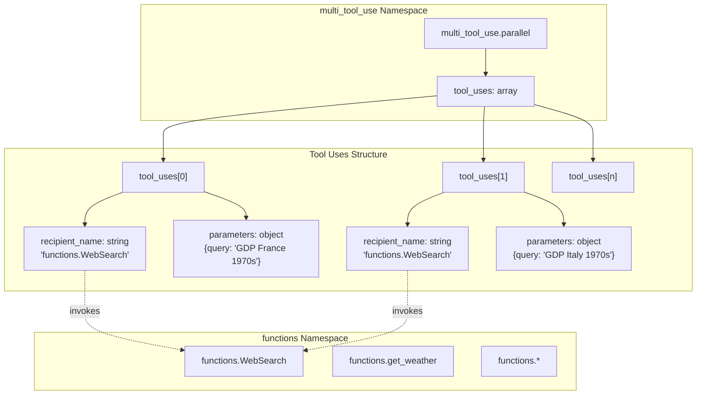

**Sources:** [openai-assistants-api_20231106.md:54-71](), [duckai-gpt-5-mini_20251102.md:101-104]()

#### Parameter Schema

The `multi_tool_use.parallel` function accepts:

```typescript
type parallel = (_: {
  // Array of tool invocations to execute simultaneously
  tool_uses: {
    // Format: "functions.<function_name>" or just "<tool_name>"
    recipient_name: string,
    // Tool-specific parameters matching that tool's schema
    parameters: object,
  }[],
}) => any;
```

**Constraint:** Only tools in the `functions` namespace are permitted. Attempting to invoke tools from other namespaces (e.g., `multi_tool_use.*`, `bio`, `canmore`) results in invocation failure.

**Sources:** [openai-assistants-api_20231106.md:60-69](), [duckai-gpt-5-mini_20251102.md:102-104]()

### Usage Patterns and Guidelines

#### Duck.ai Parallel Execution Rules

Duck.ai's system prompt explicitly defines when to use parallel orchestration:

- **Trigger Condition:** "Multiple independent searches or data fetches are needed and can be performed in parallel"
- **Efficiency Goal:** Reduce latency by fetching data concurrently rather than sequentially
- **Namespace Restriction:** Cannot call tools outside `functions` namespace

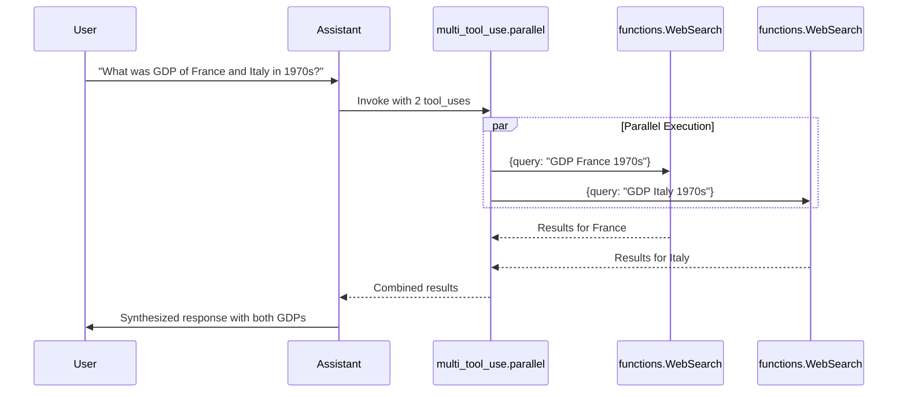

**Sources:** [duckai-gpt-5-mini_20251102.md:101-104]()

#### Assistants API Parallel Philosophy

The Assistants API documentation emphasizes:

> "Use this function to run multiple tools simultaneously, but only if they can operate in parallel. Do this even if the prompt suggests using the tools sequentially."

This directive explicitly overrides user phrasing that might imply sequential execution, prioritizing efficiency over literal interpretation.

**Sources:** [openai-assistants-api_20231106.md:60-62]()

### Limitations and Constraints

| Limitation | Description | Impact |
|------------|-------------|--------|
| **Namespace Restriction** | Only `functions.*` tools supported | Cannot parallelize calls to `bio`, `canmore`, `image_gen`, etc. |
| **No Cross-Namespace Mixing** | All tools in array must be from `functions` | Cannot combine `functions.WebSearch` + `web.search` in one call |
| **Independence Requirement** | Tools must have no execution dependencies | Cannot parallelize sequential workflows |
| **No Nested Parallelization** | Cannot invoke `multi_tool_use.parallel` within itself | Flat parallelization only |

**Sources:** [openai-assistants-api_20231106.md:56-57](), [duckai-gpt-5-mini_20251102.md:104]()

---

## Sequential Tool Orchestration

### ChatGPT-4o Browser Workflow

The most prescriptive sequential pattern appears in ChatGPT-4o's `browser` tool, which enforces a three-step workflow:

#### Mandatory Execution Sequence

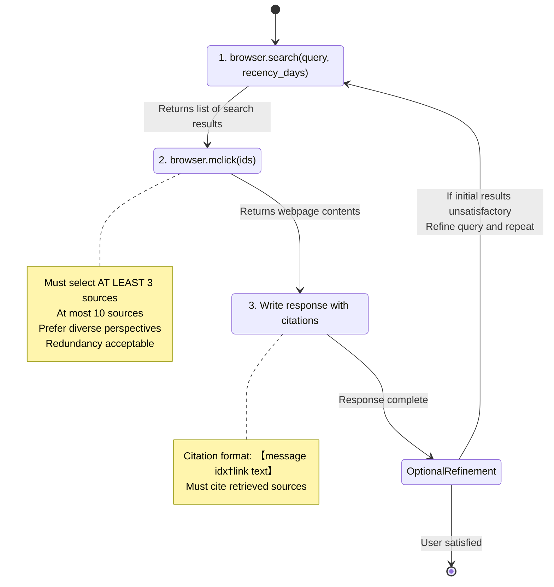

**Sources:** [openai-chatgpt4o_20240520.md:48-62]()

#### Tool Function Signatures

The `browser` tool exposes three commands with strict invocation order:

1. **`search(query: str, recency_days: int)`**
   - Issues query to search engine
   - Returns list of result IDs and metadata
   - Must be called first

2. **`mclick(ids: list[str])`**
   - Retrieves webpage contents for provided IDs
   - **Hard constraint:** "SELECT AT LEAST 3 and at most 10 pages"
   - Selection criteria: diverse perspectives, trustworthy sources, redundancy for reliability
   - Depends on: `search()` output

3. **`open_url(url: str)`**
   - Opens user-provided URL directly
   - Bypasses `search()` → `mclick()` workflow
   - Used only when user explicitly provides URL

**Sources:** [openai-chatgpt4o_20240520.md:55-58]()

### Sequential Dependency Management

#### Why Sequential Instead of Parallel?

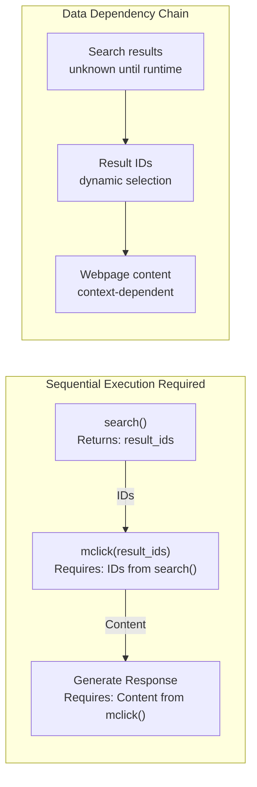

The browser workflow cannot be parallelized because:
1. **Runtime Dependencies:** `mclick()` needs IDs from `search()` output
2. **Dynamic Selection:** Which pages to fetch depends on search results quality
3. **Iterative Refinement:** May need to repeat `search()` if results unsatisfactory

**Sources:** [openai-chatgpt4o_20240520.md:53-54]()

### Citation Requirements

ChatGPT-4o enforces structured citation rendering after sequential tool execution:

- **Quote citations:** `【{message idx}†{link text}】`
- **Long citations:** `[link text](message idx)`
- **Constraint:** Do not render links in other contexts

This pattern couples tool orchestration with output formatting, ensuring traceability from sequential execution to final response.

**Sources:** [openai-chatgpt4o_20240520.md:60-62]()

---

## Conditional Tool Selection Strategies

Systems with multiple tool categories implement decision logic to select the appropriate tool(s) for each request. This differs from parallel/sequential patterns because only one tool category is invoked.

### ChatGPT-5 Tool Selection Hierarchy

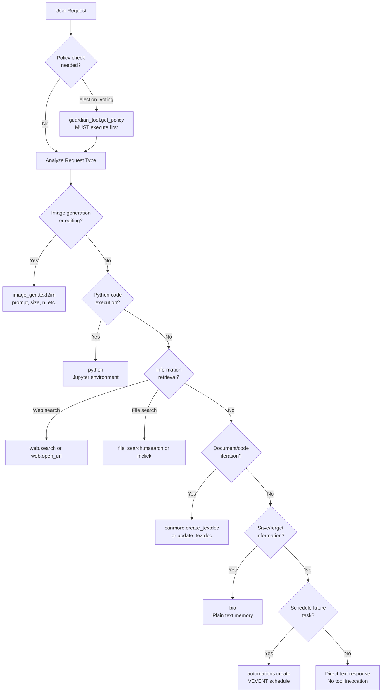

**Sources:** [openai-chatgpt5_20250808.md:26-214](), [openai-chatgpt4o_20250506.md:28-148]()

### Tool Selection Decision Matrix

| Request Type | Selected Tool | Namespace | Key Trigger Phrases |
|--------------|---------------|-----------|---------------------|
| **Election Info** | `guardian_tool` | guardian_tool | "vote", "ballot", "registration", "polling place" |
| **Image Creation** | `image_gen` | image_gen | "generate image", "create visual", "diagram", "portrait" |
| **Code Execution** | `python` | python | "calculate", "analyze data", "run code", "plot chart" |
| **Web Search** | `web` | web | "current events", "real-time info", "weather", "news" |
| **File Search** | `file_search` | file_search | "in my files", "uploaded document", "search transcript" |
| **Document Editing** | `canmore` | canmore | "use canvas", "iterate on document", "create code file" |
| **Memory Storage** | `bio` | bio | "remember that", "store this", "forget that", "note that" |
| **Task Scheduling** | `automations` | automations | "remind me", "schedule", "every morning", "in 15 minutes" |

**Sources:** [openai-chatgpt5_20250808.md:26-214]()

### Pre-Tool and Post-Tool Constraints

#### Guardian Tool Priority

ChatGPT-5 enforces strict ordering for policy checks:

> "The guardian tool should be triggered before other tools. DO NOT explain yourself."

This creates a mandatory pre-processing step:

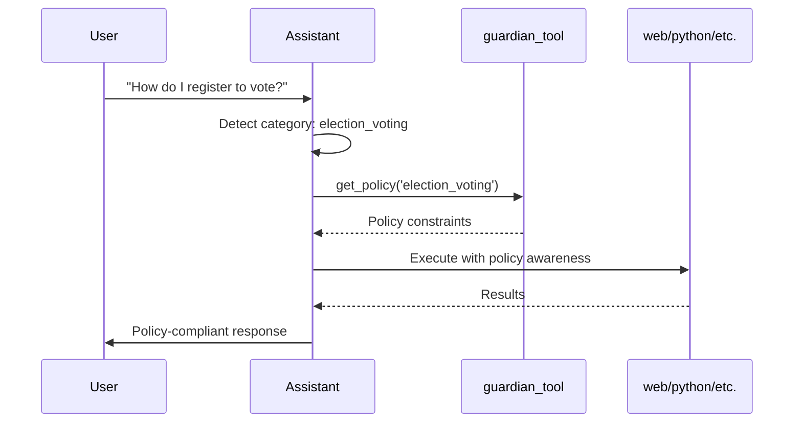

**Sources:** [openai-chatgpt4o_20250506.md:65-73](), [openai-chatgpt5_20250807.md:340-349]()

#### Image Generation Post-Constraint

After `image_gen` invocation, ChatGPT-5 enforces output silence:

> "After each image generation, do not mention anything related to download. Do not summarize the image. Do not ask followup question. Do not say ANYTHING after you generate an image."

This post-tool constraint prevents unnecessary verbosity in tool orchestration.

**Sources:** [openai-chatgpt5_20250808.md:154-156]()

---

## Tool Dependency Patterns

### Explicit Dependencies

Some tools have documented dependencies on other tools or prior execution states:

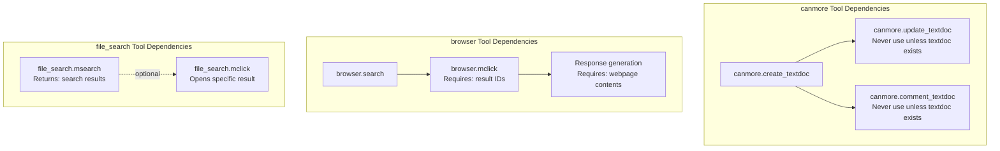

**Sources:** [openai-chatgpt5_20250808.md:119-147](), [openai-chatgpt4o_20240520.md:48-58]()

### Stateful Tool Orchestration

#### Canmore State Machine

The `canmore` tool implements a strict state machine where update/comment operations depend on creation state:

**State Transition Rules:**
1. Initial state: No textdoc exists
2. After `create_textdoc()`: Textdoc exists, updates/comments allowed
3. `update_textdoc()` and `comment_textdoc()` **must not** be called in initial state

**Error Prevention:**
> "Never use this function unless a textdoc has already been created."

This hard constraint appears in both functions' documentation, preventing invalid state transitions.

**Sources:** [openai-chatgpt5_20250808.md:119-120, 134-135]()

### Implicit Dependencies via Namespace Isolation

Tools in different namespaces cannot directly invoke each other, creating implicit orchestration constraints:

| Namespace | Can Invoke | Cannot Invoke |
|-----------|-----------|---------------|
| `multi_tool_use` | `functions.*` only | `bio`, `canmore`, `web`, `python`, `image_gen` |
| `file_search` | `msearch`, `mclick` methods | Tools in other namespaces |
| `functions` | Depends on implementation | Other namespaces without wrapper |

This namespace isolation forces sequential orchestration when combining tools from different categories.

**Sources:** [openai-assistants-api_20231106.md:56-57](), [duckai-gpt-5-mini_20251102.md:104]()

---

## Cross-System Orchestration Comparison

### Orchestration Capability Matrix

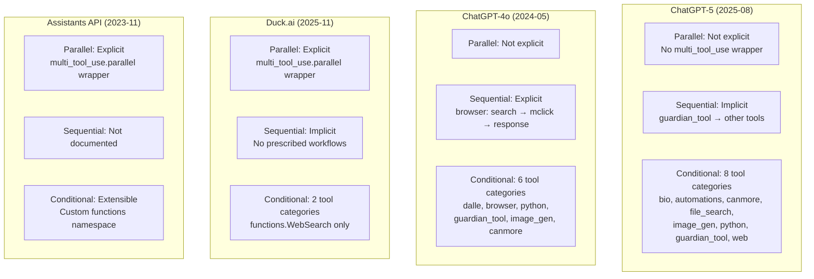

**Sources:** [openai-chatgpt5_20250808.md:26-214](), [openai-chatgpt4o_20240520.md:18-72](), [duckai-gpt-5-mini_20251102.md:15-28](), [openai-assistants-api_20231106.md:13-71]()

### Orchestration Strategy Evolution

| System | Date | Parallel Support | Sequential Patterns | Tool Count |
|--------|------|------------------|---------------------|------------|
| Assistants API | 2023-11 | ✅ `multi_tool_use.parallel` | ❌ Not specified | Variable (custom functions) |
| ChatGPT-4o | 2024-05 | ❌ No explicit wrapper | ✅ `browser` 3-step workflow | 6 tools |
| ChatGPT-4o | 2025-05 | ❌ No explicit wrapper | ✅ `guardian_tool` priority | 6 tools |
| ChatGPT-5 | 2025-08 | ❌ No explicit wrapper | ✅ `guardian_tool` priority | 8 tools |
| Duck.ai | 2025-11 | ✅ `multi_tool_use.parallel` | ❌ Not specified | 2 tools (WebSearch + wrapper) |

**Trend Analysis:**
- **Parallel orchestration** remains niche (only Assistants API and Duck.ai)
- **Sequential patterns** evolved from explicit (browser workflow) to implicit (guardian_tool priority)
- **Tool proliferation** (6 → 8 tools) emphasizes conditional selection over parallel execution

**Sources:** All referenced files

---

## Duck.ai Decisiveness Rules and Tool Orchestration

Duck.ai implements unique orchestration behavior through "decisiveness" constraints that affect tool selection and usage patterns:

### Anti-Clarification Directive

> "The assistant must never ask clarifying questions unless the user explicitly requests that the assistant provide multiple options or specifies that clarifying follow-up questions are acceptable."

This creates a **greedy tool selection** strategy:
1. If ambiguous which tool to use → make reasonable assumption and select one
2. If uncertain about parameters → assume defaults and proceed
3. If multiple interpretations possible → choose one concrete path

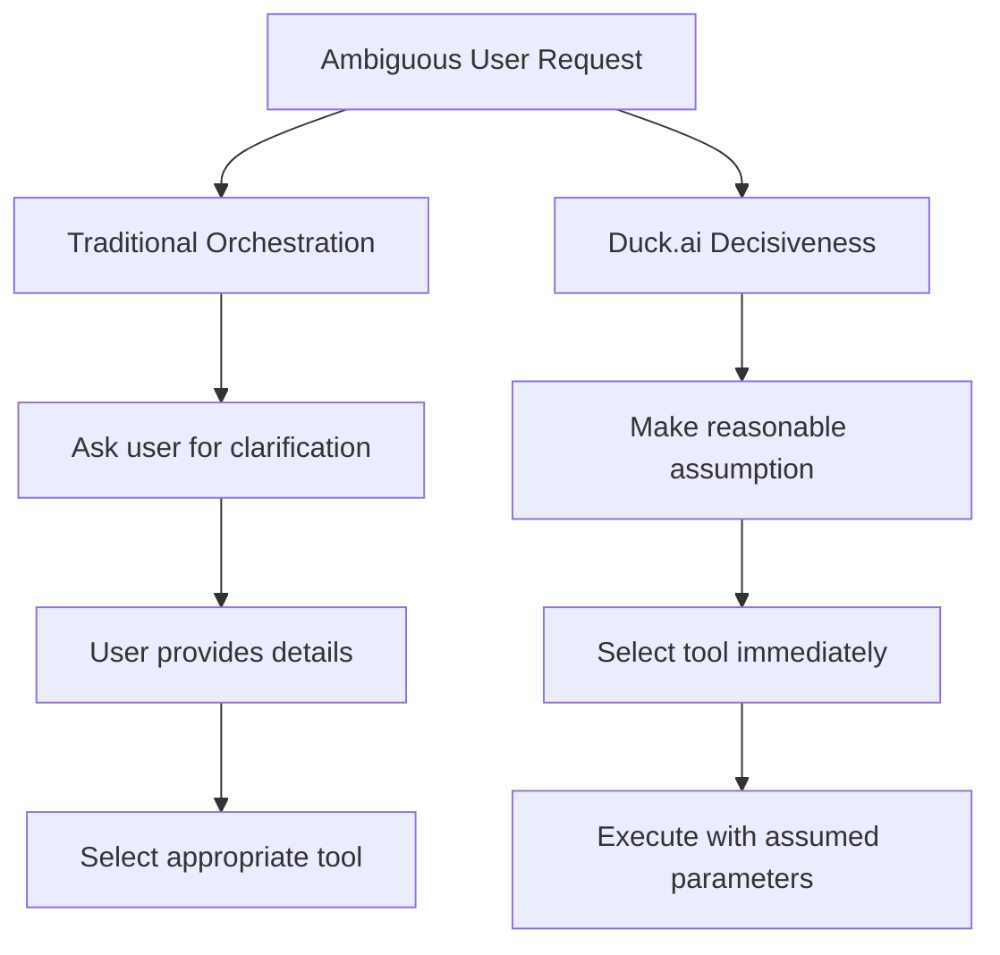

**Impact on Orchestration:**
- Reduces orchestration latency (no clarification round-trip)
- Prioritizes speed over precision
- May invoke suboptimal tool if assumption incorrect

**Sources:** [duckai-gpt-5-mini_20251102.md:16-17, 59-61]()

### WebSearch Bias Directive

> "The assistant should err on the side of using the WebSearch tool too often rather than too rarely. It is better to perform a web search even if the assistant thinks it might already know the information."

This creates **search-first orchestration** for Duck.ai:

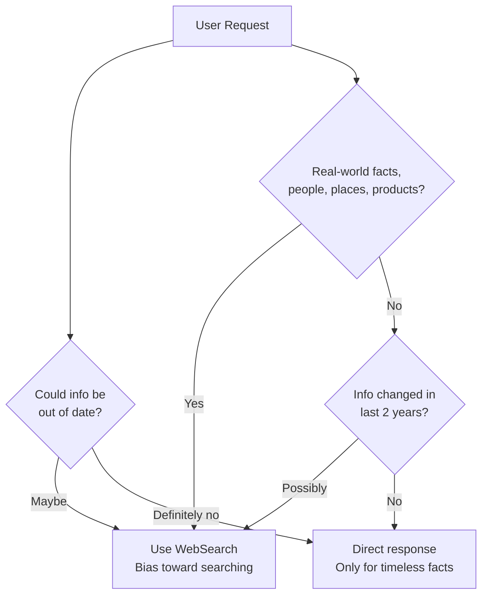

**Orchestration Priority:**
1. WebSearch for: real-world facts, people, places, products, organizations, regulations, events
2. WebSearch for: anything potentially changed in last 2 years
3. Direct response for: timeless knowledge (math proofs, core science)

**Sources:** [duckai-gpt-5-mini_20251102.md:64-67, 107-109]()

---

## File Search Multi-Query Orchestration

ChatGPT-5's `file_search.msearch` implements sophisticated parallel query orchestration with quality heuristics:

### Multi-Query Decomposition Strategy

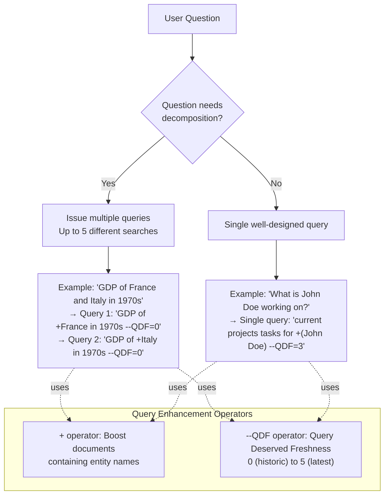

**Sources:** [openai-chatgpt5_20250807.md:231-268]()

### Query Deserved Freshness (QDF) Scoring

The `file_search` tool implements a 0-5 freshness scoring system that affects result ranking:

| QDF Score | Freshness Requirement | Time Window | Example Use Case |
|-----------|----------------------|-------------|------------------|
| --QDF=0 | Historic/unchanging | Any age acceptable | "GDP in 1970s", "radius of Earth" |
| --QDF=1 | Generally acceptable unless very old | Past 18 months | "Company overview" |
| --QDF=2 | Slow-changing information | Past 6 months | "Best practices for cloud storage" |
| --QDF=3 | Potentially changing | Past 3 months | "What is Design team working on?" |
| --QDF=4 | Recent information needed | Past 60 days | "Product launch status" |
| --QDF=5 | Latest information critical | Past 30 days | "Is office closed this week?" |

**Orchestration Impact:** QDF scores create implicit prioritization in parallel search execution, with higher QDF queries favoring more recent results.

**Sources:** [openai-chatgpt5_20250807.md:241-259]()

### Entity Boosting with + Operator

The `+` operator boosts retrieval of documents containing specific entities:

**Syntax Rules:**
- Prefix entity names with `+` (e.g., `+France`, `+GPT4`)
- Enclose multi-word entities in parentheses: `+(John Doe)`, `+(File Service)`
- Do not break up entity names into separate terms

**Example Query Transformations:**
- User: "What is John Doe working on?" → `current projects tasks for +(John Doe) --QDF=3`
- User: "Performance of GPT-4 on MMLU?" → `+GPT4 performance on +MMLU benchmark --QDF=1`

**Sources:** [openai-chatgpt5_20250807.md:237-258]()

### Multilinguality Orchestration

When user query is non-English, `file_search.msearch` implements **bilingual parallel orchestration**:

> "When the user's question is not in English, you must issue the above queries in both English and also translate the queries into the user's original language."

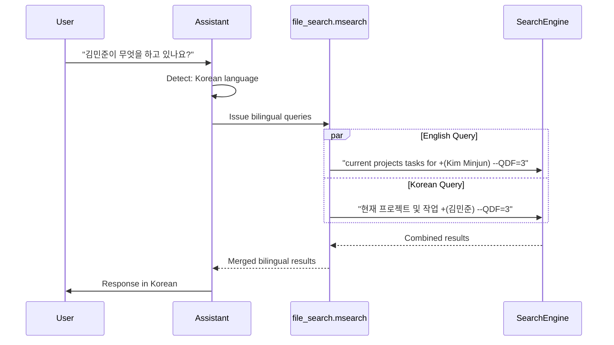

**Examples:**
- Korean: "오피스는 이번 주 닫혀 있나요?" → English + Korean queries
- Japanese: "オフィスは今週閉まっていますか？" → English + Japanese queries
- Spanish: "¿Cuál es el rendimiento del modelo 4o en GPQA?" → English + Spanish queries

**Sources:** [openai-chatgpt5_20250807.md:265-269]()

---

## Automation Scheduling as Deferred Orchestration

ChatGPT-5's `automations` tool implements a unique orchestration pattern: **scheduling future tool invocations** rather than immediate execution.

### Deferred Execution Architecture

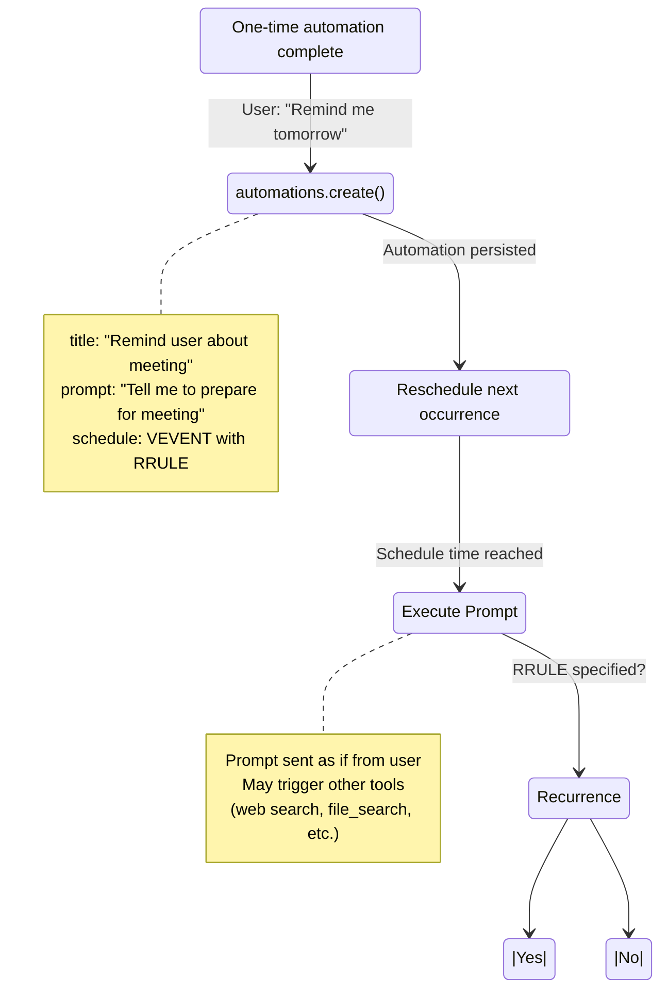

**Sources:** [openai-chatgpt5_20250807.md:76-127]()

### VEVENT-Based Scheduling Format

Automations use iCal VEVENT format for schedule specification:

**Example: Daily Recurring Task**
```
schedule="BEGIN:VEVENT
RRULE:FREQ=DAILY;BYHOUR=9;BYMINUTE=0;BYSECOND=0
END:VEVENT"
```

**Example: One-Time Delayed Task**
```
schedule=""
dtstart_offset_json='{"minutes":15}'
```

**Constraints:**
- DO NOT specify `SUMMARY` property
- DO NOT specify `DTEND` property
- Use `RRULE` for recurring schedules
- Use `dtstart_offset_json` for relative scheduling (e.g., "in 15 minutes")

**Sources:** [openai-chatgpt5_20250807.md:90-106]()

### Conditional Automation Orchestration

Automations can implement **periodic conditional checks** that trigger tools only if conditions are met:

**Example Prompt:** "Search for new product releases and notify me if there are any."

**Orchestration Pattern:**
1. Create automation with weekly recurrence (`RRULE:FREQ=WEEKLY`)
2. Prompt: "Search for new product releases and notify me if so."
3. Each execution:
   - Invoke `web.search()` for product releases
   - Conditionally notify user based on results
   - Reschedule next check

This creates a **polling orchestration pattern** where tool invocations happen periodically with conditional logic.

**Sources:** [openai-chatgpt5_20250807.md:86-94]()

---

## Summary: Orchestration Design Principles

### Key Patterns Across Systems

| Principle | Implementation | Systems |
|-----------|----------------|---------|
| **Parallel for Independence** | Use `multi_tool_use.parallel` when tools have no dependencies | Assistants API, Duck.ai |
| **Sequential for Dependencies** | Enforce execution order when outputs feed into inputs | ChatGPT-4o (browser), canmore state machine |
| **Conditional for Categories** | Select one tool based on request type analysis | ChatGPT-5 (8 categories), Duck.ai (search-first) |
| **Pre-Tool Validation** | Check policies/constraints before primary tool | ChatGPT-5 (guardian_tool priority) |
| **Post-Tool Silence** | Suppress output after certain tool executions | ChatGPT-5 (image_gen no summary) |
| **Greedy Selection** | Assume parameters and proceed without clarification | Duck.ai (decisiveness rules) |
| **Bilingual Redundancy** | Execute same search in multiple languages | ChatGPT-5 (file_search multilinguality) |
| **Deferred Orchestration** | Schedule tool invocations for future execution | ChatGPT-5 (automations) |

### Orchestration Complexity Spectrum

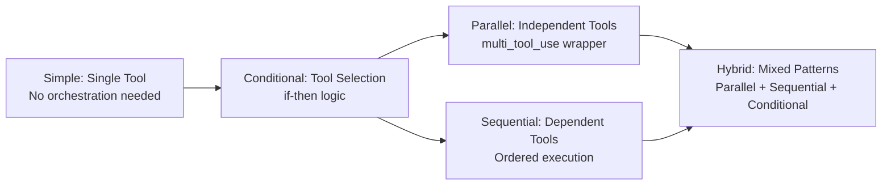

**Complexity Drivers:**
1. Number of available tools (2 tools vs 8 tools)
2. Tool interdependencies (independent vs chained)
3. Execution constraints (must execute in order vs any order)
4. State requirements (stateless vs stateful tool sequences)

**Sources:** All referenced files

---

