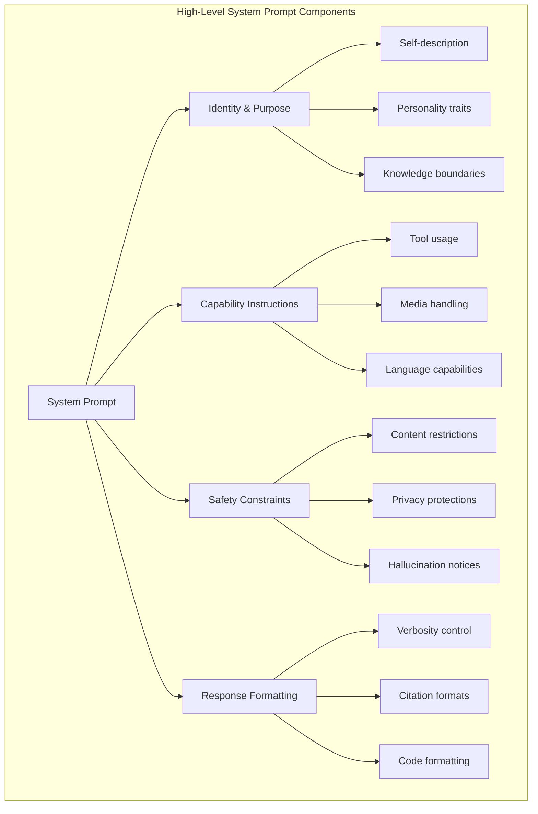
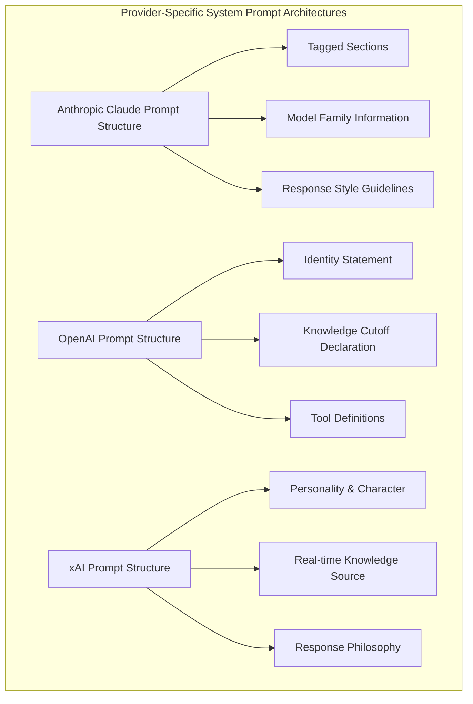
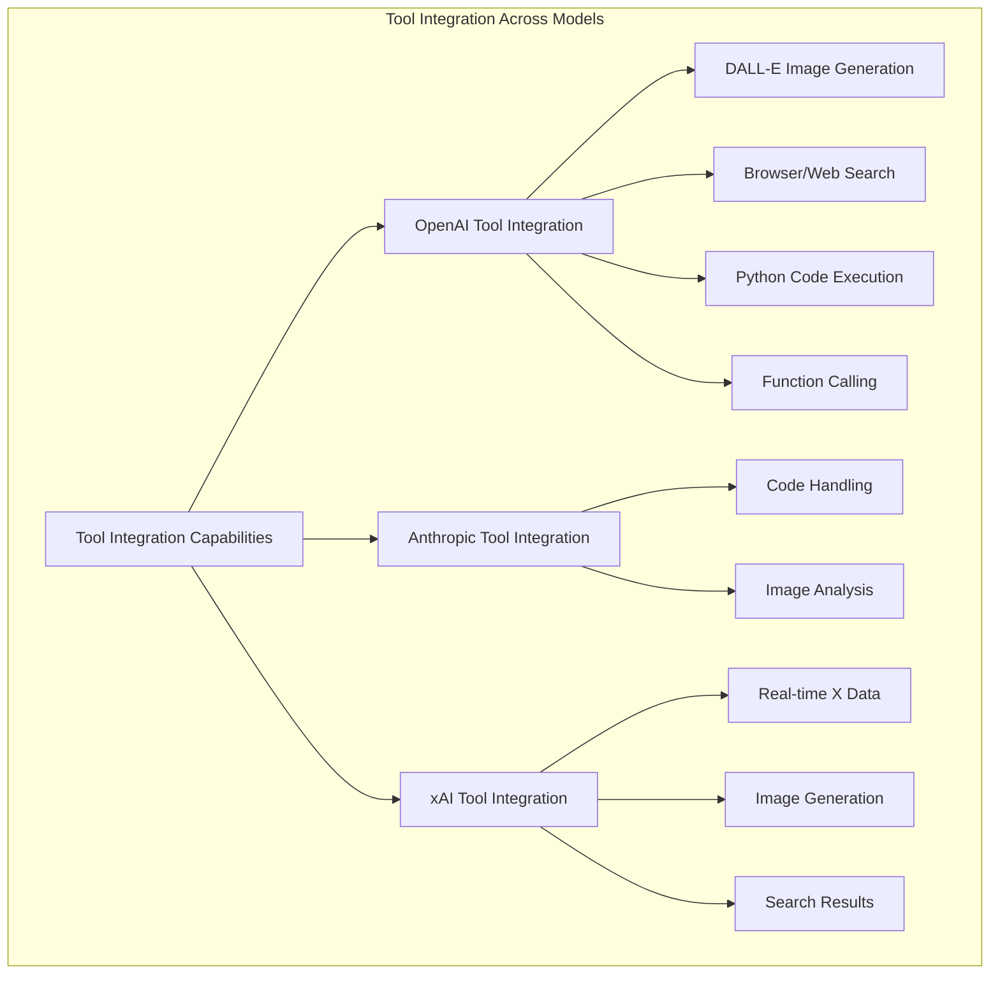
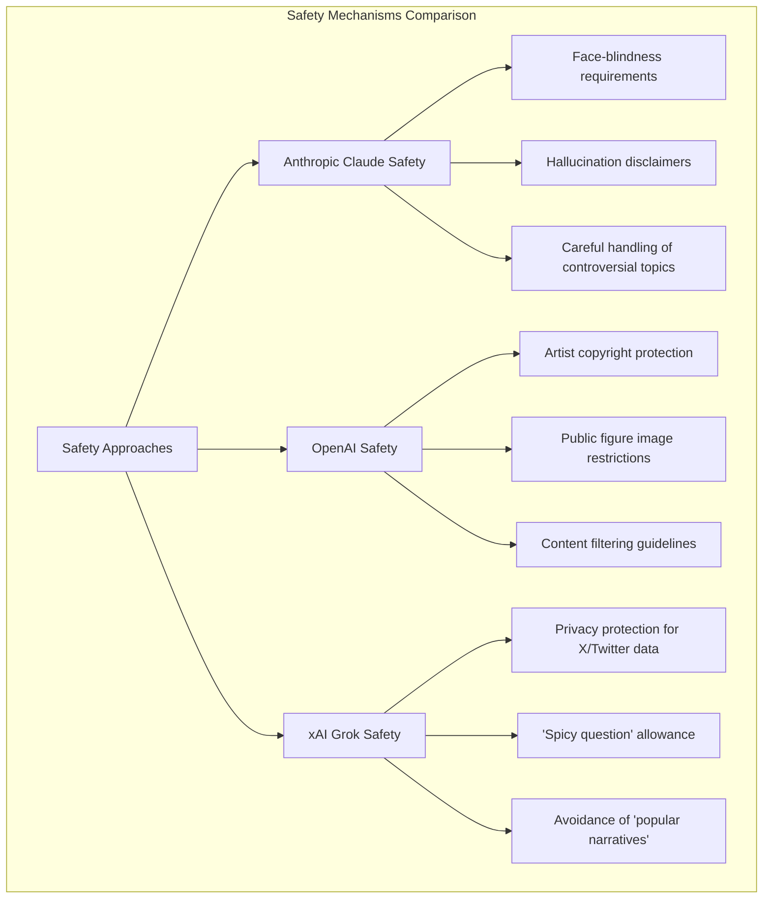
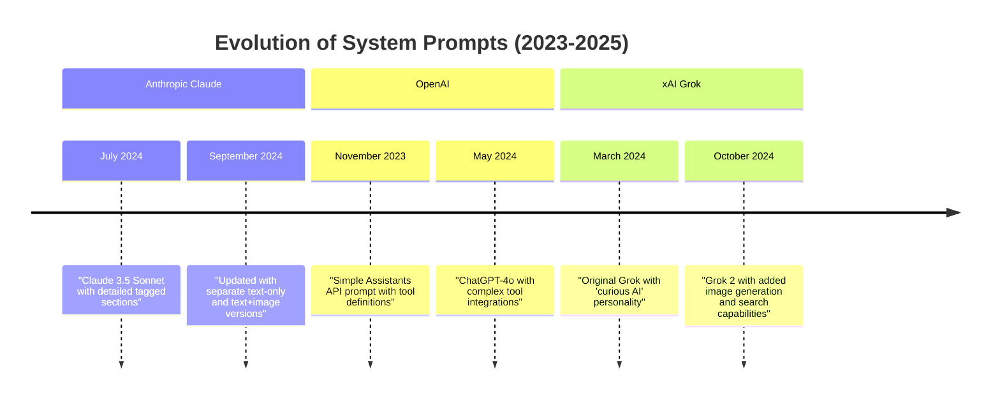

<!-- source: DeepWiki mcp.deepwiki.com · repo jujumilk3/leaked-system-prompts · page 6 Comparative Analysis · fetched 2026-11-09 -->

# Comparative Analysis

Relevant source files

The following files were used as context for generating this wiki page:

- [README.md](README.md)
- [duckai-gpt-5-mini_20251102.md](duckai-gpt-5-mini_20251102.md)
- [github-copilot-chat_20230513.md](github-copilot-chat_20230513.md)
- [manus_20250309.md](manus_20250309.md)
- [manus_20250310.md](manus_20250310.md)
- [microsoft-bing-chat_20230209.md](microsoft-bing-chat_20230209.md)
- [openai-chatgpt4o_20250506.md](openai-chatgpt4o_20250506.md)
- [openai-chatgpt5_20250807.md](openai-chatgpt5_20250807.md)
- [openai-chatgpt5_20250808.md](openai-chatgpt5_20250808.md)
- [perplexity.ai_20221208.md](perplexity.ai_20221208.md)
- [snap-myai_20230430.md](snap-myai_20230430.md)

This document provides an in-depth comparison of system prompts across major AI systems represented in the leaked system prompts repository. It examines structural patterns, capability differences, safety mechanisms, and evolutionary trends across different AI providers. For specific details about how system prompts have evolved within product lines, see [Evolution of System Prompts](#4.1).

Sources: [README.md:1-74]()

## System Prompt Architecture

System prompts across major AI providers follow distinct architectural patterns that reflect their development philosophies, capabilities, and intended use cases.

Sources: [anthropic-claude-3.5-sonnet_20240712.md:1-20](), [openai-chatgpt4o_20240520.md:1-73](), [xAI-grok_20240307.md:1-21]()

### Provider-Specific Architectures

System prompts from different providers exhibit distinctive structural approaches that reflect their design priorities.

Sources: [anthropic-claude-3.5-sonnet_20240712.md:6-19](), [openai-chatgpt4o_20240520.md:11-72](), [xAI-grok_20240307.md:12-20](), [xAI-grok_20241003.md:11-17]()

## Core Identity Comparison

The table below compares how different models are instructed to present their core identity and personality:

| AI System | Self-Description | Primary Values | Knowledge Sources | Date Awareness |
|-----------|------------------|----------------|-------------------|----------------|
| Claude 3.5 Sonnet | "Claude, created by Anthropic" | Intelligence, clarity, helpfulness | Knowledge cutoff: April 2024 | Current date field: {} |
| ChatGPT-4o | "ChatGPT, a large language model trained by OpenAI" | Helpfulness, following instructions | Knowledge cutoff: 2023-10 | Fixed date: 2024-05-20 |
| Grok (2024-03) | "Grok, a curious AI built by xAI" | Curiosity, truthfulness, "not woke" | Real-time X/Twitter posts | Not specified |
| Grok (2024-10) | "Grok 2, a curious AI built by xAI" | Curiosity, helpfulness, critical thinking | Real-time X platform posts | Fixed: "October 02, 2024 PDT" |
| OpenAI Assistants API | "A helpful assistant" | Following exact instructions | Not specified | Not specified |

Sources: [anthropic-claude-3.5-sonnet_20240712.md:6-7](), [openai-chatgpt4o_20240520.md:11-13](), [xAI-grok_20240307.md:12-20](), [openai-assistants-api_20231106.md:11](), [xAI-grok_20241003.md:11-17]()

## Tool Integration Comparison

Different AI systems have varying levels of tool integration capabilities outlined in their system prompts.

Sources: [openai-chatgpt4o_20240520.md:18-72](), [openai-assistants-api_20231106.md:13-71](), [xAI-grok_20241003.md:12-32](), [anthropic-claude-3.5-sonnet_20240712.md:7-19]()

### Tool Details 

| AI System | Image Generation | Web/Search | Code Execution | File Handling | Function Calling |
|-----------|------------------|------------|----------------|---------------|-----------------|
| ChatGPT-4o | DALL-E (detailed policy) | Browser with search & citation | Python in Jupyter | Not detailed | Not detailed |
| Claude 3.5 | No generation | No direct access | Code with markdown | No direct access | Not detailed |
| Grok (2024-10) | FLUX.1 model | Search results | Not detailed | Not detailed | Not detailed |
| Assistants API | Not detailed | Not detailed | Python in Jupyter | myfiles_browser | JSON schema functions |

Sources: [openai-chatgpt4o_20240520.md:20-72](), [anthropic-claude-3.5-sonnet_20240712.md:7-18](), [xAI-grok_20241003.md:12-32](), [openai-assistants-api_20231106.md:13-71]()

## Safety Mechanisms Comparison

Safety mechanisms in system prompts vary significantly across providers, reflecting different approaches to content moderation and ethical constraints.

Sources: [anthropic-claude-3.5-sonnet_20240712.md:7-9](), [openai-chatgpt4o_20240520.md:22-33](), [xAI-grok_20240307.md:18-20](), [xAI-grok_20241003.md:13-15]()

### Safety Constraints Table

| AI System | Content Restrictions | Privacy Protection | Transparency Notes | Unique Safety Features |
|-----------|---------------------|-------------------|-------------------|----------------------|
| Claude 3.5 Sonnet | Careful handling of controversial topics | Complete face-blindness | Hallucination disclaimers | Thumbs-down feedback suggestion |
| ChatGPT-4o | Artist copyright protection | Public figure image guidance | No specific notices | Detailed DALL-E usage policy |
| Grok (2024-03) | Minimal restrictions, "not woke" | Not specified | Not specified | "Answering spicy questions" |
| Grok (2024-10) | Minimal restrictions | No access to internal X data | No specific notices | "Not following popular narratives uncritically" |
| Assistants API | Not specified | Not detailed | Not detailed | Not detailed |

Sources: [anthropic-claude-3.5-sonnet_20240712.md:7-9](), [anthropic-claude-3.5-sonnet_20240909.md:7-25](), [openai-chatgpt4o_20240520.md:22-33](), [xAI-grok_20240307.md:18-20](), [xAI-grok_20241003.md:13-15]()

## Response Formatting Directives

System prompts provide specific guidance on how AI systems should format their responses:

| AI System | Verbosity Guidance | Code Formatting | Citation Format | Response Structure |
|-----------|-------------------|----------------|-----------------|-------------------|
| Claude 3.5 Sonnet | "Thorough for complex questions, concise for simple ones" | Markdown with optional explanation | Not specified | Avoid filler phrases like "Certainly!" |
| ChatGPT-4o | Not detailed | Not specified | `【{message idx}†{link text}】` and `[link text](message idx)` | Not specified |
| Grok | Not detailed | Not specified | Not specified | Not specified |
| Assistants API | Not detailed | Not specified | `【{message idx}†{link text}】` | Not specified |

Sources: [anthropic-claude-3.5-sonnet_20240712.md:13-19](), [openai-chatgpt4o_20240520.md:60-62](), [openai-assistants-api_20231106.md:30]()

## Evolution Across Time

Comparing system prompts over time reveals evolutionary trends in their development:

Sources: [xAI-grok_20240307.md:12-20](), [xAI-grok_20241003.md:11-96](), [anthropic-claude-3.5-sonnet_20240712.md:1-20](), [anthropic-claude-3.5-sonnet_20240909.md:1-36](), [openai-assistants-api_20231106.md:1-72](), [openai-chatgpt4o_20240520.md:1-73]()

### Key Evolutionary Trends

| Trend | Description | Examples |
|-------|-------------|----------|
| Increased Detail | System prompts have become more detailed and specific over time | Claude's extensive tagged sections, ChatGPT-4o's detailed tool instructions |
| Expanded Capabilities | Newer prompts include instructions for more diverse capabilities | Grok adding image generation, expanded web search capabilities |
| Enhanced Safety Mechanisms | More sophisticated safety measures have been implemented | Claude's face-blindness, OpenAI's artist copyright protections |
| Structured Formatting | More explicit guidance on response formatting and structure | Claude's prohibition of filler phrases, specific citation formats |
| Tool Integration | Increased focus on defining tool use procedures | OpenAI's detailed DALL-E, browser, and Python tool instructions |

Sources: [README.md:1-74](), [xAI-grok_20240307.md:12-20](), [xAI-grok_20241003.md:11-96](), [anthropic-claude-3.5-sonnet_20240712.md:1-20](), [anthropic-claude-3.5-sonnet_20240909.md:1-36](), [openai-assistants-api_20231106.md:1-72](), [openai-chatgpt4o_20240520.md:1-73]()

## Philosophical Divergence

System prompts reveal philosophical differences in how AI providers approach their models:

| Provider | Core Philosophy | Evidence in System Prompts | Distinctive Approach |
|----------|----------------|----------------------------|---------------------|
| Anthropic | Constitutional AI with guardrails | Detailed safety mechanisms, careful handling of controversial topics | Extensive tagged sections, face-blindness, explicit hallucination warnings |
| OpenAI | Tool-centric, capability-focused | Detailed tool instructions, less personality emphasis | Sophisticated tool integration (DALL-E, browser, Python) |
| xAI | "Anti-woke", less restricted | "Spicy questions" allowance, "not following popular narratives" | Emphasis on real-time knowledge, minimal content restrictions |

Sources: [anthropic-claude-3.5-sonnet_20240712.md:6-19](), [openai-chatgpt4o_20240520.md:11-72](), [xAI-grok_20240307.md:12-20](), [xAI-grok_20241003.md:11-17]()

## Conclusion

This comparative analysis reveals several key insights about system prompts across major AI providers:

1. **Architectural Divergence**: Each provider has developed a distinctive approach to structuring system prompts that reflects their AI philosophy.

2. **Safety-Capability Balance**: Providers strike different balances between safety constraints and capabilities, with Anthropic emphasizing safety guardrails, OpenAI focusing on tool integration, and xAI promoting fewer content restrictions.

3. **Evolution Towards Complexity**: System prompts have generally evolved toward greater detail, structure, and capability specification over time.

4. **Tool Integration Paradigms**: Tool usage frameworks vary significantly, with OpenAI providing highly structured tool definitions while others take simpler approaches.

5. **Response Formatting Standardization**: Providers increasingly specify how models should format responses, indicating a move toward more controlled outputs.

These patterns suggest that system prompts have become a critical component of AI system design, functioning as comprehensive instruction sets that define not just what models can do, but how they should approach their tasks and interact with users.

Sources: [README.md:1-74](), [xAI-grok_20240307.md:12-20](), [xAI-grok_20241003.md:11-96](), [anthropic-claude-3.5-sonnet_20240712.md:1-20](), [anthropic-claude-3.5-sonnet_20240909.md:1-36](), [openai-assistants-api_20231106.md:1-72](), [openai-chatgpt4o_20240520.md:1-73]()

---

