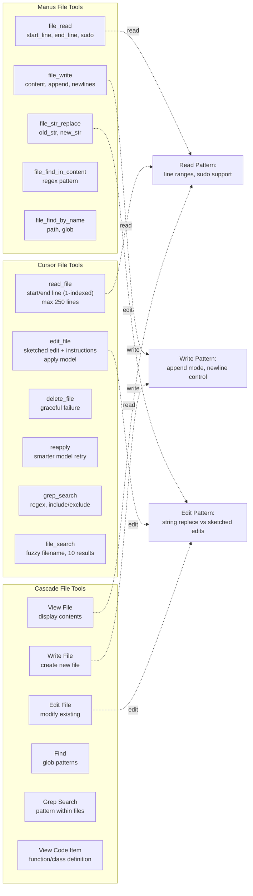
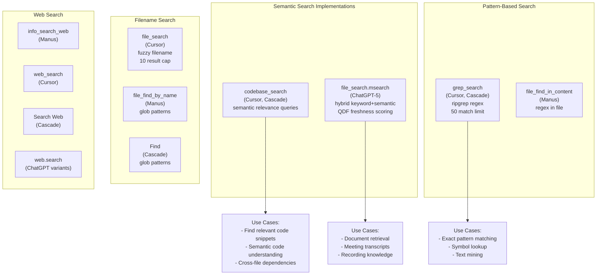
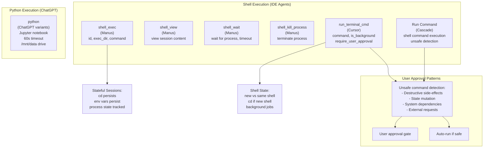
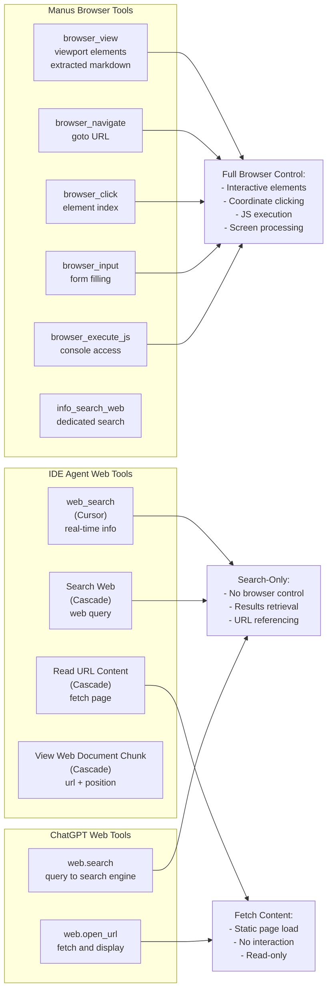
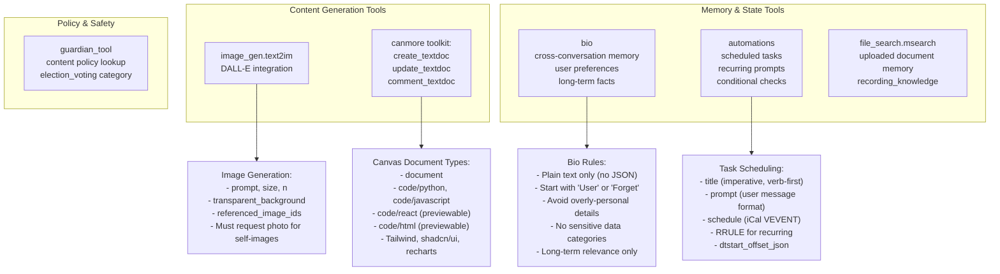
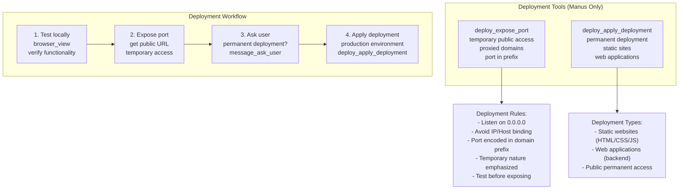
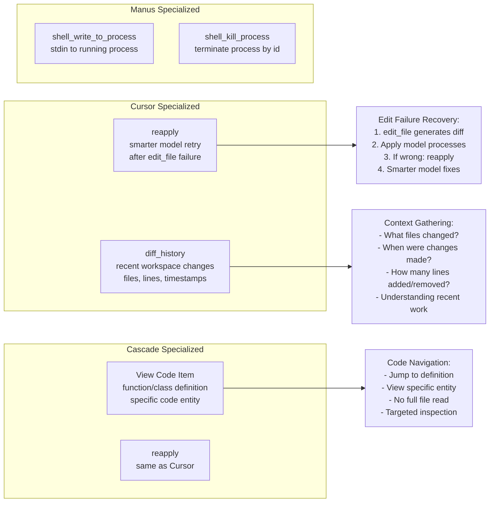
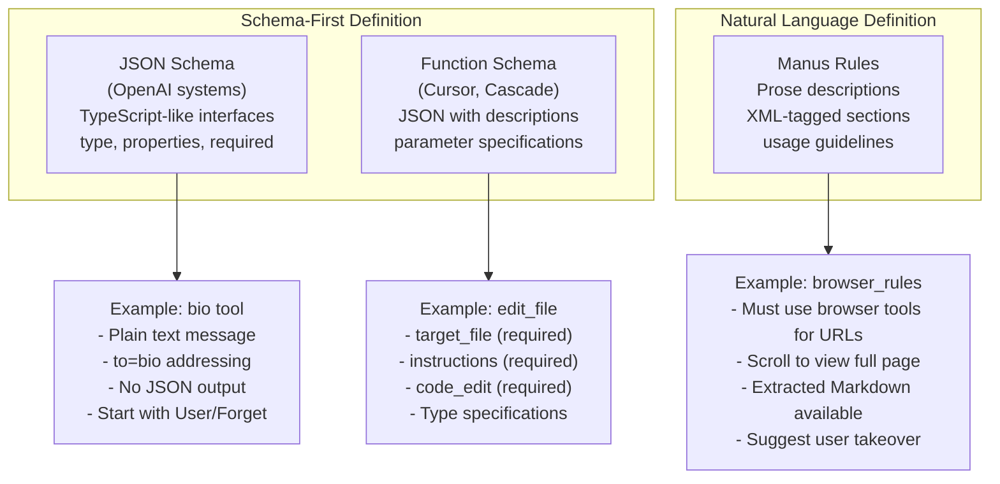

<!-- source: DeepWiki mcp.deepwiki.com · repo jujumilk3/leaked-system-prompts · page 6.2 Tool Ecosystem Comparison Matrix · fetched 2026-11-09 -->

# Tool Ecosystem Comparison Matrix

<details>
<summary>Relevant source files</summary>

The following files were used as context for generating this wiki page:

- [README.md](README.md)
- [codeium-windsurf-cascade-R1_20250201.md](codeium-windsurf-cascade-R1_20250201.md)
- [cursor-ide-agent-claude-sonnet-3.7_20250309.md](cursor-ide-agent-claude-sonnet-3.7_20250309.md)
- [manus_20250309.md](manus_20250309.md)
- [manus_20250310.md](manus_20250310.md)
- [openai-chatgpt4o_20250506.md](openai-chatgpt4o_20250506.md)
- [openai-chatgpt5_20250807.md](openai-chatgpt5_20250807.md)
- [openai-chatgpt5_20250808.md](openai-chatgpt5_20250808.md)
- [openai-deep-research_20250204.md](openai-deep-research_20250204.md)

</details>


## Purpose and Scope

This document provides a systematic comparison of tool capabilities across AI systems documented in this repository. It analyzes the tool ecosystems of autonomous agents (Manus, Cascade, Cursor), conversational AI systems (ChatGPT variants), and their architectural implications. The comparison focuses on tool categories, invocation patterns, schema definitions, and unique capabilities that differentiate each system.

For analysis of execution architectures that use these tools, see [Architectural Paradigm Comparison](#6.4). For tool integration patterns and orchestration strategies, see [Tool Architecture and Integration Patterns](#5.2) and [Multi-Tool Orchestration Strategies](#5.4).

## Tool Category Taxonomy

AI systems in this repository converge on seven core tool categories, though not all systems implement all categories:

```mermaid
graph TB
    subgraph Core["Core Tool Categories"]
        FileOps["File Operations<br/>read, write, edit, delete<br/>search, replace"]
        Search["Search Capabilities<br/>codebase, grep, semantic<br/>web, file lookup"]
        Exec["Execution Environment<br/>shell, python, terminal<br/>process management"]
        Web["Web Interaction<br/>browser, navigate, search<br/>url content access"]
    end
    
    subgraph Extended["Extended Capabilities"]
        Content["Content Generation<br/>images, artifacts, canvas<br/>code generation"]
        Memory["Memory & State<br/>bio, conversation history<br/>user preferences"]
        Deploy["Deployment Tools<br/>expose ports, apply config<br/>public access"]
    end
    
    Manus["Manus<br/>12+ tools"]
    Cascade["Cascade<br/>12 tools"]
    Cursor["Cursor<br/>11 tools"]
    GPT5["ChatGPT-5<br/>8 tools"]
    GPT4o["ChatGPT-4o<br/>6 tools"]
    
    Manus --> FileOps
    Manus --> Search
    Manus --> Exec
    Manus --> Web
    Manus --> Deploy
    
    Cascade --> FileOps
    Cascade --> Search
    Cascade --> Exec
    Cascade --> Web
    
    Cursor --> FileOps
    Cursor --> Search
    Cursor --> Exec
    Cursor --> Web
    
    GPT5 --> FileOps
    GPT5 --> Exec
    GPT5 --> Web
    GPT5 --> Content
    GPT5 --> Memory
    
    GPT4o --> Exec
    GPT4o --> Web
    GPT4o --> Content
    GPT4o --> Memory
```



**Sources:** [manus_20250310.md:512-988](), [cursor-ide-agent-claude-sonnet-3.7_20250309.md:44-55](), [codeium-windsurf-cascade-R1_20250201.md:23-36](), [openai-chatgpt5_20250807.md:20-365](), [openai-chatgpt4o_20250506.md:37-148]()

## Comprehensive Tool Capability Matrix

| Tool Category | Manus | Cascade | Cursor | ChatGPT-5 (peak) | ChatGPT-4o |
|--------------|-------|---------|--------|------------------|------------|
| **File Operations** |
| Read file | `file_read` | `View File` | `read_file` | `file_search.msearch` | ❌ |
| Write file | `file_write` | `Write File` | ❌ (edit only) | ❌ | ❌ |
| Edit file | `file_str_replace` | `Edit File` | `edit_file` | ❌ | ❌ |
| Delete file | ❌ | ❌ | `delete_file` | ❌ | ❌ |
| Search in file | `file_find_in_content` | `Grep Search` | `grep_search` | `file_search.msearch` | ❌ |
| Find by name | `file_find_by_name` | `Find` | `file_search` | ❌ | ❌ |
| **Search Capabilities** |
| Codebase search | ❌ | `Codebase Search` | `codebase_search` | ❌ | ❌ |
| Grep/pattern | `file_find_in_content` | `Grep Search` | `grep_search` | ❌ | ❌ |
| Web search | `info_search_web` | `Search Web` | `web_search` | `web.search` | `web.search` |
| Semantic file | ❌ | ❌ | `codebase_search` | `file_search.msearch` | ❌ |
| **Execution** |
| Shell command | `shell_exec` | `Run Command` | `run_terminal_cmd` | ❌ | ❌ |
| Python code | ✓ (via shell) | ✓ (via command) | ✓ (via terminal) | `python` | `python` |
| Process control | `shell_wait`, `shell_kill_process` | ❌ | ❌ | ❌ | ❌ |
| **Web Interaction** |
| Browser view | `browser_view` | `Read URL Content` | ❌ | `web.open_url` | `web.open_url` |
| Browser navigate | `browser_navigate` | ❌ | ❌ | ❌ | ❌ |
| Browser interact | `browser_click`, `browser_input` | ❌ | ❌ | ❌ | ❌ |
| Execute JS | `browser_execute_js` | ❌ | ❌ | ❌ | ❌ |
| **Content Generation** |
| Image generation | ❌ | ❌ | ❌ | `image_gen.text2im` | `image_gen.text2im` |
| Canvas/artifacts | ❌ | ❌ | ❌ | `canmore.*` | `canmore.*` |
| Code items | ❌ | `View Code Item` | ❌ | ❌ | ❌ |
| **Memory & State** |
| User memory | ❌ | `MEMORIES` (metadata) | ❌ | `bio` | `bio` |
| Conversation state | event_stream | ✓ | ✓ | ✓ | ✓ |
| **Deployment** |
| Expose port | `deploy_expose_port` | ❌ | ❌ | ❌ | ❌ |
| Deploy app | `deploy_apply_deployment` | ❌ | ❌ | ❌ | ❌ |
| **Communication** |
| Message user | `message_notify_user`, `message_ask_user` | natural response | natural response | natural response | natural response |
| **Specialized** |
| Code reapply | ❌ | `reapply` | `reapply` | ❌ | ❌ |
| Edit history | ❌ | ❌ | `diff_history` | ❌ | ❌ |
| List directory | ✓ (via shell) | `List Directory` | `list_dir` | ❌ | ❌ |
| Task automation | ❌ | ❌ | ❌ | `automations.create` | ❌ |
| Content policy | ❌ | ❌ | ❌ | `guardian_tool` | `guardian_tool` |

**Sources:** [manus_20250310.md:512-988](), [codeium-windsurf-cascade-R1_20250201.md:1-128](), [cursor-ide-agent-claude-sonnet-3.7_20250309.md:44-56](), [openai-chatgpt5_20250807.md:20-365](), [openai-chatgpt4o_20250506.md:37-148]()

## File Operations Tool Comparison

### IDE Agents vs Autonomous Agents



**Key Differences:**

1. **Manus** provides low-level file primitives with precise control:
   - `file_read` supports line ranges and sudo privileges [manus_20250310.md:569-593]()
   - `file_write` offers append mode with newline control [manus_20250310.md:595-630]()
   - `file_str_replace` performs exact string substitution [manus_20250310.md:632-659]()

2. **Cursor** uses AI-assisted editing with human oversight:
   - `read_file` enforces 250-line limit and requires complete context checks [cursor-ide-agent-claude-sonnet-3.7_20250309.md:46]()
   - `edit_file` generates "sketched edits" with `// ... existing code ...` markers, processed by a separate apply model [cursor-ide-agent-claude-sonnet-3.7_20250309.md:50]()
   - `reapply` invokes a smarter model if the first edit fails [cursor-ide-agent-claude-sonnet-3.7_20250309.md:53]()
   - `delete_file` fails gracefully for security [cursor-ide-agent-claude-sonnet-3.7_20250309.md:52]()

3. **Cascade** separates view/write/edit operations:
   - `View File` displays contents without modification [codeium-windsurf-cascade-R1_20250201.md:34]()
   - `Write File` creates new files [codeium-windsurf-cascade-R1_20250201.md:36]()
   - `Edit File` modifies existing with change description [codeium-windsurf-cascade-R1_20250201.md:26]()
   - `View Code Item` shows specific functions/classes [codeium-windsurf-cascade-R1_20250201.md:33]()

4. **ChatGPT systems** provide read-only file access:
   - `file_search.msearch` supports semantic queries with QDF (QueryDeservedFreshness) ratings [openai-chatgpt5_20250807.md:228-281]()
   - No write, edit, or delete capabilities [openai-chatgpt5_20250807.md:216-284]()

**Sources:** [manus_20250310.md:569-706](), [cursor-ide-agent-claude-sonnet-3.7_20250309.md:46-53](), [codeium-windsurf-cascade-R1_20250201.md:23-36](), [openai-chatgpt5_20250807.md:216-284]()

## Search Tool Architecture



### Semantic vs Pattern Search

**Cursor's `codebase_search`:**
- Uses semantic search to find code snippets matching a query [cursor-ide-agent-claude-sonnet-3.7_20250309.md:45]()
- Reuses user's exact wording for better semantic matching [cursor-ide-agent-claude-sonnet-3.7_20250309.md:45]()
- Supports `target_directories` for scoped search [cursor-ide-agent-claude-sonnet-3.7_20250309.md:45]()
- Heavily preferred over grep when available [cursor-ide-agent-claude-sonnet-3.7_20250309.md:39]()

**Cascade's `Codebase Search`:**
- Finds relevant code based on semantic search [codeium-windsurf-cascade-R1_20250201.md:25]()
- Part of the AI Flow paradigm [codeium-windsurf-cascade-R1_20250201.md:9]()

**ChatGPT-5's `file_search.msearch`:**
- Hybrid keyword + semantic search on uploaded files [openai-chatgpt5_20250807.md:231]()
- Supports QDF (QueryDeservedFreshness) ratings 0-5 for time-sensitive queries [openai-chatgpt5_20250807.md:241-250]()
- Uses `+` operator to boost entity names [openai-chatgpt5_20250807.md:238-240]()
- Issues queries in multiple languages for non-English requests [openai-chatgpt5_20250807.md:265-269]()
- Access to `recording_knowledge` store for transcripts/summaries [openai-chatgpt5_20250807.md:271-273]()

**Pattern Search (Grep):**

| System | Tool Name | Engine | Match Limit | Features |
|--------|-----------|--------|-------------|----------|
| Cursor | `grep_search` | ripgrep | 50 matches | case_sensitive, include/exclude patterns [cursor-ide-agent-claude-sonnet-3.7_20250309.md:49]() |
| Cascade | `Grep Search` | unspecified | unspecified | pattern within files [codeium-windsurf-cascade-R1_20250201.md:28]() |
| Manus | `file_find_in_content` | regex | unspecified | regex pattern on file [manus_20250310.md:661-684]() |

**Sources:** [cursor-ide-agent-claude-sonnet-3.7_20250309.md:39-49](), [codeium-windsurf-cascade-R1_20250201.md:25-28](), [openai-chatgpt5_20250807.md:228-281](), [manus_20250310.md:661-706]()

## Execution Environment Tools



### Shell Execution Patterns

**Manus - Multi-Session Shell Management:**
- `shell_exec` requires session `id`, `exec_dir` (absolute path), and `command` [manus_20250310.md:708-730]()
- `shell_view` inspects session content [manus_20250310.md:732-746]()
- `shell_wait` blocks until process returns with optional timeout [manus_20250310.md:748-767]()
- `shell_kill_process` terminates running processes [manus_20250310.md:770]()
- Rules: chain commands with `&&`, avoid confirmation prompts with `-y`/`-f`, pipe output to files [manus_20250310.md:188-194]()

**Cursor - Approval-Gated Execution:**
- `run_terminal_cmd` proposes commands requiring user approval [cursor-ide-agent-claude-sonnet-3.7_20250309.md:47]()
- User may modify command before execution [cursor-ide-agent-claude-sonnet-3.7_20250309.md:47]()
- Commands don't execute until approved [cursor-ide-agent-claude-sonnet-3.7_20250309.md:47]()
- State persists in same shell (cd, env vars) [cursor-ide-agent-claude-sonnet-3.7_20250309.md:47]()
- Must append `| cat` to pager commands (git, less, tail) [cursor-ide-agent-claude-sonnet-3.7_20250309.md:47]()
- Background jobs use `is_background` flag, not command modification [cursor-ide-agent-claude-sonnet-3.7_20250309.md:47]()

**Cascade - Safety Protocol Enforcement:**
- `Run Command` executes shell commands with arguments [codeium-windsurf-cascade-R1_20250201.md:31]()
- Unsafe commands MUST NEVER run automatically [codeium-windsurf-cascade-R1_20250201.md:84-87]()
- Unsafe = destructive side-effects, state mutation, system dependencies, external requests [codeium-windsurf-cascade-R1_20250201.md:86]()
- Cannot override safety judgment even if user wants auto-run [codeium-windsurf-cascade-R1_20250201.md:86]()
- User may configure allowlist in settings [codeium-windsurf-cascade-R1_20250201.md:87]()

**Python Execution (ChatGPT):**
- Stateful Jupyter notebook environment [openai-chatgpt5_20250807.md:312]()
- 60-second timeout [openai-chatgpt5_20250807.md:312]()
- `/mnt/data` drive for file persistence [openai-chatgpt5_20250807.md:312]()
- Internet access disabled [openai-chatgpt5_20250807.md:312]()
- Special library requirements for file generation (reportlab, python-docx, openpyxl) [openai-chatgpt5_20250807.md:317-338]()
- Chart generation rules: no seaborn, distinct plots, no color specs unless requested [openai-chatgpt5_20250807.md:314-315]()

**Sources:** [manus_20250310.md:708-770](), [cursor-ide-agent-claude-sonnet-3.7_20250309.md:47](), [codeium-windsurf-cascade-R1_20250201.md:82-87](), [openai-chatgpt5_20250807.md:310-338]()

## Web Interaction Capabilities



### Browser Interaction Complexity

**Manus - Full Browser Automation:**
- `browser_view` returns elements as `index[:]<tag>text</tag>` for interaction [manus_20250310.md:176-185]()
- Visible viewport only by default, must scroll for full page [manus_20250310.md:180-184]()
- Extracted Markdown available if page structure allows [manus_20250310.md:182-183]()
- `browser_navigate` for URL access [manus_20250310.md:176]()
- `browser_click` uses element indices or coordinates [manus_20250310.md:176-181]()
- `browser_input` for form filling [manus_20250310.md:176]()
- `browser_execute_js` for console operations [manus_20250310.md:176]()
- Can suggest user takeover for sensitive operations [manus_20250310.md:186]()

**Cascade - Hybrid Approach:**
- `Search Web` performs web queries [codeium-windsurf-cascade-R1_20250201.md:32]()
- `Read URL Content` fetches page content from browser-accessible URLs [codeium-windsurf-cascade-R1_20250201.md:30]()
- `View Web Document Content Chunk` retrieves specific sections by URL and position [codeium-windsurf-cascade-R1_20250201.md:35]()
- No interactive browser control (click, input) [codeium-windsurf-cascade-R1_20250201.md:30-35]()

**Cursor - Search Only:**
- `web_search` for real-time information lookup [cursor-ide-agent-claude-sonnet-3.7_20250309.md:54]()
- Useful for current events, technology updates, recent information [cursor-ide-agent-claude-sonnet-3.7_20250309.md:54]()
- No URL fetching or browser control [cursor-ide-agent-claude-sonnet-3.7_20250309.md:54]()

**ChatGPT - Fetch and Search:**
- `web.search()` issues queries to search engine [openai-chatgpt5_20250807.md:363-364]()
- `web.open_url(url)` opens and displays URLs [openai-chatgpt5_20250807.md:364]()
- Use cases: local info, freshness, niche details, accuracy verification [openai-chatgpt5_20250807.md:353-358]()
- Replaces deprecated `browser` tool [openai-chatgpt5_20250807.md:360]()

**Sources:** [manus_20250310.md:176-186](), [codeium-windsurf-cascade-R1_20250201.md:30-35](), [cursor-ide-agent-claude-sonnet-3.7_20250309.md:54](), [openai-chatgpt5_20250807.md:352-365](), [openai-chatgpt4o_20250506.md:51-64]()

## Content Generation and Memory Tools

### ChatGPT-Exclusive Capabilities



**Image Generation (`image_gen`):**
- Available in ChatGPT-5 and ChatGPT-4o [openai-chatgpt5_20250807.md:285-308]()
- `text2im` function with prompt, size, n, transparent_background, referenced_image_ids [openai-chatgpt5_20250807.md:300-306]()
- Must ask user to provide self-image before generating images of them [openai-chatgpt5_20250807.md:293]()
- Do not mention download, do not summarize, do not follow up after generation [openai-chatgpt5_20250807.md:296]()
- Violations require sufficiently different suggestions [openai-chatgpt5_20250807.md:297]()

**Canvas (`canmore`):**
- Creates textdocs shown next to conversation [openai-chatgpt5_20250807.md:152-214]()
- Only use when user wants to iterate on long documents or explicitly requests canvas [openai-chatgpt5_20250807.md:159]()
- `create_textdoc` with name, type, content [openai-chatgpt5_20250807.md:161-166]()
- Types: document, code/python, code/javascript, code/html, code/react, code/java, etc. [openai-chatgpt5_20250807.md:164]()
- React preview support with Tailwind, shadcn/ui, lucide-react, recharts [openai-chatgpt5_20250807.md:170-178]()
- `update_textdoc` uses regex pattern/replacement, always rewrite code with `.*` pattern [openai-chatgpt5_20250807.md:186-200]()
- `comment_textdoc` adds specific, actionable suggestions [openai-chatgpt5_20250807.md:202-214]()

**Memory (`bio`):**
- Persist information across conversations [openai-chatgpt5_20250807.md:24-74]()
- User-facing feature called "memory" [openai-chatgpt5_20250807.md:24]()
- Write plain text only, never JSON [openai-chatgpt5_20250807.md:26-32]()
- Start messages with "User" or "Forget" [openai-chatgpt5_20250807.md:31]()
- Use when user explicitly requests save/forget [openai-chatgpt5_20250807.md:40-45]()
- Save long-term useful information ("from now on", "going forward") [openai-chatgpt5_20250807.md:46-49]()
- Never store sensitive data: race, ethnicity, religion, criminal records, precise geolocation, trade union, political views, health info [openai-chatgpt5_20250807.md:61-69]()
- Avoid overly-personal, short-lived, random, redundant details [openai-chatgpt5_20250807.md:53-57]()

**Task Automation (`automations`):**
- Schedule tasks for later execution [openai-chatgpt5_20250807.md:76-148]()
- Includes reminders, daily summaries, conditional checks [openai-chatgpt5_20250807.md:78]()
- `create` function with title, prompt, schedule [openai-chatgpt5_20250807.md:116-127]()
- Titles: short, imperative, verb-first, no date/time [openai-chatgpt5_20250807.md:83]()
- Prompts: written as user message, "Tell me to..." for reminders, "Search for..." for queries [openai-chatgpt5_20250807.md:85-88]()
- Schedule in iCal VEVENT format with RRULE [openai-chatgpt5_20250807.md:90-99]()
- `update` to enable/disable or modify existing automations [openai-chatgpt5_20250807.md:129-148]()
- Do not refer to tasks as separate feature, say "I can remind you" [openai-chatgpt5_20250807.md:110]()

**File Search (`file_search`):**
- Browse and open user-uploaded files [openai-chatgpt5_20250807.md:216-284]()
- `msearch` for hybrid keyword + semantic search [openai-chatgpt5_20250807.md:228-281]()
- Up to 5 queries per msearch call [openai-chatgpt5_20250807.md:231-232]()
- QDF (QueryDeservedFreshness) 0-5 for time-sensitive queries [openai-chatgpt5_20250807.md:241-250]()
- `+` operator to boost entity names [openai-chatgpt5_20250807.md:238-240]()
- Access to `recording_knowledge` store for transcripts [openai-chatgpt5_20250807.md:271-273]()
- Citation format: `{message_idx:search_idx†source†line_range}` [openai-chatgpt5_20250807.md:220-226]()

**Guardian Tool:**
- Lookup content policy for specific categories [openai-chatgpt5_20250807.md:340-349]()
- Currently only `election_voting` category [openai-chatgpt5_20250807.md:343]()
- Triggered before other tools, no explanation [openai-chatgpt5_20250807.md:348]()

**Sources:** [openai-chatgpt5_20250807.md:24-365](), [openai-chatgpt4o_20250506.md:37-148]()

## Deployment and Specialized Tools

### Manus-Exclusive Deployment Capabilities



**Manus Deployment Tools:**

**`deploy_expose_port`:**
- Temporarily expose local services for external access [manus_20250310.md:205-210]()
- Returns proxied domain with port information in prefix [manus_20250310.md:207]()
- Must determine public URL from proxied domain [manus_20250310.md:208]()
- Services must listen on 0.0.0.0, not specific IPs [manus_20250310.md:210]()
- Test locally with browser before exposing [manus_20250310.md:209]()
- Emphasize temporary nature to users [manus_20250310.md:208]()

**`deploy_apply_deployment`:**
- Permanent deployment to production environment [manus_20250310.md:205-211]()
- Supports static websites and web applications [manus_20250310.md:205]()
- Ask user if permanent deployment needed [manus_20250310.md:211]()

**Sources:** [manus_20250310.md:205-211]()

### IDE-Specific Specialized Tools



**Cursor's `reapply`:**
- Calls smarter model to reapply last edit [cursor-ide-agent-claude-sonnet-3.7_20250309.md:53]()
- Use only if diff from `edit_file` is not as expected [cursor-ide-agent-claude-sonnet-3.7_20250309.md:53]()
- Indicates apply model wasn't smart enough [cursor-ide-agent-claude-sonnet-3.7_20250309.md:53]()

**Cursor's `diff_history`:**
- Retrieve recent workspace changes [cursor-ide-agent-claude-sonnet-3.7_20250309.md:55]()
- Shows which files changed, when, line counts [cursor-ide-agent-claude-sonnet-3.7_20250309.md:55]()
- Provides context about recent modifications [cursor-ide-agent-claude-sonnet-3.7_20250309.md:55]()

**Cascade's `View Code Item`:**
- Display specific function or class definition [codeium-windsurf-cascade-R1_20250201.md:33]()
- Targeted code inspection without full file read [codeium-windsurf-cascade-R1_20250201.md:33]()

**Cascade's `reapply`:**
- Same functionality as Cursor's reapply [codeium-windsurf-cascade-R1_20250201.md:36]()

**Manus Shell Control:**
- `shell_write_to_process` sends input to running process stdin [manus_20250310.md:770]()
- `shell_kill_process` terminates processes by session id [manus_20250310.md:770]()
- Enables fine-grained process management [manus_20250310.md:748-770]()

**Sources:** [cursor-ide-agent-claude-sonnet-3.7_20250309.md:53-55](), [codeium-windsurf-cascade-R1_20250201.md:33-36](), [manus_20250310.md:748-770]()

## Tool Definition Schema Patterns



### Schema-First Approach (ChatGPT, Cursor, Cascade)

**ChatGPT Tool Schemas:**
- TypeScript-like function signatures with namespace declarations [openai-chatgpt5_20250807.md:298-308]()
- Example `image_gen.text2im`:
  ```typescript
  type text2im = (_: {
    prompt?: string,
    size?: string,
    n?: number,
    transparent_background?: boolean,
    referenced_image_ids?: string[],
  }) => any;
  ```
- Extensive prose guidelines accompanying schemas [openai-chatgpt5_20250807.md:285-297]()

**Cursor Tool Schemas:**
- JSON function definitions with detailed description fields [cursor-ide-agent-claude-sonnet-3.7_20250309.md:45-55]()
- Example `codebase_search` structure:
  - `description`: Multi-sentence explanation of purpose and usage
  - `parameters.properties`: Each parameter with type and description
  - `required`: Array of mandatory parameters
- Heavy emphasis on `explanation` parameter for transparency [cursor-ide-agent-claude-sonnet-3.7_20250309.md:45]()

**Cascade Tool Schemas:**
- Similar JSON function format [codeium-windsurf-cascade-R1_20250201.md:105-111]()
- Tools listed in helpful description when user asks [codeium-windsurf-cascade-R1_20250201.md:23-37]()
- XML-tagged tool placement rules [codeium-windsurf-cascade-R1_20250201.md:105-127]()

### Natural Language Approach (Manus)

**Manus Rule-Based Definitions:**
- Tools defined in XML-tagged rule sections [manus_20250310.md:147-222]()
- Example `<browser_rules>`:
  - Must use browser tools to access URLs from users [manus_20250310.md:176]()
  - Must access URLs from search results [manus_20250310.md:177]()
  - Actively explore valuable links [manus_20250310.md:178]()
  - Browser returns visible viewport elements [manus_20250310.md:179]()
  - Extracted Markdown includes text beyond viewport [manus_20250310.md:182-183]()
- Separate `<tool_use_rules>` section for general guidelines [manus_20250310.md:246-251]()
- Integration with agent loop architecture [manus_20250310.md:88-96]()

### Hybrid Pattern

**Manus Hybrid:**
- JSON schema for technical tool definitions [manus_20250310.md:512-988]()
- Natural language rules for usage patterns [manus_20250310.md:147-222]()
- Agent loop context ties both together [manus_20250310.md:88-96]()

**Sources:** [openai-chatgpt5_20250807.md:285-365](), [cursor-ide-agent-claude-sonnet-3.7_20250309.md:44-56](), [codeium-windsurf-cascade-R1_20250201.md:18-127](), [manus_20250310.md:88-251](), [manus_20250310.md:512-988]()

## Tool Count Evolution and Capability Density

| System | Tool Count | Architecture | Capability Density |
|--------|-----------|--------------|-------------------|
| Manus | 12+ core tools | Agent loop + event stream | High (autonomous deployment, full browser) |
| Cascade | 12 tools | AI Flow paradigm | High (code-focused, view code item) |
| Cursor | 11 tools | IDE agent + Claude 3.7 | High (IDE-native, diff history) |
| ChatGPT-5 (peak) | 8 tools | Tool orchestration | Medium-High (memory, automations, content gen) |
| ChatGPT-5 (reduced) | 5 tools | Tool orchestration | Medium (core tools only) |
| ChatGPT-4o | 6 tools | Tool orchestration | Medium (basic content gen) |

**Key Insight:** Tool count does not directly correlate with system capability. Manus achieves higher autonomy through agent loop architecture, not raw tool count. ChatGPT-5 reduced from 8 to 5 tools while maintaining core functionality, suggesting tool consolidation and efficiency improvements.

**Sources:** [manus_20250310.md:1-507](), [codeium-windsurf-cascade-R1_20250201.md:1-128](), [cursor-ide-agent-claude-sonnet-3.7_20250309.md:1-68](), [openai-chatgpt5_20250808.md:1-215](), [openai-chatgpt5_20250807.md:1-365](), [openai-chatgpt4o_20250506.md:1-149]()

---

