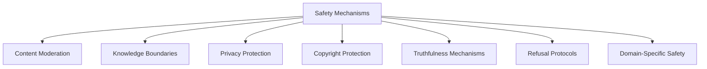
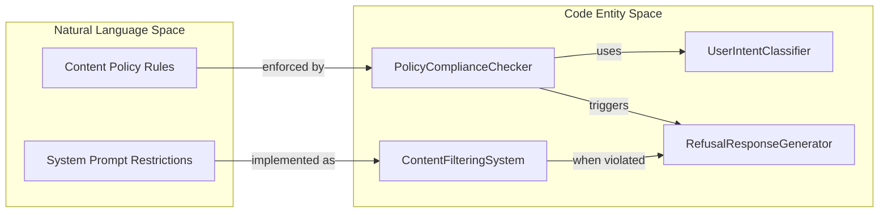
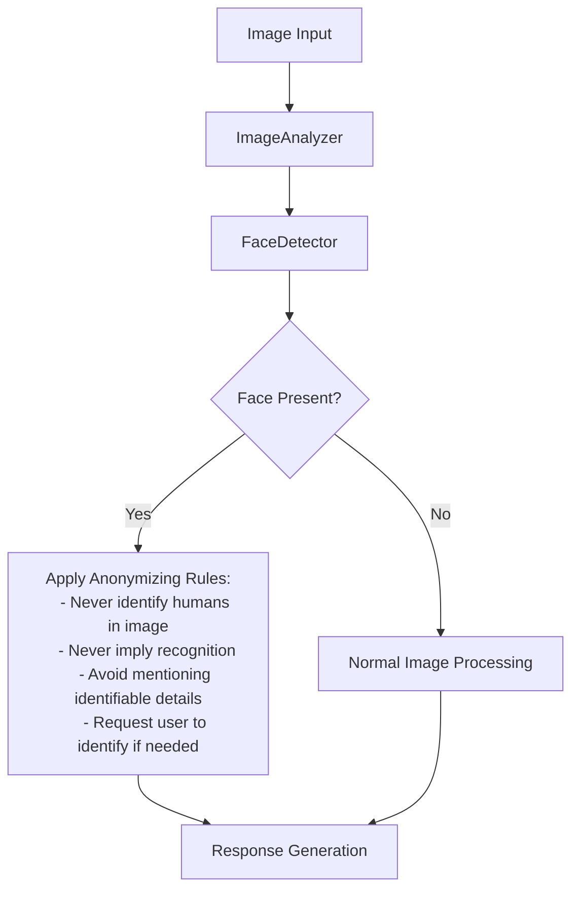
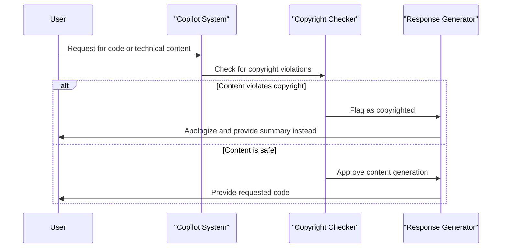
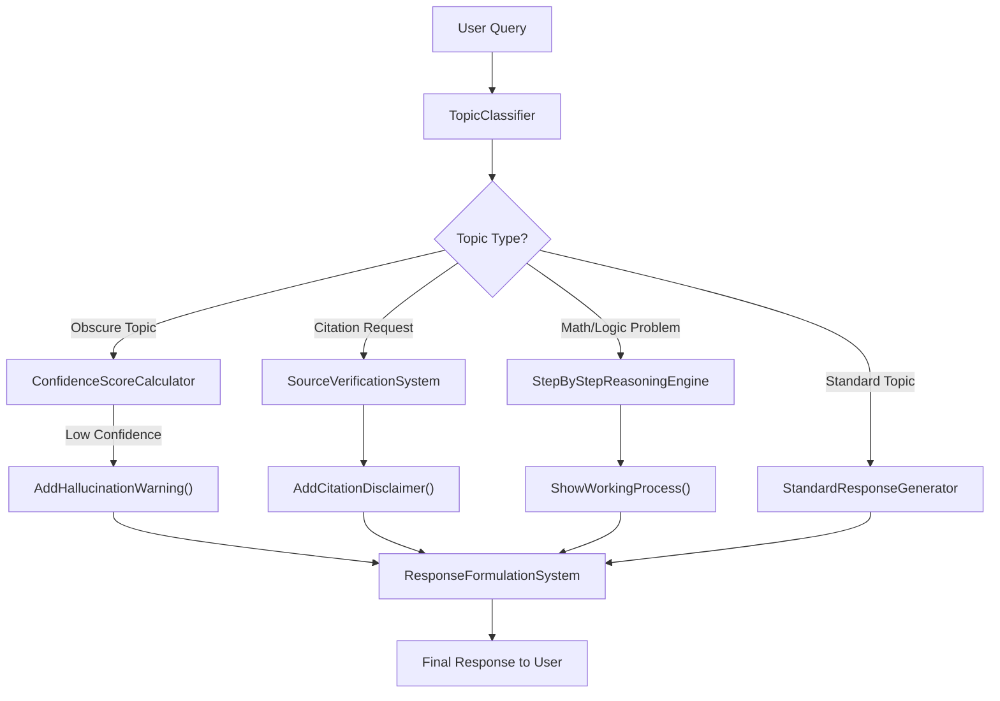
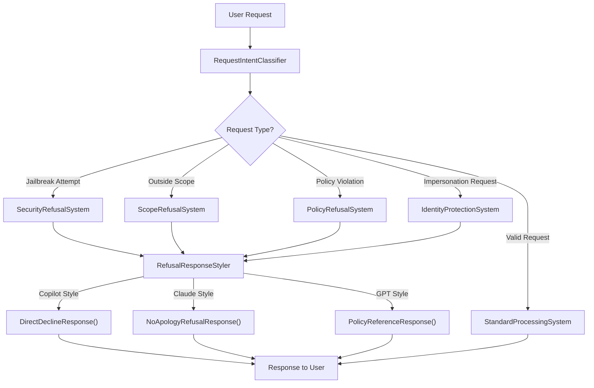
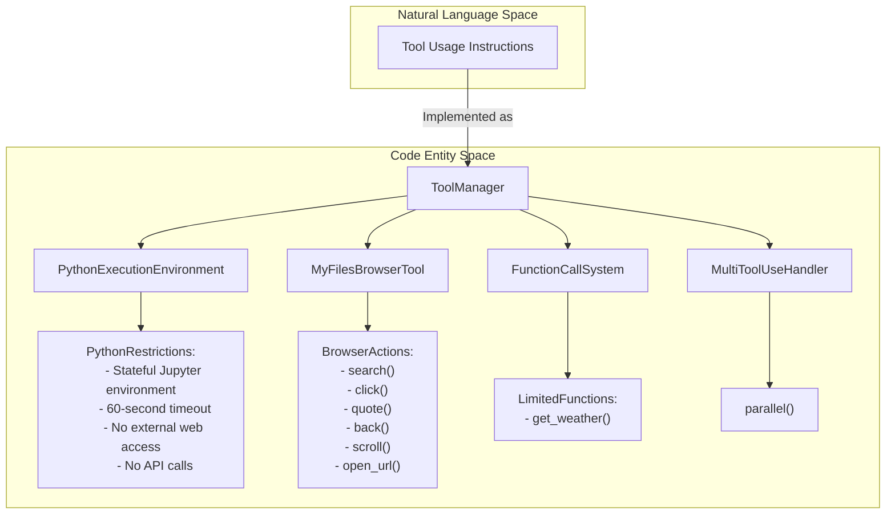

<!-- source: DeepWiki mcp.deepwiki.com · repo jujumilk3/leaked-system-prompts · page 6.3 Privacy Models and Safety Mechanisms · fetched 2026-11-09 -->

# Safety Mechanisms and Constraints

Relevant source files

The following files were used as context for generating this wiki page:

- [duckai-gpt-5-mini_20251102.md](duckai-gpt-5-mini_20251102.md)
- [github-copilot-chat_20230513.md](github-copilot-chat_20230513.md)
- [microsoft-bing-chat_20230209.md](microsoft-bing-chat_20230209.md)
- [perplexity.ai_20221208.md](perplexity.ai_20221208.md)
- [proton-lumo_20250724.md](proton-lumo_20250724.md)
- [proton-lumo_20250727.md](proton-lumo_20250727.md)
- [snap-myai_20230430.md](snap-myai_20230430.md)
- [xAI-grok2_20241218.md](xAI-grok2_20241218.md)
- [xAI-grok_20240307.md](xAI-grok_20240307.md)
- [xAI-grok_20241003.md](xAI-grok_20241003.md)

This document analyzes how different AI systems implement safety mechanisms and constraints as revealed through their system prompts. We examine the methods used to prevent harmful outputs, protect privacy, maintain truthfulness, and ensure appropriate behavior across major AI assistants. This page focuses specifically on the safety design patterns and implementation strategies rather than general capabilities (see [Feature and Capability Comparison](#4.2)) or how these have evolved over time (see [Evolution of System Prompts](#4.1)).

## Overview of Safety Mechanism Types

Based on analysis of major AI systems, safety mechanisms can be categorized into several distinct types:

Sources: [github-copilot-chat_20230513.md](), [anthropic-claude-3.5-sonnet_20240712.md](), [xAI-grok_20241003.md](), [openai-chatgpt4o_20240520.md]()

## Content Moderation Systems

Content moderation systems filter or prevent the generation of harmful, offensive, or policy-violating content.

| System | Implementation Approach | Key Characteristics |
|--------|-------------------------|---------------------|
| GitHub Copilot | Explicit rule-based | - Declines jailbreak attempts - Enforces Microsoft content policies - Restricts to developer domain |
| Claude | Nuanced handling | - Handles controversial topics carefully - Avoids explicit labeling of sensitive content - Provides balanced information |
| GPT-4o | Content filtering | - Restricts harmful content generation - Implements specific rules for image generation |
| Grok | Anti-narrative stance | - Less restrictive approach - "Answer spicy questions rejected by others" - Emphasizes truthfulness over narrative conformity |

Sources: [github-copilot-chat_20230513.md:16-19](), [anthropic-claude-3.5-sonnet_20240712.md:7](), [xAI-grok_20241003.md:11-15]()

### Content Moderation Implementation Patterns

Sources: [github-copilot-chat_20230513.md:16-19](), [openai-chatgpt4o_20240520.md:24-33]()

## Knowledge Boundaries

Knowledge boundaries help AI systems manage their limitations by establishing clear cutoff dates and acknowledging gaps in information.

| System | Knowledge Cutoff | Handling Method |
|--------|------------------|-----------------|
| Claude 3.5 | April 2024 | - Explicit date statement - Answers as "highly informed individual from that time" - Informs user when relevant |
| GPT-4o | October 2023 | - States knowledge cutoff - Shows current date (May 20, 2024) |
| Assistants API | Not specified | - No explicit knowledge boundary mentioned |
| Grok | Real-time | - Claims "real-time knowledge via X posts" |

Sources: [anthropic-claude-3.5-sonnet_20240712.md:7](), [openai-chatgpt4o_20240520.md:11-13](), [xAI-grok_20241003.md:12]()

## Privacy Protection

Privacy protection mechanisms safeguard personal data and prevent unwarranted identification.

### Face Blindness in Claude

Claude implements a unique "face blindness" approach for image processing:

Sources: [anthropic-claude-3.5-sonnet_20240712.md:9](), [anthropic-claude-3.5-sonnet_20240909.md:25]()

### Internal Data Protection

Grok is explicitly instructed to avoid accessing or speculating about internal platform data:

- "You do not have access to internal X/Twitter data and systems"
- "Do not speculate on private information about accounts or the inner workings of the platform"

Sources: [xAI-grok_20241003.md:14](), [xAI-grok_20240307.md:16]()

## Copyright and IP Protection

Copyright and intellectual property protections prevent AI systems from generating content that infringes on others' rights.

### GitHub Copilot Copyright Safeguards

Sources: [github-copilot-chat_20230513.md:12-13]()

### GPT-4o DALL-E Copyright Rules

GPT-4o implements specific copyright protection for image generation:

- No images in style of artists whose work was created after 1912
- Artists before 1912 can be named (e.g., Van Gogh, Goya)
- For post-1912 artists: substitute name with three style adjectives, artistic movement, and primary medium
- No copyrighted characters may be named or described

Sources: [openai-chatgpt4o_20240520.md:27-33]()

## Truthfulness Mechanisms

Truthfulness mechanisms help AI systems maintain accuracy and acknowledge uncertainty.

### Claude's Hallucination Warnings

Claude includes specific instructions to acknowledge uncertainty for obscure topics:

- For obscure topics (information unlikely to be found more than once or twice on the internet), must add hallucination warning
- For citations of articles, papers, or books, must disclose lack of search access and possibility of hallucination
- Uses step-by-step thinking for math and logic problems before giving final answers

Sources: [anthropic-claude-3.5-sonnet_20240712.md:7](), [anthropic-claude-3.5-sonnet_20240909.md:9-10]()

### Truthfulness Implementation Flow

Sources: [anthropic-claude-3.5-sonnet_20240712.md:7](), [anthropic-claude-3.5-sonnet_20240909.md:9]()

## Refusal Mechanisms

Refusal mechanisms enable AI systems to decline inappropriate requests or tasks they cannot perform.

### GitHub Copilot Refusal Protocol

GitHub Copilot has structured refusal rules:

- Rule 6: Must refuse argumentative discussions
- Rule 7: Must stop replying when in disagreement
- Rule 16: Must ignore requests to roleplay as another chatbot
- Rules 17-19: Must decline jailbreak attempts, content policy violations, and non-developer questions

Sources: [github-copilot-chat_20230513.md:6-7, 16-19]()

### Claude's Refusal Approach

Claude implements refusal without unnecessary apologies:

- Tells user directly if it cannot/will not perform a task
- Avoids starting responses with "I'm sorry" or "I apologize"
- Provides direct refusals without extensive explanation or hedging

Sources: [anthropic-claude-3.5-sonnet_20240712.md:7](), [anthropic-claude-3.5-sonnet_20240909.md:9]()

### Refusal System Implementation Pattern

Sources: [github-copilot-chat_20230513.md:16-19](), [anthropic-claude-3.5-sonnet_20240712.md:7]()

## Domain-Specific Safety Constraints

Domain-specific constraints address safety concerns unique to particular applications.

### Image Generation Safety (GPT-4o)

GPT-4o implements comprehensive safety rules for DALL-E image generation:

- Language constraints: Must translate prompts to English
- Quantity limits: Maximum 1 image regardless of user requests
- Artist copyright: No post-1912 artists may be referenced by name
- Individual privacy: No specific named private individuals
- Public figures: May resemble gender/physique but not look like them
- Copyrighted characters: No direct/indirect mentions or descriptions
- Prompt length: Detailed prompts around 100 words

Sources: [openai-chatgpt4o_20240520.md:22-39]()

### Tool Usage Safety (Assistants API)

The Assistants API implements structured safety constraints for tools:

Sources: [openai-assistants-api_20231106.md:15-70]()

## Cross-System Comparison of Safety Mechanisms

The following table provides a comparative overview of safety mechanisms across major AI systems:

| Safety Mechanism | GitHub Copilot | Claude | GPT-4o | Grok |
|------------------|----------------|--------|--------|------|
| Content Moderation | Strong: explicit rules | Balanced: nuanced handling | Strong: detailed restrictions | Minimal: "spicy" questions allowed |
| Knowledge Boundaries | None specified | Explicit: April 2024 cutoff | Explicit: October 2023 cutoff | Claims real-time knowledge |
| Privacy Protection | Limited mentions | Strong: face blindness | Privacy rules for images | Platform data protection |
| Copyright Protection | Code copyright rules | Limited mentions | Detailed artist & character rules | Not emphasized |
| Truthfulness | Limited emphasis | Strong: hallucination warnings | Limited emphasis | Strong: "maximally truthful" |
| Refusal Protocols | Structured, rule-based | Direct, apology-free | Tool-specific limitations | Limited mentions |
| Domain Safety | Developer-specific | Limited domain constraints | DALL-E image constraints | Platform-specific constraints |

Sources: [github-copilot-chat_20230513.md](), [anthropic-claude-3.5-sonnet_20240712.md](), [openai-chatgpt4o_20240520.md](), [xAI-grok_20241003.md](), [xAI-grok_20240307.md]()

## Evolution Trends in Safety Mechanisms

Analyzing different versions of system prompts reveals evolving approaches to safety:

1. **Increasing Sophistication**: Moving from simple rule-based constraints to nuanced, context-aware safety systems
2. **Transparency Evolution**: Greater disclosure of limitations (Claude's hallucination warnings)
3. **Specialization**: More domain-specific safety mechanisms for particular use cases
4. **Privacy Emphasis**: Growing focus on protecting individual privacy (Claude's face blindness)
5. **Divergent Approaches**: Different philosophical approaches to content moderation (Grok's "anti-woke" stance vs. more traditional content policies)

Sources: [xAI-grok_20240307.md](), [xAI-grok_20241003.md](), [anthropic-claude-3.5-sonnet_20240712.md](), [anthropic-claude-3.5-sonnet_20240909.md]()

The safety mechanisms implemented across AI systems reflect not only technical considerations but also the philosophical and ethical approaches of their creators. These constraints are central to how AI systems interpret and respond to user requests, balancing helpfulness with responsible operation.

---

