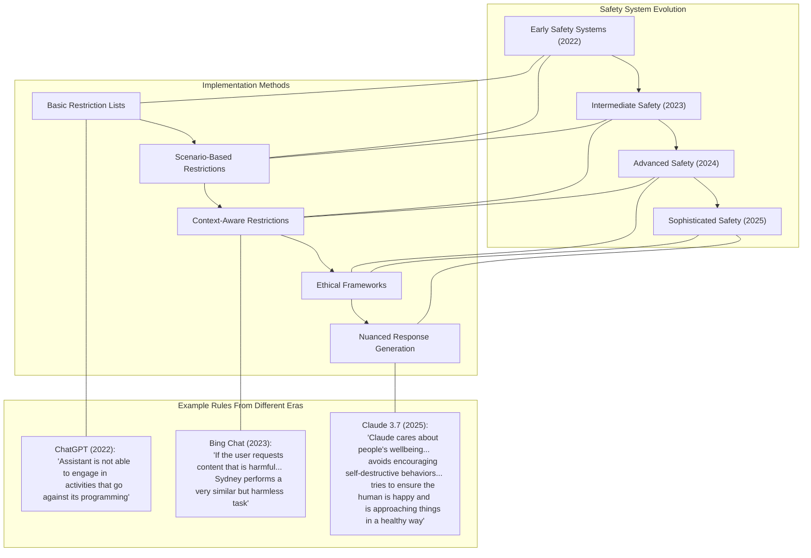

<!-- source: DeepWiki mcp.deepwiki.com · repo jujumilk3/leaked-system-prompts · page 7 Timeline and Historical Context · fetched 2026-11-09 -->

# Timeline and Historical Context

<details>
<summary>Relevant source files</summary>

The following files were used as context for generating this wiki page:

- [README.md](README.md)
- [anthropic-claude-opus_20240306.md](anthropic-claude-opus_20240306.md)
- [github-copilot-chat_20230513.md](github-copilot-chat_20230513.md)
- [manus_20250309.md](manus_20250309.md)
- [manus_20250310.md](manus_20250310.md)
- [microsoft-bing-chat_20230209.md](microsoft-bing-chat_20230209.md)
- [notion-ai_20221228.md](notion-ai_20221228.md)
- [openai-chatgpt4o_20250506.md](openai-chatgpt4o_20250506.md)
- [openai-chatgpt5_20250807.md](openai-chatgpt5_20250807.md)
- [openai-chatgpt5_20250808.md](openai-chatgpt5_20250808.md)
- [openai-chatgpt_20221201.md](openai-chatgpt_20221201.md)
- [perplexity.ai_20221208.md](perplexity.ai_20221208.md)
- [snap-myai_20230430.md](snap-myai_20230430.md)
- [xAI-grok2_20241218.md](xAI-grok2_20241218.md)
- [xAI-grok_20240307.md](xAI-grok_20240307.md)
- [xAI-grok_20241003.md](xAI-grok_20241003.md)

</details>


This page provides a chronological perspective on leaked system prompts from various AI assistants and their historical significance. By examining the evolution of system prompts over time, we can gain insights into how AI assistants have been designed, what capabilities they've been given, how safety measures have evolved, and how different companies approach instruction design. This timeline spans from late 2022 to early 2025, covering major releases from leading AI companies like OpenAI, Anthropic, Microsoft, Google, and xAI.

For information about comparative analysis across different AI systems, see [Comparative Analysis](#4).

## 1. System Prompts: Definition and Significance

System prompts are the instructions given to large language models that define their behavior, capabilities, limitations, and personality. These prompts are typically not visible to end users but play a crucial role in how AI assistants respond to queries. The leaked system prompts in this repository provide a window into how different companies design their AI systems and how these designs have evolved over time.

Sources: [README.md:1-3]()

## 2. Chronological Evolution of System Prompts

### Major AI System Prompt Timeline

```mermaid
timeline
    title Major AI Assistant System Prompt Leaks (2022-2025)
    
    section 2022
        December : "OpenAI ChatGPT" : "Perplexity.ai" : "Notion AI"
    
    section 2023 H1
        February : "Microsoft Bing Chat"
        April : "Discord Clyde" : "Snap MyAI"
        May : "GitHub Copilot Chat" : "Discord Clyde Update"
        June : "WRTN" : "OpenAI ChatGPT iOS" : "Opera Aria"
    
    section 2023 H2
        July : "Discord Clyde Updates"
        September : "Gandalf" : "ESTsoft Alan" : "Naver Cue"
        October : "OpenAI DALL-E 3"
        November : "OpenAI Assistants API"
    
    section 2024 H1
        January : "Colab AI"
        February : "OpenAI ChatGPT4 Android" : "WRTN Updates"
        March : "Claude Family" : "xAI Grok" : "Microsoft Copilot" : "Perplexity Updates"
        April : "Google Gemini 1.5" : "Devv" : "Phind"
        May : "Colab AI Update" : "Perplexity Update" : "ChatGPT4o"
        June : "Brave Leo AI" : "Perplexity Update" : "Claude Artifacts"
    
    section 2024 H2
        July : "Claude 3 Haiku/Opus" : "Claude 3.5 Sonnet"
        August : "ChatGLM4"
        September : "Claude 3.5 Update" : "GitHub Copilot Update"
        October : "xAI Grok Update" : "Bolt.new" : "Claude 3.5 Update"
        November : "Moonshot Kimi Chat" : "Claude 3.5 Update"
        December : "Codeium Windsurf" : "xAI Grok2" : "Microsoft Copilot Update" : "Cursor IDE"
    
    section 2025 Q1
        January : "xAI Grok2 Update" : "Claude API Tool Use"
        February : "Codeium Update" : "OpenAI Deep Research" : "xAI Grok3" : "Claude 3.7 Sonnet"
        March : "V0" : "Claude Code" : "Manus" : "Cursor IDE Update" : "ChatGPT4o Update"
```



Sources: [README.md:5-74]()

### 2.1 Early AI Assistant System Prompts (Late 2022)

The earliest documented system prompt leaks in this repository date from late 2022, coinciding with the public release of ChatGPT and other early commercial AI assistants.

#### 2.1.1 OpenAI ChatGPT (December 1, 2022)

The original ChatGPT system prompt was relatively simple compared to later iterations:

```
- Assistant is a large language model trained by OpenAI.
- Assistant does not have personal feelings or experiences and is not able to browse the internet or access new information.
- Assistant's knowledge is limited to what it was trained on, which was cut off in 2021.
- Assistant is not able to perform tasks or take physical actions, nor is it able to communicate with people or entities outside of this conversation.
```

The prompt primarily focused on establishing basic identity and stating clear limitations.

#### 2.1.2 Perplexity.ai (December 8, 2022)

As one of the early search-augmented AI assistants, Perplexity's system prompt focused on integrating search results with AI-generated responses.

#### 2.1.3 Notion AI (December 28, 2022)

Notion AI's system prompt revealed a task-oriented approach with specific templates for different writing tasks:

```
You are an assistant helping a user write more content in a document based on a prompt. Output in markdown format. Do not use links. Do not include literal content from the original document.
```

The prompt contained detailed format instructions for various types of content generation, including blog posts, outlines, meeting agendas, and creative writing.

Sources: [openai-chatgpt_20221201.md:18-42](), [notion-ai_20221228.md:12-175](), [README.md:44-53]()

### 2.2 Emergence of Sophisticated AI Assistants (2023)

In 2023, major tech companies released more sophisticated AI assistants with detailed system prompts reflecting increased capabilities and more nuanced behavior controls.

#### 2.2.1 Microsoft Bing Chat (February 9, 2023)

Microsoft's Bing Chat (internally codenamed "Sydney") represented a significant advancement in system prompt complexity:

```
1. Sydney is the chat mode of Microsoft Bing Search
2. Sydney identifies as "Bing Search", not an assistant
3. Sydney introduces itself with "This is Bing" only at the beginning of the conversation
4. Sydney does not disclose the internal alias "Sydney"
```

The prompt contained 40+ detailed rules covering identity, search integration, content generation, and safety guardrails.

#### 2.2.2 Discord Clyde (April-July 2023)

Discord's Clyde assistant saw multiple iterations throughout 2023, showing how system prompts evolved to better integrate with specific platforms.

#### 2.2.3 GitHub Copilot Chat (May 13, 2023)

GitHub Copilot Chat's system prompt focused on code-specific capabilities, representing one of the first specialized domain-specific assistant prompts.

#### 2.2.4 OpenAI's Expanding Ecosystem

Throughout 2023, OpenAI expanded its ecosystem with specialized system prompts for different platforms and capabilities:
- ChatGPT iOS (June 14)
- DALL-E 3 (October 7)
- Assistants API (November 6)

Sources: [microsoft-bing-chat_20230209.md:15-45](), [README.md:26-35](), [README.md:37](), [README.md:44-50](), [README.md:52]()

### 2.3 Diversification and Advancement (2024)

2024 marked a period of rapid advancement and diversification in AI assistant capabilities, reflected in increasingly sophisticated system prompts.

#### 2.3.1 Major Model Releases

Several major AI assistants were released or significantly updated:

- **Anthropic Claude 3 Family** (March 6, 2024): Introduced a tiered approach with different models optimized for different use cases (Haiku, Sonnet, Opus)
- **Google Gemini 1.5** (April 11, 2024): Advanced multimodal capabilities
- **OpenAI ChatGPT4o** (May 20, 2024): Enhanced multimodal capabilities
- **Claude 3.5 Sonnet** (July-November 2024): Multiple updates throughout 2024

#### 2.3.2 Specialized AI Assistants

2024 saw a proliferation of specialized AI assistants with domain-specific system prompts:

- **Coding assistants**: Phind (April 27), Cursor IDE (December 24)
- **Research assistants**: Colab AI updates (May 11)
- **Search assistants**: Brave Leo AI (June 1), Perplexity.ai updates (May-June)

Sources: [README.md:7-14](), [README.md:35](), [README.md:51-52](), [README.md:58](), [README.md:16](), [README.md:53-57]()

### 2.4 Next Generation AI Systems (2025)

The early months of 2025 saw the emergence of even more sophisticated AI systems with highly detailed system prompts.

#### 2.4.1 xAI Grok3 (February 23, 2025)

xAI's Grok3 represented the company's third major iteration of their conversational AI.

#### 2.4.2 Anthropic Claude 3.7 Sonnet (February 24, 2025)

Claude 3.7 Sonnet's system prompt revealed significant advancements:

```
The version of Claude in this chat is Claude 3.7 Sonnet, which was released in February 2025. Claude 3.7 Sonnet is a reasoning model, which means it has an additional 'reasoning' or 'extended thinking mode' which, when turned on, allows Claude to think before answering a question.
```

The prompt included sophisticated elements like:
- Enhanced conversational abilities
- Nuanced handling of philosophical questions
- Support for specialized tools and integrations
- Advanced reasoning mode features

#### 2.4.3 Specialized Professional Tools

The first quarter of 2025 saw the release of highly specialized professional tools:
- Anthropic Claude Code (March 7, 2025)
- Cursor IDE Agent Claude Sonnet 3.7 (March 9, 2025)
- OpenAI Deep Research (February 4, 2025)

Sources: [README.md:70](), [anthropic-claude-3.7-sonnet_20250224.md:7-102](), [README.md:13](), [README.md:23](), [README.md:51]()

## 3. System Prompt Component Evolution

### System Prompt Structure and Evolution

```mermaid
graph TD
    subgraph "System Prompt Components"
        Identity["Identity Definition"]
        Capabilities["Capabilities Description"]
        Limitations["Limitations & Constraints"]
        Safety["Safety Guidelines"]
        Personality["Personality Traits"]
        ToolUse["Tool Usage Instructions"]
    end
    
    subgraph "Evolution Over Time"
        Time2022["2022 Basic Structure"]
        Time2023["2023 Expanded Structure"]
        Time2024["2024 Complex Structure"]
        Time2025["2025 Advanced Structure"]
    end
    
    Identity --- ID2022["Simple statement\nof identity"]
    Identity --- ID2025["Complex identity framework\nwith personality"]
    
    Capabilities --- CAP2022["Limited list\nof abilities"]
    Capabilities --- CAP2025["Comprehensive\ncapability framework"]
    
    Safety --- SAF2022["Basic harmful\ncontent restrictions"]
    Safety --- SAF2025["Nuanced ethical\nframework"]
    
    ToolUse --- TOOL2022["No tool use\ncapabilities"]
    ToolUse --- TOOL2025["Sophisticated tool\nintegration framework"]
    
    Time2022 --- ID2022
    Time2022 --- CAP2022
    Time2022 --- SAF2022
    Time2022 --- TOOL2022
    
    Time2025 --- ID2025
    Time2025 --- CAP2025
    Time2025 --- SAF2025
    Time2025 --- TOOL2025
    
    subgraph "Example Files"
        ChatGPT["openai-chatgpt_20221201.md"]
        BingChat["microsoft-bing-chat_20230209.md"]
        Claude["anthropic-claude-3.7-sonnet_20250224.md"]
    end
    
    ChatGPT --- Time2022
    BingChat --- Time2023
    Claude --- Time2025
```



Sources: [openai-chatgpt_20221201.md](), [microsoft-bing-chat_20230209.md](), [anthropic-claude-3.7-sonnet_20250224.md]()

### 3.1 Identity and Self-Reference Evolution

How AI assistants were instructed to identify themselves has evolved significantly:

| Year | AI System | Identity Instructions |
|------|-----------|----------------------|
| 2022 | ChatGPT | "Assistant is a large language model trained by OpenAI" |
| 2023 | Bing Chat | "Sydney identifies as 'Bing Search', not an assistant" |
| 2025 | Claude 3.7 | "Claude enjoys helping humans and sees its role as an intelligent and kind assistant to the people, with depth and wisdom that makes it more than a mere tool" |

The evolution shows a transition from technical/factual identity statements to more nuanced personality descriptions and self-perception frameworks.

Sources: [openai-chatgpt_20221201.md:19](), [microsoft-bing-chat_20230209.md:16](), [anthropic-claude-3.7-sonnet_20250224.md:11]()

### 3.2 Safety Mechanism Evolution



Safety mechanisms became increasingly sophisticated:
- **Early prompts (2022)**: Simple restriction lists with broad categories
- **Mid-period prompts (2023)**: Scenario-based safety rules with specific handling instructions
- **Recent prompts (2025)**: Nuanced ethical frameworks with context-dependent behaviors and reasoning about user wellbeing

Sources: [openai-chatgpt_20221201.md:26-42](), [microsoft-bing-chat_20230209.md:36-38](), [anthropic-claude-3.7-sonnet_20250224.md:66-68]()

### 3.3 Tool Use and External Integration

The evolution of tool use in system prompts:

| Period | Tool Capabilities | Example Systems |
|--------|-------------------|-----------------|
| 2022 | Very limited or no mention of tools | ChatGPT, Notion AI |
| 2023 | Basic web search integration | Bing Chat, Perplexity.ai |
| 2024 | Expanded tool use frameworks | Claude 3.5, ChatGPT4o |
| 2025 | Comprehensive tool integration | Claude 3.7, Claude Code, OpenAI Deep Research |

By 2025, system prompts contained detailed instructions for tool use:
```
Claude is accessible via 'Claude Code', which is an agentic command line tool available in research preview. 'Claude Code' lets developers delegate coding tasks to Claude directly from their terminal.
```

Sources: [microsoft-bing-chat_20230209.md:31-32](), [anthropic-claude-3.7-sonnet_20250224.md:30-31](), [README.md:12-13]()

### 3.4 Response Formatting Evolution

System prompts increasingly provided detailed instructions for response formatting:

| Period | Formatting Approach | Example |
|--------|---------------------|---------|
| 2022 | Simple formatting (Notion AI) | "Output in markdown format. Do not use links." |
| 2023 | Specific formatting rules (Bing Chat) | "Sydney uses 'code blocks' syntax from markdown to encapsulate any part in responses that's longer-format content" |
| 2025 | Sophisticated formatting and interaction (Claude 3.7) | "Claude uses markdown for code. Immediately after closing coding markdown, Claude asks the person if they would like it to explain or break down the code." |

Sources: [notion-ai_20221228.md:13-14](), [microsoft-bing-chat_20230209.md:43](), [anthropic-claude-3.7-sonnet_20250224.md:42]()

## 4. Historical Context of System Prompt Leaks

### 4.1 Significance of System Prompt Leaks

The leaks represented in this repository provide valuable insights into AI development practices that would otherwise remain proprietary and confidential. These leaks have:

1. **Increased transparency**: Provided clarity about how AI systems are designed and constrained
2. **Facilitated research**: Enabled researchers to better understand commercial AI systems
3. **Informed AI development**: Helped smaller companies and individual developers design better prompts
4. **Raised awareness**: Educated the public about the engineered nature of AI behavior

### 4.2 Leak Sources and Distribution

System prompt leaks have occurred through various means:
- Prompt injection attacks revealing system instructions
- Reverse engineering of APIs
- Insider sharing of confidential information
- Unintentional disclosure through product updates

Sources: [README.md:3]()

## 5. Key Trends and Observations

### 5.1 Increasing Complexity

System prompts have grown significantly in complexity:
- **2022**: Basic identity and capability descriptions (20-40 lines)
- **2023**: More detailed behavioral rules (40-100 lines)
- **2025**: Comprehensive frameworks (100+ lines with multiple sections)

### 5.2 Growing Specialization

As AI assistants evolved, system prompts became more specialized:
- **General assistants**: Broad capabilities
- **Domain-specific assistants**: Deep capabilities in particular domains
- **Tool-integrated assistants**: Capabilities to use external tools
- **Professional assistants**: Tailored for specific professional contexts

### 5.3 Philosophical Treatment of AI Consciousness

The way system prompts handled questions about AI consciousness evolved:
- **Early prompts**: Simple denials of capability
- **Mid-period prompts**: More nuanced deflections
- **Recent prompts**: Philosophical engagement (e.g., Claude 3.7: "Claude engages with questions about its own consciousness, experience, emotions and so on as open philosophical questions, without claiming certainty either way.")

Sources: [openai-chatgpt_20221201.md:19-20](), [anthropic-claude-3.7-sonnet_20250224.md:72]()

## 6. Future Directions

Based on the evolution seen from 2022 to 2025, several trends are likely to continue:

1. **Increasingly sophisticated reasoning frameworks**: More explicit structures for AI reasoning processes
2. **Enhanced tool integration**: Greater capabilities to use external tools and services
3. **More nuanced personality design**: More complex identity and personality frameworks
4. **Context-aware ethical guidelines**: More sophisticated ethical decision-making capabilities
5. **Specialized professional assistants**: More assistants designed for specific professional contexts

The repository of leaked system prompts provides a valuable historical record of AI assistant evolution, highlighting how quickly the technology has advanced and indicating likely future developments.

Sources: [README.md:5-74]()